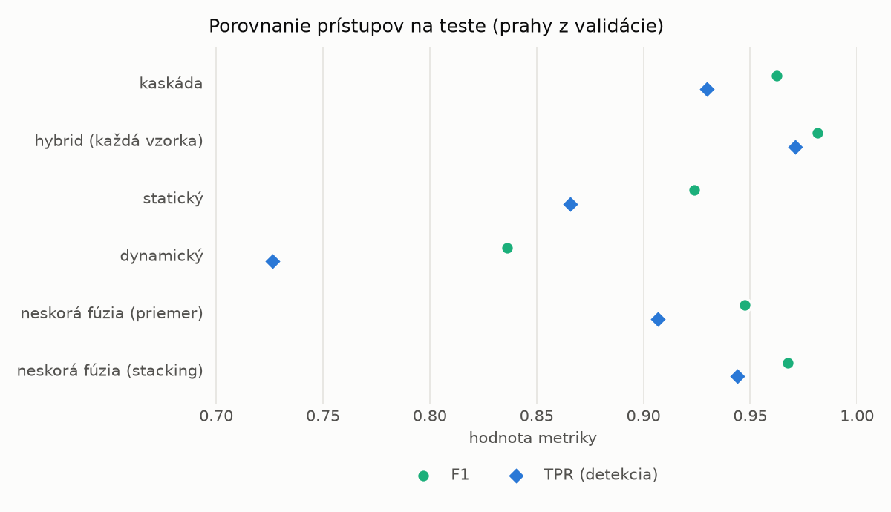
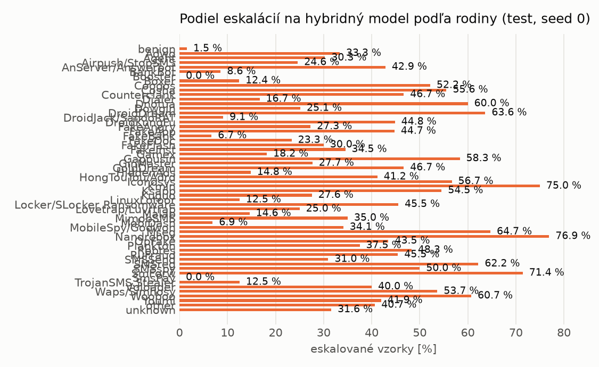

# Kaskáda `modal` – beh `20261123-010134`

> Generované `src/cascade/evaluate.py` (2026-11-23T01:01:35+01:00). Seedy: [0, 1, 2]; hodnoty = priemer ± sm. odchýlka.
> Všetky prahy sú určené na validácii (FPR ≤ 1 %); test sa na nič nenastavuje.

| rola | beh |
|---|---|
| static | `runs_v4/real_p/full/students_static/mlp_kd_modal/20261123-002851` |
| dynamic | `runs_v4/real_p/full/students_dynamic/mlp_kd_modal/20261123-004749` |
| hybrid | `runs_v4/real_p/full/hybrid/lightgbm/20261122-235912` |

## Test
| prístup | accuracy | balanced_accuracy | precision | recall_tpr | fpr | f1 | mcc |
|---|---|---|---|---|---|---|---|
| kaskáda | 0.9675 ± 0.0013 | 0.9639 ± 0.0014 | 0.9977 ± 0.0000 | 0.9296 ± 0.0028 | 0.0017 ± 0.0000 | 0.9625 ± 0.0015 | 0.9357 ± 0.0024 |
| hybrid (každá vzorka) | 0.9835 ± 0.0003 | 0.9824 ± 0.0004 | 0.9922 ± 0.0004 | 0.9709 ± 0.0006 | 0.0062 ± 0.0003 | 0.9814 ± 0.0004 | 0.9668 ± 0.0007 |
| statický | 0.9360 ± 0.0028 | 0.9294 ± 0.0031 | 0.9903 ± 0.0003 | 0.8657 ± 0.0063 | 0.0069 ± 0.0002 | 0.9238 ± 0.0036 | 0.8749 ± 0.0052 |
| dynamický | 0.8724 ± 0.0013 | 0.8587 ± 0.0016 | 0.9849 ± 0.0010 | 0.7265 ± 0.0038 | 0.0090 ± 0.0007 | 0.8362 ± 0.0022 | 0.7585 ± 0.0021 |
| neskorá fúzia (priemer) | 0.9548 ± 0.0025 | 0.9502 ± 0.0029 | 0.9916 ± 0.0007 | 0.9067 ± 0.0063 | 0.0062 ± 0.0005 | 0.9473 ± 0.0032 | 0.9106 ± 0.0048 |
| neskorá fúzia (stacking) | 0.9716 ± 0.0013 | 0.9690 ± 0.0015 | 0.9922 ± 0.0005 | 0.9439 ± 0.0034 | 0.0060 ± 0.0004 | 0.9675 ± 0.0016 | 0.9432 ± 0.0025 |

## Validácia
| prístup | accuracy | balanced_accuracy | precision | recall_tpr | fpr | f1 | mcc |
|---|---|---|---|---|---|---|---|
| kaskáda | 0.9666 ± 0.0008 | 0.9632 ± 0.0009 | 0.9950 ± 0.0004 | 0.9302 ± 0.0014 | 0.0038 ± 0.0003 | 0.9615 ± 0.0009 | 0.9337 ± 0.0016 |
| hybrid (každá vzorka) | 0.9816 ± 0.0004 | 0.9805 ± 0.0004 | 0.9879 ± 0.0002 | 0.9707 ± 0.0007 | 0.0096 ± 0.0002 | 0.9792 ± 0.0005 | 0.9628 ± 0.0008 |
| statický | 0.9322 ± 0.0028 | 0.9255 ± 0.0031 | 0.9863 ± 0.0001 | 0.8607 ± 0.0062 | 0.0097 ± 0.0000 | 0.9192 ± 0.0036 | 0.8671 ± 0.0053 |
| dynamický | 0.8702 ± 0.0015 | 0.8563 ± 0.0017 | 0.9837 ± 0.0001 | 0.7224 ± 0.0034 | 0.0097 ± 0.0000 | 0.8330 ± 0.0023 | 0.7542 ± 0.0027 |
| neskorá fúzia (priemer) | 0.9498 ± 0.0037 | 0.9451 ± 0.0041 | 0.9870 ± 0.0001 | 0.8999 ± 0.0084 | 0.0096 ± 0.0002 | 0.9414 ± 0.0045 | 0.9007 ± 0.0070 |
| neskorá fúzia (stacking) | 0.9687 ± 0.0020 | 0.9662 ± 0.0022 | 0.9879 ± 0.0006 | 0.9417 ± 0.0045 | 0.0094 ± 0.0004 | 0.9642 ± 0.0023 | 0.9373 ± 0.0039 |

## Správanie kaskády (test, seed 0)
- podiel eskalácií na hybrid: **13.38%** (1693 vzoriek)
- chyby pri zhode študentov (kaskáda ich nemôže opraviť): **350**
  (3.193% zo zhôd; FP 1, FN 349)
- úspešnosť na eskalovaných vzorkách: hybrid 0.9728292971057295, statický 0.7466036621382162,
  dynamický 0.25339633786178384  → prínos hybridu pri nezhode

## Výpočtové nároky (odhad z benchmarkov komponentov)
| meranie | statický | dynamický | hybrid na každej vzorke | neskorá fúzia | kaskáda (odhad) |
|---|---|---|---|---|---|
| CPU čas ms/vz. (dávka) | 0.0350 | 0.0330 | 0.0575 | 0.0680 | 0.0757 |
| CPU čas ms/vz. (1 vz.) | 0.1345 | 0.1349 | 0.0496 | 0.2695 | 0.2761 |
| latencia ms (1 vz., postupne) | 0.0753 | 0.0748 | 0.0496 | 0.1501 | 0.1568 |

