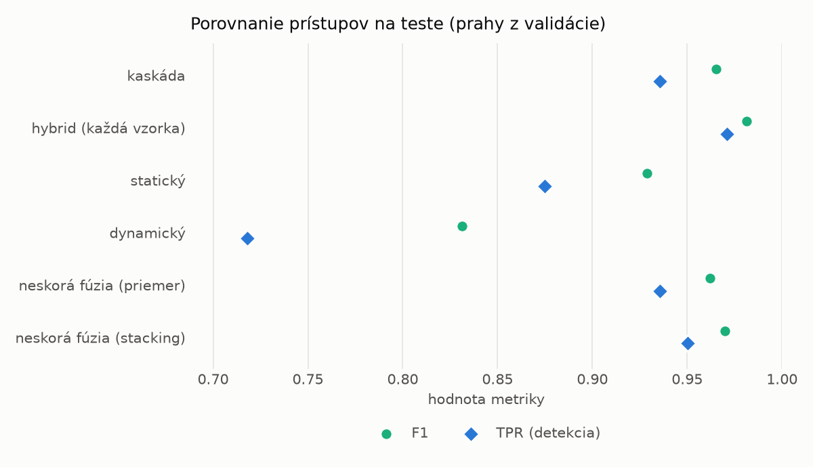
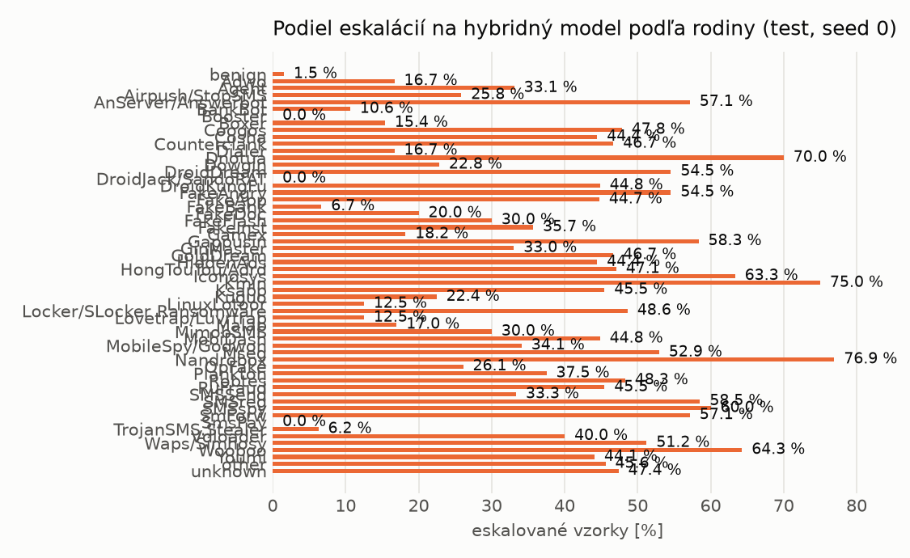

# Kaskáda `nokd` – beh `20261123-010132`

> Generované `src/cascade/evaluate.py` (2026-11-23T01:01:33+01:00). Seedy: [0, 1, 2]; hodnoty = priemer ± sm. odchýlka.
> Všetky prahy sú určené na validácii (FPR ≤ 1 %); test sa na nič nenastavuje.

| rola | beh |
|---|---|
| static | `runs_v4/real_p/full/students_static/mlp_nokd/20261123-002453` |
| dynamic | `runs_v4/real_p/full/students_dynamic/mlp_nokd/20261123-004046` |
| hybrid | `runs_v4/real_p/full/hybrid/lightgbm/20261122-235912` |

## Test
| prístup | accuracy | balanced_accuracy | precision | recall_tpr | fpr | f1 | mcc |
|---|---|---|---|---|---|---|---|
| kaskáda | 0.9699 ± 0.0002 | 0.9667 ± 0.0002 | 0.9969 ± 0.0007 | 0.9357 ± 0.0006 | 0.0023 ± 0.0005 | 0.9654 ± 0.0002 | 0.9403 ± 0.0003 |
| hybrid (každá vzorka) | 0.9835 ± 0.0003 | 0.9824 ± 0.0004 | 0.9922 ± 0.0004 | 0.9709 ± 0.0006 | 0.0062 ± 0.0003 | 0.9814 ± 0.0004 | 0.9668 ± 0.0007 |
| statický | 0.9397 ± 0.0013 | 0.9336 ± 0.0014 | 0.9896 ± 0.0009 | 0.8748 ± 0.0033 | 0.0075 ± 0.0007 | 0.9286 ± 0.0016 | 0.8818 ± 0.0023 |
| dynamický | 0.8692 ± 0.0022 | 0.8550 ± 0.0025 | 0.9866 ± 0.0005 | 0.7180 ± 0.0053 | 0.0079 ± 0.0004 | 0.8311 ± 0.0034 | 0.7532 ± 0.0038 |
| neskorá fúzia (priemer) | 0.9668 ± 0.0033 | 0.9639 ± 0.0038 | 0.9897 ± 0.0012 | 0.9358 ± 0.0086 | 0.0079 ± 0.0010 | 0.9620 ± 0.0040 | 0.9338 ± 0.0064 |
| neskorá fúzia (stacking) | 0.9737 ± 0.0004 | 0.9715 ± 0.0005 | 0.9905 ± 0.0011 | 0.9503 ± 0.0020 | 0.0074 ± 0.0009 | 0.9700 ± 0.0005 | 0.9472 ± 0.0007 |

## Validácia
| prístup | accuracy | balanced_accuracy | precision | recall_tpr | fpr | f1 | mcc |
|---|---|---|---|---|---|---|---|
| kaskáda | 0.9693 ± 0.0017 | 0.9663 ± 0.0017 | 0.9946 ± 0.0011 | 0.9366 ± 0.0027 | 0.0041 ± 0.0008 | 0.9648 ± 0.0019 | 0.9390 ± 0.0033 |
| hybrid (každá vzorka) | 0.9816 ± 0.0004 | 0.9805 ± 0.0004 | 0.9879 ± 0.0002 | 0.9707 ± 0.0007 | 0.0096 ± 0.0002 | 0.9792 ± 0.0005 | 0.9628 ± 0.0008 |
| statický | 0.9353 ± 0.0044 | 0.9290 ± 0.0049 | 0.9864 ± 0.0002 | 0.8677 ± 0.0097 | 0.0097 ± 0.0000 | 0.9232 ± 0.0056 | 0.8731 ± 0.0082 |
| dynamický | 0.8683 ± 0.0021 | 0.8542 ± 0.0023 | 0.9836 ± 0.0001 | 0.7182 ± 0.0046 | 0.0097 ± 0.0000 | 0.8302 ± 0.0031 | 0.7508 ± 0.0037 |
| neskorá fúzia (priemer) | 0.9661 ± 0.0042 | 0.9633 ± 0.0046 | 0.9874 ± 0.0001 | 0.9364 ± 0.0093 | 0.0097 ± 0.0000 | 0.9612 ± 0.0050 | 0.9322 ± 0.0081 |
| neskorá fúzia (stacking) | 0.9719 ± 0.0007 | 0.9697 ± 0.0008 | 0.9876 ± 0.0002 | 0.9491 ± 0.0018 | 0.0096 ± 0.0002 | 0.9680 ± 0.0009 | 0.9435 ± 0.0014 |

## Správanie kaskády (test, seed 0)
- podiel eskalácií na hybrid: **14.18%** (1794 vzoriek)
- chyby pri zhode študentov (kaskáda ich nemôže opraviť): **328**
  (3.020% zo zhôd; FP 0, FN 328)
- úspešnosť na eskalovaných vzorkách: hybrid 0.9715719063545151, statický 0.750278706800446,
  dynamický 0.24972129319955408  → prínos hybridu pri nezhode

## Výpočtové nároky (odhad z benchmarkov komponentov)
| meranie | statický | dynamický | hybrid na každej vzorke | neskorá fúzia | kaskáda (odhad) |
|---|---|---|---|---|---|
| CPU čas ms/vz. (dávka) | 0.0349 | 0.0328 | 0.0575 | 0.0676 | 0.0757 |
| CPU čas ms/vz. (1 vz.) | 0.1341 | 0.1375 | 0.0496 | 0.2716 | 0.2785 |
| latencia ms (1 vz., postupne) | 0.0752 | 0.0755 | 0.0496 | 0.1507 | 0.1577 |

