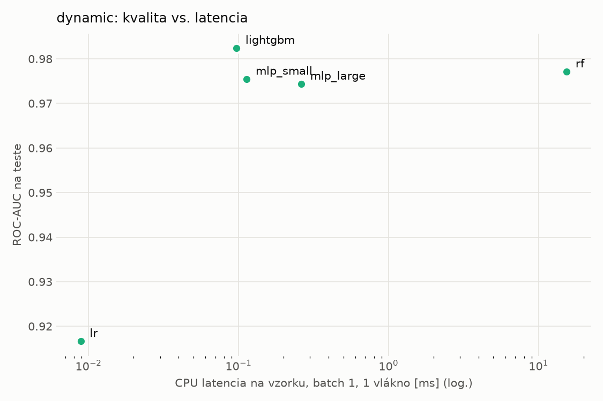
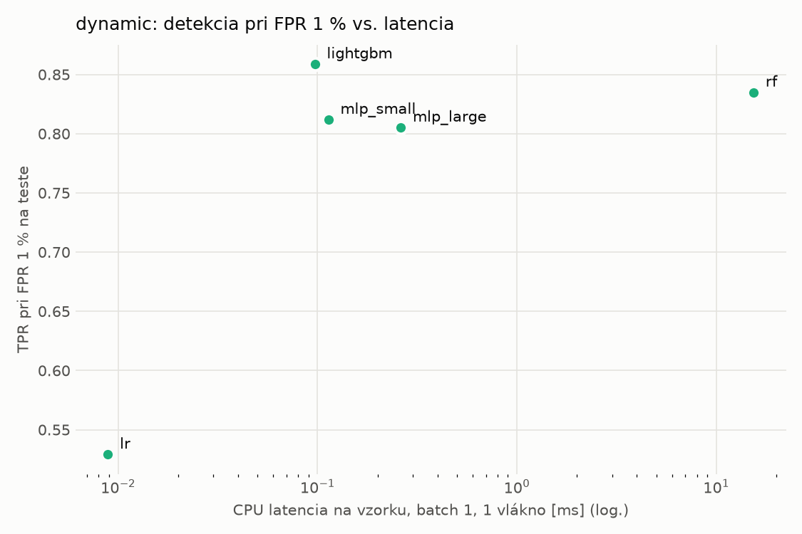
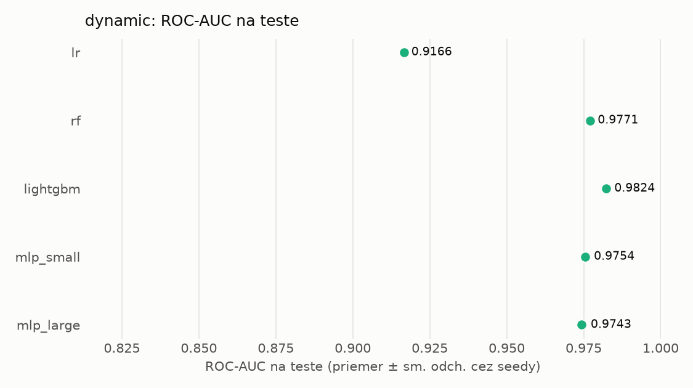
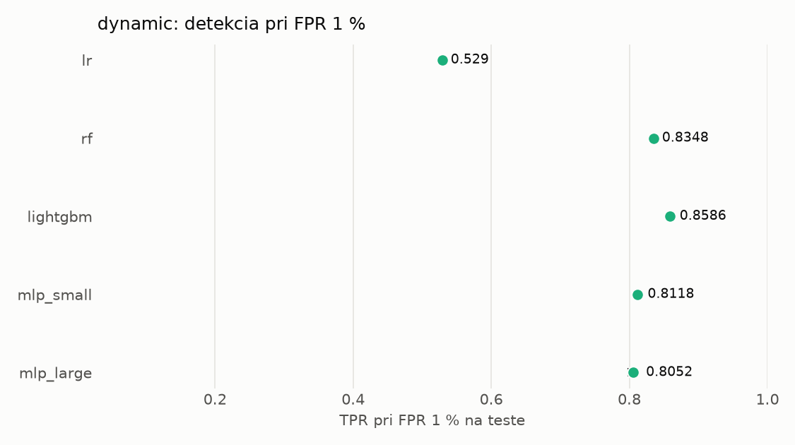

# Porovnanie modelov – dynamic

> Generované `src/evaluation/compare.py` (2026-11-22T23:57:35+01:00); použitý je posledný beh každého modelu.
> Metriky sú priemer cez seedy. \* = pri prahu určenom na validácii (FPR ≤ 1 %).
> CPU ms/vz. = medián latencie jednej vzorky na 1 vlákne vrátane transformácie vstupu (meranie hneď po tréningu,
> orientačné). Oficiálne merania spotreby sú v časti „Spotreba zdrojov pri inferencii“.

## Detekčná kvalita a orientačné časy
| model | ROC-AUC val | ROC-AUC test | TPR@FPR 1 % test | TPR@FPR 0,1 % test | F1 test* | FPR test* | gap train−val | CPU ms/vz. | CPU vz./s | GPU ms/vz. | parametre | MB | tréning s | ladenie min |
|---|---|---|---|---|---|---|---|---|---|---|---|---|---|---|
| [lr](../../dynamic/lr/20261122-233312/README.md) | 0.9100 | 0.9166 ± 0.0000 | 0.5290 | 0.3908 | 0.6596 | 0.0069 | 0.0069 | 0.009 | 4 359 027 | – | 124 | 0.01 | 0.4 | 0.1 |
| [rf](../../dynamic/rf/20261122-233325/README.md) | 0.9755 | 0.9771 ± 0.0001 | 0.8348 | 0.7417 | 0.8997 | 0.0077 | 0.0229 | 15.398 | 101 370 | – | 3 310 534 | 265.22 | 2.7 | 0.9 |
| [lightgbm](../../dynamic/lightgbm/20261122-233440/README.md) | 0.9812 | 0.9824 ± 0.0002 | 0.8586 | 0.7618 | 0.9118 | 0.0074 | 0.0176 | 0.097 | 139 896 | – | 183 222 | 10.04 | 10.6 | 8.0 |
| [mlp_small](../../dynamic/mlp_small/20261122-234317/README.md) | 0.9732 | 0.9754 ± 0.0005 | 0.8118 | 0.6488 | 0.8724 | 0.0072 | 0.0142 | 0.114 | 2 692 308 | 0.377 | 65 537 | 0.27 | 24.5 | 7.4 |
| [mlp_large](../../dynamic/mlp_large/20261122-235153/README.md) | 0.9745 | 0.9743 ± 0.0005 | 0.8052 | 0.6573 | 0.8739 | 0.0076 | 0.0130 | 0.262 | 348 539 | 0.619 | 1 119 745 | 4.51 | 9.2 | 5.2 |

## Nízka prevalencia malvéru (test, prah z validácie)
| model | TPR | FPR | precision @ 1 % | falošné na 1 skutočný poplach @ 1 % | precision @ 0.1 % | falošné na 1 skutočný poplach @ 0.1 % |
|---|---|---|---|---|---|---|
| lr | 0.4962 | 0.0069 | 0.422 | 1.37 | 0.067 | 13.84 |
| rf | 0.8254 | 0.0077 | 0.519 | 0.93 | 0.097 | 9.36 |
| lightgbm | 0.8455 | 0.0074 | 0.537 | 0.86 | 0.103 | 8.69 |
| mlp_small | 0.7805 | 0.0072 | 0.524 | 0.91 | 0.098 | 9.16 |
| mlp_large | 0.7834 | 0.0076 | 0.509 | 0.97 | 0.093 | 9.74 |

Prepočet: TPR a FPR nezávisia od podielu malvéru, preto sa dajú preniesť na nízku prevalenciu (v reálnej prevádzke je malvéru ~1 % alebo menej; v teste 54 %). „Falošné na 1 skutočný poplach“ = koľko neškodných súborov je označených na každý zachytený malvér.

## Spotreba zdrojov pri inferencii (benchmark, testovacia množina)
_Benchmark zatiaľ nebol spustený (`python -m src.evaluation.benchmark --approach dynamic`)._

## Grafy

