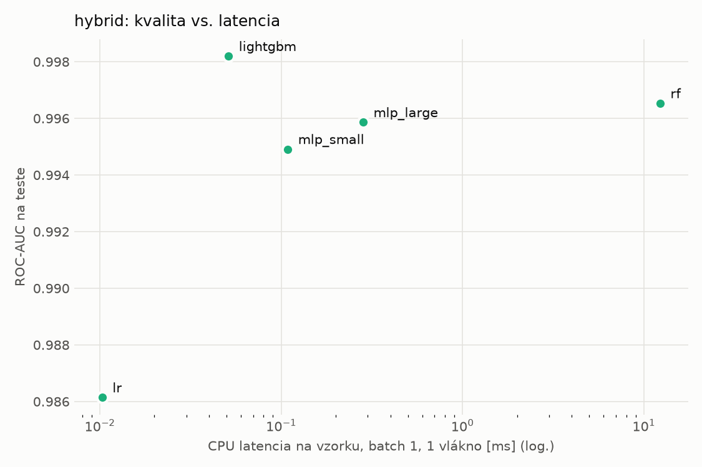
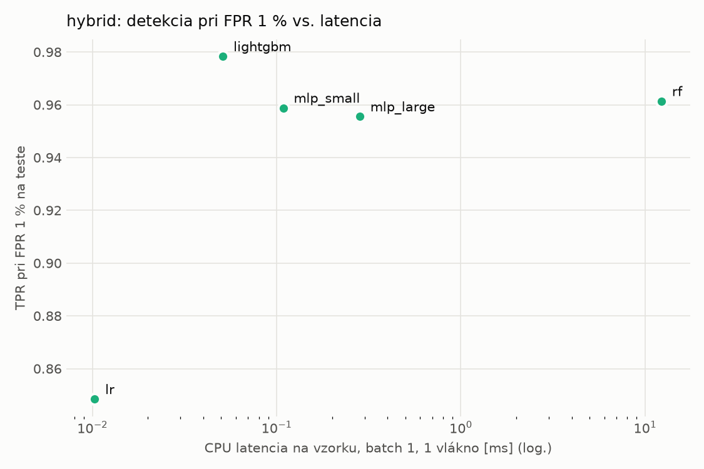
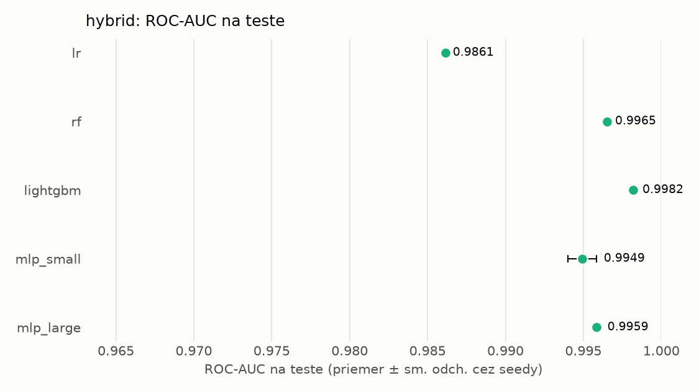
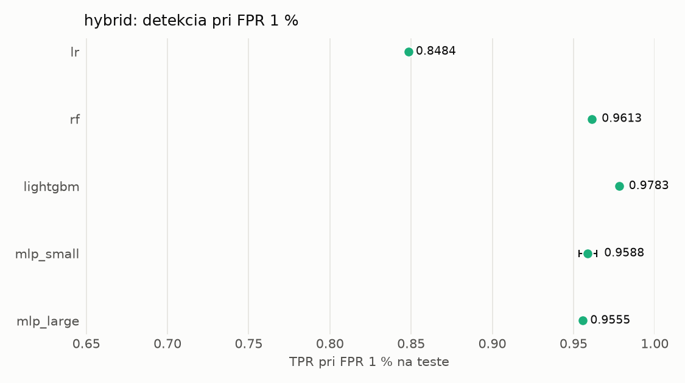

# Porovnanie modelov – hybrid

> Generované `src/evaluation/compare.py` (2026-11-23T00:11:39+01:00); použitý je posledný beh každého modelu.
> Metriky sú priemer cez seedy. \* = pri prahu určenom na validácii (FPR ≤ 1 %).
> CPU ms/vz. = medián latencie jednej vzorky na 1 vlákne vrátane transformácie vstupu (meranie hneď po tréningu,
> orientačné). Oficiálne merania spotreby sú v časti „Spotreba zdrojov pri inferencii“.

## Detekčná kvalita a orientačné časy
| model | ROC-AUC val | ROC-AUC test | TPR@FPR 1 % test | TPR@FPR 0,1 % test | F1 test* | FPR test* | gap train−val | CPU ms/vz. | CPU vz./s | GPU ms/vz. | parametre | MB | tréning s | ladenie min |
|---|---|---|---|---|---|---|---|---|---|---|---|---|---|---|
| [lr](../../hybrid/lr/20261122-235738/README.md) | 0.9842 | 0.9861 ± 0.0000 | 0.8484 | 0.5997 | 0.9029 | 0.0070 | 0.0023 | 0.010 | 2 228 287 | – | 287 | 0.01 | 0.3 | 0.1 |
| [rf](../../hybrid/rf/20261122-235747/README.md) | 0.9955 | 0.9965 ± 0.0000 | 0.9613 | 0.8956 | 0.9712 | 0.0057 | 0.0045 | 12.282 | 98 690 | – | 1 927 422 | 154.53 | 2.9 | 1.1 |
| [lightgbm](../../hybrid/lightgbm/20261122-235912/README.md) | 0.9969 | 0.9982 ± 0.0001 | 0.9783 | 0.9274 | 0.9814 | 0.0062 | 0.0031 | 0.051 | 238 509 | – | 71 318 | 4.06 | 5.5 | 5.7 |
| [mlp_small](../../hybrid/mlp_small/20261123-000512/README.md) | 0.9941 | 0.9949 ± 0.0009 | 0.9588 | 0.8049 | 0.9698 | 0.0065 | 0.0046 | 0.109 | 934 850 | 0.672 | 107 265 | 0.45 | 1.8 | 2.8 |
| [mlp_large](../../hybrid/mlp_large/20261123-000809/README.md) | 0.9944 | 0.9959 ± 0.0002 | 0.9555 | 0.8393 | 0.9691 | 0.0078 | 0.0042 | 0.283 | 165 798 | 0.417 | 2 400 257 | 9.64 | 6.8 | 3.1 |

## Nízka prevalencia malvéru (test, prah z validácie)
| model | TPR | FPR | precision @ 1 % | falošné na 1 skutočný poplach @ 1 % | precision @ 0.1 % | falošné na 1 skutočný poplach @ 0.1 % |
|---|---|---|---|---|---|---|
| lr | 0.8301 | 0.0070 | 0.544 | 0.84 | 0.106 | 8.45 |
| rf | 0.9506 | 0.0057 | 0.628 | 0.59 | 0.143 | 5.97 |
| lightgbm | 0.9709 | 0.0062 | 0.612 | 0.63 | 0.135 | 6.39 |
| mlp_small | 0.9489 | 0.0065 | 0.594 | 0.68 | 0.127 | 6.88 |
| mlp_large | 0.9490 | 0.0078 | 0.552 | 0.81 | 0.109 | 8.19 |

Prepočet: TPR a FPR nezávisia od podielu malvéru, preto sa dajú preniesť na nízku prevalenciu (v reálnej prevádzke je malvéru ~1 % alebo menej; v teste 54 %). „Falošné na 1 skutočný poplach“ = koľko neškodných súborov je označených na každý zachytený malvér.

## Spotreba zdrojov pri inferencii (benchmark, testovacia množina)
_Benchmark zatiaľ nebol spustený (`python -m src.evaluation.benchmark --approach hybrid`)._

## Grafy

