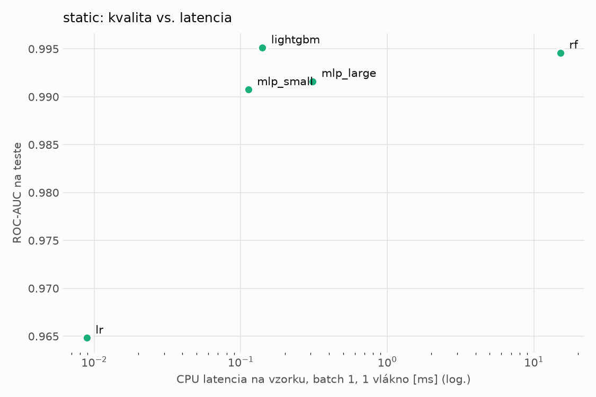
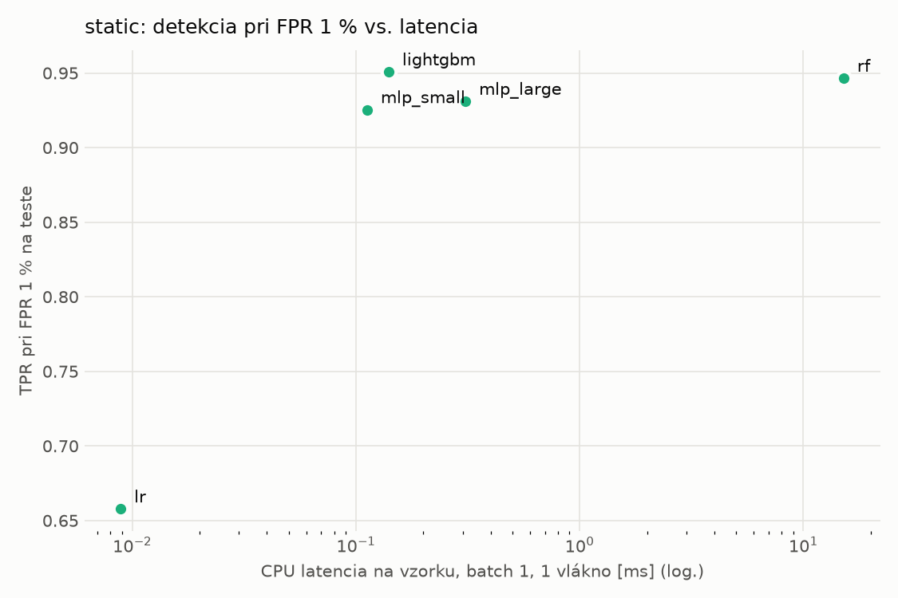
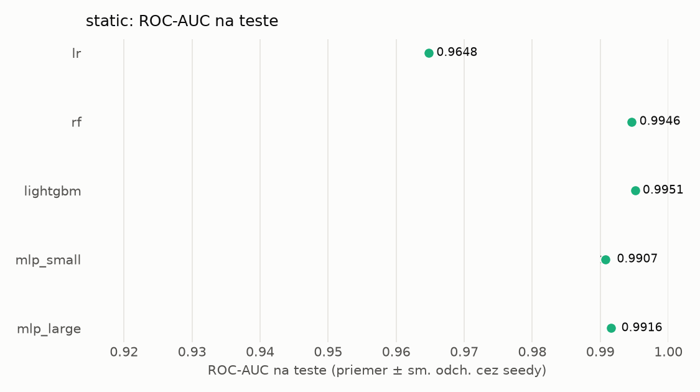
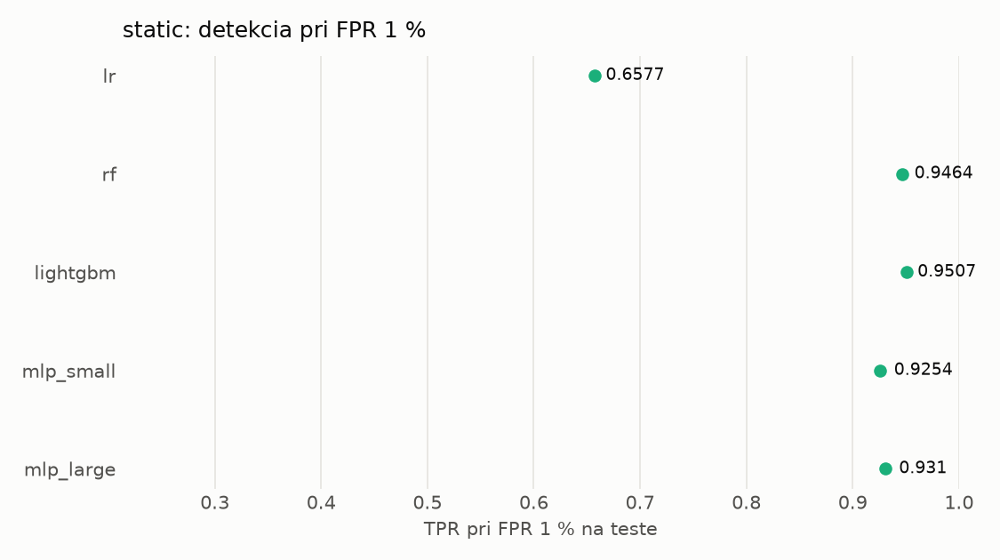

# Porovnanie modelov – static

> Generované `src/evaluation/compare.py` (2026-11-22T23:31:06+01:00); použitý je posledný beh každého modelu.
> Metriky sú priemer cez seedy. \* = pri prahu určenom na validácii (FPR ≤ 1 %).
> CPU ms/vz. = medián latencie jednej vzorky na 1 vlákne vrátane transformácie vstupu (meranie hneď po tréningu,
> orientačné). Oficiálne merania spotreby sú v časti „Spotreba zdrojov pri inferencii“.

## Detekčná kvalita a orientačné časy
| model | ROC-AUC val | ROC-AUC test | TPR@FPR 1 % test | TPR@FPR 0,1 % test | F1 test* | FPR test* | gap train−val | CPU ms/vz. | CPU vz./s | GPU ms/vz. | parametre | MB | tréning s | ladenie min |
|---|---|---|---|---|---|---|---|---|---|---|---|---|---|---|
| [lr](../../static/lr/20261122-230905/README.md) | 0.9632 | 0.9648 ± 0.0000 | 0.6577 | 0.1549 | 0.7620 | 0.0080 | 0.0052 | 0.009 | 3 410 861 | – | 164 | 0.01 | 0.2 | 0.1 |
| [rf](../../static/rf/20261122-230914/README.md) | 0.9933 | 0.9946 ± 0.0001 | 0.9464 | 0.8745 | 0.9585 | 0.0060 | 0.0067 | 15.178 | 110 496 | – | 3 077 138 | 246.55 | 1.8 | 0.7 |
| [lightgbm](../../static/lightgbm/20261122-231010/README.md) | 0.9944 | 0.9951 ± 0.0000 | 0.9507 | 0.8671 | 0.9665 | 0.0080 | 0.0056 | 0.140 | 101 042 | – | 397 091 | 22.33 | 9.2 | 8.0 |
| [mlp_small](../../static/mlp_small/20261122-231849/README.md) | 0.9902 | 0.9907 ± 0.0006 | 0.9254 | 0.6727 | 0.9441 | 0.0065 | 0.0068 | 0.113 | 2 229 111 | 0.388 | 75 777 | 0.32 | 11.3 | 4.5 |
| [mlp_large](../../static/mlp_large/20261122-232356/README.md) | 0.9908 | 0.9916 ± 0.0004 | 0.9310 | 0.6660 | 0.9446 | 0.0063 | 0.0074 | 0.310 | 126 662 | 0.538 | 2 966 529 | 11.91 | 12.9 | 6.5 |

## Nízka prevalencia malvéru (test, prah z validácie)
| model | TPR | FPR | precision @ 1 % | falošné na 1 skutočný poplach @ 1 % | precision @ 0.1 % | falošné na 1 skutočný poplach @ 0.1 % |
|---|---|---|---|---|---|---|
| lr | 0.6215 | 0.0080 | 0.439 | 1.28 | 0.072 | 12.89 |
| rf | 0.9270 | 0.0060 | 0.611 | 0.64 | 0.135 | 6.43 |
| lightgbm | 0.9444 | 0.0080 | 0.543 | 0.84 | 0.105 | 8.48 |
| mlp_small | 0.9013 | 0.0065 | 0.584 | 0.71 | 0.122 | 7.20 |
| mlp_large | 0.9019 | 0.0063 | 0.591 | 0.69 | 0.125 | 6.98 |

Prepočet: TPR a FPR nezávisia od podielu malvéru, preto sa dajú preniesť na nízku prevalenciu (v reálnej prevádzke je malvéru ~1 % alebo menej; v teste 54 %). „Falošné na 1 skutočný poplach“ = koľko neškodných súborov je označených na každý zachytený malvér.

## Spotreba zdrojov pri inferencii (benchmark, testovacia množina)
_Benchmark zatiaľ nebol spustený (`python -m src.evaluation.benchmark --approach static`)._

## Grafy

