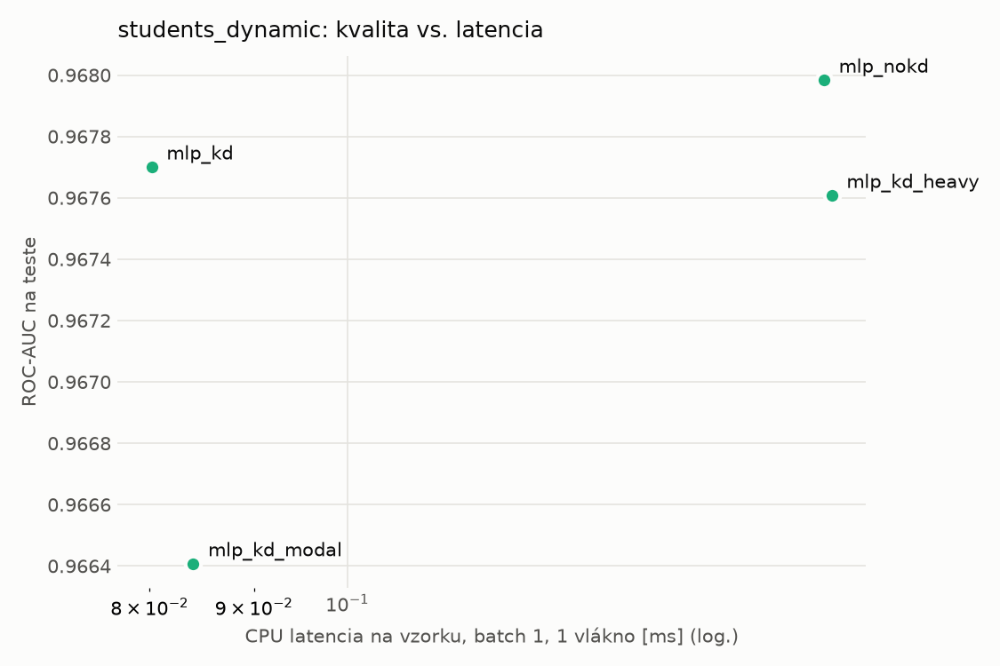
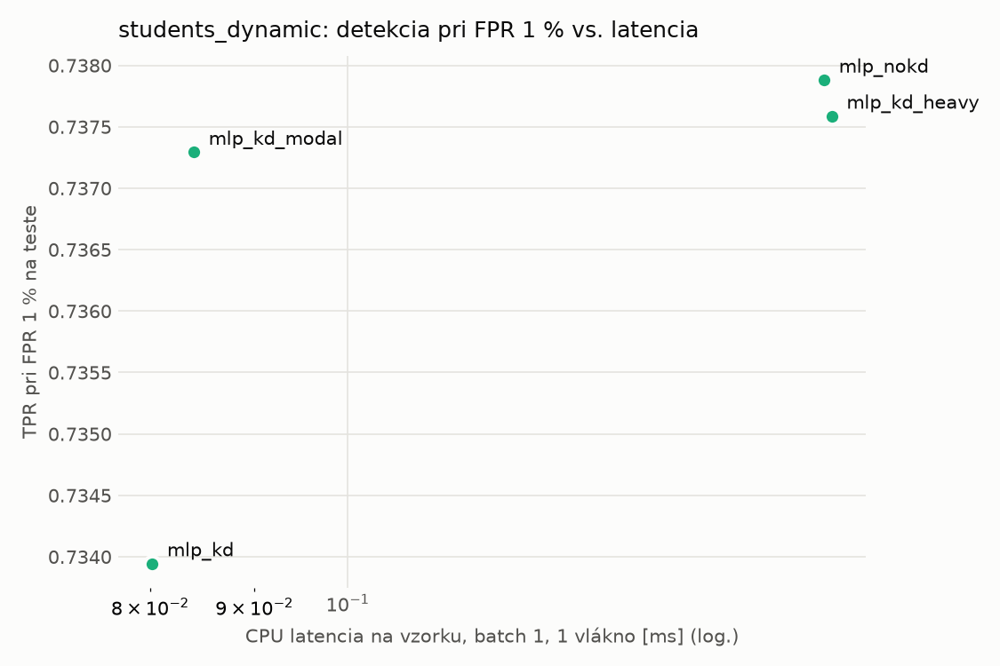
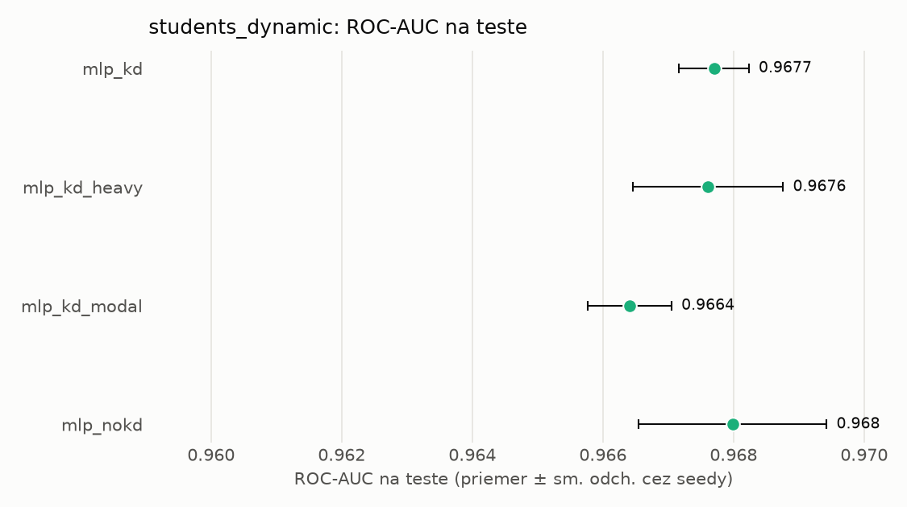
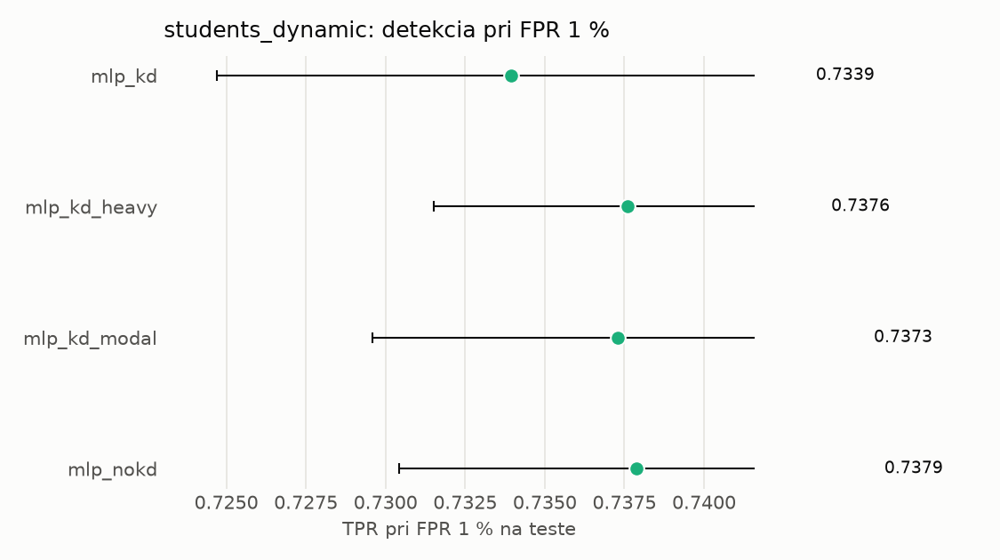

# Porovnanie modelov – students_dynamic

> Generované `src/evaluation/compare.py` (2026-11-23T00:58:14+01:00); použitý je posledný beh každého modelu.
> Metriky sú priemer cez seedy. \* = pri prahu určenom na validácii (FPR ≤ 1 %).
> CPU ms/vz. = medián latencie jednej vzorky na 1 vlákne vrátane transformácie vstupu (meranie hneď po tréningu,
> orientačné). Oficiálne merania spotreby sú v časti „Spotreba zdrojov pri inferencii“.

## Detekčná kvalita a orientačné časy
| model | ROC-AUC val | ROC-AUC test | TPR@FPR 1 % test | TPR@FPR 0,1 % test | F1 test* | FPR test* | gap train−val | CPU ms/vz. | CPU vz./s | GPU ms/vz. | parametre | MB | tréning s | ladenie min |
|---|---|---|---|---|---|---|---|---|---|---|---|---|---|---|
| [mlp_kd](../../students_dynamic/mlp_kd/20261123-003616/README.md) | 0.9644 | 0.9677 ± 0.0005 | 0.7339 | 0.5115 | 0.8350 | 0.0085 | 0.0088 | 0.080 | 5 326 375 | 0.271 | 8 129 | 0.04 | 7.0 | 4.1 |
| [mlp_kd_heavy](../../students_dynamic/mlp_kd_heavy/20261123-005328/README.md) | 0.9661 | 0.9676 ± 0.0012 | 0.7376 | 0.5128 | 0.8416 | 0.0098 | 0.0074 | 0.173 | 8 273 518 | 0.454 | 8 129 | 0.04 | 7.3 | 4.4 |
| [mlp_kd_modal](../../students_dynamic/mlp_kd_modal/20261123-004749/README.md) | 0.9639 | 0.9664 ± 0.0006 | 0.7373 | 0.5259 | 0.8362 | 0.0090 | 0.0061 | 0.084 | 8 087 418 | 0.274 | 8 129 | 0.04 | 11.7 | 5.0 |
| [mlp_nokd](../../students_dynamic/mlp_nokd/20261123-004046/README.md) | 0.9651 | 0.9680 ± 0.0014 | 0.7379 | 0.4920 | 0.8311 | 0.0079 | 0.0094 | 0.171 | 7 857 453 | 0.274 | 8 129 | 0.04 | 12.5 | 6.4 |

## Nízka prevalencia malvéru (test, prah z validácie)
| model | TPR | FPR | precision @ 1 % | falošné na 1 skutočný poplach @ 1 % | precision @ 0.1 % | falošné na 1 skutočný poplach @ 0.1 % |
|---|---|---|---|---|---|---|
| mlp_kd | 0.7242 | 0.0085 | 0.461 | 1.17 | 0.078 | 11.79 |
| mlp_kd_heavy | 0.7353 | 0.0098 | 0.430 | 1.32 | 0.070 | 13.36 |
| mlp_kd_modal | 0.7265 | 0.0090 | 0.449 | 1.23 | 0.075 | 12.41 |
| mlp_nokd | 0.7180 | 0.0079 | 0.478 | 1.09 | 0.083 | 11.02 |

Prepočet: TPR a FPR nezávisia od podielu malvéru, preto sa dajú preniesť na nízku prevalenciu (v reálnej prevádzke je malvéru ~1 % alebo menej; v teste 54 %). „Falošné na 1 skutočný poplach“ = koľko neškodných súborov je označených na každý zachytený malvér.

## Spotreba zdrojov pri inferencii (benchmark, testovacia množina)
_Benchmark zatiaľ nebol spustený (`python -m src.evaluation.benchmark --approach students_dynamic`)._

## Grafy

