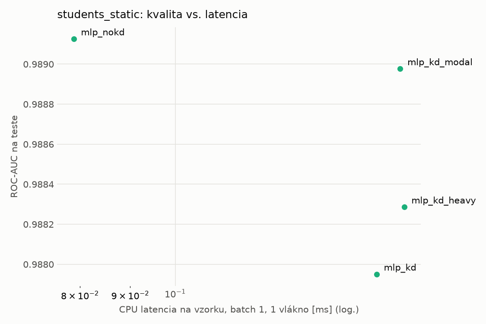
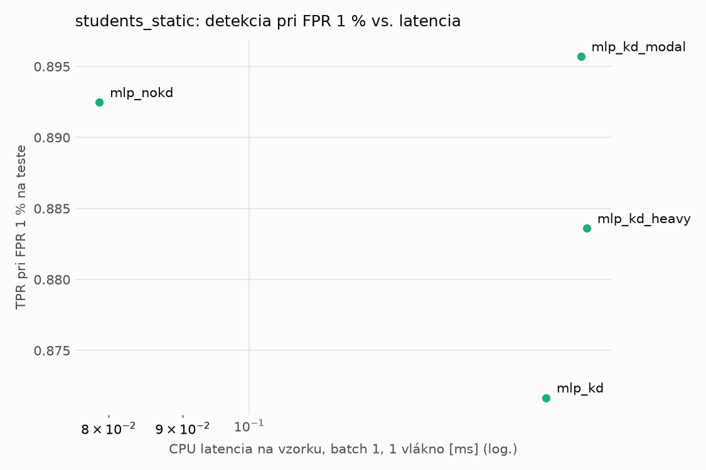
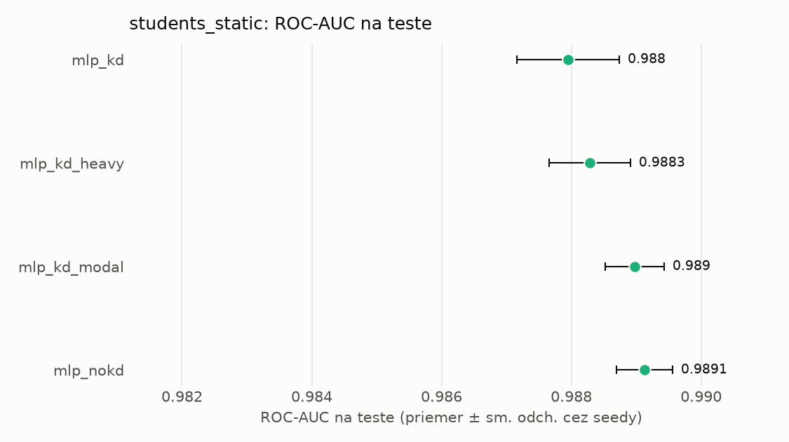
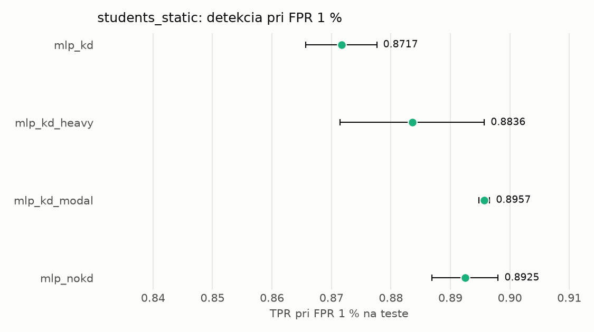

# Porovnanie modelov – students_static

> Generované `src/evaluation/compare.py` (2026-11-23T00:36:13+01:00); použitý je posledný beh každého modelu.
> Metriky sú priemer cez seedy. \* = pri prahu určenom na validácii (FPR ≤ 1 %).
> CPU ms/vz. = medián latencie jednej vzorky na 1 vlákne vrátane transformácie vstupu (meranie hneď po tréningu,
> orientačné). Oficiálne merania spotreby sú v časti „Spotreba zdrojov pri inferencii“.

## Detekčná kvalita a orientačné časy
| model | ROC-AUC val | ROC-AUC test | TPR@FPR 1 % test | TPR@FPR 0,1 % test | F1 test* | FPR test* | gap train−val | CPU ms/vz. | CPU vz./s | GPU ms/vz. | parametre | MB | tréning s | ladenie min |
|---|---|---|---|---|---|---|---|---|---|---|---|---|---|---|
| [mlp_kd](../../students_static/mlp_kd/20261123-002115/README.md) | 0.9867 | 0.9880 ± 0.0008 | 0.8717 | 0.6209 | 0.9076 | 0.0063 | 0.0046 | 0.160 | 3 227 583 | 0.276 | 10 689 | 0.05 | 4.7 | 3.4 |
| [mlp_kd_heavy](../../students_static/mlp_kd_heavy/20261123-003302/README.md) | 0.9870 | 0.9883 ± 0.0006 | 0.8836 | 0.6346 | 0.9149 | 0.0063 | 0.0063 | 0.171 | 6 819 333 | 0.274 | 10 689 | 0.05 | 4.0 | 3.0 |
| [mlp_kd_modal](../../students_static/mlp_kd_modal/20261123-002851/README.md) | 0.9881 | 0.9890 ± 0.0005 | 0.8957 | 0.7114 | 0.9238 | 0.0069 | 0.0044 | 0.169 | 5 833 602 | 0.271 | 10 689 | 0.05 | 10.2 | 3.6 |
| [mlp_nokd](../../students_static/mlp_nokd/20261123-002453/README.md) | 0.9882 | 0.9891 ± 0.0004 | 0.8925 | 0.6198 | 0.9286 | 0.0075 | 0.0064 | 0.079 | 4 795 938 | 0.275 | 10 689 | 0.05 | 10.6 | 3.4 |

## Nízka prevalencia malvéru (test, prah z validácie)
| model | TPR | FPR | precision @ 1 % | falošné na 1 skutočný poplach @ 1 % | precision @ 0.1 % | falošné na 1 skutočný poplach @ 0.1 % |
|---|---|---|---|---|---|---|
| mlp_kd | 0.8372 | 0.0063 | 0.575 | 0.74 | 0.118 | 7.46 |
| mlp_kd_heavy | 0.8498 | 0.0063 | 0.577 | 0.73 | 0.119 | 7.41 |
| mlp_kd_modal | 0.8657 | 0.0069 | 0.558 | 0.79 | 0.111 | 7.99 |
| mlp_nokd | 0.8748 | 0.0075 | 0.541 | 0.85 | 0.105 | 8.56 |

Prepočet: TPR a FPR nezávisia od podielu malvéru, preto sa dajú preniesť na nízku prevalenciu (v reálnej prevádzke je malvéru ~1 % alebo menej; v teste 54 %). „Falošné na 1 skutočný poplach“ = koľko neškodných súborov je označených na každý zachytený malvér.

## Spotreba zdrojov pri inferencii (benchmark, testovacia množina)
_Benchmark zatiaľ nebol spustený (`python -m src.evaluation.benchmark --approach students_static`)._

## Grafy

