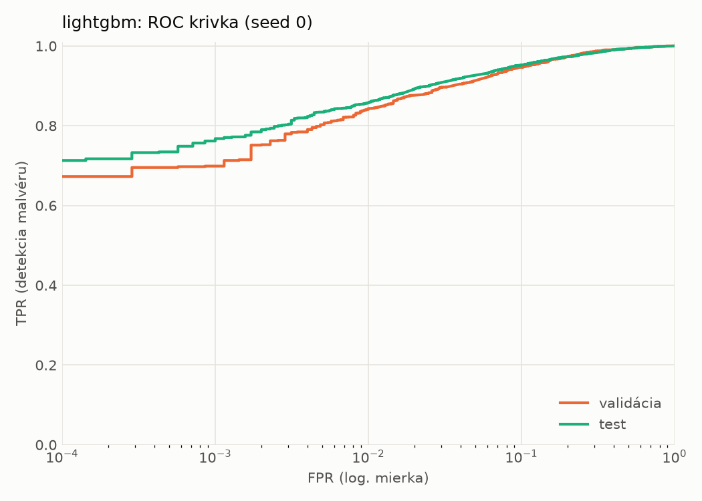
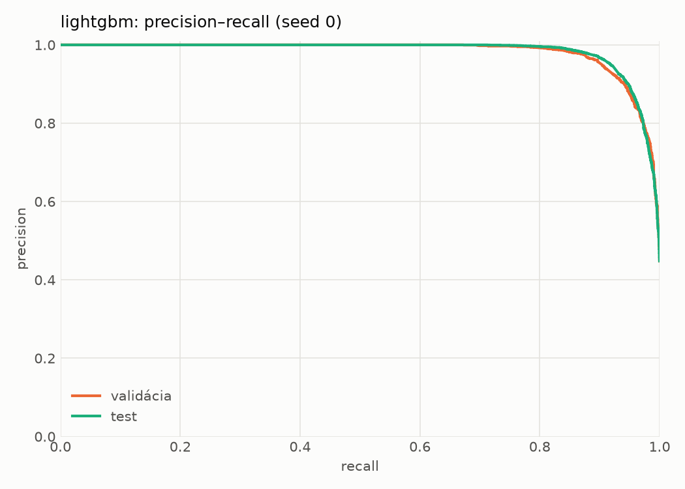
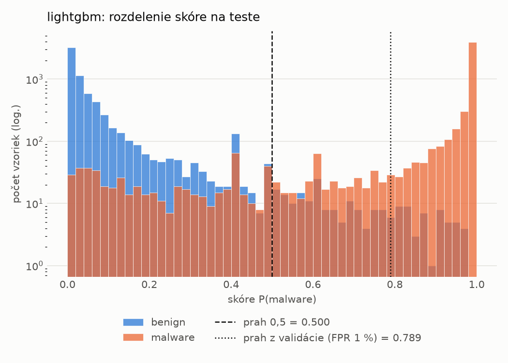
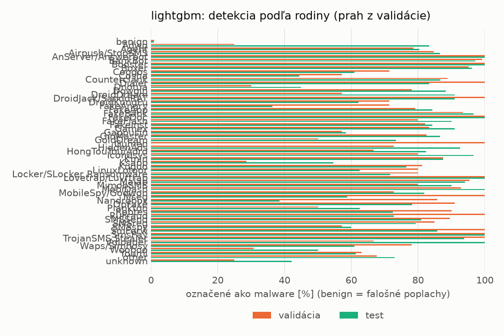
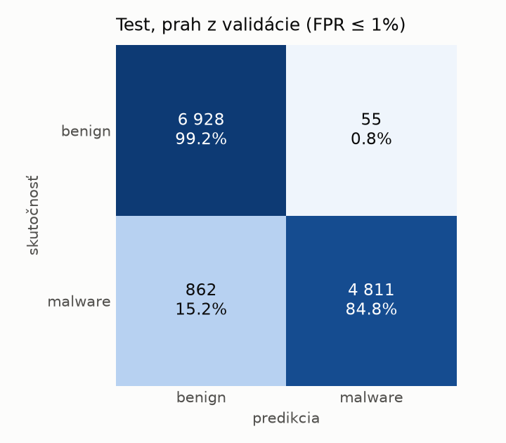
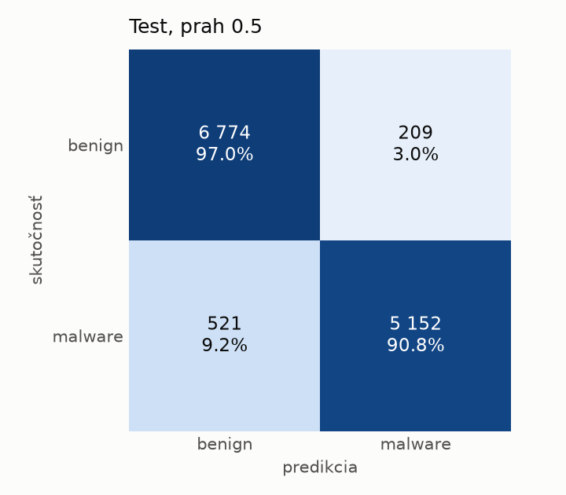
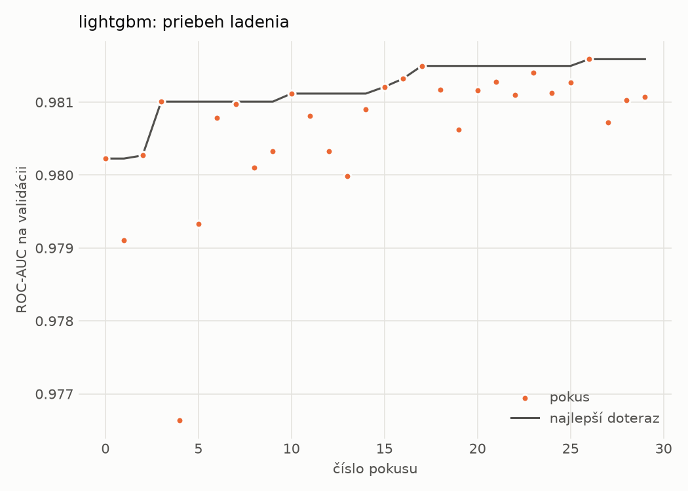
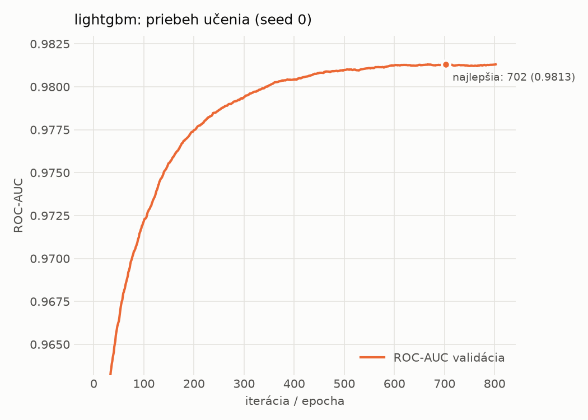

# dynamic/lightgbm – beh `20261122-233440`

> Automaticky generované (`src/training/run_tabular.py`). Konfigurácia: `config.yaml`, protokol: `protocol.yaml`.

- **Model:** `lightgbm` – LightGBM, gradient boosting stromov s early stopping na validácii (pôvodné hodnoty príznakov)
- **Ladenie:** 30 dokončených pokusov (Optuna TPE), cieľ ROC-AUC na validácii, 8.0 min
- **Finálne modely:** seedy [0, 1, 2]; hodnoty sú priemer ± smerodajná odchýlka cez seedy
- **Najlepšie hyperparametre:** `{"num_boost_round": 5000, "early_stopping_rounds": 100, "learning_rate": 0.027489744122517933, "num_leaves": 131, "min_child_samples": 30, "feature_fraction": 0.6013521321216351, "bagging_fraction": 0.9615246014341245, "lambda_l1": 3.231327066876444e-06, "lambda_l2": 0.000134433136248308}`

## Detekčná kvalita (bez prahu)
| metrika | train (podvzorka) | validácia | test |
|---|---|---|---|
| ROC-AUC | 0.9989 ± 0.0003 | 0.9812 ± 0.0001 | 0.9824 ± 0.0002 |
| PR-AUC | 0.9985 ± 0.0004 | 0.9815 ± 0.0001 | 0.9832 ± 0.0002 |
| TPR pri FPR 1 % | 0.9705 ± 0.0055 | 0.8401 ± 0.0027 | 0.8586 ± 0.0019 |
| TPR pri FPR 0,1 % | 0.9574 ± 0.0029 | 0.7038 ± 0.0044 | 0.7618 ± 0.0102 |
| log loss | 0.0560 ± 0.0067 | 0.1634 ± 0.0006 | 0.1541 ± 0.0007 |
| Brier skóre | 0.0134 ± 0.0016 | 0.0477 ± 0.0001 | 0.0442 ± 0.0002 |

Rozdiel ROC-AUC train − validácia: **0.0176** (veľký rozdiel = preučenie).

## Pri prahu z validácie (FPR ≤ 1% na validácii)
| metrika | train (podvzorka) | validácia | test |
|---|---|---|---|
| accuracy | 0.9734 ± 0.0022 | 0.9230 ± 0.0011 | 0.9267 ± 0.0007 |
| balanced accuracy | 0.9695 ± 0.0025 | 0.9153 ± 0.0012 | 0.9191 ± 0.0009 |
| precision | 0.9999 ± 0.0001 | 0.9862 ± 0.0004 | 0.9894 ± 0.0009 |
| recall (TPR) | 0.9390 ± 0.0049 | 0.8401 ± 0.0027 | 0.8455 ± 0.0023 |
| FPR | 0.0001 ± 0.0001 | 0.0096 ± 0.0003 | 0.0074 ± 0.0007 |
| F1 | 0.9685 ± 0.0027 | 0.9073 ± 0.0014 | 0.9118 ± 0.0010 |
| MCC | 0.9469 ± 0.0043 | 0.8502 ± 0.0019 | 0.8575 ± 0.0013 |

## Pri pevnom prahu 0.5
| metrika | train (podvzorka) | validácia | test |
|---|---|---|---|
| accuracy | 0.9824 ± 0.0014 | 0.9368 ± 0.0009 | 0.9424 ± 0.0004 |
| balanced accuracy | 0.9806 ± 0.0015 | 0.9332 ± 0.0009 | 0.9391 ± 0.0005 |
| precision | 0.9929 ± 0.0013 | 0.9581 ± 0.0009 | 0.9623 ± 0.0012 |
| recall (TPR) | 0.9666 ± 0.0021 | 0.8983 ± 0.0011 | 0.9070 ± 0.0012 |
| FPR | 0.0053 ± 0.0009 | 0.0319 ± 0.0007 | 0.0288 ± 0.0010 |
| F1 | 0.9796 ± 0.0017 | 0.9272 ± 0.0010 | 0.9338 ± 0.0005 |
| MCC | 0.9644 ± 0.0029 | 0.8729 ± 0.0018 | 0.8841 ± 0.0009 |

## Výpočtové nároky (seed 0, testovacia množina)
| meranie | hodnota |
|---|---|
| tréning finálneho modelu | 10.6 s (priemer cez seedy) |
| ladenie spolu | 477 s |
| počet parametrov / uzlov | 183 222 |
| veľkosť modelu na disku | 10.04 MB |
| CPU latencia modelu (batch 1, 1 vlákno) | 0.097 ms (p95 0.113) |
| CPU priepustnosť (24 vlákien) | 139 896 vzoriek/s |

## Grafy
| | |
|---|---|
|  |  |
|  |  |
|  |  |
|  |  |

## Súbory
`metrics.json` (všetky metriky po seedoch vrátane rodín), `timing.json`, `hpo_trials.csv`,
`predictions/<časť>_seed<N>.parquet` (sha256, family, label, score), `model/seed_<N>/`, `log.txt`.
