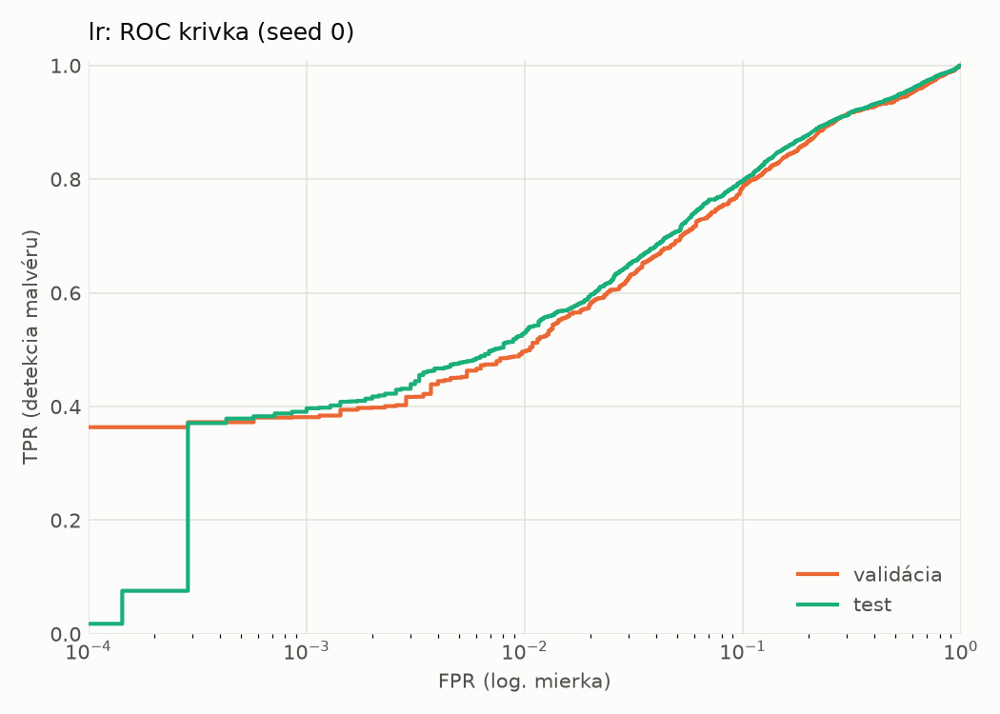
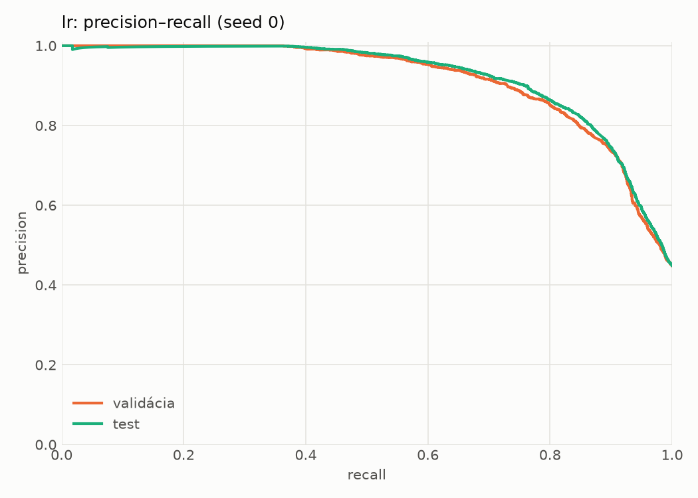
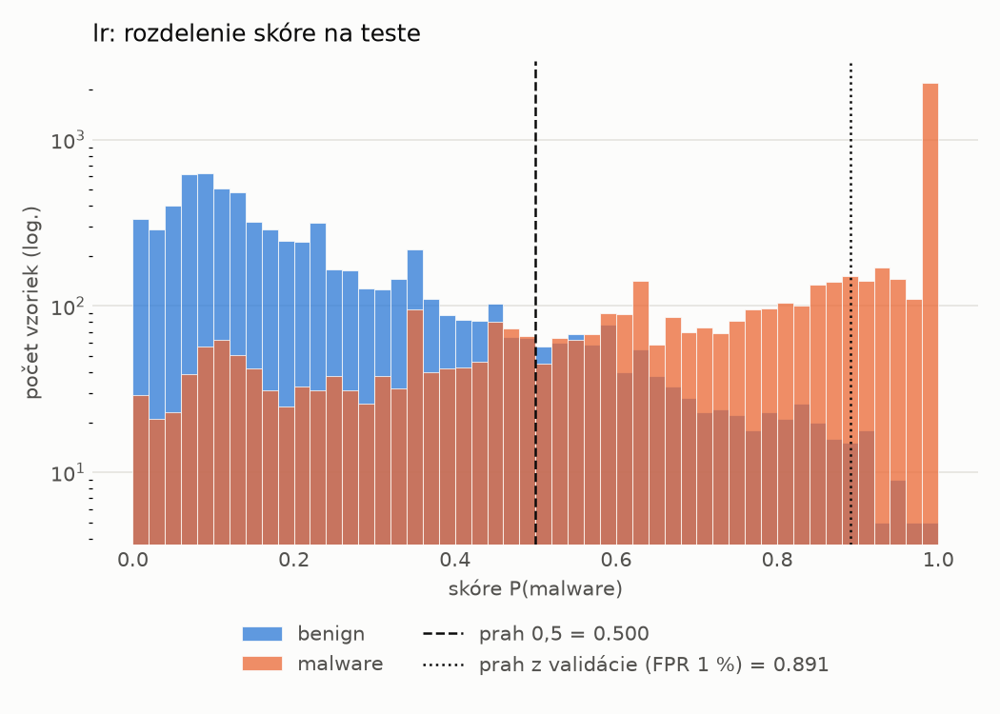
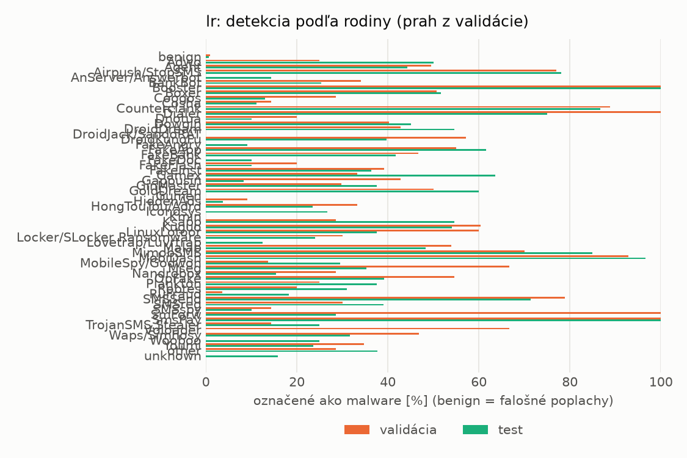
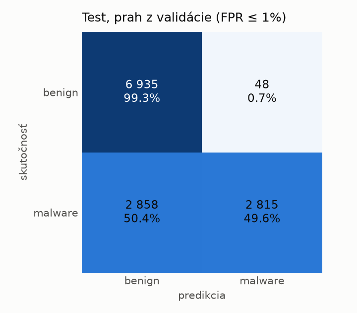
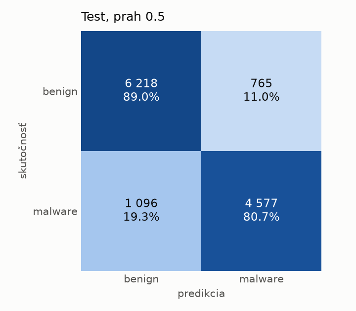
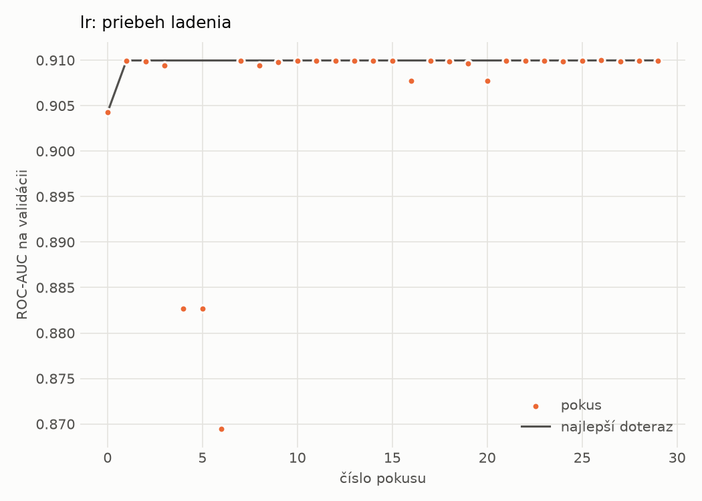

# dynamic/lr – beh `20261122-233312`

> Automaticky generované (`src/training/run_tabular.py`). Konfigurácia: `config.yaml`, protokol: `protocol.yaml`.

- **Model:** `logreg` – logistická regresia s L2 regularizáciou (vstup signed log1p + štandardizácia)
- **Ladenie:** 30 dokončených pokusov (Optuna TPE), cieľ ROC-AUC na validácii, 0.1 min
- **Finálne modely:** seedy [0, 1, 2]; hodnoty sú priemer ± smerodajná odchýlka cez seedy
- **Najlepšie hyperparametre:** `{"max_iter": 2000, "C": 9.535095002298556}`

## Detekčná kvalita (bez prahu)
| metrika | train (podvzorka) | validácia | test |
|---|---|---|---|
| ROC-AUC | 0.9168 ± 0.0000 | 0.9100 ± 0.0000 | 0.9166 ± 0.0000 |
| PR-AUC | 0.9177 ± 0.0000 | 0.9154 ± 0.0000 | 0.9209 ± 0.0000 |
| TPR pri FPR 1 % | 0.5168 ± 0.0000 | 0.4966 ± 0.0000 | 0.5290 ± 0.0000 |
| TPR pri FPR 0,1 % | 0.3951 ± 0.0000 | 0.3813 ± 0.0000 | 0.3908 ± 0.0000 |
| log loss | 0.3546 ± 0.0000 | 0.3656 ± 0.0000 | 0.3561 ± 0.0000 |
| Brier skóre | 0.1086 ± 0.0000 | 0.1128 ± 0.0000 | 0.1088 ± 0.0000 |

Rozdiel ROC-AUC train − validácia: **0.0069** (veľký rozdiel = preučenie).

## Pri prahu z validácie (FPR ≤ 1% na validácii)
| metrika | train (podvzorka) | validácia | test |
|---|---|---|---|
| accuracy | 0.7844 ± 0.0000 | 0.7690 ± 0.0000 | 0.7704 ± 0.0000 |
| balanced accuracy | 0.7541 ± 0.0000 | 0.7435 ± 0.0000 | 0.7447 ± 0.0000 |
| precision | 0.9741 ± 0.0000 | 0.9764 ± 0.0000 | 0.9832 ± 0.0000 |
| recall (TPR) | 0.5188 ± 0.0000 | 0.4966 ± 0.0000 | 0.4962 ± 0.0000 |
| FPR | 0.0106 ± 0.0000 | 0.0097 ± 0.0000 | 0.0069 ± 0.0000 |
| F1 | 0.6771 ± 0.0000 | 0.6584 ± 0.0000 | 0.6596 ± 0.0000 |
| MCC | 0.5970 ± 0.0000 | 0.5772 ± 0.0000 | 0.5817 ± 0.0000 |

## Pri pevnom prahu 0.5
| metrika | train (podvzorka) | validácia | test |
|---|---|---|---|
| accuracy | 0.8552 ± 0.0000 | 0.8476 ± 0.0000 | 0.8530 ± 0.0000 |
| balanced accuracy | 0.8508 ± 0.0000 | 0.8432 ± 0.0000 | 0.8486 ± 0.0000 |
| precision | 0.8454 ± 0.0000 | 0.8502 ± 0.0000 | 0.8568 ± 0.0000 |
| recall (TPR) | 0.8170 ± 0.0000 | 0.8011 ± 0.0000 | 0.8068 ± 0.0000 |
| FPR | 0.1153 ± 0.0000 | 0.1146 ± 0.0000 | 0.1096 ± 0.0000 |
| F1 | 0.8310 ± 0.0000 | 0.8249 ± 0.0000 | 0.8310 ± 0.0000 |
| MCC | 0.7047 ± 0.0000 | 0.6911 ± 0.0000 | 0.7021 ± 0.0000 |

## Výpočtové nároky (seed 0, testovacia množina)
| meranie | hodnota |
|---|---|
| tréning finálneho modelu | 0.4 s (priemer cez seedy) |
| ladenie spolu | 8 s |
| počet parametrov / uzlov | 124 |
| veľkosť modelu na disku | 0.01 MB |
| transformácia vstupu – latencia (1 vlákno) | 0.005 ms |
| transformácia vstupu – priepustnosť | 1 383 956 vzoriek/s |
| CPU latencia modelu (batch 1, 1 vlákno) | 0.004 ms (p95 0.004) |
| CPU priepustnosť (24 vlákien) | 4 359 027 vzoriek/s |

## Grafy
| | |
|---|---|
|  |  |
|  |  |
|  |  |
|  |  |

## Súbory
`metrics.json` (všetky metriky po seedoch vrátane rodín), `timing.json`, `hpo_trials.csv`,
`predictions/<časť>_seed<N>.parquet` (sha256, family, label, score), `model/seed_<N>/`, `log.txt`.
