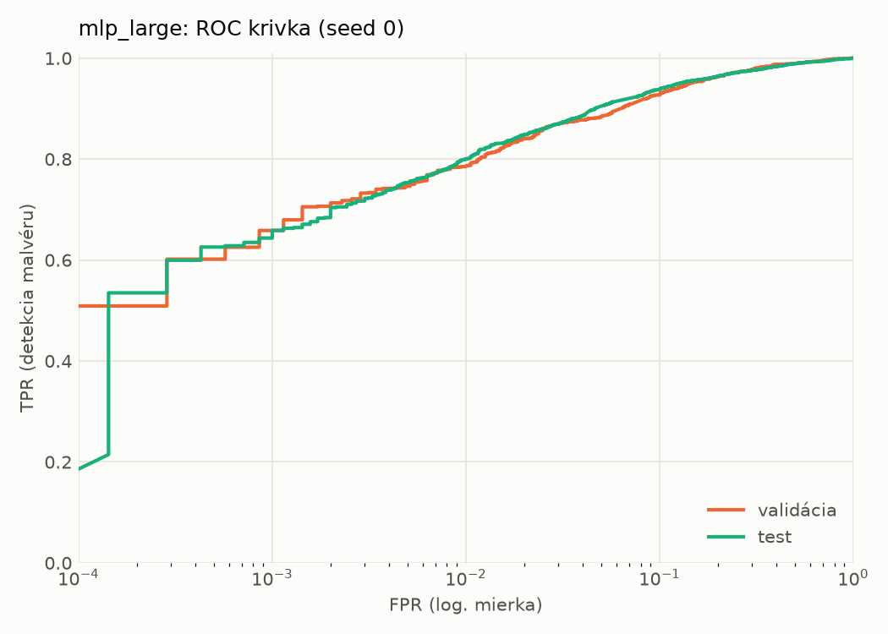
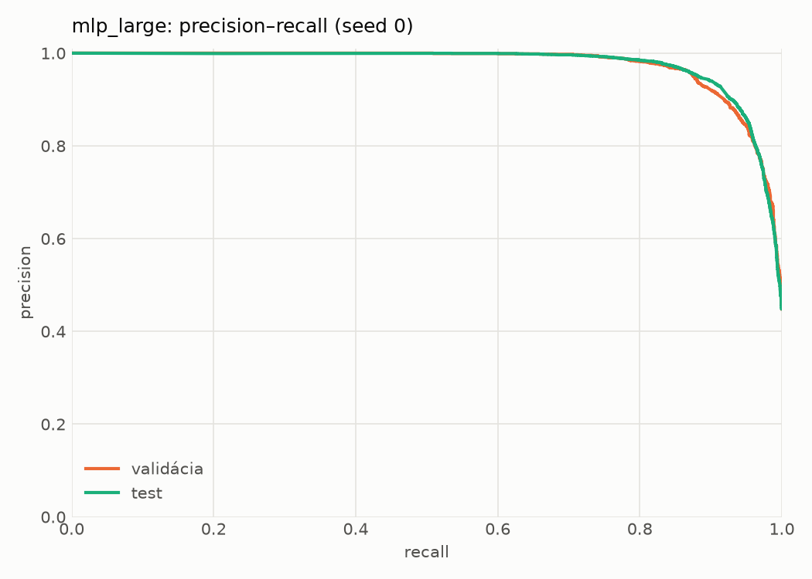
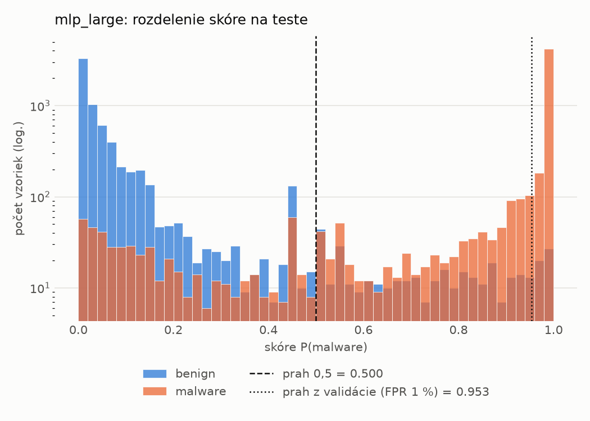
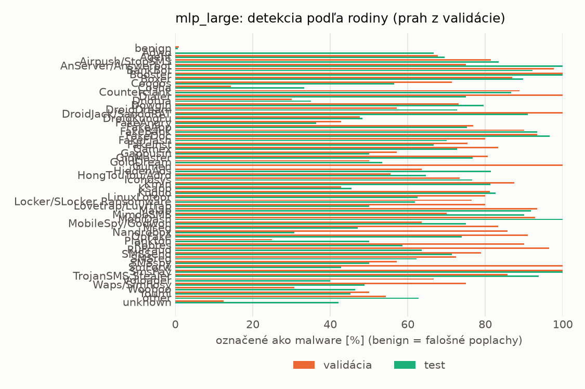
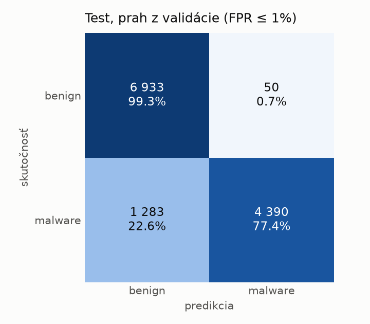
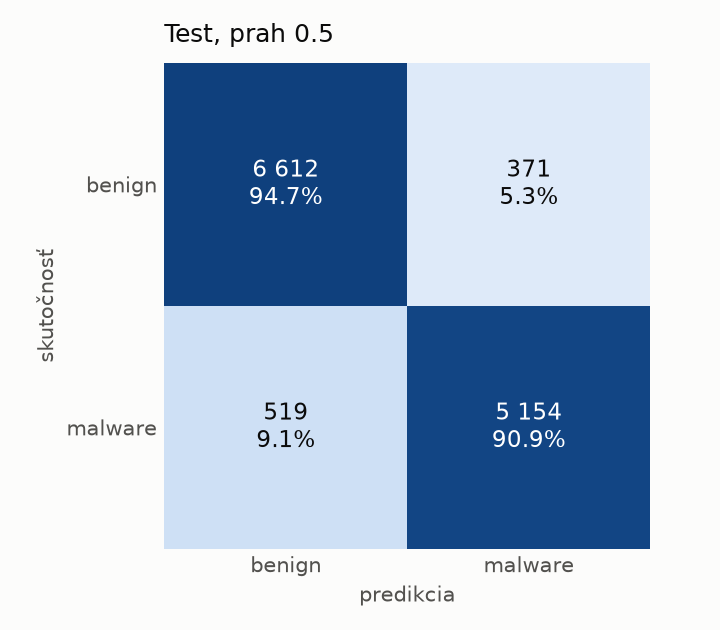
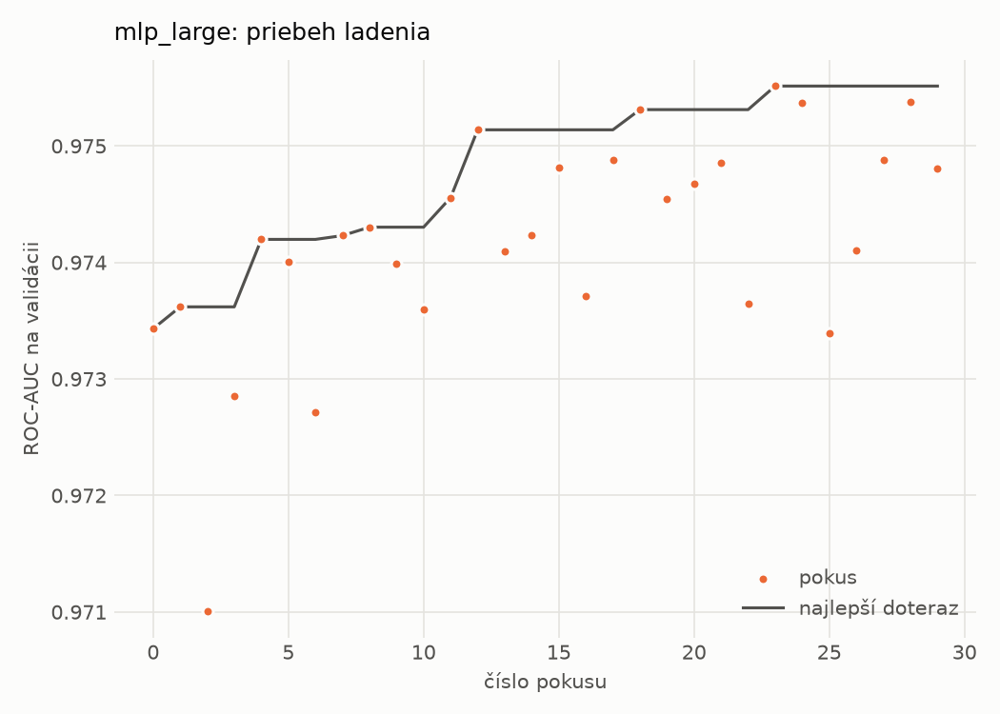
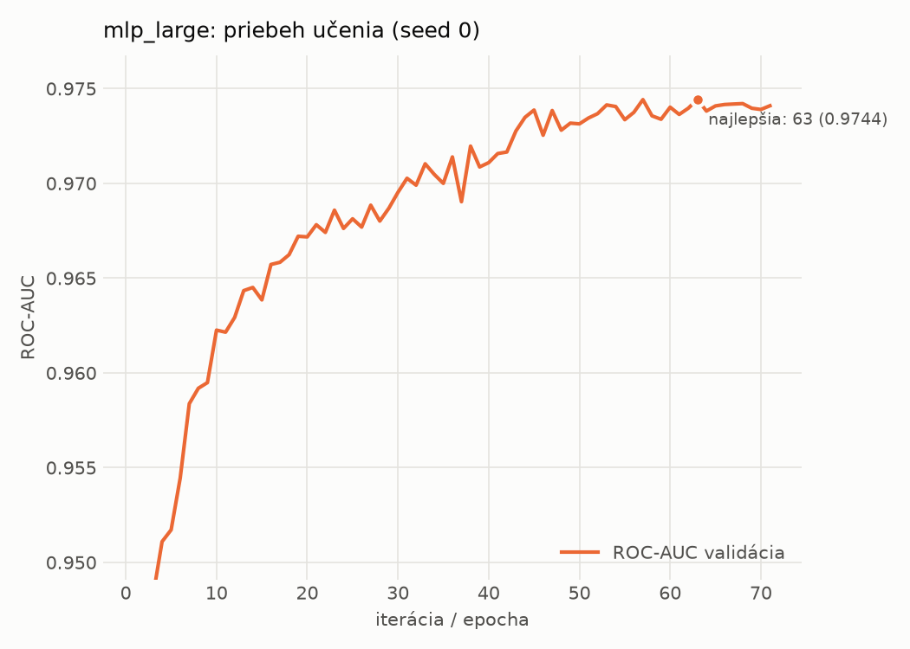

# dynamic/mlp_large – beh `20261122-235153`

> Automaticky generované (`src/training/run_tabular.py`). Konfigurácia: `config.yaml`, protokol: `protocol.yaml`.

- **Model:** `mlp` – veľká neurónová sieť (3–5 skrytých vrstiev, 512–2048 neurónov), kandidát na učiteľa
- **Ladenie:** 30 dokončených pokusov (Optuna TPE), cieľ ROC-AUC na validácii, 5.2 min
- **Finálne modely:** seedy [0, 1, 2]; hodnoty sú priemer ± smerodajná odchýlka cez seedy
- **Najlepšie hyperparametre:** `{"max_epochs": 100, "patience": 8, "hidden_layers": 5, "hidden_width": 512, "width_decay": 1.0, "dropout": 0.3998176791356432, "lr": 0.0024125104549951384, "weight_decay": 1.1960883604412328e-06, "batch_size": 1024}`

## Detekčná kvalita (bez prahu)
| metrika | train (podvzorka) | validácia | test |
|---|---|---|---|
| ROC-AUC | 0.9876 ± 0.0004 | 0.9745 ± 0.0004 | 0.9743 ± 0.0005 |
| PR-AUC | 0.9871 ± 0.0004 | 0.9752 ± 0.0002 | 0.9754 ± 0.0007 |
| TPR pri FPR 1 % | 0.8819 ± 0.0052 | 0.7959 ± 0.0127 | 0.8052 ± 0.0066 |
| TPR pri FPR 0,1 % | 0.7825 ± 0.0181 | 0.6375 ± 0.0257 | 0.6573 ± 0.0127 |
| log loss | 0.1310 ± 0.0034 | 0.1999 ± 0.0044 | 0.1946 ± 0.0004 |
| Brier skóre | 0.0378 ± 0.0008 | 0.0577 ± 0.0006 | 0.0546 ± 0.0003 |

Rozdiel ROC-AUC train − validácia: **0.0130** (veľký rozdiel = preučenie).

## Pri prahu z validácie (FPR ≤ 1% na validácii)
| metrika | train (podvzorka) | validácia | test |
|---|---|---|---|
| accuracy | 0.9224 ± 0.0035 | 0.9032 ± 0.0056 | 0.8987 ± 0.0042 |
| balanced accuracy | 0.9113 ± 0.0041 | 0.8932 ± 0.0063 | 0.8879 ± 0.0048 |
| precision | 0.9967 ± 0.0012 | 0.9854 ± 0.0001 | 0.9882 ± 0.0019 |
| recall (TPR) | 0.8247 ± 0.0089 | 0.7959 ± 0.0127 | 0.7834 ± 0.0106 |
| FPR | 0.0021 ± 0.0008 | 0.0096 ± 0.0002 | 0.0076 ± 0.0014 |
| F1 | 0.9025 ± 0.0049 | 0.8805 ± 0.0077 | 0.8739 ± 0.0060 |
| MCC | 0.8495 ± 0.0063 | 0.8137 ± 0.0102 | 0.8061 ± 0.0072 |

## Pri pevnom prahu 0.5
| metrika | train (podvzorka) | validácia | test |
|---|---|---|---|
| accuracy | 0.9494 ± 0.0010 | 0.9211 ± 0.0010 | 0.9289 ± 0.0006 |
| balanced accuracy | 0.9475 ± 0.0012 | 0.9194 ± 0.0012 | 0.9269 ± 0.0007 |
| precision | 0.9500 ± 0.0020 | 0.9198 ± 0.0021 | 0.9323 ± 0.0019 |
| recall (TPR) | 0.9330 ± 0.0032 | 0.9026 ± 0.0036 | 0.9073 ± 0.0023 |
| FPR | 0.0379 ± 0.0017 | 0.0639 ± 0.0020 | 0.0535 ± 0.0017 |
| F1 | 0.9414 ± 0.0013 | 0.9112 ± 0.0013 | 0.9197 ± 0.0008 |
| MCC | 0.8970 ± 0.0021 | 0.8403 ± 0.0021 | 0.8562 ± 0.0013 |

## Výpočtové nároky (seed 0, testovacia množina)
| meranie | hodnota |
|---|---|
| tréning finálneho modelu | 9.2 s (priemer cez seedy) |
| ladenie spolu | 312 s |
| počet parametrov / uzlov | 1 119 745 |
| veľkosť modelu na disku | 4.51 MB |
| transformácia vstupu – latencia (1 vlákno) | 0.014 ms |
| transformácia vstupu – priepustnosť | 775 314 vzoriek/s |
| CPU latencia modelu (batch 1, 1 vlákno) | 0.248 ms (p95 0.276) |
| CPU priepustnosť (24 vlákien) | 348 539 vzoriek/s |
| GPU latencia (batch 1) | 0.619 ms (p95 1.377) |
| GPU priepustnosť | 1 824 078 vzoriek/s |
| GPU špičková pamäť | 116 MB |

## Grafy
| | |
|---|---|
|  |  |
|  |  |
|  |  |
|  |  |

## Súbory
`metrics.json` (všetky metriky po seedoch vrátane rodín), `timing.json`, `hpo_trials.csv`,
`predictions/<časť>_seed<N>.parquet` (sha256, family, label, score), `model/seed_<N>/`, `log.txt`.
