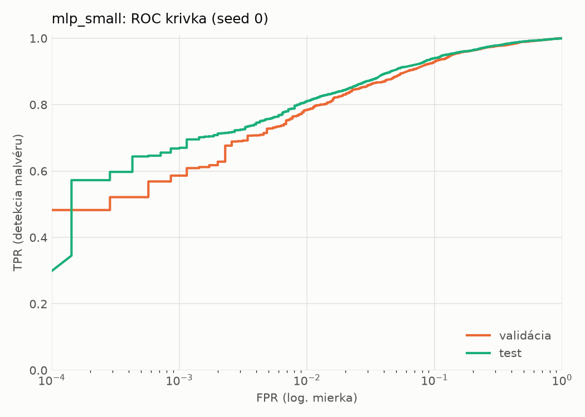
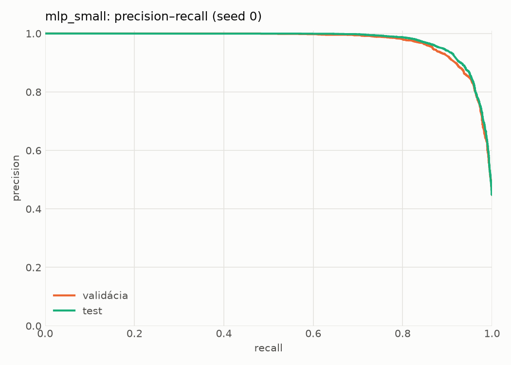
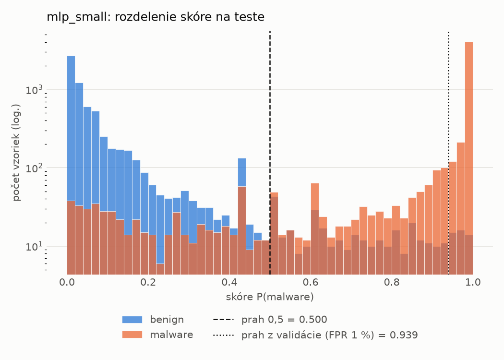
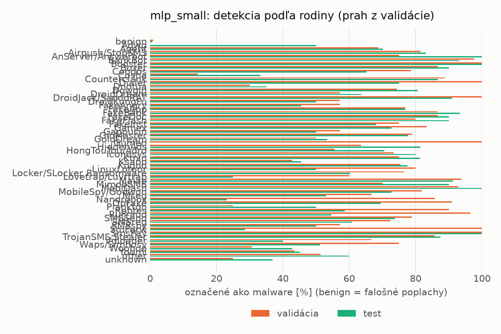
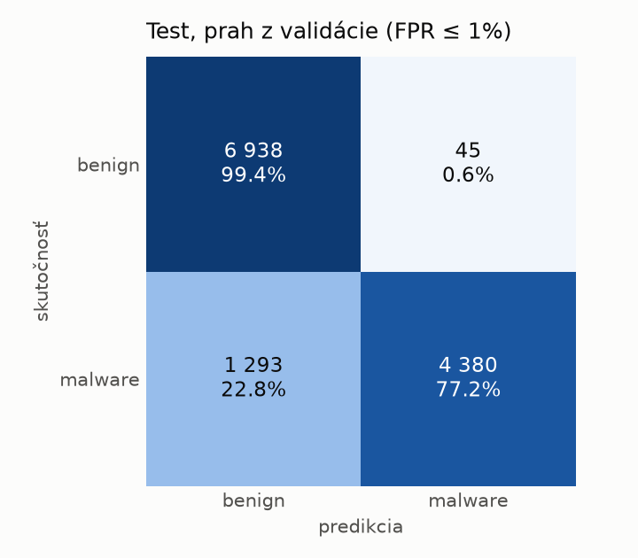
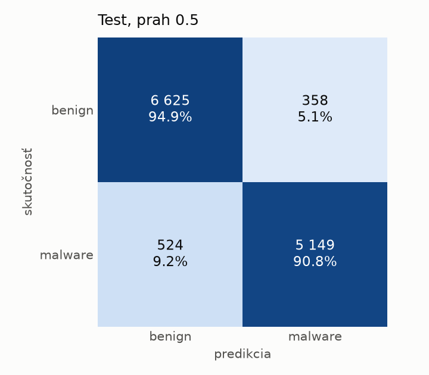
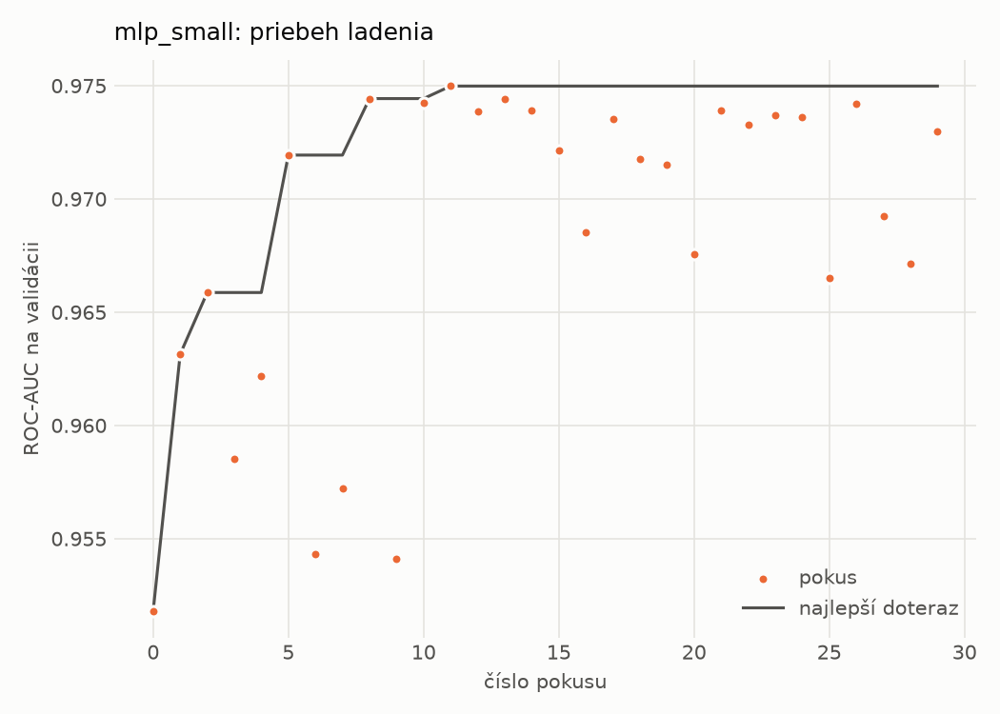
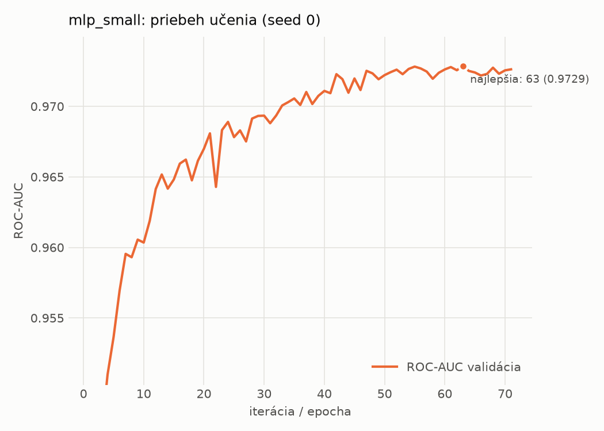

# dynamic/mlp_small – beh `20261122-234317`

> Automaticky generované (`src/training/run_tabular.py`). Konfigurácia: `config.yaml`, protokol: `protocol.yaml`.

- **Model:** `mlp` – malá neurónová sieť (1–2 skryté vrstvy), kandidát na ľahkého študenta
- **Ladenie:** 30 dokončených pokusov (Optuna TPE), cieľ ROC-AUC na validácii, 7.4 min
- **Finálne modely:** seedy [0, 1, 2]; hodnoty sú priemer ± smerodajná odchýlka cez seedy
- **Najlepšie hyperparametre:** `{"width_decay": 0.5, "max_epochs": 100, "patience": 8, "hidden_layers": 2, "hidden_width": 256, "dropout": 0.2449160262890371, "lr": 0.002872548733508973, "weight_decay": 4.509331245708397e-06, "batch_size": 256}`

## Detekčná kvalita (bez prahu)
| metrika | train (podvzorka) | validácia | test |
|---|---|---|---|
| ROC-AUC | 0.9874 ± 0.0001 | 0.9732 ± 0.0003 | 0.9754 ± 0.0005 |
| PR-AUC | 0.9868 ± 0.0000 | 0.9739 ± 0.0002 | 0.9764 ± 0.0003 |
| TPR pri FPR 1 % | 0.8749 ± 0.0012 | 0.7906 ± 0.0069 | 0.8118 ± 0.0024 |
| TPR pri FPR 0,1 % | 0.7749 ± 0.0091 | 0.5699 ± 0.0324 | 0.6488 ± 0.0226 |
| log loss | 0.1333 ± 0.0004 | 0.2061 ± 0.0019 | 0.1919 ± 0.0024 |
| Brier skóre | 0.0384 ± 0.0001 | 0.0586 ± 0.0001 | 0.0537 ± 0.0004 |

Rozdiel ROC-AUC train − validácia: **0.0142** (veľký rozdiel = preučenie).

## Pri prahu z validácie (FPR ≤ 1% na validácii)
| metrika | train (podvzorka) | validácia | test |
|---|---|---|---|
| accuracy | 0.9216 ± 0.0027 | 0.9007 ± 0.0031 | 0.8977 ± 0.0029 |
| balanced accuracy | 0.9103 ± 0.0031 | 0.8904 ± 0.0034 | 0.8867 ± 0.0034 |
| precision | 0.9968 ± 0.0009 | 0.9851 ± 0.0001 | 0.9888 ± 0.0011 |
| recall (TPR) | 0.8227 ± 0.0068 | 0.7906 ± 0.0069 | 0.7805 ± 0.0073 |
| FPR | 0.0021 ± 0.0006 | 0.0097 ± 0.0000 | 0.0072 ± 0.0008 |
| F1 | 0.9014 ± 0.0037 | 0.8772 ± 0.0043 | 0.8724 ± 0.0043 |
| MCC | 0.8480 ± 0.0048 | 0.8091 ± 0.0056 | 0.8044 ± 0.0051 |

## Pri pevnom prahu 0.5
| metrika | train (podvzorka) | validácia | test |
|---|---|---|---|
| accuracy | 0.9491 ± 0.0007 | 0.9207 ± 0.0017 | 0.9299 ± 0.0012 |
| balanced accuracy | 0.9468 ± 0.0003 | 0.9186 ± 0.0017 | 0.9275 ± 0.0011 |
| precision | 0.9534 ± 0.0038 | 0.9225 ± 0.0045 | 0.9366 ± 0.0036 |
| recall (TPR) | 0.9286 ± 0.0024 | 0.8985 ± 0.0039 | 0.9048 ± 0.0026 |
| FPR | 0.0351 ± 0.0031 | 0.0613 ± 0.0040 | 0.0498 ± 0.0031 |
| F1 | 0.9408 ± 0.0006 | 0.9104 ± 0.0019 | 0.9204 ± 0.0013 |
| MCC | 0.8964 ± 0.0015 | 0.8395 ± 0.0035 | 0.8582 ± 0.0025 |

## Výpočtové nároky (seed 0, testovacia množina)
| meranie | hodnota |
|---|---|
| tréning finálneho modelu | 24.5 s (priemer cez seedy) |
| ladenie spolu | 441 s |
| počet parametrov / uzlov | 65 537 |
| veľkosť modelu na disku | 0.27 MB |
| transformácia vstupu – latencia (1 vlákno) | 0.014 ms |
| transformácia vstupu – priepustnosť | 784 980 vzoriek/s |
| CPU latencia modelu (batch 1, 1 vlákno) | 0.099 ms (p95 0.111) |
| CPU priepustnosť (24 vlákien) | 2 692 308 vzoriek/s |
| GPU latencia (batch 1) | 0.377 ms (p95 0.409) |
| GPU priepustnosť | 1 505 860 vzoriek/s |
| GPU špičková pamäť | 66 MB |

## Grafy
| | |
|---|---|
|  |  |
|  |  |
|  |  |
|  |  |

## Súbory
`metrics.json` (všetky metriky po seedoch vrátane rodín), `timing.json`, `hpo_trials.csv`,
`predictions/<časť>_seed<N>.parquet` (sha256, family, label, score), `model/seed_<N>/`, `log.txt`.
