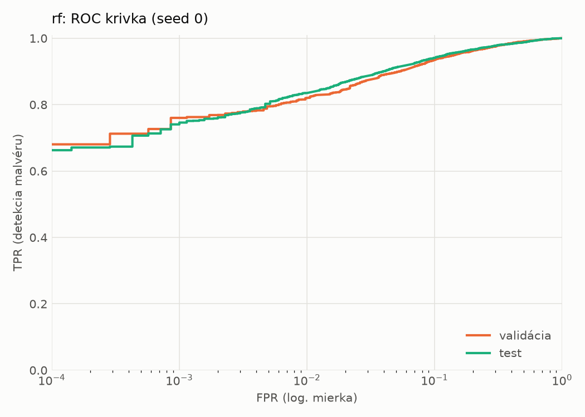
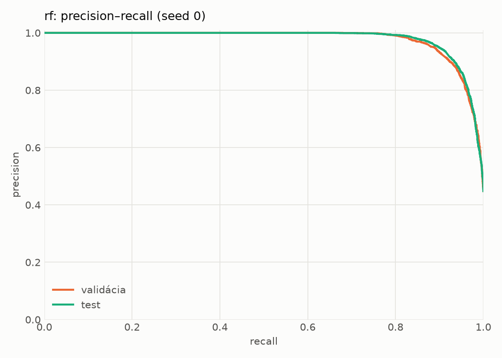
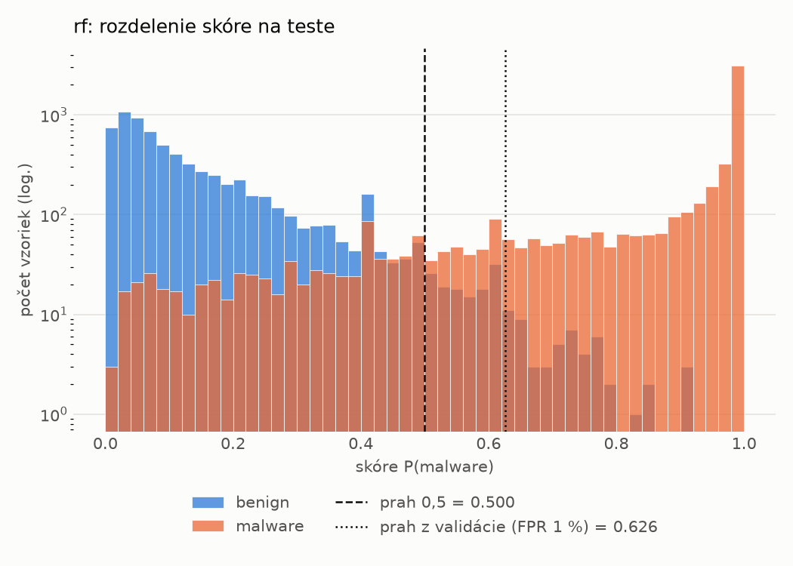
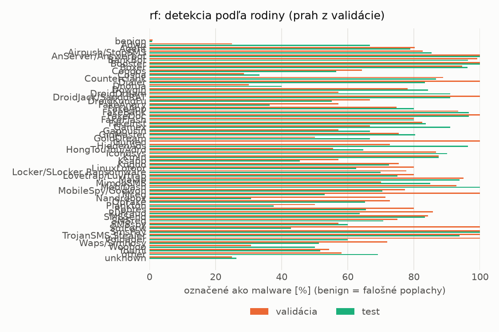
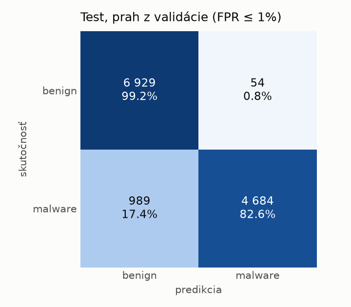
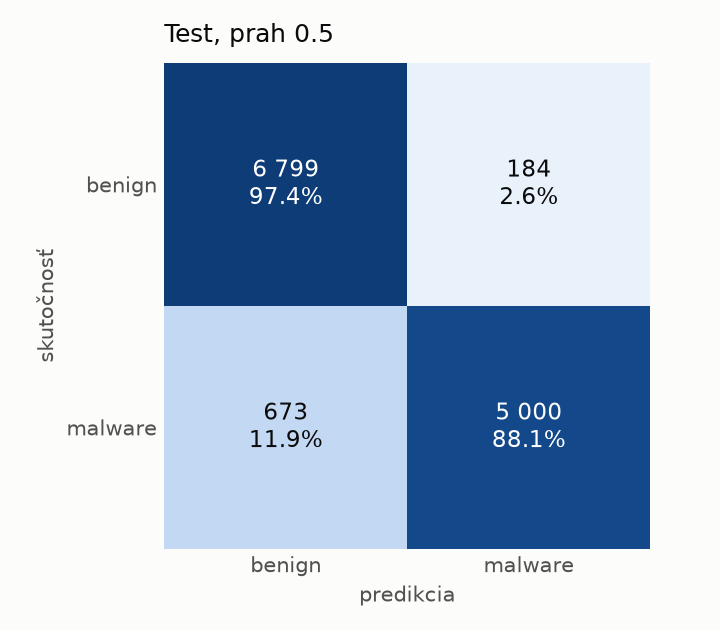
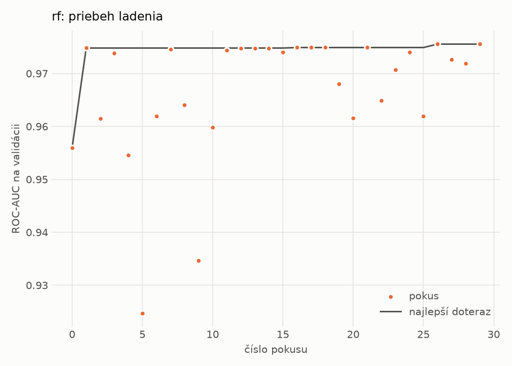

# dynamic/rf – beh `20261122-233325`

> Automaticky generované (`src/training/run_tabular.py`). Konfigurácia: `config.yaml`, protokol: `protocol.yaml`.

- **Model:** `random_forest` – Random Forest (pôvodné hodnoty príznakov)
- **Ladenie:** 30 dokončených pokusov (Optuna TPE), cieľ ROC-AUC na validácii, 0.9 min
- **Finálne modely:** seedy [0, 1, 2]; hodnoty sú priemer ± smerodajná odchýlka cez seedy
- **Najlepšie hyperparametre:** `{"n_estimators": 500, "max_depth": 24, "min_samples_leaf": 1, "max_features": "sqrt"}`

## Detekčná kvalita (bez prahu)
| metrika | train (podvzorka) | validácia | test |
|---|---|---|---|
| ROC-AUC | 0.9984 ± 0.0000 | 0.9755 ± 0.0001 | 0.9771 ± 0.0001 |
| PR-AUC | 0.9981 ± 0.0000 | 0.9768 ± 0.0001 | 0.9787 ± 0.0000 |
| TPR pri FPR 1 % | 0.9744 ± 0.0001 | 0.8206 ± 0.0014 | 0.8348 ± 0.0003 |
| TPR pri FPR 0,1 % | 0.9513 ± 0.0002 | 0.7550 ± 0.0051 | 0.7417 ± 0.0056 |
| log loss | 0.0898 ± 0.0002 | 0.2013 ± 0.0004 | 0.1961 ± 0.0002 |
| Brier skóre | 0.0187 ± 0.0001 | 0.0579 ± 0.0001 | 0.0555 ± 0.0000 |

Rozdiel ROC-AUC train − validácia: **0.0229** (veľký rozdiel = preučenie).

## Pri prahu z validácie (FPR ≤ 1% na validácii)
| metrika | train (podvzorka) | validácia | test |
|---|---|---|---|
| accuracy | 0.9774 ± 0.0002 | 0.9142 ± 0.0006 | 0.9175 ± 0.0010 |
| balanced accuracy | 0.9741 ± 0.0002 | 0.9054 ± 0.0007 | 0.9088 ± 0.0011 |
| precision | 1.0000 ± 0.0000 | 0.9856 ± 0.0000 | 0.9886 ± 0.0002 |
| recall (TPR) | 0.9481 ± 0.0004 | 0.8206 ± 0.0014 | 0.8254 ± 0.0021 |
| FPR | 0.0000 ± 0.0000 | 0.0097 ± 0.0000 | 0.0077 ± 0.0001 |
| F1 | 0.9734 ± 0.0002 | 0.8955 ± 0.0009 | 0.8997 ± 0.0014 |
| MCC | 0.9548 ± 0.0003 | 0.8337 ± 0.0012 | 0.8403 ± 0.0019 |

## Pri pevnom prahu 0.5
| metrika | train (podvzorka) | validácia | test |
|---|---|---|---|
| accuracy | 0.9826 ± 0.0001 | 0.9272 ± 0.0006 | 0.9327 ± 0.0003 |
| balanced accuracy | 0.9806 ± 0.0001 | 0.9219 ± 0.0006 | 0.9279 ± 0.0004 |
| precision | 0.9953 ± 0.0000 | 0.9631 ± 0.0013 | 0.9647 ± 0.0005 |
| recall (TPR) | 0.9646 ± 0.0002 | 0.8710 ± 0.0008 | 0.8821 ± 0.0007 |
| FPR | 0.0035 ± 0.0000 | 0.0271 ± 0.0010 | 0.0262 ± 0.0004 |
| F1 | 0.9797 ± 0.0001 | 0.9147 ± 0.0007 | 0.9215 ± 0.0004 |
| MCC | 0.9648 ± 0.0002 | 0.8548 ± 0.0013 | 0.8655 ± 0.0007 |

## Výpočtové nároky (seed 0, testovacia množina)
| meranie | hodnota |
|---|---|
| tréning finálneho modelu | 2.7 s (priemer cez seedy) |
| ladenie spolu | 56 s |
| počet parametrov / uzlov | 3 310 534 |
| veľkosť modelu na disku | 265.22 MB |
| CPU latencia modelu (batch 1, 1 vlákno) | 15.398 ms (p95 15.795) |
| CPU priepustnosť (24 vlákien) | 101 370 vzoriek/s |

## Grafy
| | |
|---|---|
|  |  |
|  |  |
|  |  |
|  |  |

## Súbory
`metrics.json` (všetky metriky po seedoch vrátane rodín), `timing.json`, `hpo_trials.csv`,
`predictions/<časť>_seed<N>.parquet` (sha256, family, label, score), `model/seed_<N>/`, `log.txt`.
