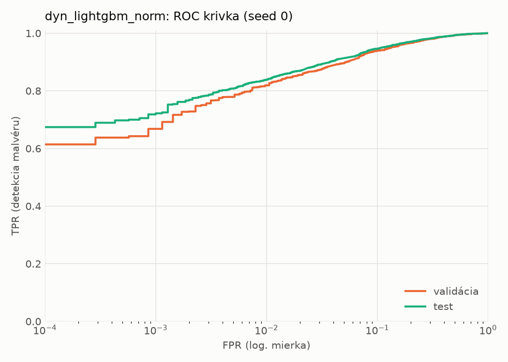
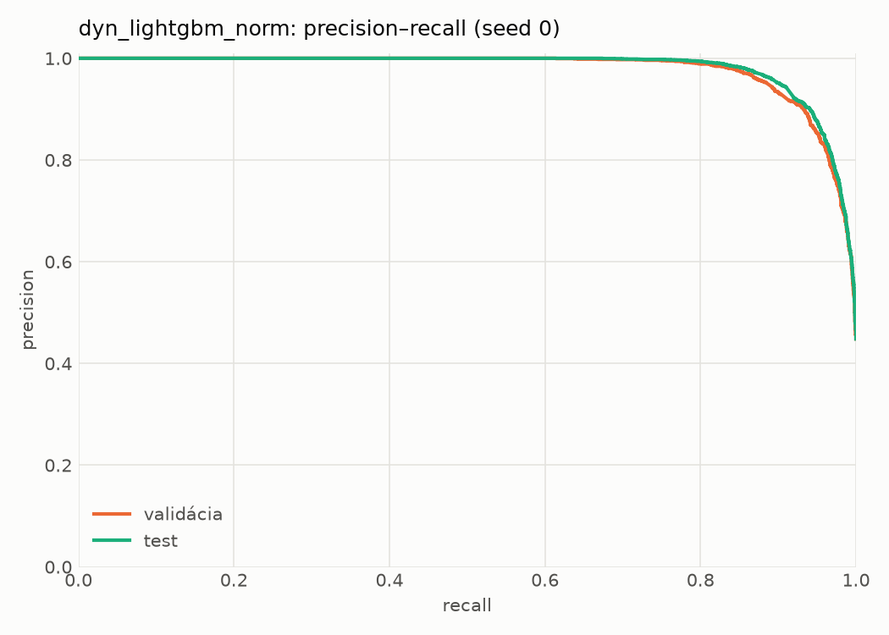
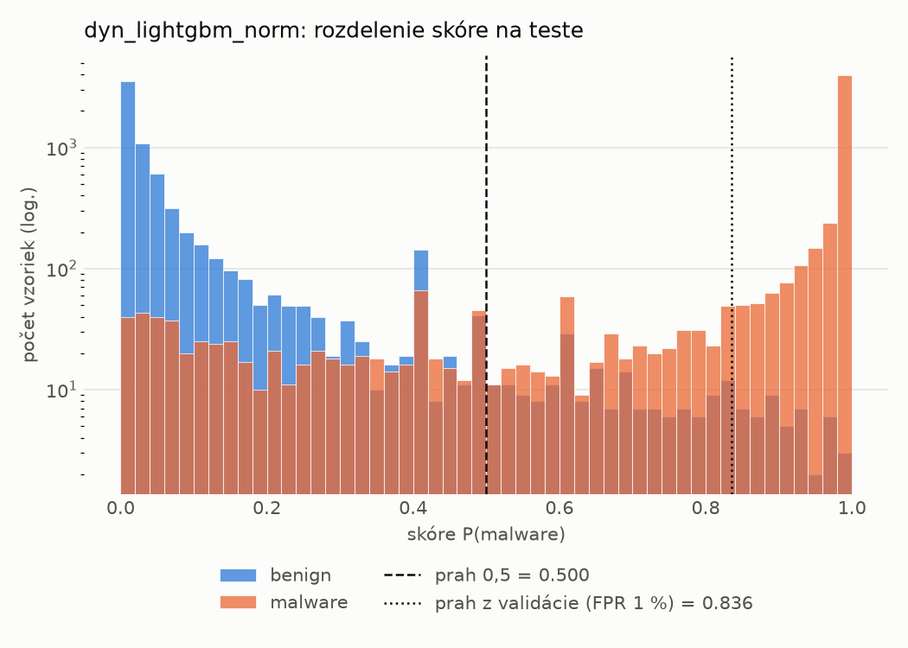
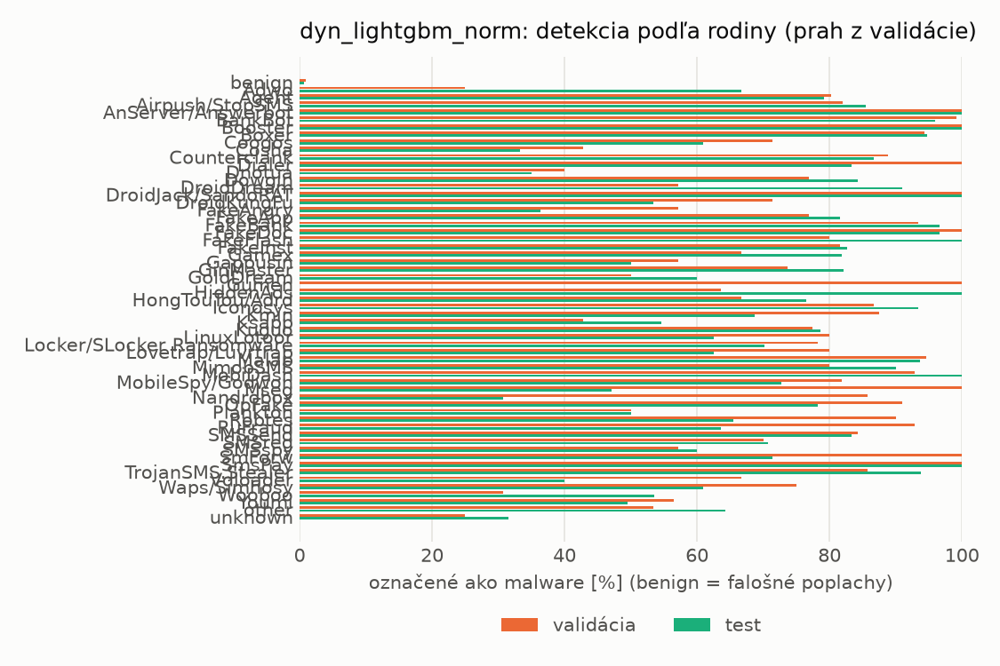
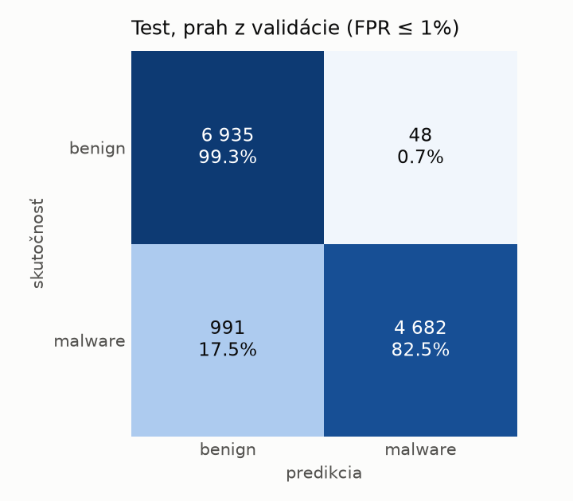
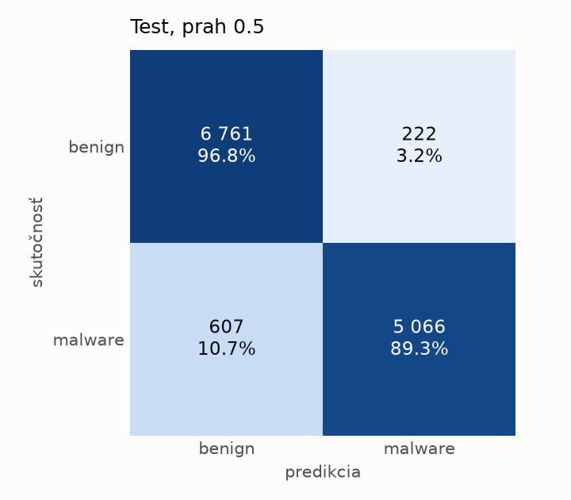
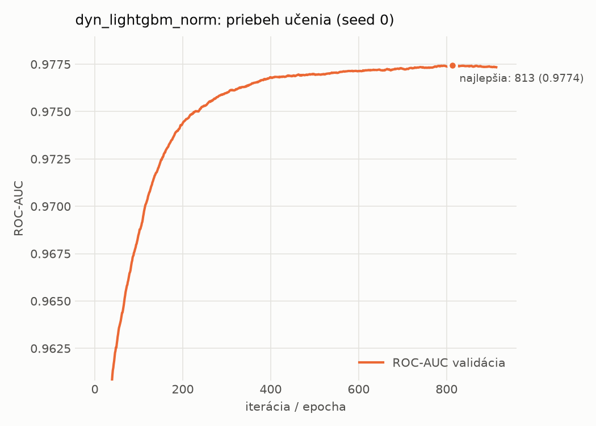

# dynamic_norm/dyn_lightgbm_norm – beh `20261123-001142`

> Automaticky generované (`src/training/run_tabular.py`). Konfigurácia: `config.yaml`, protokol: `protocol.yaml`.

- **Model:** `lightgbm` – dynamic lightgbm s dynamikou ako podiely systémových volaní (kontrola artefaktu množstva aktivity)
- **Ladenie:** bez ladenia – hyperparametre prevzaté z `runs_v4/real_p/full/dynamic/lightgbm/20261122-233440`
- **Finálne modely:** seedy [0, 1, 2]; hodnoty sú priemer ± smerodajná odchýlka cez seedy
- **Najlepšie hyperparametre:** `{"num_boost_round": 5000, "early_stopping_rounds": 100, "learning_rate": 0.027489744122517933, "num_leaves": 131, "min_child_samples": 30, "feature_fraction": 0.6013521321216351, "bagging_fraction": 0.9615246014341245, "lambda_l1": 3.231327066876444e-06, "lambda_l2": 0.000134433136248308}`

## Detekčná kvalita (bez prahu)
| metrika | train (podvzorka) | validácia | test |
|---|---|---|---|
| ROC-AUC | 0.9994 ± 0.0001 | 0.9773 ± 0.0002 | 0.9799 ± 0.0003 |
| PR-AUC | 0.9991 ± 0.0002 | 0.9780 ± 0.0001 | 0.9805 ± 0.0002 |
| TPR pri FPR 1 % | 0.9828 ± 0.0037 | 0.8228 ± 0.0039 | 0.8392 ± 0.0014 |
| TPR pri FPR 0,1 % | 0.9649 ± 0.0026 | 0.6785 ± 0.0099 | 0.7221 ± 0.0037 |
| log loss | 0.0488 ± 0.0055 | 0.1808 ± 0.0017 | 0.1674 ± 0.0008 |
| Brier skóre | 0.0107 ± 0.0012 | 0.0529 ± 0.0002 | 0.0488 ± 0.0002 |

Rozdiel ROC-AUC train − validácia: **0.0221** (veľký rozdiel = preučenie).

## Pri prahu z validácie (FPR ≤ 1% na validácii)
| metrika | train (podvzorka) | validácia | test |
|---|---|---|---|
| accuracy | 0.9726 ± 0.0013 | 0.9152 ± 0.0017 | 0.9177 ± 0.0007 |
| balanced accuracy | 0.9685 ± 0.0015 | 0.9065 ± 0.0019 | 0.9090 ± 0.0008 |
| precision | 1.0000 ± 0.0000 | 0.9856 ± 0.0001 | 0.9896 ± 0.0008 |
| recall (TPR) | 0.9370 ± 0.0030 | 0.8228 ± 0.0039 | 0.8250 ± 0.0022 |
| FPR | 0.0000 ± 0.0000 | 0.0097 ± 0.0000 | 0.0071 ± 0.0006 |
| F1 | 0.9675 ± 0.0016 | 0.8969 ± 0.0023 | 0.8998 ± 0.0010 |
| MCC | 0.9453 ± 0.0026 | 0.8356 ± 0.0032 | 0.8408 ± 0.0012 |

## Pri pevnom prahu 0.5
| metrika | train (podvzorka) | validácia | test |
|---|---|---|---|
| accuracy | 0.9867 ± 0.0017 | 0.9278 ± 0.0005 | 0.9349 ± 0.0004 |
| balanced accuracy | 0.9856 ± 0.0015 | 0.9240 ± 0.0004 | 0.9312 ± 0.0005 |
| precision | 0.9926 ± 0.0041 | 0.9484 ± 0.0051 | 0.9565 ± 0.0030 |
| recall (TPR) | 0.9768 ± 0.0006 | 0.8874 ± 0.0047 | 0.8954 ± 0.0029 |
| FPR | 0.0056 ± 0.0031 | 0.0393 ± 0.0043 | 0.0331 ± 0.0025 |
| F1 | 0.9847 ± 0.0019 | 0.9168 ± 0.0004 | 0.9249 ± 0.0005 |
| MCC | 0.9731 ± 0.0035 | 0.8547 ± 0.0012 | 0.8690 ± 0.0010 |

## Výpočtové nároky (seed 0, testovacia množina)
| meranie | hodnota |
|---|---|
| tréning finálneho modelu | 12.0 s (priemer cez seedy) |
| ladenie spolu | 0 s |
| počet parametrov / uzlov | 212 193 |
| veľkosť modelu na disku | 11.85 MB |
| CPU latencia modelu (batch 1, 1 vlákno) | 0.112 ms (p95 0.126) |
| CPU priepustnosť (24 vlákien) | 133 884 vzoriek/s |

## Grafy
| | |
|---|---|
|  |  |
|  |  |
|  |  |
|  |  |

## Súbory
`metrics.json` (všetky metriky po seedoch vrátane rodín), `timing.json`, `hpo_trials.csv`,
`predictions/<časť>_seed<N>.parquet` (sha256, family, label, score), `model/seed_<N>/`, `log.txt`.
