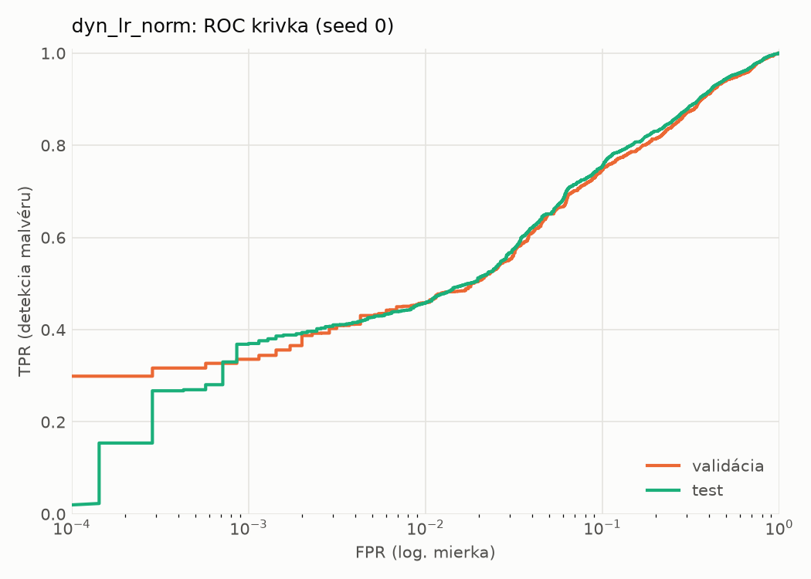
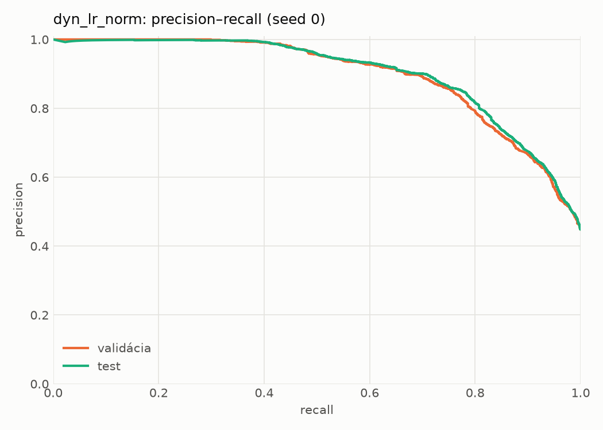
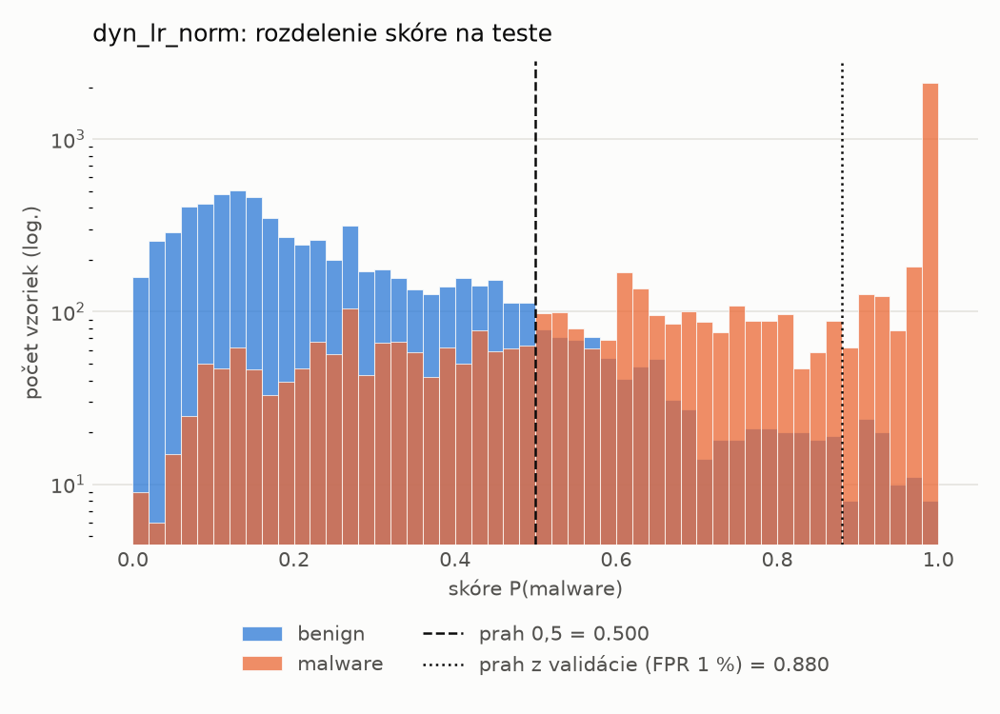
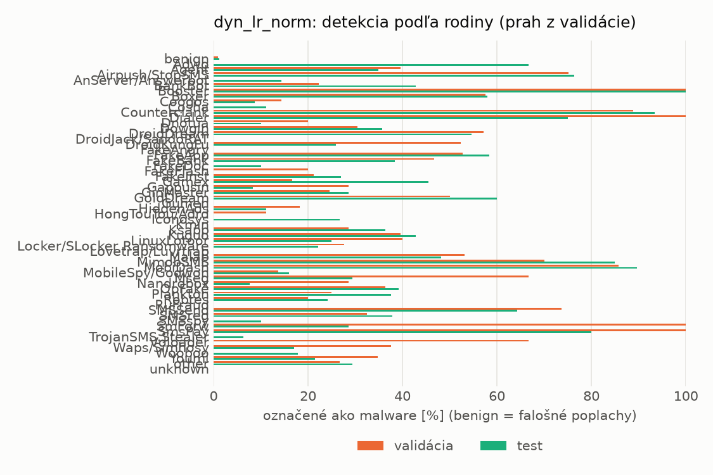
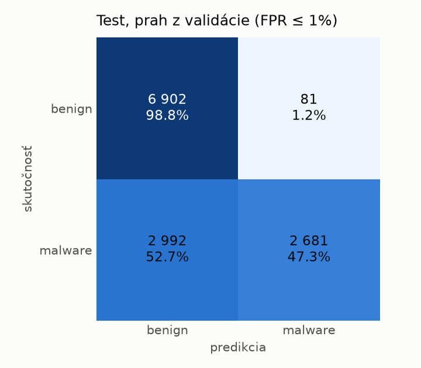
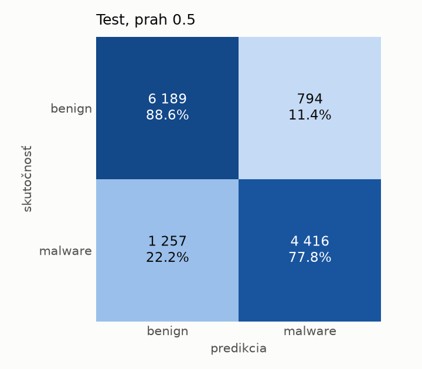

# dynamic_norm/dyn_lr_norm – beh `20261123-001226`

> Automaticky generované (`src/training/run_tabular.py`). Konfigurácia: `config.yaml`, protokol: `protocol.yaml`.

- **Model:** `logreg` – dynamic lr s dynamikou ako podiely systémových volaní (kontrola artefaktu množstva aktivity)
- **Ladenie:** bez ladenia – hyperparametre prevzaté z `runs_v4/real_p/full/dynamic/lr/20261122-233312`
- **Finálne modely:** seedy [0, 1, 2]; hodnoty sú priemer ± smerodajná odchýlka cez seedy
- **Najlepšie hyperparametre:** `{"max_iter": 2000, "C": 9.535095002298556}`

## Detekčná kvalita (bez prahu)
| metrika | train (podvzorka) | validácia | test |
|---|---|---|---|
| ROC-AUC | 0.8987 ± 0.0000 | 0.8929 ± 0.0000 | 0.8991 ± 0.0000 |
| PR-AUC | 0.8994 ± 0.0000 | 0.8967 ± 0.0000 | 0.9014 ± 0.0000 |
| TPR pri FPR 1 % | 0.4881 ± 0.0000 | 0.4582 ± 0.0000 | 0.4571 ± 0.0000 |
| TPR pri FPR 0,1 % | 0.3836 ± 0.0000 | 0.3358 ± 0.0000 | 0.3684 ± 0.0000 |
| log loss | 0.3892 ± 0.0000 | 0.3997 ± 0.0000 | 0.3936 ± 0.0000 |
| Brier skóre | 0.1229 ± 0.0000 | 0.1266 ± 0.0000 | 0.1237 ± 0.0000 |

Rozdiel ROC-AUC train − validácia: **0.0058** (veľký rozdiel = preučenie).

## Pri prahu z validácie (FPR ≤ 1% na validácii)
| metrika | train (podvzorka) | validácia | test |
|---|---|---|---|
| accuracy | 0.7740 ± 0.0000 | 0.7517 ± 0.0000 | 0.7572 ± 0.0000 |
| balanced accuracy | 0.7424 ± 0.0000 | 0.7242 ± 0.0000 | 0.7305 ± 0.0000 |
| precision | 0.9687 ± 0.0000 | 0.9745 ± 0.0000 | 0.9707 ± 0.0000 |
| recall (TPR) | 0.4972 ± 0.0000 | 0.4582 ± 0.0000 | 0.4726 ± 0.0000 |
| FPR | 0.0124 ± 0.0000 | 0.0097 ± 0.0000 | 0.0116 ± 0.0000 |
| F1 | 0.6572 ± 0.0000 | 0.6233 ± 0.0000 | 0.6357 ± 0.0000 |
| MCC | 0.5770 ± 0.0000 | 0.5468 ± 0.0000 | 0.5550 ± 0.0000 |

## Pri pevnom prahu 0.5
| metrika | train (podvzorka) | validácia | test |
|---|---|---|---|
| accuracy | 0.8372 ± 0.0000 | 0.8302 ± 0.0000 | 0.8379 ± 0.0000 |
| balanced accuracy | 0.8310 ± 0.0000 | 0.8235 ± 0.0000 | 0.8324 ± 0.0000 |
| precision | 0.8332 ± 0.0000 | 0.8460 ± 0.0000 | 0.8476 ± 0.0000 |
| recall (TPR) | 0.7831 ± 0.0000 | 0.7594 ± 0.0000 | 0.7784 ± 0.0000 |
| FPR | 0.1210 ± 0.0000 | 0.1124 ± 0.0000 | 0.1137 ± 0.0000 |
| F1 | 0.8073 ± 0.0000 | 0.8004 ± 0.0000 | 0.8115 ± 0.0000 |
| MCC | 0.6676 ± 0.0000 | 0.6562 ± 0.0000 | 0.6717 ± 0.0000 |

## Výpočtové nároky (seed 0, testovacia množina)
| meranie | hodnota |
|---|---|
| tréning finálneho modelu | 0.5 s (priemer cez seedy) |
| ladenie spolu | 0 s |
| počet parametrov / uzlov | 123 |
| veľkosť modelu na disku | 0.01 MB |
| transformácia vstupu – latencia (1 vlákno) | 0.005 ms |
| transformácia vstupu – priepustnosť | 1 295 063 vzoriek/s |
| CPU latencia modelu (batch 1, 1 vlákno) | 0.004 ms (p95 0.004) |
| CPU priepustnosť (24 vlákien) | 4 296 724 vzoriek/s |

## Grafy
| | |
|---|---|
|  |  |
|  |  |
|  |  |
|  |  |

## Súbory
`metrics.json` (všetky metriky po seedoch vrátane rodín), `timing.json`, `hpo_trials.csv`,
`predictions/<časť>_seed<N>.parquet` (sha256, family, label, score), `model/seed_<N>/`, `log.txt`.
