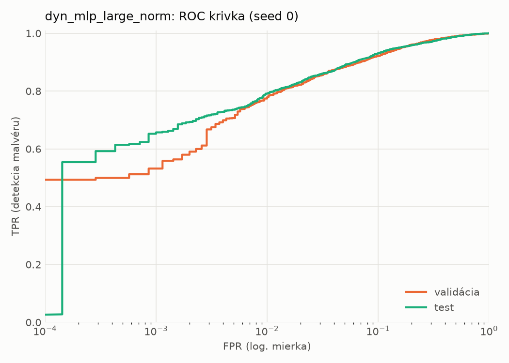
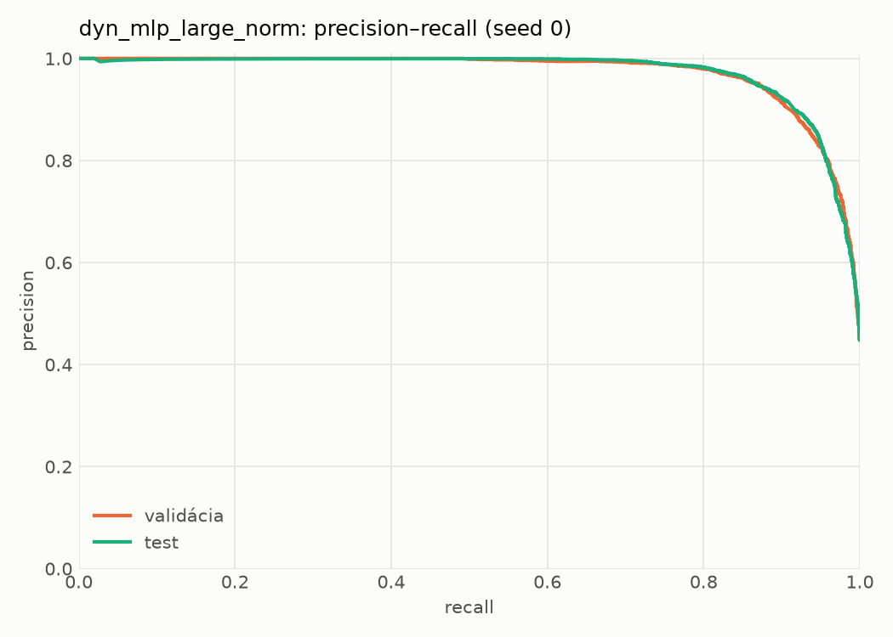
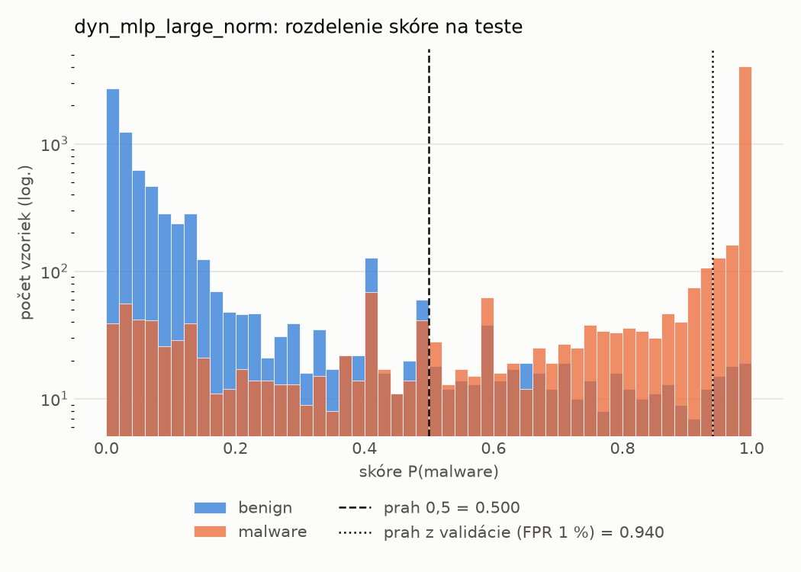
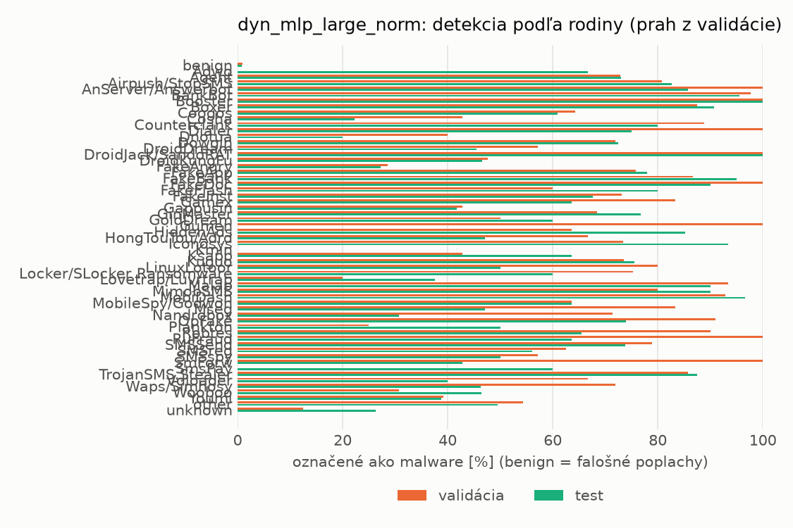
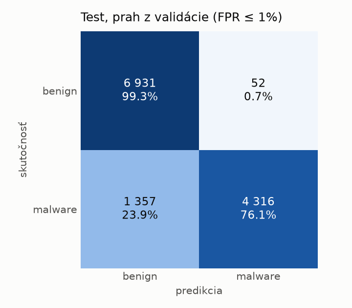
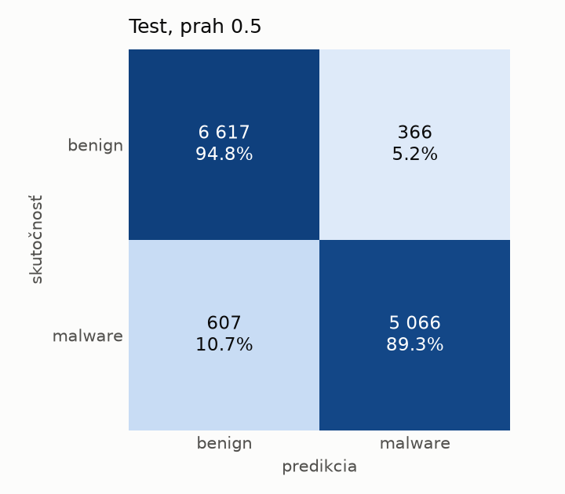
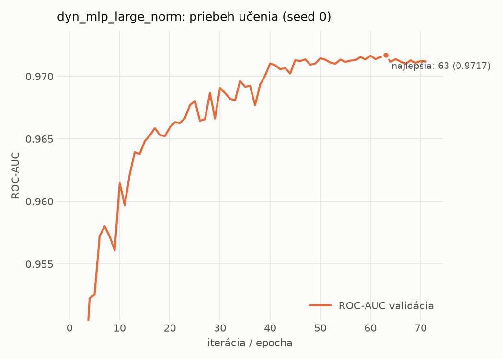

# dynamic_norm/dyn_mlp_large_norm – beh `20261123-001229`

> Automaticky generované (`src/training/run_tabular.py`). Konfigurácia: `config.yaml`, protokol: `protocol.yaml`.

- **Model:** `mlp` – dynamic mlp_large s dynamikou ako podiely systémových volaní (kontrola artefaktu množstva aktivity)
- **Ladenie:** bez ladenia – hyperparametre prevzaté z `runs_v4/real_p/full/dynamic/mlp_large/20261122-235153`
- **Finálne modely:** seedy [0, 1, 2]; hodnoty sú priemer ± smerodajná odchýlka cez seedy
- **Najlepšie hyperparametre:** `{"max_epochs": 100, "patience": 8, "hidden_layers": 5, "hidden_width": 512, "width_decay": 1.0, "dropout": 0.3998176791356432, "lr": 0.0024125104549951384, "weight_decay": 1.1960883604412328e-06, "batch_size": 1024}`

## Detekčná kvalita (bez prahu)
| metrika | train (podvzorka) | validácia | test |
|---|---|---|---|
| ROC-AUC | 0.9815 ± 0.0031 | 0.9707 ± 0.0009 | 0.9720 ± 0.0008 |
| PR-AUC | 0.9814 ± 0.0029 | 0.9710 ± 0.0011 | 0.9723 ± 0.0011 |
| TPR pri FPR 1 % | 0.8509 ± 0.0119 | 0.7708 ± 0.0030 | 0.7790 ± 0.0109 |
| TPR pri FPR 0,1 % | 0.7623 ± 0.0186 | 0.5009 ± 0.0334 | 0.6352 ± 0.0164 |
| log loss | 0.1598 ± 0.0159 | 0.2143 ± 0.0034 | 0.2042 ± 0.0054 |
| Brier skóre | 0.0467 ± 0.0050 | 0.0619 ± 0.0018 | 0.0591 ± 0.0019 |

Rozdiel ROC-AUC train − validácia: **0.0109** (veľký rozdiel = preučenie).

## Pri prahu z validácie (FPR ≤ 1% na validácii)
| metrika | train (podvzorka) | validácia | test |
|---|---|---|---|
| accuracy | 0.9078 ± 0.0011 | 0.8919 ± 0.0014 | 0.8882 ± 0.0012 |
| balanced accuracy | 0.8947 ± 0.0012 | 0.8806 ± 0.0016 | 0.8762 ± 0.0014 |
| precision | 0.9946 ± 0.0030 | 0.9848 ± 0.0003 | 0.9873 ± 0.0013 |
| recall (TPR) | 0.7926 ± 0.0025 | 0.7708 ± 0.0030 | 0.7603 ± 0.0034 |
| FPR | 0.0033 ± 0.0019 | 0.0096 ± 0.0002 | 0.0079 ± 0.0008 |
| F1 | 0.8822 ± 0.0015 | 0.8648 ± 0.0020 | 0.8591 ± 0.0018 |
| MCC | 0.8221 ± 0.0024 | 0.7932 ± 0.0026 | 0.7870 ± 0.0019 |

## Pri pevnom prahu 0.5
| metrika | train (podvzorka) | validácia | test |
|---|---|---|---|
| accuracy | 0.9375 ± 0.0078 | 0.9158 ± 0.0046 | 0.9217 ± 0.0033 |
| balanced accuracy | 0.9346 ± 0.0071 | 0.9129 ± 0.0039 | 0.9188 ± 0.0026 |
| precision | 0.9426 ± 0.0173 | 0.9245 ± 0.0149 | 0.9319 ± 0.0121 |
| recall (TPR) | 0.9123 ± 0.0067 | 0.8848 ± 0.0088 | 0.8907 ± 0.0062 |
| FPR | 0.0431 ± 0.0139 | 0.0589 ± 0.0131 | 0.0530 ± 0.0104 |
| F1 | 0.9271 ± 0.0085 | 0.9041 ± 0.0045 | 0.9107 ± 0.0031 |
| MCC | 0.8729 ± 0.0161 | 0.8299 ± 0.0096 | 0.8419 ± 0.0071 |

## Výpočtové nároky (seed 0, testovacia množina)
| meranie | hodnota |
|---|---|
| tréning finálneho modelu | 8.4 s (priemer cez seedy) |
| ladenie spolu | 0 s |
| počet parametrov / uzlov | 1 119 233 |
| veľkosť modelu na disku | 4.51 MB |
| transformácia vstupu – latencia (1 vlákno) | 0.014 ms |
| transformácia vstupu – priepustnosť | 842 240 vzoriek/s |
| CPU latencia modelu (batch 1, 1 vlákno) | 0.267 ms (p95 0.305) |
| CPU priepustnosť (24 vlákien) | 326 841 vzoriek/s |
| GPU latencia (batch 1) | 0.618 ms (p95 1.367) |
| GPU priepustnosť | 1 859 563 vzoriek/s |
| GPU špičková pamäť | 90 MB |

## Grafy
| | |
|---|---|
|  |  |
|  |  |
|  |  |
|  |  |

## Súbory
`metrics.json` (všetky metriky po seedoch vrátane rodín), `timing.json`, `hpo_trials.csv`,
`predictions/<časť>_seed<N>.parquet` (sha256, family, label, score), `model/seed_<N>/`, `log.txt`.
