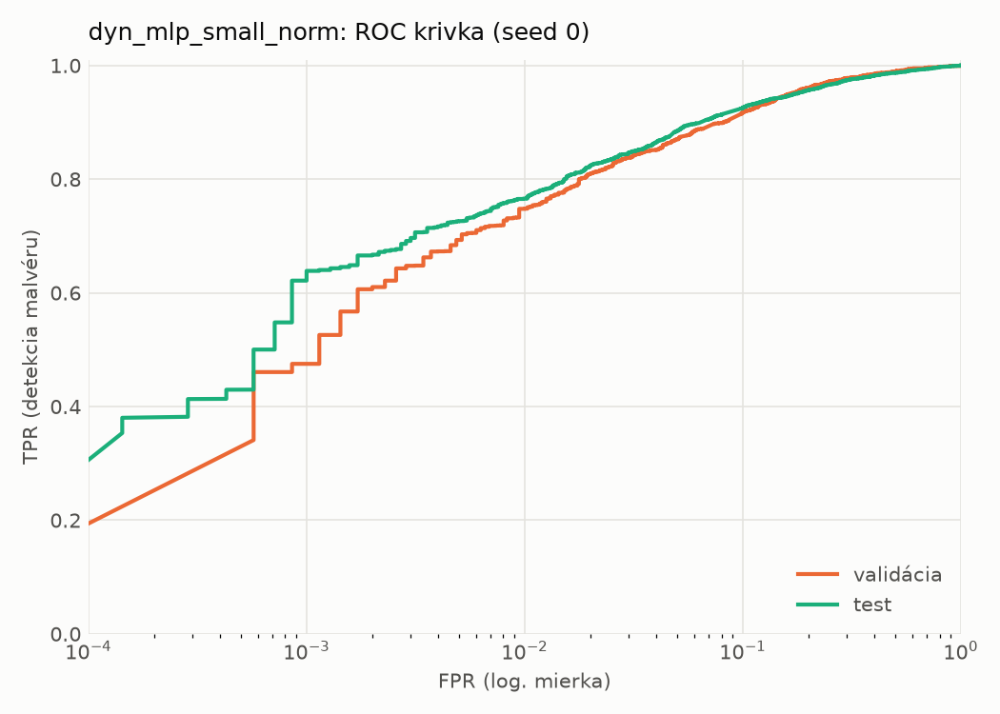
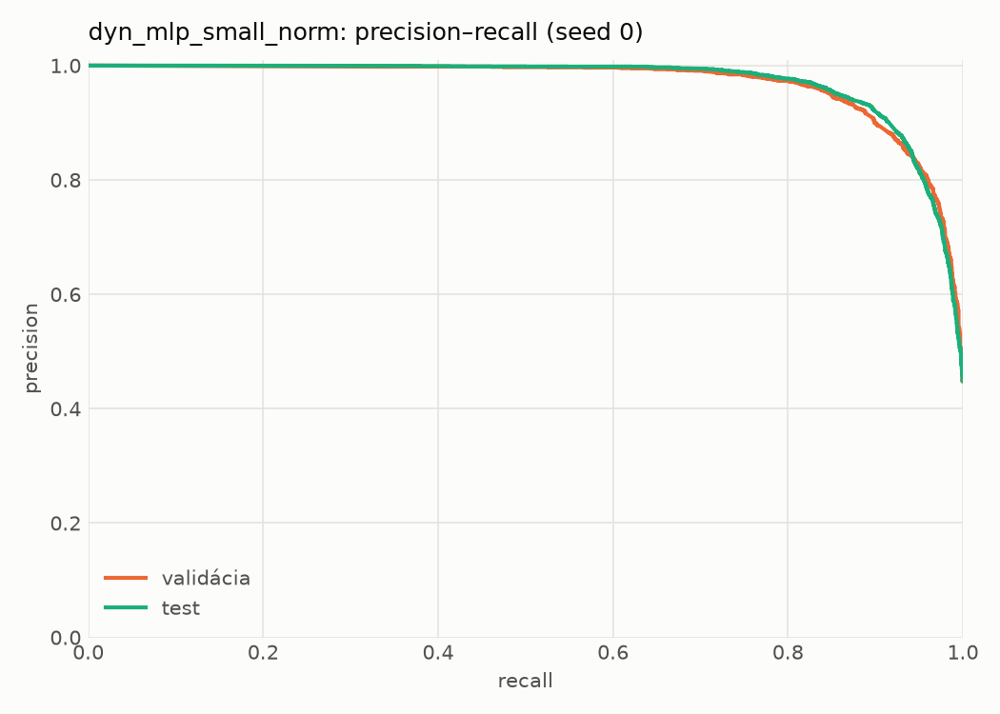
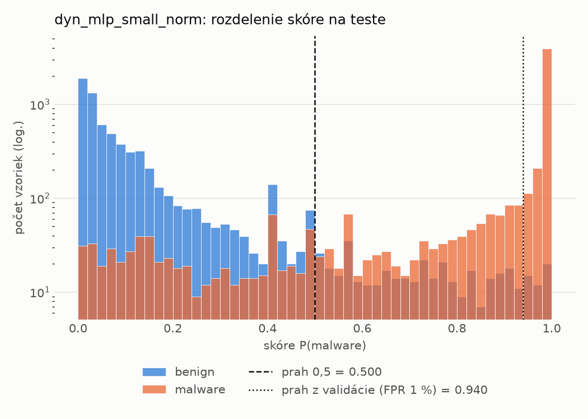
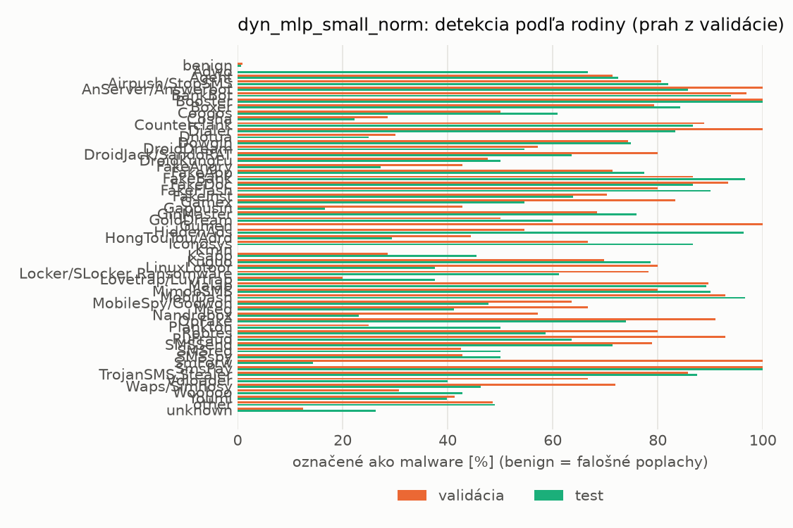
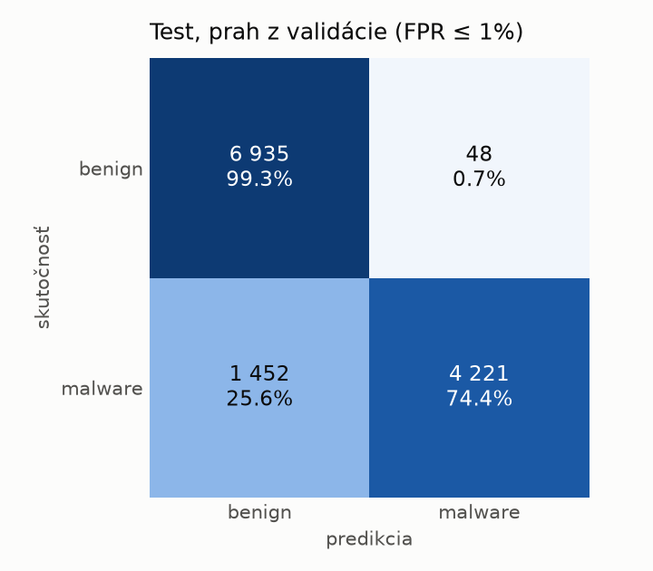
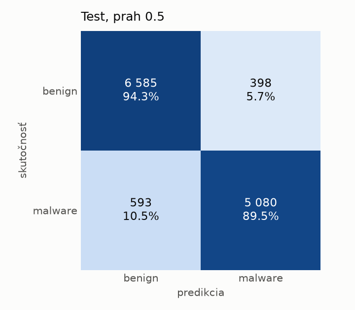
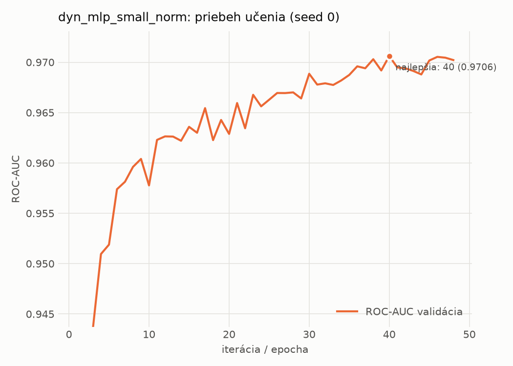

# dynamic_norm/dyn_mlp_small_norm – beh `20261123-001256`

> Automaticky generované (`src/training/run_tabular.py`). Konfigurácia: `config.yaml`, protokol: `protocol.yaml`.

- **Model:** `mlp` – dynamic mlp_small s dynamikou ako podiely systémových volaní (kontrola artefaktu množstva aktivity)
- **Ladenie:** bez ladenia – hyperparametre prevzaté z `runs_v4/real_p/full/dynamic/mlp_small/20261122-234317`
- **Finálne modely:** seedy [0, 1, 2]; hodnoty sú priemer ± smerodajná odchýlka cez seedy
- **Najlepšie hyperparametre:** `{"width_decay": 0.5, "max_epochs": 100, "patience": 8, "hidden_layers": 2, "hidden_width": 256, "dropout": 0.2449160262890371, "lr": 0.002872548733508973, "weight_decay": 4.509331245708397e-06, "batch_size": 256}`

## Detekčná kvalita (bez prahu)
| metrika | train (podvzorka) | validácia | test |
|---|---|---|---|
| ROC-AUC | 0.9791 ± 0.0017 | 0.9706 ± 0.0001 | 0.9710 ± 0.0010 |
| PR-AUC | 0.9792 ± 0.0016 | 0.9701 ± 0.0005 | 0.9717 ± 0.0009 |
| TPR pri FPR 1 % | 0.8391 ± 0.0084 | 0.7520 ± 0.0073 | 0.7677 ± 0.0018 |
| TPR pri FPR 0,1 % | 0.7197 ± 0.0110 | 0.4969 ± 0.0269 | 0.5950 ± 0.0260 |
| log loss | 0.1712 ± 0.0068 | 0.2187 ± 0.0042 | 0.2094 ± 0.0028 |
| Brier skóre | 0.0499 ± 0.0022 | 0.0627 ± 0.0007 | 0.0600 ± 0.0011 |

Rozdiel ROC-AUC train − validácia: **0.0086** (veľký rozdiel = preučenie).

## Pri prahu z validácie (FPR ≤ 1% na validácii)
| metrika | train (podvzorka) | validácia | test |
|---|---|---|---|
| accuracy | 0.9023 ± 0.0028 | 0.8835 ± 0.0032 | 0.8821 ± 0.0029 |
| balanced accuracy | 0.8883 ± 0.0032 | 0.8712 ± 0.0036 | 0.8693 ± 0.0033 |
| precision | 0.9950 ± 0.0009 | 0.9845 ± 0.0002 | 0.9879 ± 0.0007 |
| recall (TPR) | 0.7795 ± 0.0062 | 0.7520 ± 0.0073 | 0.7460 ± 0.0069 |
| FPR | 0.0030 ± 0.0005 | 0.0096 ± 0.0002 | 0.0074 ± 0.0005 |
| F1 | 0.8742 ± 0.0040 | 0.8527 ± 0.0047 | 0.8501 ± 0.0043 |
| MCC | 0.8121 ± 0.0052 | 0.7780 ± 0.0058 | 0.7763 ± 0.0051 |

## Pri pevnom prahu 0.5
| metrika | train (podvzorka) | validácia | test |
|---|---|---|---|
| accuracy | 0.9335 ± 0.0030 | 0.9153 ± 0.0009 | 0.9215 ± 0.0013 |
| balanced accuracy | 0.9303 ± 0.0033 | 0.9122 ± 0.0013 | 0.9186 ± 0.0015 |
| precision | 0.9397 ± 0.0041 | 0.9261 ± 0.0047 | 0.9317 ± 0.0037 |
| recall (TPR) | 0.9055 ± 0.0066 | 0.8816 ± 0.0065 | 0.8903 ± 0.0053 |
| FPR | 0.0449 ± 0.0033 | 0.0572 ± 0.0043 | 0.0531 ± 0.0034 |
| F1 | 0.9223 ± 0.0037 | 0.9033 ± 0.0014 | 0.9105 ± 0.0017 |
| MCC | 0.8647 ± 0.0061 | 0.8289 ± 0.0016 | 0.8414 ± 0.0025 |

## Výpočtové nároky (seed 0, testovacia množina)
| meranie | hodnota |
|---|---|
| tréning finálneho modelu | 14.6 s (priemer cez seedy) |
| ladenie spolu | 0 s |
| počet parametrov / uzlov | 65 281 |
| veľkosť modelu na disku | 0.27 MB |
| transformácia vstupu – latencia (1 vlákno) | 0.014 ms |
| transformácia vstupu – priepustnosť | 822 619 vzoriek/s |
| CPU latencia modelu (batch 1, 1 vlákno) | 0.103 ms (p95 0.239) |
| CPU priepustnosť (24 vlákien) | 2 337 168 vzoriek/s |
| GPU latencia (batch 1) | 0.660 ms (p95 0.704) |
| GPU priepustnosť | 2 951 080 vzoriek/s |
| GPU špičková pamäť | 90 MB |

## Grafy
| | |
|---|---|
|  |  |
|  |  |
|  |  |
|  |  |

## Súbory
`metrics.json` (všetky metriky po seedoch vrátane rodín), `timing.json`, `hpo_trials.csv`,
`predictions/<časť>_seed<N>.parquet` (sha256, family, label, score), `model/seed_<N>/`, `log.txt`.
