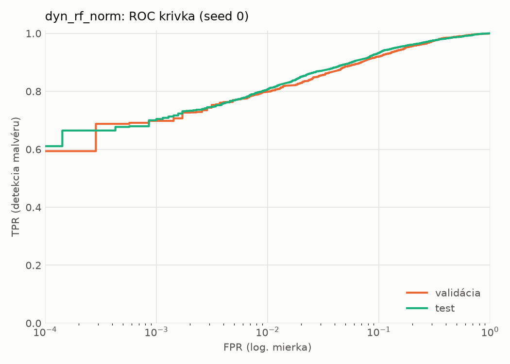
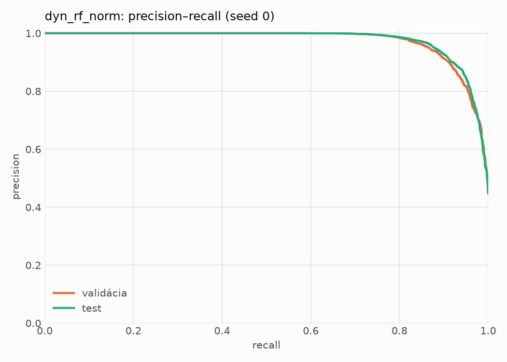
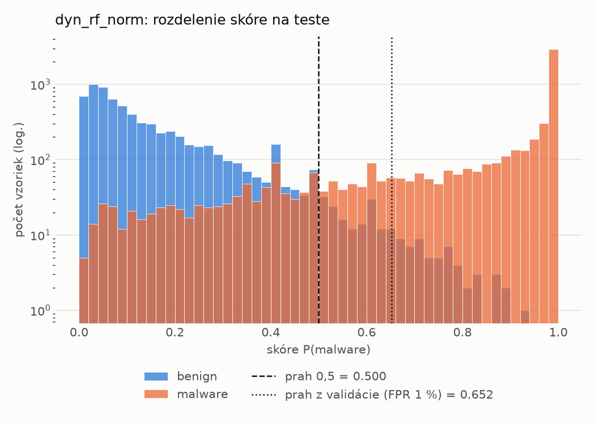
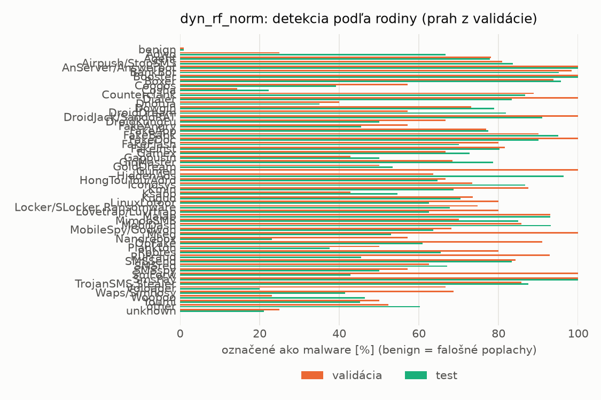
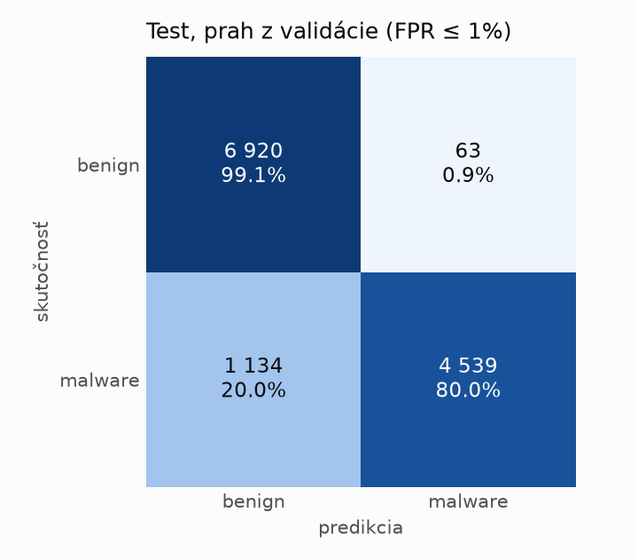
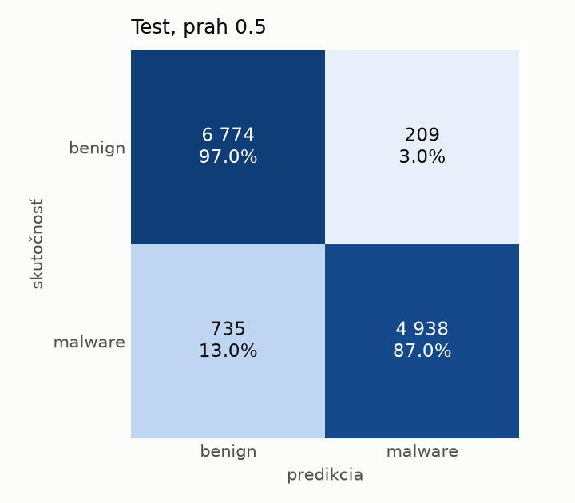

# dynamic_norm/dyn_rf_norm – beh `20261123-001342`

> Automaticky generované (`src/training/run_tabular.py`). Konfigurácia: `config.yaml`, protokol: `protocol.yaml`.

- **Model:** `random_forest` – dynamic rf s dynamikou ako podiely systémových volaní (kontrola artefaktu množstva aktivity)
- **Ladenie:** bez ladenia – hyperparametre prevzaté z `runs_v4/real_p/full/dynamic/rf/20261122-233325`
- **Finálne modely:** seedy [0, 1, 2]; hodnoty sú priemer ± smerodajná odchýlka cez seedy
- **Najlepšie hyperparametre:** `{"n_estimators": 500, "max_depth": 24, "min_samples_leaf": 1, "max_features": "sqrt"}`

## Detekčná kvalita (bez prahu)
| metrika | train (podvzorka) | validácia | test |
|---|---|---|---|
| ROC-AUC | 0.9989 ± 0.0000 | 0.9715 ± 0.0001 | 0.9738 ± 0.0001 |
| PR-AUC | 0.9987 ± 0.0000 | 0.9728 ± 0.0001 | 0.9754 ± 0.0001 |
| TPR pri FPR 1 % | 0.9821 ± 0.0008 | 0.7989 ± 0.0006 | 0.8086 ± 0.0034 |
| TPR pri FPR 0,1 % | 0.9510 ± 0.0006 | 0.6979 ± 0.0069 | 0.6980 ± 0.0145 |
| log loss | 0.0911 ± 0.0006 | 0.2171 ± 0.0003 | 0.2104 ± 0.0002 |
| Brier skóre | 0.0183 ± 0.0002 | 0.0631 ± 0.0001 | 0.0602 ± 0.0001 |

Rozdiel ROC-AUC train − validácia: **0.0274** (veľký rozdiel = preučenie).

## Pri prahu z validácie (FPR ≤ 1% na validácii)
| metrika | train (podvzorka) | validácia | test |
|---|---|---|---|
| accuracy | 0.9745 ± 0.0006 | 0.9045 ± 0.0003 | 0.9062 ± 0.0007 |
| balanced accuracy | 0.9707 ± 0.0007 | 0.8946 ± 0.0004 | 0.8964 ± 0.0008 |
| precision | 1.0000 ± 0.0000 | 0.9854 ± 0.0003 | 0.9865 ± 0.0001 |
| recall (TPR) | 0.9414 ± 0.0015 | 0.7989 ± 0.0006 | 0.8018 ± 0.0015 |
| FPR | 0.0000 ± 0.0000 | 0.0096 ± 0.0002 | 0.0089 ± 0.0001 |
| F1 | 0.9698 ± 0.0008 | 0.8824 ± 0.0004 | 0.8846 ± 0.0010 |
| MCC | 0.9490 ± 0.0013 | 0.8161 ± 0.0006 | 0.8194 ± 0.0013 |

## Pri pevnom prahu 0.5
| metrika | train (podvzorka) | validácia | test |
|---|---|---|---|
| accuracy | 0.9836 ± 0.0004 | 0.9190 ± 0.0009 | 0.9256 ± 0.0003 |
| balanced accuracy | 0.9817 ± 0.0005 | 0.9138 ± 0.0011 | 0.9205 ± 0.0003 |
| precision | 0.9955 ± 0.0000 | 0.9516 ± 0.0006 | 0.9598 ± 0.0004 |
| recall (TPR) | 0.9667 ± 0.0010 | 0.8631 ± 0.0028 | 0.8706 ± 0.0003 |
| FPR | 0.0034 ± 0.0000 | 0.0356 ± 0.0006 | 0.0296 ± 0.0003 |
| F1 | 0.9809 ± 0.0005 | 0.9052 ± 0.0013 | 0.9130 ± 0.0003 |
| MCC | 0.9669 ± 0.0009 | 0.8378 ± 0.0017 | 0.8514 ± 0.0006 |

## Výpočtové nároky (seed 0, testovacia množina)
| meranie | hodnota |
|---|---|
| tréning finálneho modelu | 3.5 s (priemer cez seedy) |
| ladenie spolu | 0 s |
| počet parametrov / uzlov | 3 037 072 |
| veľkosť modelu na disku | 243.34 MB |
| CPU latencia modelu (batch 1, 1 vlákno) | 15.698 ms (p95 16.167) |
| CPU priepustnosť (24 vlákien) | 121 750 vzoriek/s |

## Grafy
| | |
|---|---|
|  |  |
|  |  |
|  |  |
|  |  |

## Súbory
`metrics.json` (všetky metriky po seedoch vrátane rodín), `timing.json`, `hpo_trials.csv`,
`predictions/<časť>_seed<N>.parquet` (sha256, family, label, score), `model/seed_<N>/`, `log.txt`.
