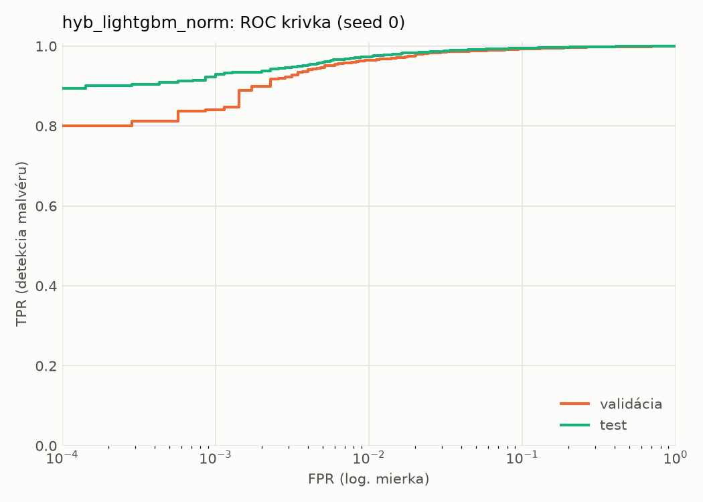
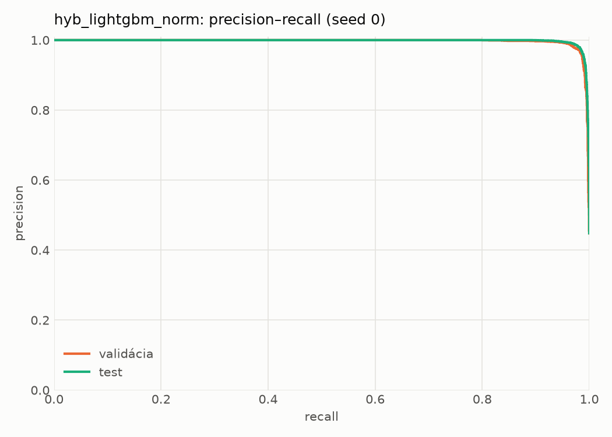
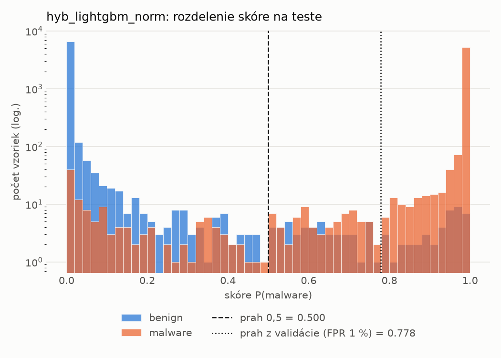
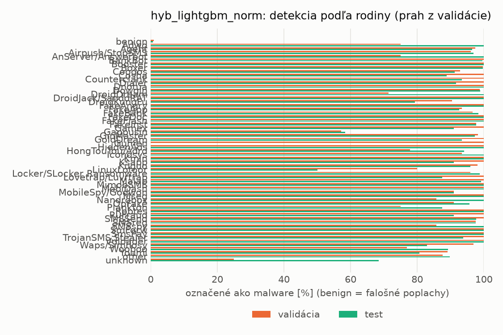
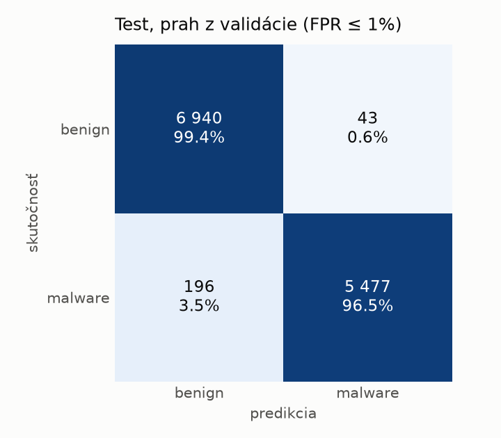
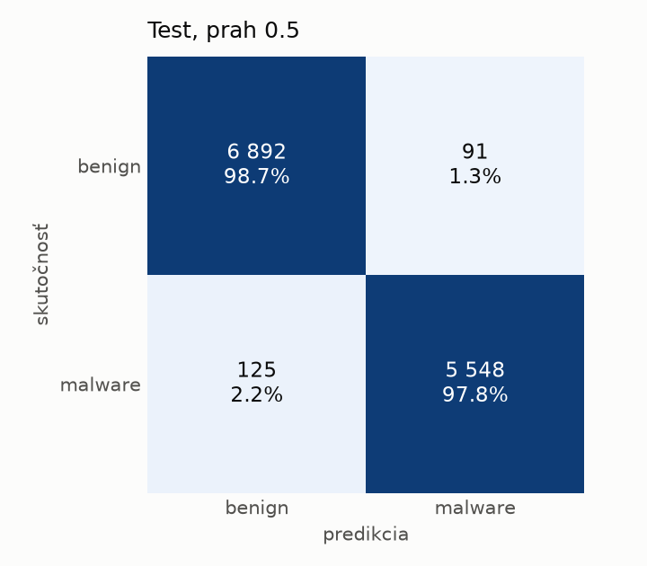
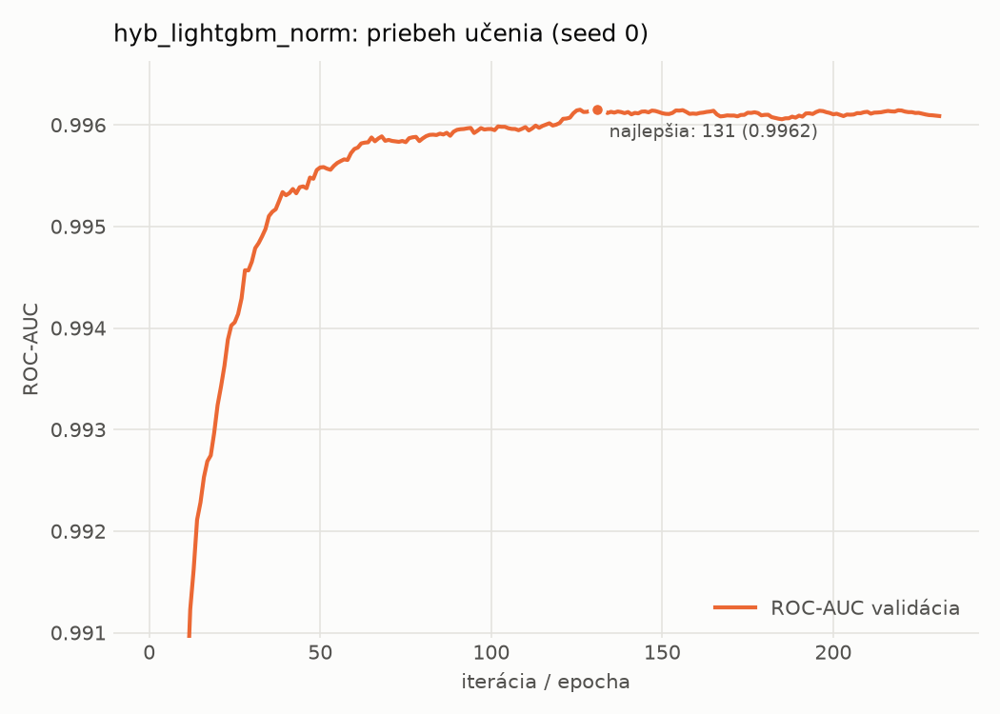

# hybrid_norm/hyb_lightgbm_norm – beh `20261123-001403`

> Automaticky generované (`src/training/run_tabular.py`). Konfigurácia: `config.yaml`, protokol: `protocol.yaml`.

- **Model:** `lightgbm` – hybrid lightgbm s dynamikou ako podiely systémových volaní (kontrola artefaktu množstva aktivity)
- **Ladenie:** bez ladenia – hyperparametre prevzaté z `runs_v4/real_p/full/hybrid/lightgbm/20261122-235912`
- **Finálne modely:** seedy [0, 1, 2]; hodnoty sú priemer ± smerodajná odchýlka cez seedy
- **Najlepšie hyperparametre:** `{"num_boost_round": 5000, "early_stopping_rounds": 100, "learning_rate": 0.156156388281821, "num_leaves": 106, "min_child_samples": 12, "feature_fraction": 0.9629001596575603, "bagging_fraction": 0.9482638746669452, "lambda_l1": 1.6337309047659264e-08, "lambda_l2": 0.01636800654484922}`

## Detekčná kvalita (bez prahu)
| metrika | train (podvzorka) | validácia | test |
|---|---|---|---|
| ROC-AUC | 1.0000 ± 0.0000 | 0.9963 ± 0.0001 | 0.9978 ± 0.0001 |
| PR-AUC | 1.0000 ± 0.0000 | 0.9966 ± 0.0001 | 0.9978 ± 0.0001 |
| TPR pri FPR 1 % | 1.0000 ± 0.0000 | 0.9660 ± 0.0017 | 0.9740 ± 0.0010 |
| TPR pri FPR 0,1 % | 1.0000 ± 0.0000 | 0.8663 ± 0.0235 | 0.9217 ± 0.0008 |
| log loss | 0.0007 ± 0.0007 | 0.0781 ± 0.0043 | 0.0583 ± 0.0026 |
| Brier skóre | 0.0000 ± 0.0000 | 0.0169 ± 0.0003 | 0.0135 ± 0.0002 |

Rozdiel ROC-AUC train − validácia: **0.0037** (veľký rozdiel = preučenie).

## Pri prahu z validácie (FPR ≤ 1% na validácii)
| metrika | train (podvzorka) | validácia | test |
|---|---|---|---|
| accuracy | 1.0000 ± 0.0000 | 0.9795 ± 0.0007 | 0.9817 ± 0.0009 |
| balanced accuracy | 1.0000 ± 0.0000 | 0.9782 ± 0.0008 | 0.9803 ± 0.0011 |
| precision | 1.0000 ± 0.0000 | 0.9880 ± 0.0002 | 0.9922 ± 0.0003 |
| recall (TPR) | 1.0000 ± 0.0000 | 0.9660 ± 0.0017 | 0.9668 ± 0.0023 |
| FPR | 0.0000 ± 0.0000 | 0.0096 ± 0.0002 | 0.0062 ± 0.0002 |
| F1 | 1.0000 ± 0.0000 | 0.9769 ± 0.0009 | 0.9793 ± 0.0011 |
| MCC | 1.0000 ± 0.0000 | 0.9587 ± 0.0015 | 0.9632 ± 0.0019 |

## Pri pevnom prahu 0.5
| metrika | train (podvzorka) | validácia | test |
|---|---|---|---|
| accuracy | 1.0000 ± 0.0000 | 0.9786 ± 0.0009 | 0.9831 ± 0.0002 |
| balanced accuracy | 1.0000 ± 0.0000 | 0.9781 ± 0.0008 | 0.9826 ± 0.0002 |
| precision | 1.0000 ± 0.0000 | 0.9785 ± 0.0017 | 0.9852 ± 0.0012 |
| recall (TPR) | 1.0000 ± 0.0000 | 0.9737 ± 0.0004 | 0.9771 ± 0.0008 |
| FPR | 0.0000 ± 0.0000 | 0.0174 ± 0.0014 | 0.0119 ± 0.0010 |
| F1 | 1.0000 ± 0.0000 | 0.9761 ± 0.0010 | 0.9811 ± 0.0003 |
| MCC | 1.0000 ± 0.0000 | 0.9567 ± 0.0018 | 0.9659 ± 0.0005 |

## Výpočtové nároky (seed 0, testovacia množina)
| meranie | hodnota |
|---|---|
| tréning finálneho modelu | 4.9 s (priemer cez seedy) |
| ladenie spolu | 0 s |
| počet parametrov / uzlov | 27 641 |
| veľkosť modelu na disku | 1.55 MB |
| CPU latencia modelu (batch 1, 1 vlákno) | 0.035 ms (p95 0.058) |
| CPU priepustnosť (24 vlákien) | 591 819 vzoriek/s |

## Grafy
| | |
|---|---|
|  |  |
|  |  |
|  |  |
|  |  |

## Súbory
`metrics.json` (všetky metriky po seedoch vrátane rodín), `timing.json`, `hpo_trials.csv`,
`predictions/<časť>_seed<N>.parquet` (sha256, family, label, score), `model/seed_<N>/`, `log.txt`.
