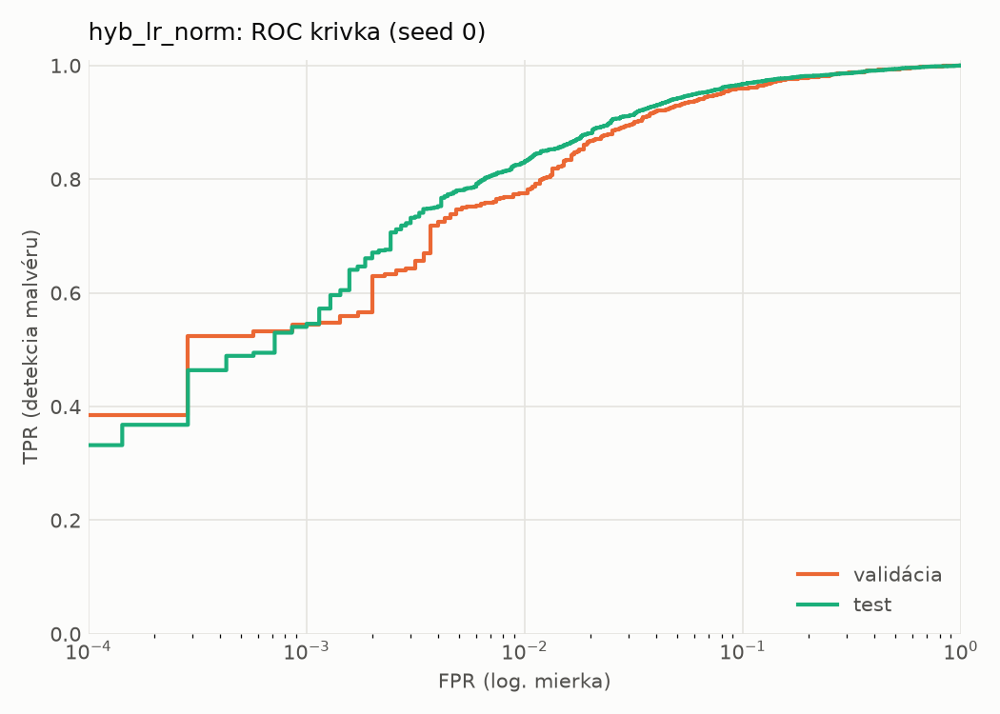
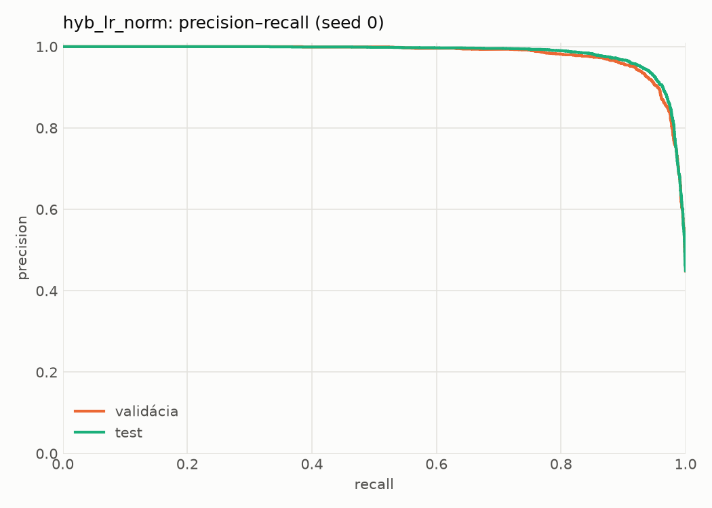
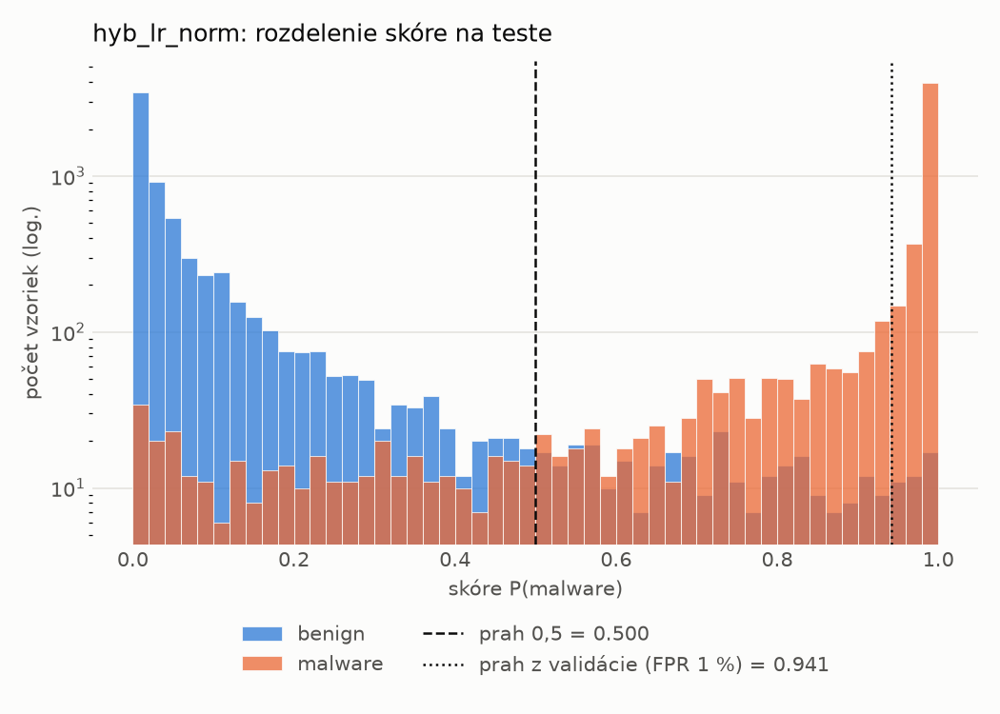
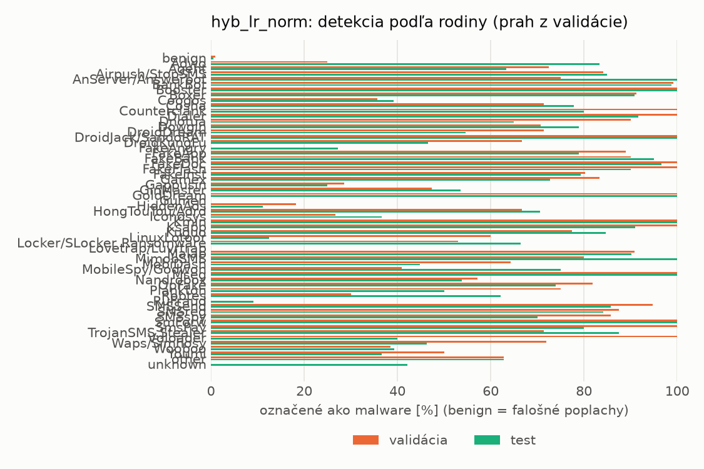
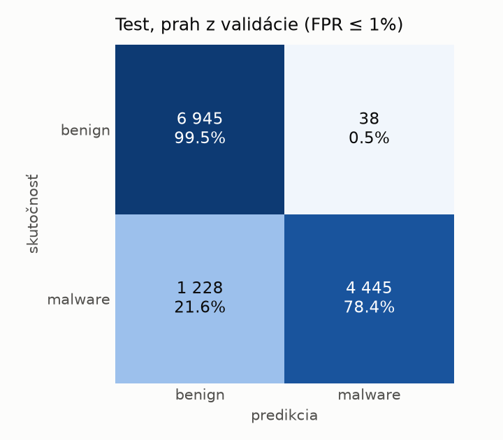
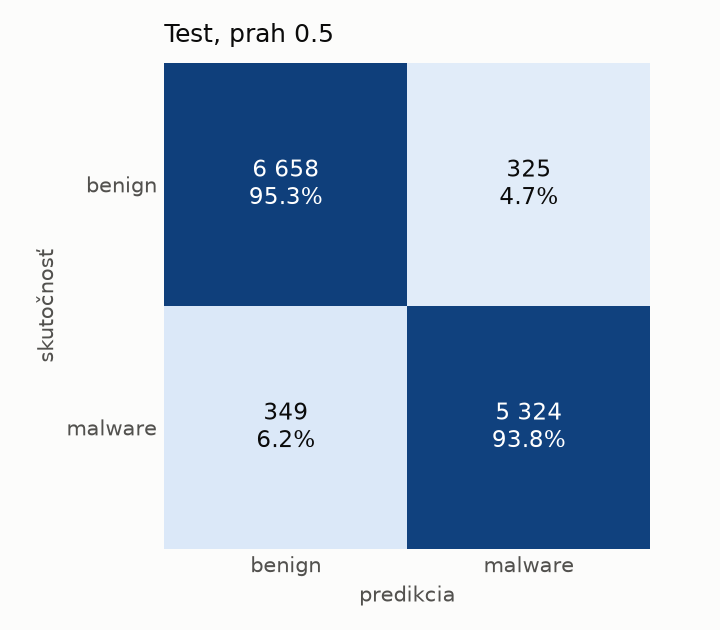

# hybrid_norm/hyb_lr_norm – beh `20261123-001420`

> Automaticky generované (`src/training/run_tabular.py`). Konfigurácia: `config.yaml`, protokol: `protocol.yaml`.

- **Model:** `logreg` – hybrid lr s dynamikou ako podiely systémových volaní (kontrola artefaktu množstva aktivity)
- **Ladenie:** bez ladenia – hyperparametre prevzaté z `runs_v4/real_p/full/hybrid/lr/20261122-235738`
- **Finálne modely:** seedy [0, 1, 2]; hodnoty sú priemer ± smerodajná odchýlka cez seedy
- **Najlepšie hyperparametre:** `{"max_iter": 2000, "C": 0.07124252843547843}`

## Detekčná kvalita (bez prahu)
| metrika | train (podvzorka) | validácia | test |
|---|---|---|---|
| ROC-AUC | 0.9846 ± 0.0000 | 0.9820 ± 0.0000 | 0.9843 ± 0.0000 |
| PR-AUC | 0.9845 ± 0.0000 | 0.9815 ± 0.0000 | 0.9842 ± 0.0000 |
| TPR pri FPR 1 % | 0.8354 ± 0.0000 | 0.7760 ± 0.0000 | 0.8294 ± 0.0000 |
| TPR pri FPR 0,1 % | 0.6446 ± 0.0000 | 0.5439 ± 0.0000 | 0.5401 ± 0.0000 |
| log loss | 0.1447 ± 0.0000 | 0.1640 ± 0.0000 | 0.1515 ± 0.0000 |
| Brier skóre | 0.0395 ± 0.0000 | 0.0459 ± 0.0000 | 0.0416 ± 0.0000 |

Rozdiel ROC-AUC train − validácia: **0.0025** (veľký rozdiel = preučenie).

## Pri prahu z validácie (FPR ≤ 1% na validácii)
| metrika | train (podvzorka) | validácia | test |
|---|---|---|---|
| accuracy | 0.9046 ± 0.0000 | 0.8944 ± 0.0000 | 0.9000 ± 0.0000 |
| balanced accuracy | 0.8910 ± 0.0000 | 0.8833 ± 0.0000 | 0.8890 ± 0.0000 |
| precision | 0.9939 ± 0.0000 | 0.9852 ± 0.0000 | 0.9915 ± 0.0000 |
| recall (TPR) | 0.7858 ± 0.0000 | 0.7760 ± 0.0000 | 0.7835 ± 0.0000 |
| FPR | 0.0037 ± 0.0000 | 0.0095 ± 0.0000 | 0.0054 ± 0.0000 |
| F1 | 0.8777 ± 0.0000 | 0.8682 ± 0.0000 | 0.8753 ± 0.0000 |
| MCC | 0.8161 ± 0.0000 | 0.7976 ± 0.0000 | 0.8091 ± 0.0000 |

## Pri pevnom prahu 0.5
| metrika | train (podvzorka) | validácia | test |
|---|---|---|---|
| accuracy | 0.9512 ± 0.0000 | 0.9407 ± 0.0000 | 0.9467 ± 0.0000 |
| balanced accuracy | 0.9495 ± 0.0000 | 0.9392 ± 0.0000 | 0.9460 ± 0.0000 |
| precision | 0.9506 ± 0.0000 | 0.9421 ± 0.0000 | 0.9425 ± 0.0000 |
| recall (TPR) | 0.9366 ± 0.0000 | 0.9245 ± 0.0000 | 0.9385 ± 0.0000 |
| FPR | 0.0376 ± 0.0000 | 0.0461 ± 0.0000 | 0.0465 ± 0.0000 |
| F1 | 0.9436 ± 0.0000 | 0.9332 ± 0.0000 | 0.9405 ± 0.0000 |
| MCC | 0.9007 ± 0.0000 | 0.8800 ± 0.0000 | 0.8923 ± 0.0000 |

## Výpočtové nároky (seed 0, testovacia množina)
| meranie | hodnota |
|---|---|
| tréning finálneho modelu | 0.2 s (priemer cez seedy) |
| ladenie spolu | 0 s |
| počet parametrov / uzlov | 286 |
| veľkosť modelu na disku | 0.01 MB |
| transformácia vstupu – latencia (1 vlákno) | 0.007 ms |
| transformácia vstupu – priepustnosť | 493 375 vzoriek/s |
| CPU latencia modelu (batch 1, 1 vlákno) | 0.004 ms (p95 0.004) |
| CPU priepustnosť (24 vlákien) | 2 094 359 vzoriek/s |

## Grafy
| | |
|---|---|
|  |  |
|  |  |
|  |  |
|  |  |

## Súbory
`metrics.json` (všetky metriky po seedoch vrátane rodín), `timing.json`, `hpo_trials.csv`,
`predictions/<časť>_seed<N>.parquet` (sha256, family, label, score), `model/seed_<N>/`, `log.txt`.
