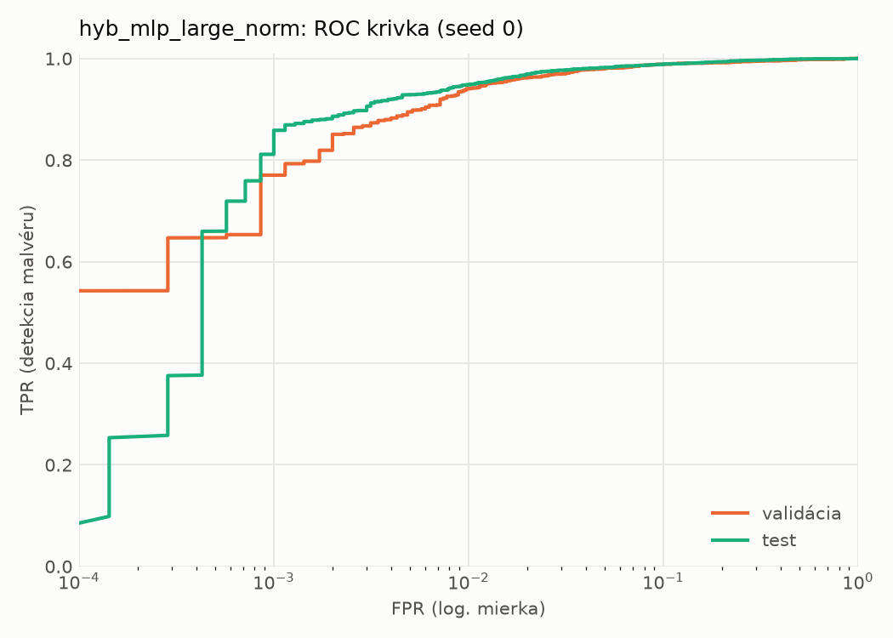
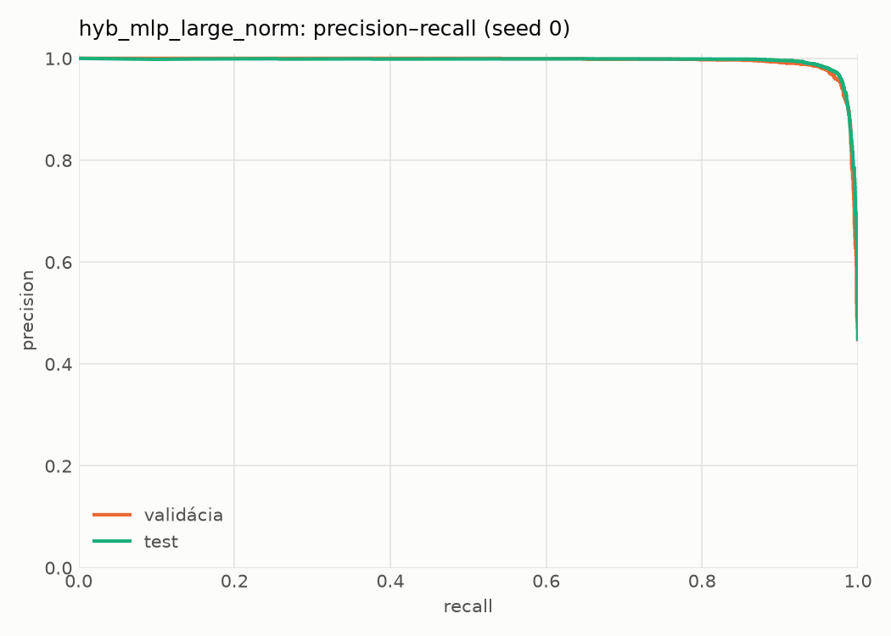
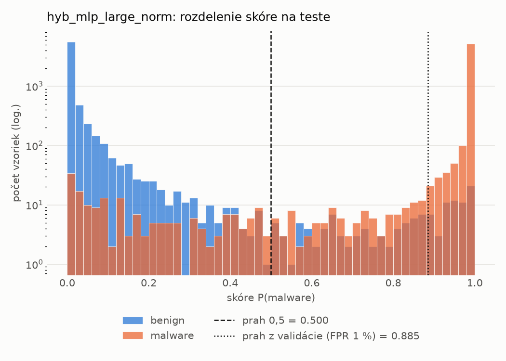
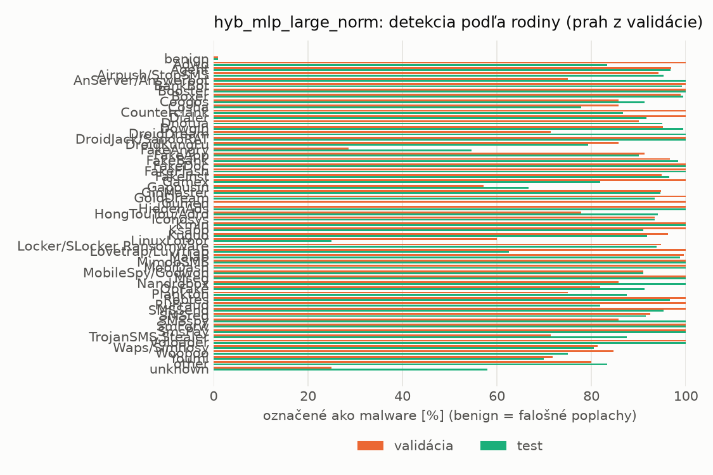
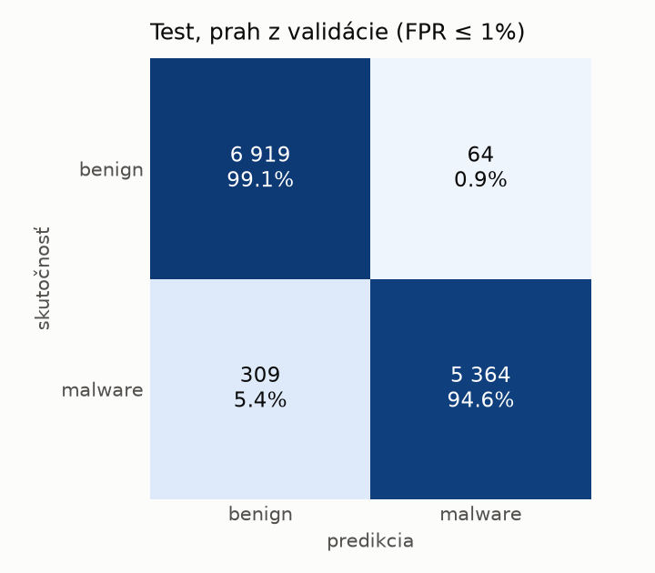
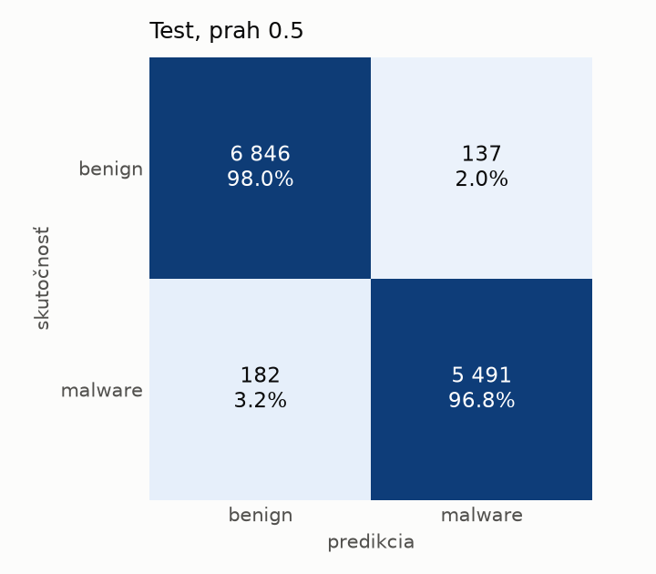
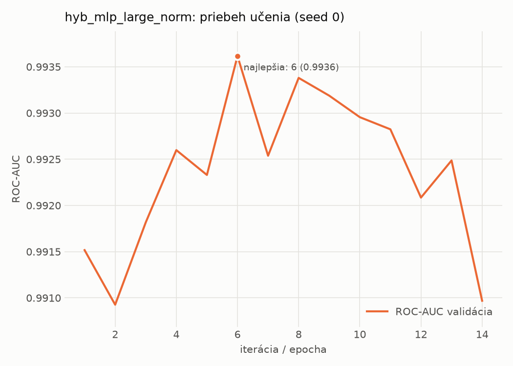

# hybrid_norm/hyb_mlp_large_norm – beh `20261123-001423`

> Automaticky generované (`src/training/run_tabular.py`). Konfigurácia: `config.yaml`, protokol: `protocol.yaml`.

- **Model:** `mlp` – hybrid mlp_large s dynamikou ako podiely systémových volaní (kontrola artefaktu množstva aktivity)
- **Ladenie:** bez ladenia – hyperparametre prevzaté z `runs_v4/real_p/full/hybrid/mlp_large/20261123-000809`
- **Finálne modely:** seedy [0, 1, 2]; hodnoty sú priemer ± smerodajná odchýlka cez seedy
- **Najlepšie hyperparametre:** `{"max_epochs": 100, "patience": 8, "hidden_layers": 3, "hidden_width": 1024, "width_decay": 1.0, "dropout": 0.11375540844608736, "lr": 0.0022038218939289885, "weight_decay": 1.0842262717330169e-05, "batch_size": 256}`

## Detekčná kvalita (bez prahu)
| metrika | train (podvzorka) | validácia | test |
|---|---|---|---|
| ROC-AUC | 0.9986 ± 0.0008 | 0.9932 ± 0.0004 | 0.9949 ± 0.0002 |
| PR-AUC | 0.9985 ± 0.0009 | 0.9936 ± 0.0002 | 0.9945 ± 0.0004 |
| TPR pri FPR 1 % | 0.9847 ± 0.0072 | 0.9373 ± 0.0027 | 0.9517 ± 0.0056 |
| TPR pri FPR 0,1 % | 0.9643 ± 0.0176 | 0.7276 ± 0.0870 | 0.8072 ± 0.0087 |
| log loss | 0.0363 ± 0.0135 | 0.1037 ± 0.0096 | 0.0870 ± 0.0059 |
| Brier skóre | 0.0095 ± 0.0036 | 0.0228 ± 0.0012 | 0.0202 ± 0.0020 |

Rozdiel ROC-AUC train − validácia: **0.0055** (veľký rozdiel = preučenie).

## Pri prahu z validácie (FPR ≤ 1% na validácii)
| metrika | train (podvzorka) | validácia | test |
|---|---|---|---|
| accuracy | 0.9804 ± 0.0010 | 0.9665 ± 0.0012 | 0.9691 ± 0.0013 |
| balanced accuracy | 0.9776 ± 0.0010 | 0.9638 ± 0.0014 | 0.9663 ± 0.0016 |
| precision | 0.9989 ± 0.0010 | 0.9874 ± 0.0000 | 0.9906 ± 0.0022 |
| recall (TPR) | 0.9561 ± 0.0014 | 0.9373 ± 0.0027 | 0.9399 ± 0.0050 |
| FPR | 0.0008 ± 0.0007 | 0.0097 ± 0.0000 | 0.0073 ± 0.0017 |
| F1 | 0.9770 ± 0.0011 | 0.9617 ± 0.0015 | 0.9646 ± 0.0016 |
| MCC | 0.9606 ± 0.0020 | 0.9330 ± 0.0024 | 0.9382 ± 0.0024 |

## Pri pevnom prahu 0.5
| metrika | train (podvzorka) | validácia | test |
|---|---|---|---|
| accuracy | 0.9882 ± 0.0048 | 0.9723 ± 0.0022 | 0.9752 ± 0.0031 |
| balanced accuracy | 0.9876 ± 0.0049 | 0.9719 ± 0.0022 | 0.9748 ± 0.0029 |
| precision | 0.9901 ± 0.0050 | 0.9706 ± 0.0022 | 0.9745 ± 0.0053 |
| recall (TPR) | 0.9828 ± 0.0065 | 0.9675 ± 0.0028 | 0.9702 ± 0.0025 |
| FPR | 0.0076 ± 0.0039 | 0.0238 ± 0.0017 | 0.0207 ± 0.0044 |
| F1 | 0.9864 ± 0.0055 | 0.9691 ± 0.0025 | 0.9723 ± 0.0034 |
| MCC | 0.9760 ± 0.0097 | 0.9440 ± 0.0044 | 0.9499 ± 0.0062 |

## Výpočtové nároky (seed 0, testovacia množina)
| meranie | hodnota |
|---|---|
| tréning finálneho modelu | 7.8 s (priemer cez seedy) |
| ladenie spolu | 0 s |
| počet parametrov / uzlov | 2 399 233 |
| veľkosť modelu na disku | 9.64 MB |
| transformácia vstupu – latencia (1 vlákno) | 0.017 ms |
| transformácia vstupu – priepustnosť | 292 792 vzoriek/s |
| CPU latencia modelu (batch 1, 1 vlákno) | 0.269 ms (p95 0.318) |
| CPU priepustnosť (24 vlákien) | 151 968 vzoriek/s |
| GPU latencia (batch 1) | 0.427 ms (p95 0.900) |
| GPU priepustnosť | 533 871 vzoriek/s |
| GPU špičková pamäť | 177 MB |

## Grafy
| | |
|---|---|
|  |  |
|  |  |
|  |  |
|  |  |

## Súbory
`metrics.json` (všetky metriky po seedoch vrátane rodín), `timing.json`, `hpo_trials.csv`,
`predictions/<časť>_seed<N>.parquet` (sha256, family, label, score), `model/seed_<N>/`, `log.txt`.
