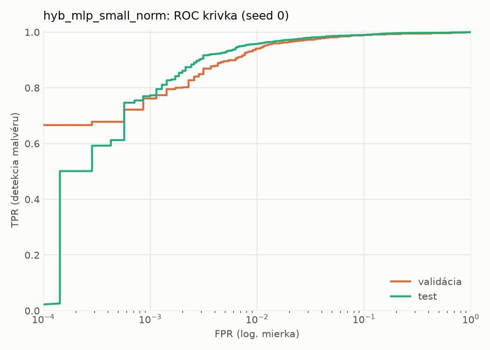
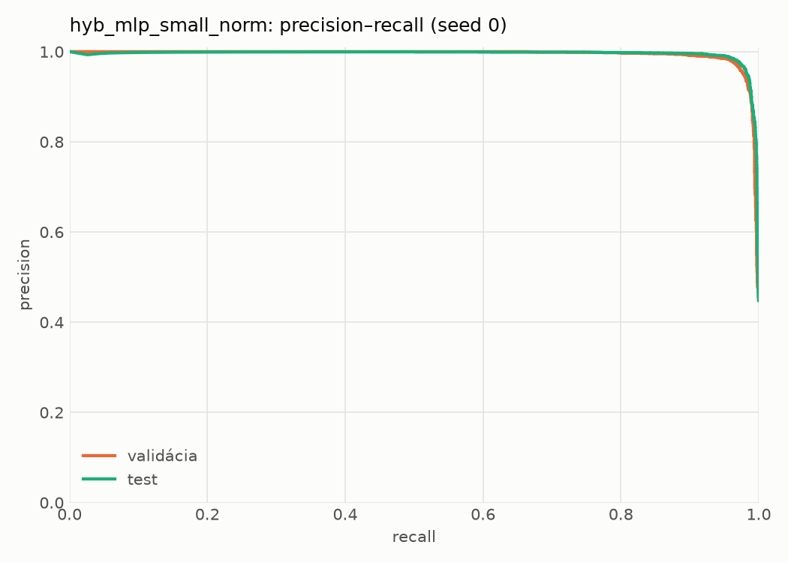
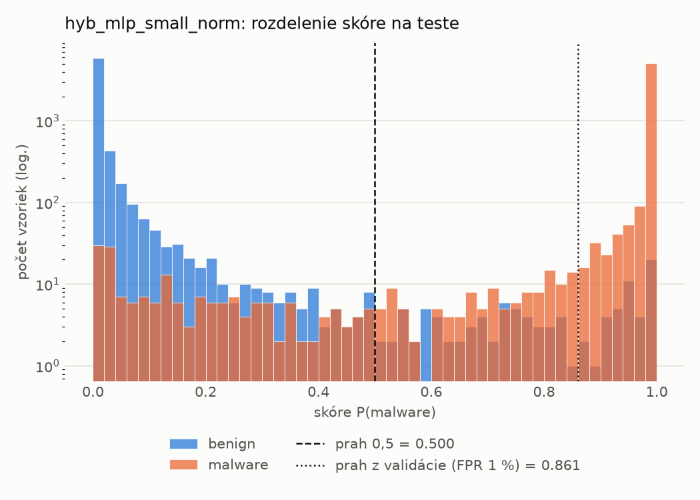
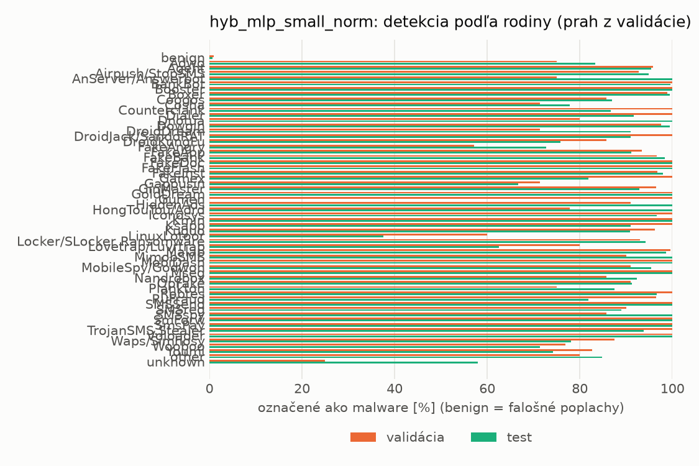
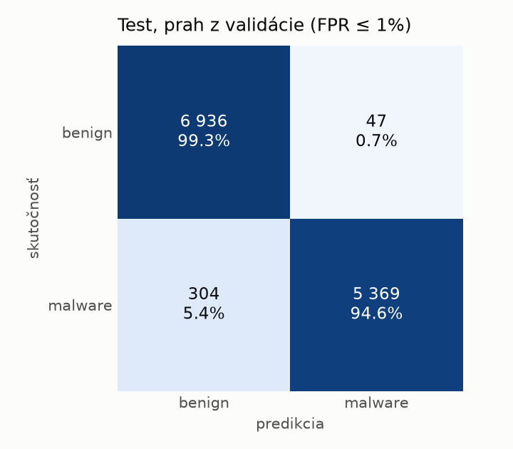
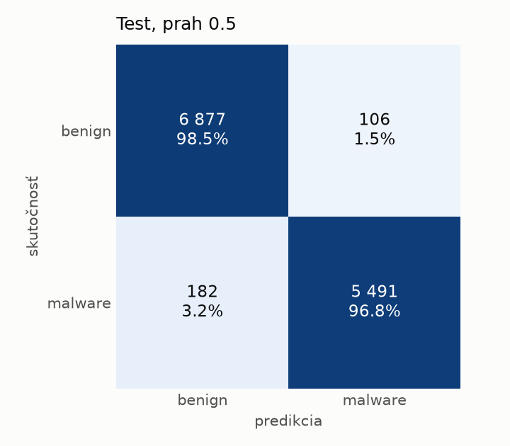
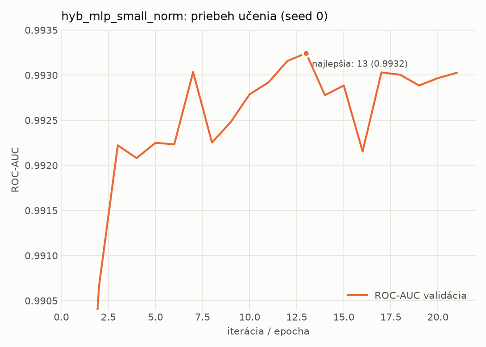

# hybrid_norm/hyb_mlp_small_norm – beh `20261123-001449`

> Automaticky generované (`src/training/run_tabular.py`). Konfigurácia: `config.yaml`, protokol: `protocol.yaml`.

- **Model:** `mlp` – hybrid mlp_small s dynamikou ako podiely systémových volaní (kontrola artefaktu množstva aktivity)
- **Ladenie:** bez ladenia – hyperparametre prevzaté z `runs_v4/real_p/full/hybrid/mlp_small/20261123-000512`
- **Finálne modely:** seedy [0, 1, 2]; hodnoty sú priemer ± smerodajná odchýlka cez seedy
- **Najlepšie hyperparametre:** `{"width_decay": 0.5, "max_epochs": 100, "patience": 8, "hidden_layers": 2, "hidden_width": 256, "dropout": 0.17059205009500078, "lr": 0.0013906274900964423, "weight_decay": 9.337519104222036e-06, "batch_size": 1024}`

## Detekčná kvalita (bez prahu)
| metrika | train (podvzorka) | validácia | test |
|---|---|---|---|
| ROC-AUC | 0.9974 ± 0.0016 | 0.9933 ± 0.0002 | 0.9949 ± 0.0006 |
| PR-AUC | 0.9972 ± 0.0016 | 0.9936 ± 0.0004 | 0.9945 ± 0.0012 |
| TPR pri FPR 1 % | 0.9713 ± 0.0171 | 0.9283 ± 0.0153 | 0.9473 ± 0.0128 |
| TPR pri FPR 0,1 % | 0.9215 ± 0.0406 | 0.7552 ± 0.0272 | 0.8093 ± 0.0538 |
| log loss | 0.0528 ± 0.0181 | 0.0929 ± 0.0025 | 0.0803 ± 0.0068 |
| Brier skóre | 0.0137 ± 0.0050 | 0.0236 ± 0.0019 | 0.0207 ± 0.0025 |

Rozdiel ROC-AUC train − validácia: **0.0041** (veľký rozdiel = preučenie).

## Pri prahu z validácie (FPR ≤ 1% na validácii)
| metrika | train (podvzorka) | validácia | test |
|---|---|---|---|
| accuracy | 0.9739 ± 0.0095 | 0.9625 ± 0.0068 | 0.9665 ± 0.0073 |
| balanced accuracy | 0.9703 ± 0.0108 | 0.9593 ± 0.0076 | 0.9634 ± 0.0081 |
| precision | 0.9973 ± 0.0012 | 0.9872 ± 0.0002 | 0.9909 ± 0.0004 |
| recall (TPR) | 0.9425 ± 0.0210 | 0.9283 ± 0.0153 | 0.9338 ± 0.0162 |
| FPR | 0.0019 ± 0.0008 | 0.0097 ± 0.0000 | 0.0070 ± 0.0002 |
| F1 | 0.9691 ± 0.0116 | 0.9568 ± 0.0082 | 0.9614 ± 0.0087 |
| MCC | 0.9477 ± 0.0188 | 0.9251 ± 0.0133 | 0.9332 ± 0.0142 |

## Pri pevnom prahu 0.5
| metrika | train (podvzorka) | validácia | test |
|---|---|---|---|
| accuracy | 0.9830 ± 0.0065 | 0.9702 ± 0.0030 | 0.9735 ± 0.0038 |
| balanced accuracy | 0.9820 ± 0.0066 | 0.9694 ± 0.0030 | 0.9727 ± 0.0037 |
| precision | 0.9869 ± 0.0076 | 0.9716 ± 0.0036 | 0.9753 ± 0.0052 |
| recall (TPR) | 0.9740 ± 0.0075 | 0.9616 ± 0.0032 | 0.9653 ± 0.0036 |
| FPR | 0.0100 ± 0.0058 | 0.0228 ± 0.0029 | 0.0199 ± 0.0042 |
| F1 | 0.9804 ± 0.0075 | 0.9666 ± 0.0033 | 0.9703 ± 0.0042 |
| MCC | 0.9655 ± 0.0132 | 0.9397 ± 0.0060 | 0.9464 ± 0.0076 |

## Výpočtové nároky (seed 0, testovacia množina)
| meranie | hodnota |
|---|---|
| tréning finálneho modelu | 1.4 s (priemer cez seedy) |
| ladenie spolu | 0 s |
| počet parametrov / uzlov | 107 009 |
| veľkosť modelu na disku | 0.44 MB |
| transformácia vstupu – latencia (1 vlákno) | 0.016 ms |
| transformácia vstupu – priepustnosť | 293 258 vzoriek/s |
| CPU latencia modelu (batch 1, 1 vlákno) | 0.101 ms (p95 0.113) |
| CPU priepustnosť (24 vlákien) | 1 264 828 vzoriek/s |
| GPU latencia (batch 1) | 0.665 ms (p95 0.727) |
| GPU priepustnosť | 1 342 968 vzoriek/s |
| GPU špičková pamäť | 165 MB |

## Grafy
| | |
|---|---|
|  |  |
|  |  |
|  |  |
|  |  |

## Súbory
`metrics.json` (všetky metriky po seedoch vrátane rodín), `timing.json`, `hpo_trials.csv`,
`predictions/<časť>_seed<N>.parquet` (sha256, family, label, score), `model/seed_<N>/`, `log.txt`.
