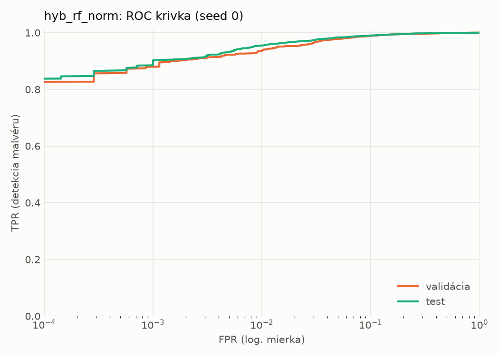
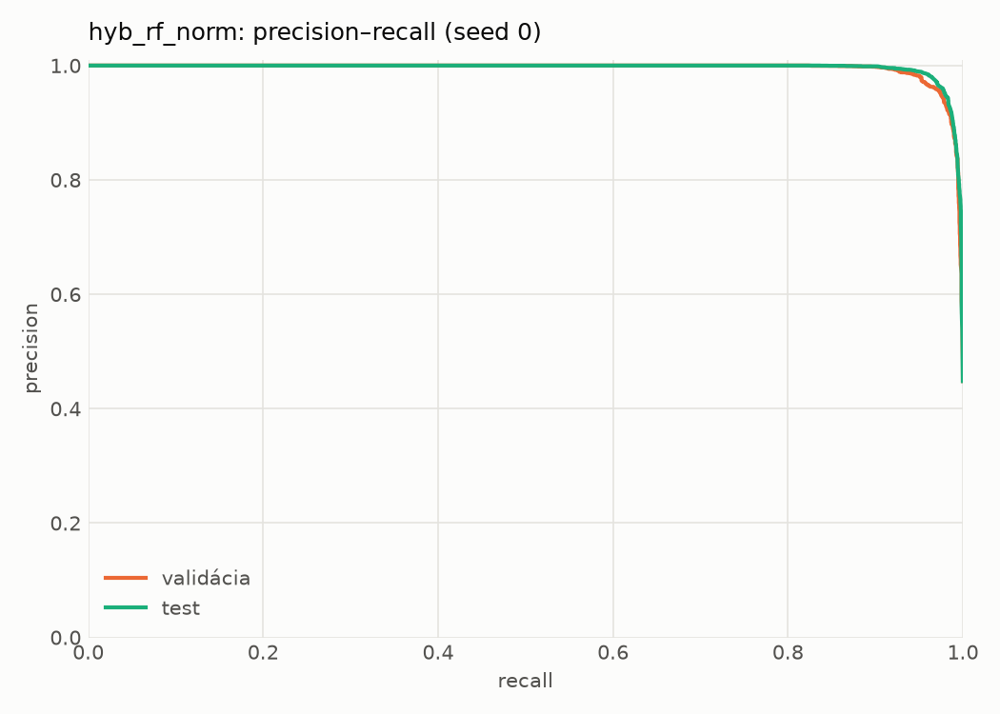
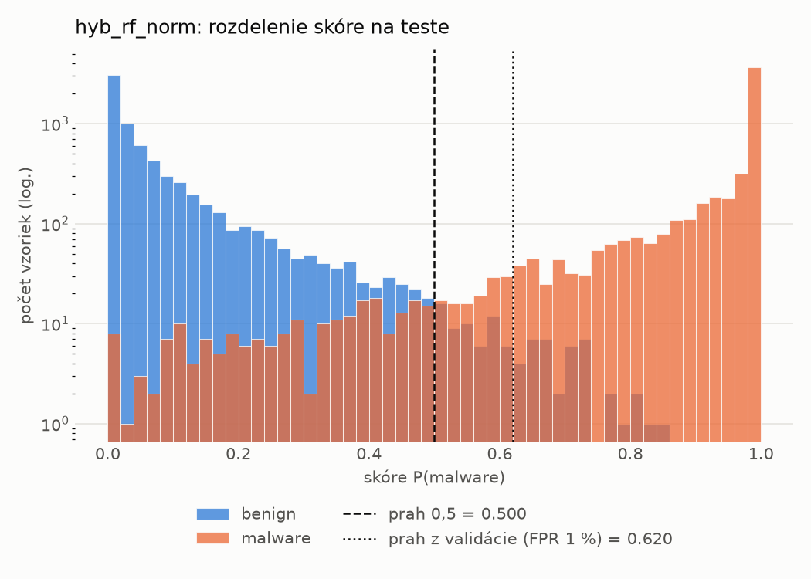
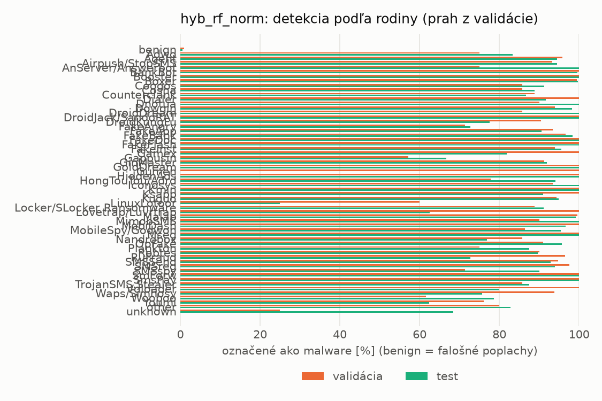
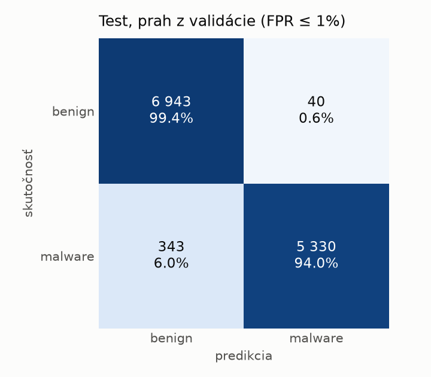
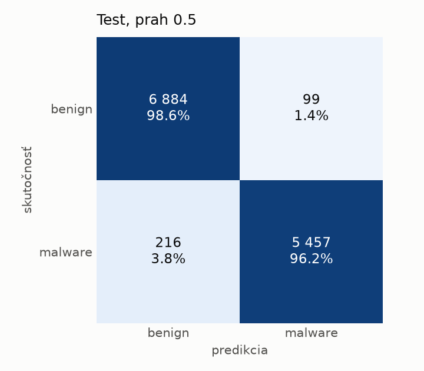

# hybrid_norm/hyb_rf_norm – beh `20261123-001455`

> Automaticky generované (`src/training/run_tabular.py`). Konfigurácia: `config.yaml`, protokol: `protocol.yaml`.

- **Model:** `random_forest` – hybrid rf s dynamikou ako podiely systémových volaní (kontrola artefaktu množstva aktivity)
- **Ladenie:** bez ladenia – hyperparametre prevzaté z `runs_v4/real_p/full/hybrid/rf/20261122-235747`
- **Finálne modely:** seedy [0, 1, 2]; hodnoty sú priemer ± smerodajná odchýlka cez seedy
- **Najlepšie hyperparametre:** `{"n_estimators": 400, "max_depth": null, "min_samples_leaf": 1, "max_features": "sqrt"}`

## Detekčná kvalita (bez prahu)
| metrika | train (podvzorka) | validácia | test |
|---|---|---|---|
| ROC-AUC | 1.0000 ± 0.0000 | 0.9948 ± 0.0001 | 0.9958 ± 0.0001 |
| PR-AUC | 1.0000 ± 0.0000 | 0.9949 ± 0.0000 | 0.9959 ± 0.0000 |
| TPR pri FPR 1 % | 1.0000 ± 0.0000 | 0.9354 ± 0.0009 | 0.9544 ± 0.0001 |
| TPR pri FPR 0,1 % | 1.0000 ± 0.0000 | 0.8823 ± 0.0051 | 0.8912 ± 0.0089 |
| log loss | 0.0290 ± 0.0002 | 0.1034 ± 0.0018 | 0.0988 ± 0.0004 |
| Brier skóre | 0.0032 ± 0.0000 | 0.0261 ± 0.0001 | 0.0241 ± 0.0000 |

Rozdiel ROC-AUC train − validácia: **0.0052** (veľký rozdiel = preučenie).

## Pri prahu z validácie (FPR ≤ 1% na validácii)
| metrika | train (podvzorka) | validácia | test |
|---|---|---|---|
| accuracy | 1.0000 ± 0.0000 | 0.9658 ± 0.0005 | 0.9702 ± 0.0004 |
| balanced accuracy | 1.0000 ± 0.0000 | 0.9629 ± 0.0005 | 0.9675 ± 0.0005 |
| precision | 1.0000 ± 0.0000 | 0.9876 ± 0.0002 | 0.9923 ± 0.0004 |
| recall (TPR) | 1.0000 ± 0.0000 | 0.9354 ± 0.0009 | 0.9409 ± 0.0013 |
| FPR | 0.0000 ± 0.0000 | 0.0096 ± 0.0002 | 0.0060 ± 0.0003 |
| F1 | 1.0000 ± 0.0000 | 0.9608 ± 0.0005 | 0.9659 ± 0.0005 |
| MCC | 1.0000 ± 0.0000 | 0.9316 ± 0.0009 | 0.9406 ± 0.0008 |

## Pri pevnom prahu 0.5
| metrika | train (podvzorka) | validácia | test |
|---|---|---|---|
| accuracy | 1.0000 ± 0.0000 | 0.9676 ± 0.0006 | 0.9752 ± 0.0003 |
| balanced accuracy | 1.0000 ± 0.0000 | 0.9665 ± 0.0006 | 0.9740 ± 0.0003 |
| precision | 1.0000 ± 0.0000 | 0.9718 ± 0.0005 | 0.9822 ± 0.0001 |
| recall (TPR) | 1.0000 ± 0.0000 | 0.9556 ± 0.0011 | 0.9622 ± 0.0007 |
| FPR | 0.0000 ± 0.0000 | 0.0225 ± 0.0004 | 0.0141 ± 0.0001 |
| F1 | 1.0000 ± 0.0000 | 0.9636 ± 0.0007 | 0.9721 ± 0.0003 |
| MCC | 1.0000 ± 0.0000 | 0.9346 ± 0.0012 | 0.9500 ± 0.0006 |

## Výpočtové nároky (seed 0, testovacia množina)
| meranie | hodnota |
|---|---|
| tréning finálneho modelu | 3.1 s (priemer cez seedy) |
| ladenie spolu | 0 s |
| počet parametrov / uzlov | 1 822 804 |
| veľkosť modelu na disku | 146.16 MB |
| CPU latencia modelu (batch 1, 1 vlákno) | 12.891 ms (p95 13.314) |
| CPU priepustnosť (24 vlákien) | 109 782 vzoriek/s |

## Grafy
| | |
|---|---|
|  |  |
|  |  |
|  |  |
|  |  |

## Súbory
`metrics.json` (všetky metriky po seedoch vrátane rodín), `timing.json`, `hpo_trials.csv`,
`predictions/<časť>_seed<N>.parquet` (sha256, family, label, score), `model/seed_<N>/`, `log.txt`.
