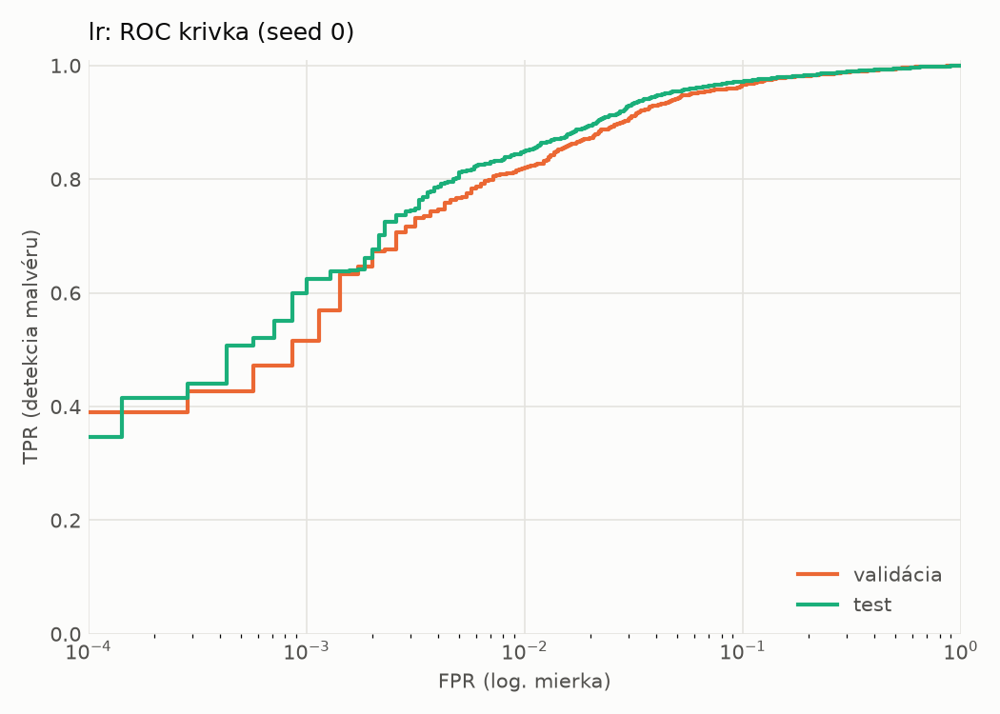
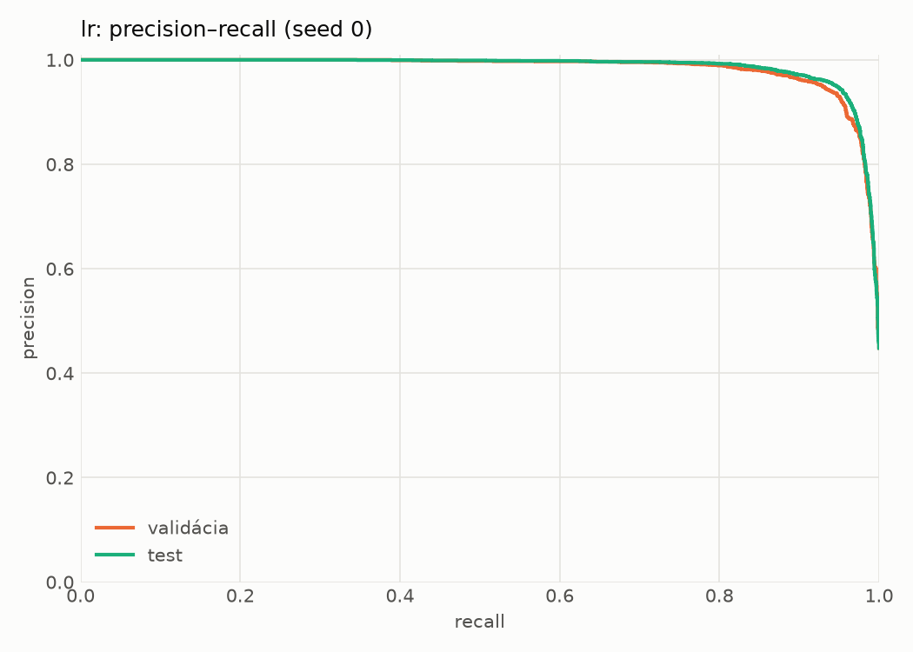
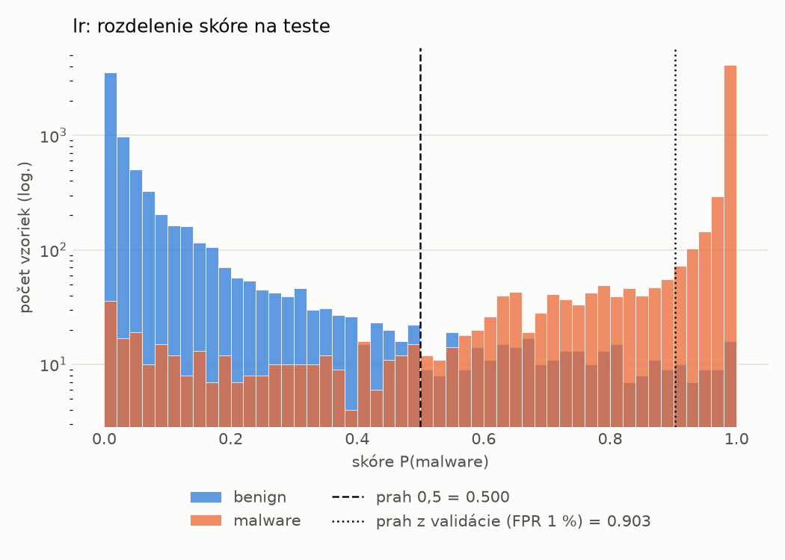
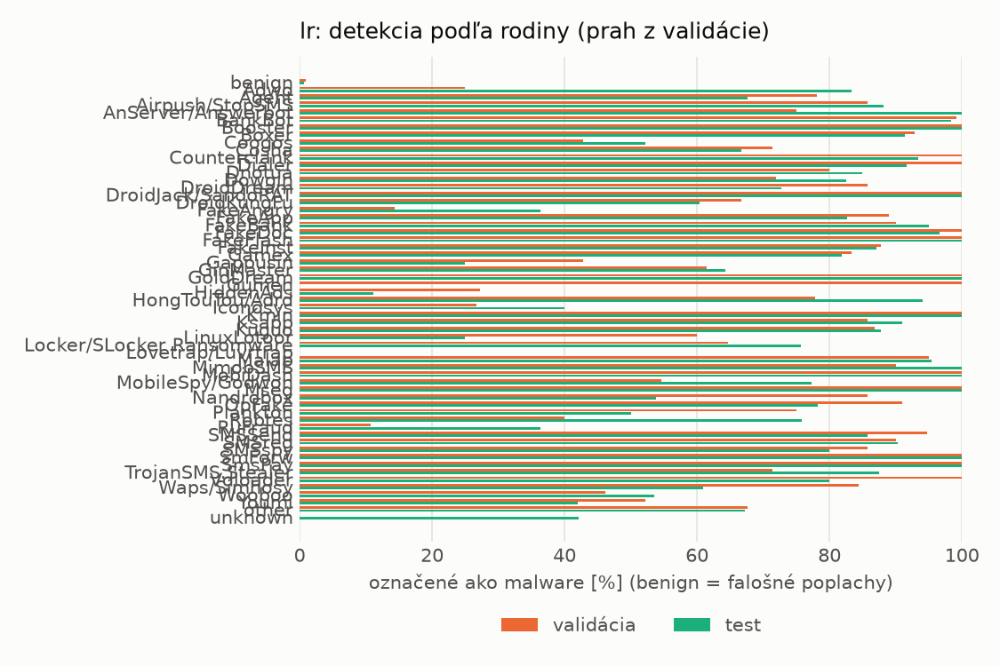
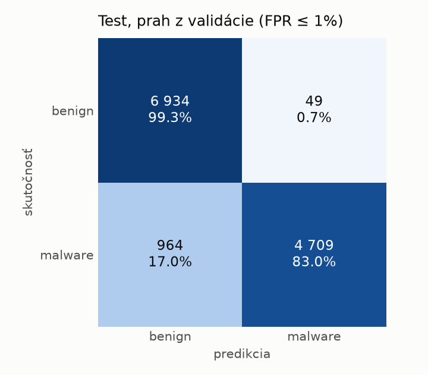
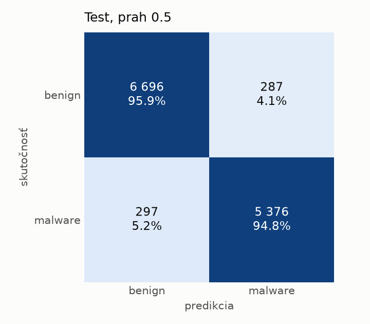
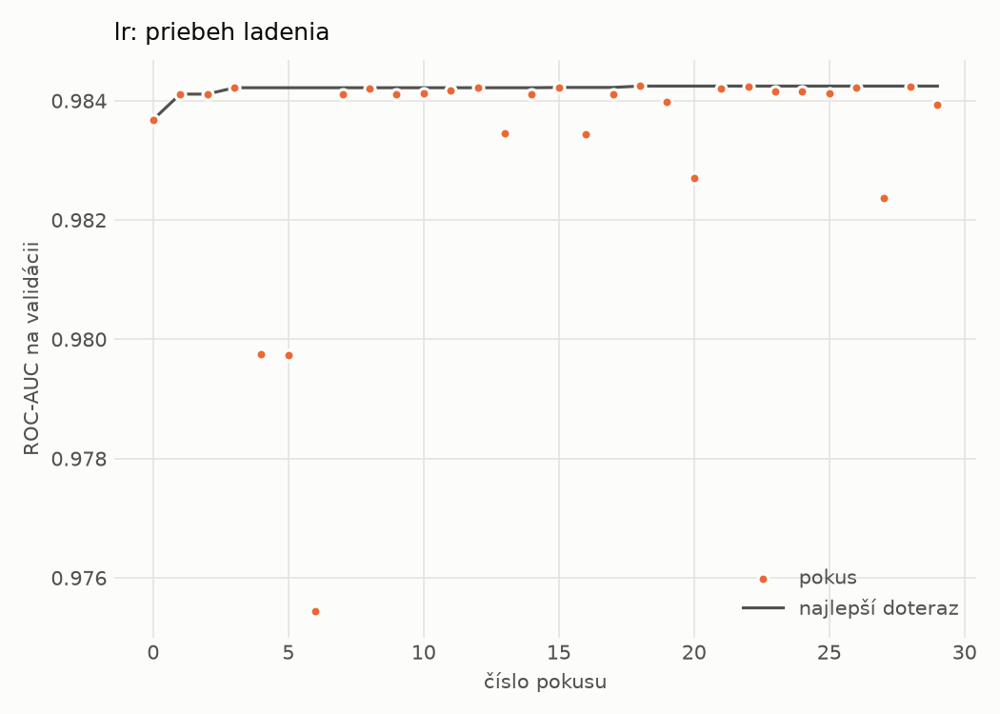

# hybrid/lr – beh `20261122-235738`

> Automaticky generované (`src/training/run_tabular.py`). Konfigurácia: `config.yaml`, protokol: `protocol.yaml`.

- **Model:** `logreg` – logistická regresia s L2 regularizáciou (vstup signed log1p + štandardizácia)
- **Ladenie:** 30 dokončených pokusov (Optuna TPE), cieľ ROC-AUC na validácii, 0.1 min
- **Finálne modely:** seedy [0, 1, 2]; hodnoty sú priemer ± smerodajná odchýlka cez seedy
- **Najlepšie hyperparametre:** `{"max_iter": 2000, "C": 0.07124252843547843}`

## Detekčná kvalita (bez prahu)
| metrika | train (podvzorka) | validácia | test |
|---|---|---|---|
| ROC-AUC | 0.9866 ± 0.0000 | 0.9842 ± 0.0000 | 0.9861 ± 0.0000 |
| PR-AUC | 0.9865 ± 0.0000 | 0.9839 ± 0.0000 | 0.9863 ± 0.0000 |
| TPR pri FPR 1 % | 0.8561 ± 0.0000 | 0.8187 ± 0.0000 | 0.8484 ± 0.0000 |
| TPR pri FPR 0,1 % | 0.6187 ± 0.0000 | 0.5164 ± 0.0000 | 0.5997 ± 0.0000 |
| log loss | 0.1337 ± 0.0000 | 0.1518 ± 0.0000 | 0.1401 ± 0.0000 |
| Brier skóre | 0.0361 ± 0.0000 | 0.0421 ± 0.0000 | 0.0377 ± 0.0000 |

Rozdiel ROC-AUC train − validácia: **0.0023** (veľký rozdiel = preučenie).

## Pri prahu z validácie (FPR ≤ 1% na validácii)
| metrika | train (podvzorka) | validácia | test |
|---|---|---|---|
| accuracy | 0.9225 ± 0.0000 | 0.9133 ± 0.0000 | 0.9200 ± 0.0000 |
| balanced accuracy | 0.9119 ± 0.0000 | 0.9045 ± 0.0000 | 0.9115 ± 0.0000 |
| precision | 0.9910 ± 0.0000 | 0.9856 ± 0.0000 | 0.9897 ± 0.0000 |
| recall (TPR) | 0.8297 ± 0.0000 | 0.8187 ± 0.0000 | 0.8301 ± 0.0000 |
| FPR | 0.0058 ± 0.0000 | 0.0097 ± 0.0000 | 0.0070 ± 0.0000 |
| F1 | 0.9032 ± 0.0000 | 0.8944 ± 0.0000 | 0.9029 ± 0.0000 |
| MCC | 0.8486 ± 0.0000 | 0.8322 ± 0.0000 | 0.8451 ± 0.0000 |

## Pri pevnom prahu 0.5
| metrika | train (podvzorka) | validácia | test |
|---|---|---|---|
| accuracy | 0.9552 ± 0.0000 | 0.9462 ± 0.0000 | 0.9539 ± 0.0000 |
| balanced accuracy | 0.9541 ± 0.0000 | 0.9449 ± 0.0000 | 0.9533 ± 0.0000 |
| precision | 0.9511 ± 0.0000 | 0.9473 ± 0.0000 | 0.9493 ± 0.0000 |
| recall (TPR) | 0.9458 ± 0.0000 | 0.9319 ± 0.0000 | 0.9476 ± 0.0000 |
| FPR | 0.0376 ± 0.0000 | 0.0421 ± 0.0000 | 0.0411 ± 0.0000 |
| F1 | 0.9484 ± 0.0000 | 0.9395 ± 0.0000 | 0.9485 ± 0.0000 |
| MCC | 0.9088 ± 0.0000 | 0.8912 ± 0.0000 | 0.9067 ± 0.0000 |

## Výpočtové nároky (seed 0, testovacia množina)
| meranie | hodnota |
|---|---|
| tréning finálneho modelu | 0.3 s (priemer cez seedy) |
| ladenie spolu | 6 s |
| počet parametrov / uzlov | 287 |
| veľkosť modelu na disku | 0.01 MB |
| transformácia vstupu – latencia (1 vlákno) | 0.006 ms |
| transformácia vstupu – priepustnosť | 492 174 vzoriek/s |
| CPU latencia modelu (batch 1, 1 vlákno) | 0.004 ms (p95 0.005) |
| CPU priepustnosť (24 vlákien) | 2 228 287 vzoriek/s |

## Grafy
| | |
|---|---|
|  |  |
|  |  |
|  |  |
|  |  |

## Súbory
`metrics.json` (všetky metriky po seedoch vrátane rodín), `timing.json`, `hpo_trials.csv`,
`predictions/<časť>_seed<N>.parquet` (sha256, family, label, score), `model/seed_<N>/`, `log.txt`.
