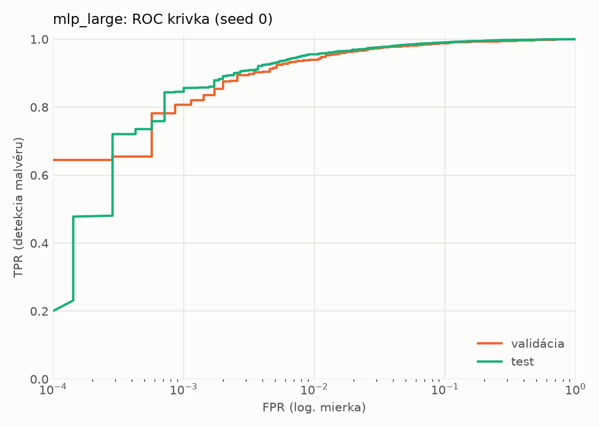
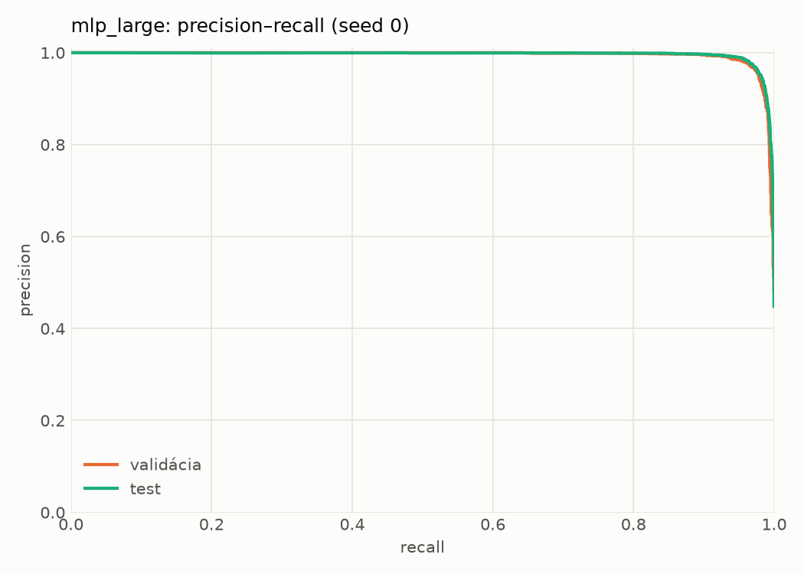
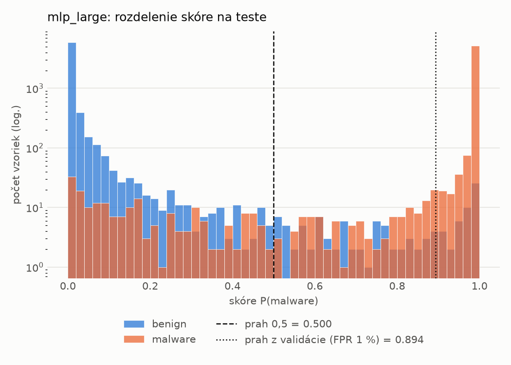
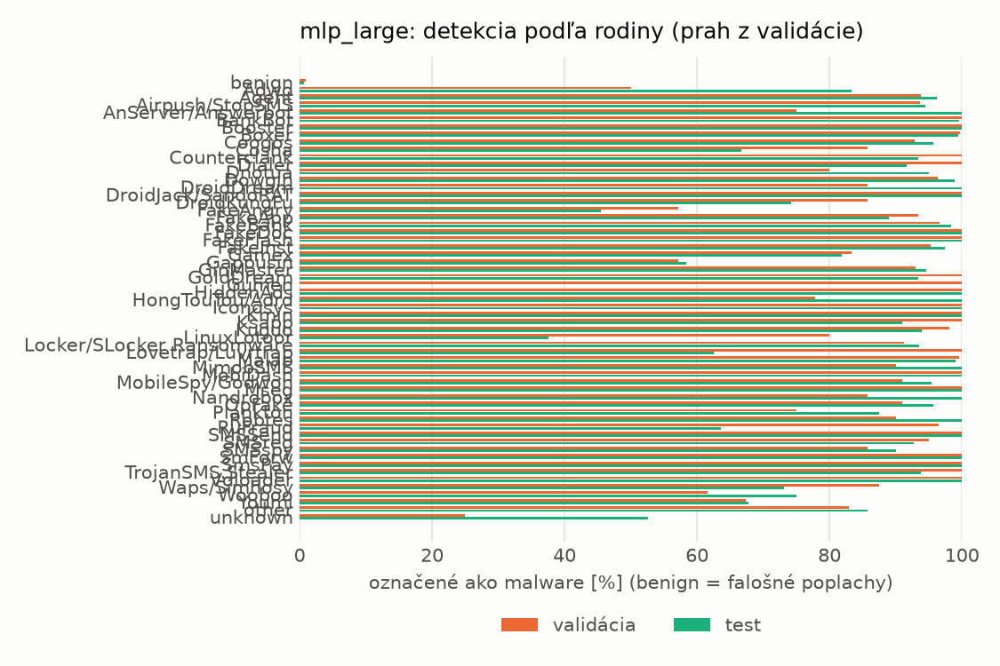
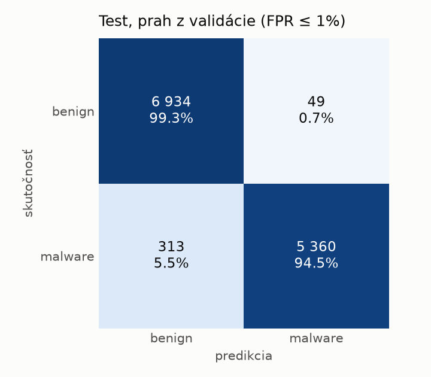
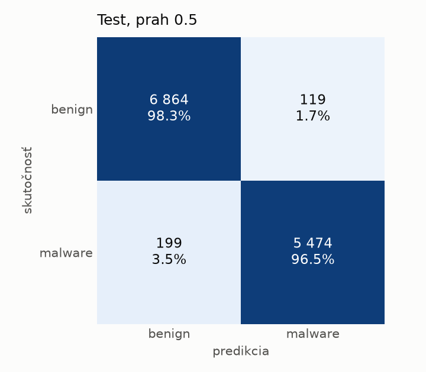
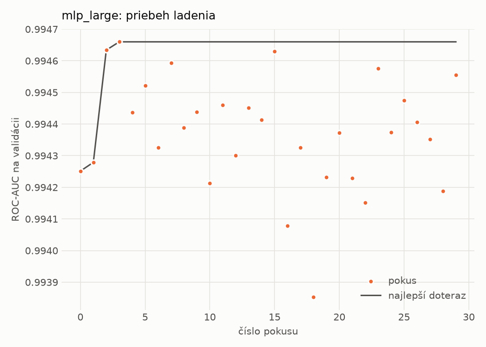
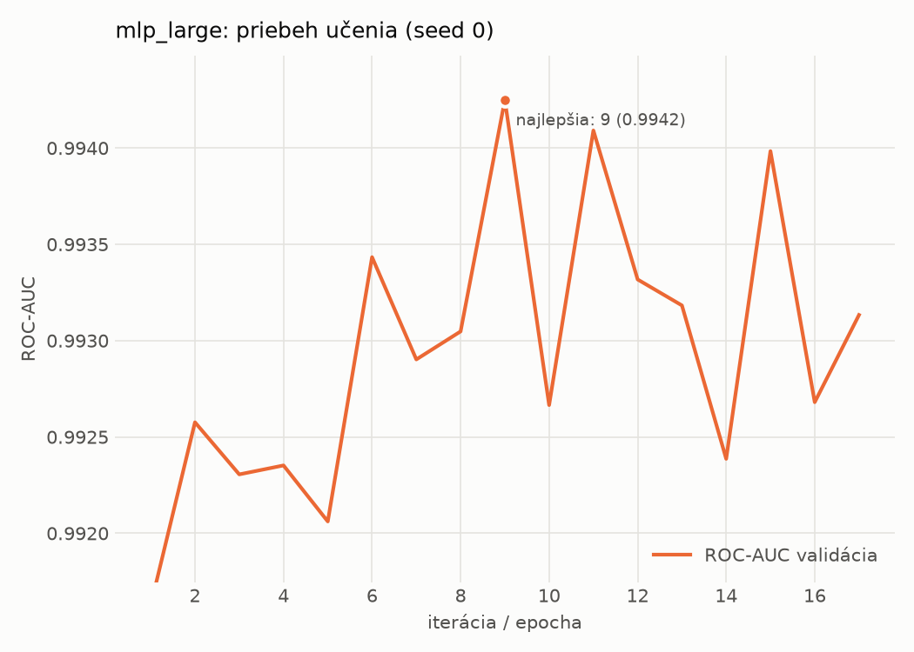

# hybrid/mlp_large – beh `20261123-000809`

> Automaticky generované (`src/training/run_tabular.py`). Konfigurácia: `config.yaml`, protokol: `protocol.yaml`.

- **Model:** `mlp` – veľká neurónová sieť (3–5 skrytých vrstiev, 512–2048 neurónov), kandidát na učiteľa
- **Ladenie:** 30 dokončených pokusov (Optuna TPE), cieľ ROC-AUC na validácii, 3.1 min
- **Finálne modely:** seedy [0, 1, 2]; hodnoty sú priemer ± smerodajná odchýlka cez seedy
- **Najlepšie hyperparametre:** `{"max_epochs": 100, "patience": 8, "hidden_layers": 3, "hidden_width": 1024, "width_decay": 1.0, "dropout": 0.11375540844608736, "lr": 0.0022038218939289885, "weight_decay": 1.0842262717330169e-05, "batch_size": 256}`

## Detekčná kvalita (bez prahu)
| metrika | train (podvzorka) | validácia | test |
|---|---|---|---|
| ROC-AUC | 0.9986 ± 0.0006 | 0.9944 ± 0.0003 | 0.9959 ± 0.0002 |
| PR-AUC | 0.9986 ± 0.0006 | 0.9945 ± 0.0002 | 0.9956 ± 0.0002 |
| TPR pri FPR 1 % | 0.9845 ± 0.0061 | 0.9447 ± 0.0064 | 0.9555 ± 0.0003 |
| TPR pri FPR 0,1 % | 0.9675 ± 0.0098 | 0.7319 ± 0.0869 | 0.8393 ± 0.0389 |
| log loss | 0.0358 ± 0.0086 | 0.0926 ± 0.0035 | 0.0792 ± 0.0016 |
| Brier skóre | 0.0092 ± 0.0022 | 0.0216 ± 0.0008 | 0.0194 ± 0.0003 |

Rozdiel ROC-AUC train − validácia: **0.0042** (veľký rozdiel = preučenie).

## Pri prahu z validácie (FPR ≤ 1% na validácii)
| metrika | train (podvzorka) | validácia | test |
|---|---|---|---|
| accuracy | 0.9838 ± 0.0032 | 0.9700 ± 0.0027 | 0.9728 ± 0.0015 |
| balanced accuracy | 0.9816 ± 0.0036 | 0.9676 ± 0.0030 | 0.9706 ± 0.0017 |
| precision | 0.9989 ± 0.0009 | 0.9877 ± 0.0004 | 0.9900 ± 0.0010 |
| recall (TPR) | 0.9640 ± 0.0068 | 0.9447 ± 0.0064 | 0.9490 ± 0.0042 |
| FPR | 0.0008 ± 0.0007 | 0.0096 ± 0.0003 | 0.0078 ± 0.0008 |
| F1 | 0.9811 ± 0.0038 | 0.9657 ± 0.0032 | 0.9691 ± 0.0017 |
| MCC | 0.9675 ± 0.0064 | 0.9398 ± 0.0053 | 0.9456 ± 0.0028 |

## Pri pevnom prahu 0.5
| metrika | train (podvzorka) | validácia | test |
|---|---|---|---|
| accuracy | 0.9878 ± 0.0031 | 0.9731 ± 0.0008 | 0.9761 ± 0.0013 |
| balanced accuracy | 0.9868 ± 0.0032 | 0.9722 ± 0.0008 | 0.9751 ± 0.0013 |
| precision | 0.9925 ± 0.0040 | 0.9766 ± 0.0020 | 0.9807 ± 0.0017 |
| recall (TPR) | 0.9794 ± 0.0050 | 0.9631 ± 0.0013 | 0.9656 ± 0.0015 |
| FPR | 0.0057 ± 0.0031 | 0.0187 ± 0.0017 | 0.0155 ± 0.0014 |
| F1 | 0.9859 ± 0.0036 | 0.9698 ± 0.0009 | 0.9731 ± 0.0014 |
| MCC | 0.9752 ± 0.0063 | 0.9457 ± 0.0017 | 0.9516 ± 0.0026 |

## Výpočtové nároky (seed 0, testovacia množina)
| meranie | hodnota |
|---|---|
| tréning finálneho modelu | 6.8 s (priemer cez seedy) |
| ladenie spolu | 186 s |
| počet parametrov / uzlov | 2 400 257 |
| veľkosť modelu na disku | 9.64 MB |
| transformácia vstupu – latencia (1 vlákno) | 0.017 ms |
| transformácia vstupu – priepustnosť | 288 201 vzoriek/s |
| CPU latencia modelu (batch 1, 1 vlákno) | 0.267 ms (p95 0.321) |
| CPU priepustnosť (24 vlákien) | 165 798 vzoriek/s |
| GPU latencia (batch 1) | 0.417 ms (p95 0.900) |
| GPU priepustnosť | 703 490 vzoriek/s |
| GPU špičková pamäť | 237 MB |

## Grafy
| | |
|---|---|
|  |  |
|  |  |
|  |  |
|  |  |

## Súbory
`metrics.json` (všetky metriky po seedoch vrátane rodín), `timing.json`, `hpo_trials.csv`,
`predictions/<časť>_seed<N>.parquet` (sha256, family, label, score), `model/seed_<N>/`, `log.txt`.
