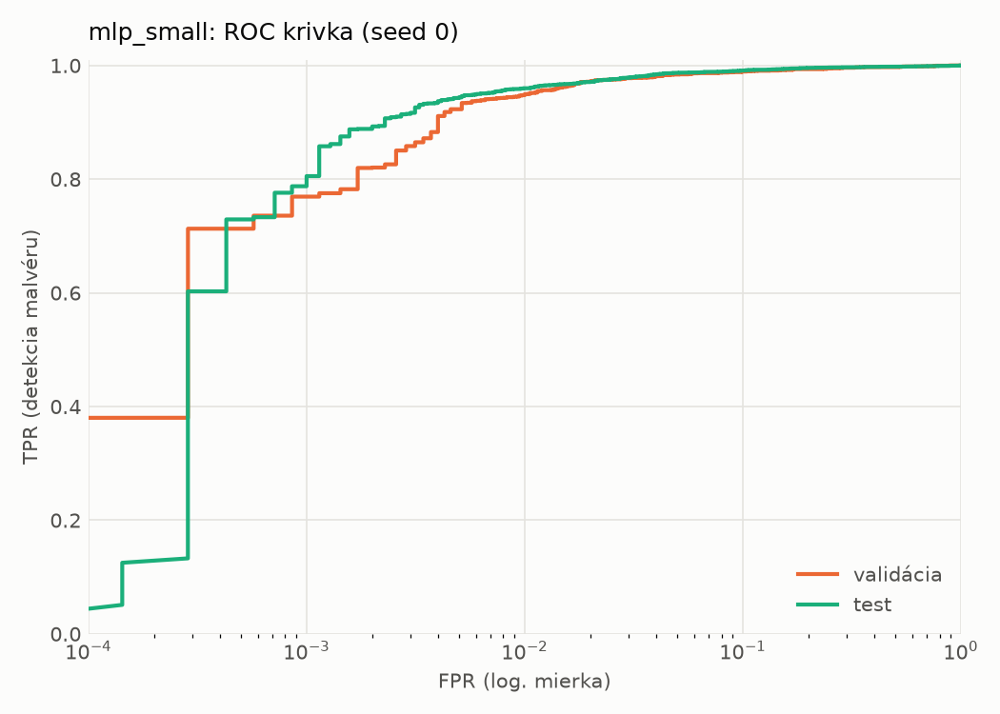
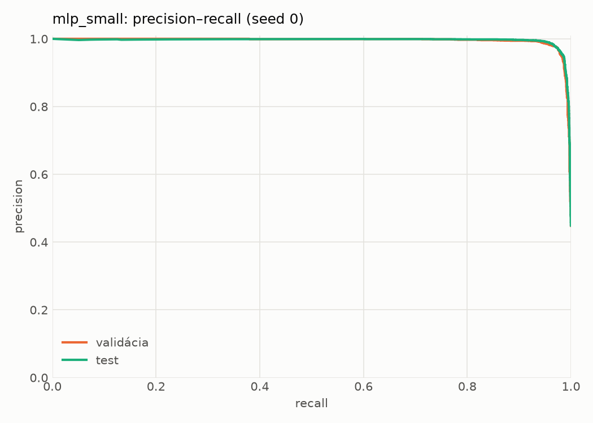
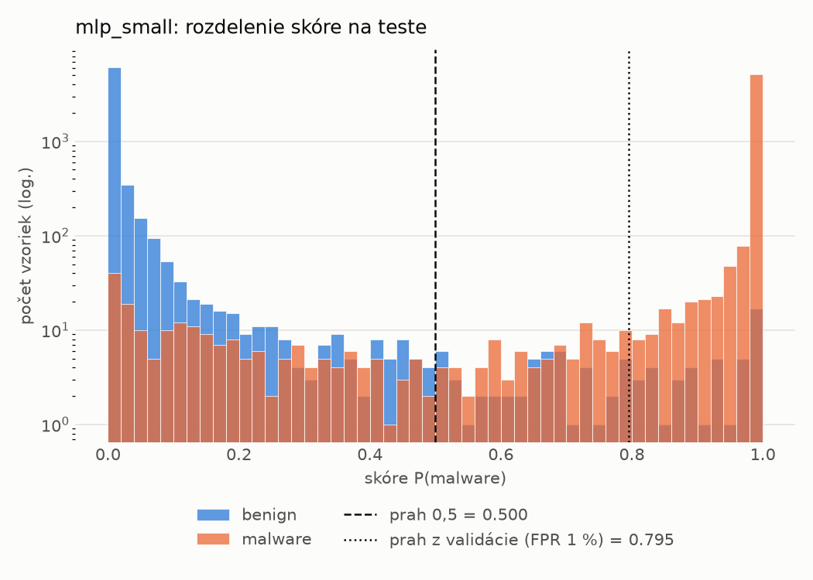
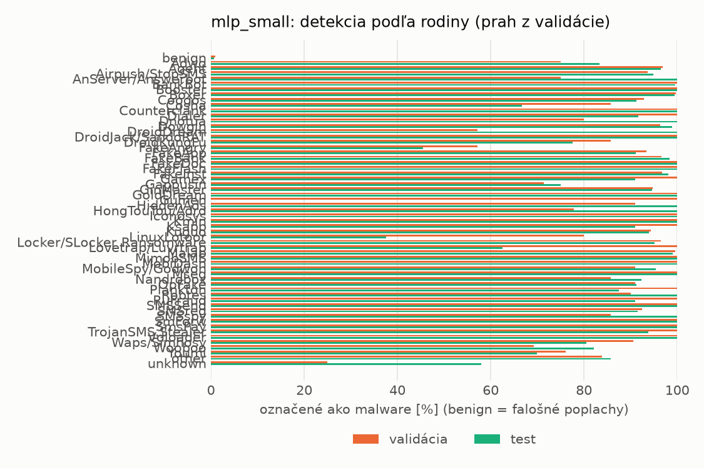
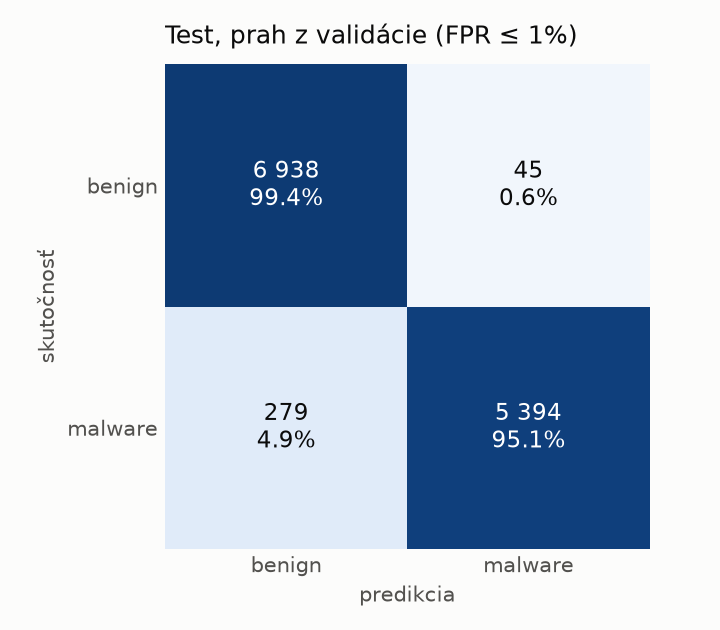
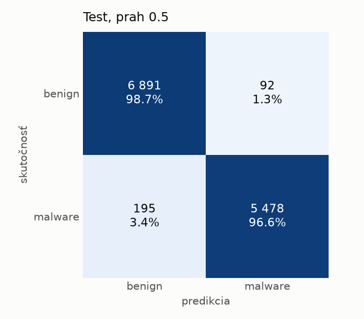
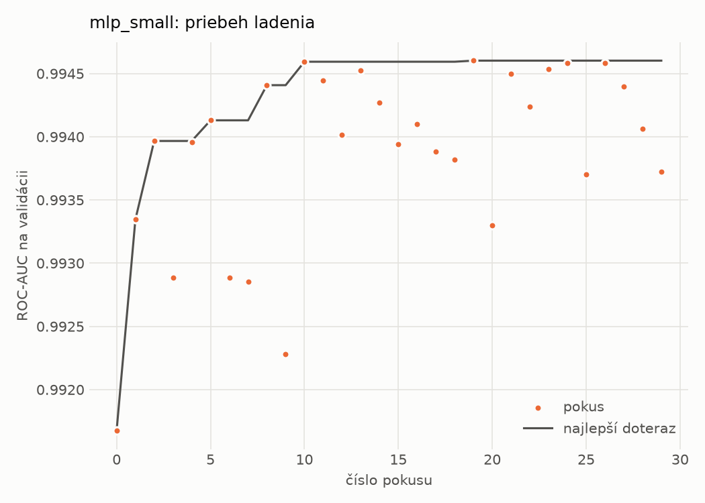
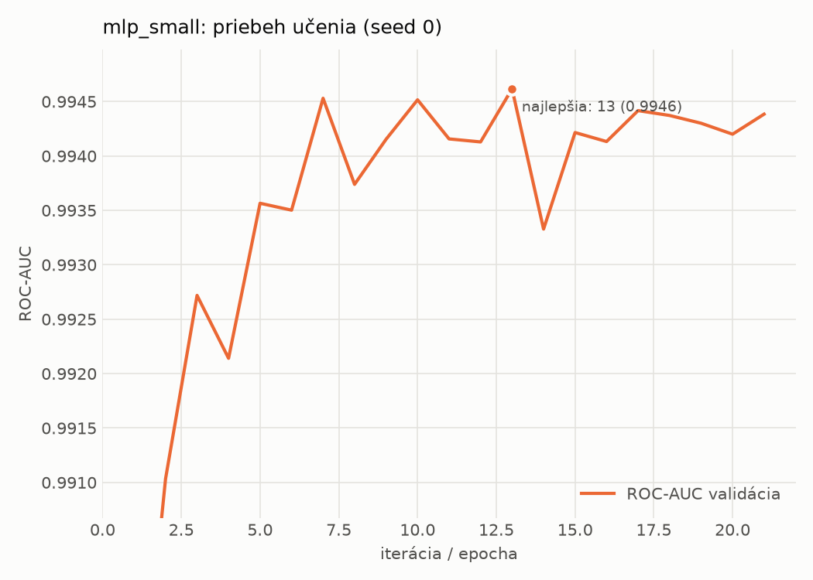

# hybrid/mlp_small – beh `20261123-000512`

> Automaticky generované (`src/training/run_tabular.py`). Konfigurácia: `config.yaml`, protokol: `protocol.yaml`.

- **Model:** `mlp` – malá neurónová sieť (1–2 skryté vrstvy), kandidát na ľahkého študenta
- **Ladenie:** 30 dokončených pokusov (Optuna TPE), cieľ ROC-AUC na validácii, 2.8 min
- **Finálne modely:** seedy [0, 1, 2]; hodnoty sú priemer ± smerodajná odchýlka cez seedy
- **Najlepšie hyperparametre:** `{"width_decay": 0.5, "max_epochs": 100, "patience": 8, "hidden_layers": 2, "hidden_width": 256, "dropout": 0.17059205009500078, "lr": 0.0013906274900964423, "weight_decay": 9.337519104222036e-06, "batch_size": 1024}`

## Detekčná kvalita (bez prahu)
| metrika | train (podvzorka) | validácia | test |
|---|---|---|---|
| ROC-AUC | 0.9987 ± 0.0009 | 0.9941 ± 0.0005 | 0.9949 ± 0.0009 |
| PR-AUC | 0.9986 ± 0.0008 | 0.9944 ± 0.0004 | 0.9950 ± 0.0004 |
| TPR pri FPR 1 % | 0.9865 ± 0.0069 | 0.9478 ± 0.0085 | 0.9588 ± 0.0056 |
| TPR pri FPR 0,1 % | 0.9688 ± 0.0217 | 0.7872 ± 0.0162 | 0.8049 ± 0.0159 |
| log loss | 0.0340 ± 0.0129 | 0.0872 ± 0.0044 | 0.0774 ± 0.0051 |
| Brier skóre | 0.0086 ± 0.0036 | 0.0208 ± 0.0019 | 0.0185 ± 0.0017 |

Rozdiel ROC-AUC train − validácia: **0.0046** (veľký rozdiel = preučenie).

## Pri prahu z validácie (FPR ≤ 1% na validácii)
| metrika | train (podvzorka) | validácia | test |
|---|---|---|---|
| accuracy | 0.9846 ± 0.0055 | 0.9712 ± 0.0038 | 0.9735 ± 0.0033 |
| balanced accuracy | 0.9824 ± 0.0062 | 0.9690 ± 0.0042 | 0.9712 ± 0.0037 |
| precision | 0.9991 ± 0.0011 | 0.9875 ± 0.0001 | 0.9916 ± 0.0004 |
| recall (TPR) | 0.9655 ± 0.0116 | 0.9478 ± 0.0085 | 0.9489 ± 0.0071 |
| FPR | 0.0006 ± 0.0008 | 0.0097 ± 0.0000 | 0.0065 ± 0.0003 |
| F1 | 0.9820 ± 0.0066 | 0.9672 ± 0.0045 | 0.9698 ± 0.0039 |
| MCC | 0.9690 ± 0.0111 | 0.9422 ± 0.0075 | 0.9470 ± 0.0066 |

## Pri pevnom prahu 0.5
| metrika | train (podvzorka) | validácia | test |
|---|---|---|---|
| accuracy | 0.9895 ± 0.0046 | 0.9738 ± 0.0025 | 0.9770 ± 0.0025 |
| balanced accuracy | 0.9887 ± 0.0045 | 0.9732 ± 0.0021 | 0.9761 ± 0.0022 |
| precision | 0.9934 ± 0.0077 | 0.9739 ± 0.0070 | 0.9807 ± 0.0061 |
| recall (TPR) | 0.9824 ± 0.0039 | 0.9674 ± 0.0019 | 0.9676 ± 0.0017 |
| FPR | 0.0051 ± 0.0059 | 0.0211 ± 0.0059 | 0.0155 ± 0.0050 |
| F1 | 0.9878 ± 0.0053 | 0.9706 ± 0.0026 | 0.9741 ± 0.0027 |
| MCC | 0.9786 ± 0.0094 | 0.9469 ± 0.0050 | 0.9534 ± 0.0050 |

## Výpočtové nároky (seed 0, testovacia množina)
| meranie | hodnota |
|---|---|
| tréning finálneho modelu | 1.8 s (priemer cez seedy) |
| ladenie spolu | 169 s |
| počet parametrov / uzlov | 107 265 |
| veľkosť modelu na disku | 0.45 MB |
| transformácia vstupu – latencia (1 vlákno) | 0.007 ms |
| transformácia vstupu – priepustnosť | 449 638 vzoriek/s |
| CPU latencia modelu (batch 1, 1 vlákno) | 0.101 ms (p95 0.238) |
| CPU priepustnosť (24 vlákien) | 934 850 vzoriek/s |
| GPU latencia (batch 1) | 0.672 ms (p95 0.720) |
| GPU priepustnosť | 1 259 692 vzoriek/s |
| GPU špičková pamäť | 107 MB |

## Grafy
| | |
|---|---|
|  |  |
|  |  |
|  |  |
|  |  |

## Súbory
`metrics.json` (všetky metriky po seedoch vrátane rodín), `timing.json`, `hpo_trials.csv`,
`predictions/<časť>_seed<N>.parquet` (sha256, family, label, score), `model/seed_<N>/`, `log.txt`.
