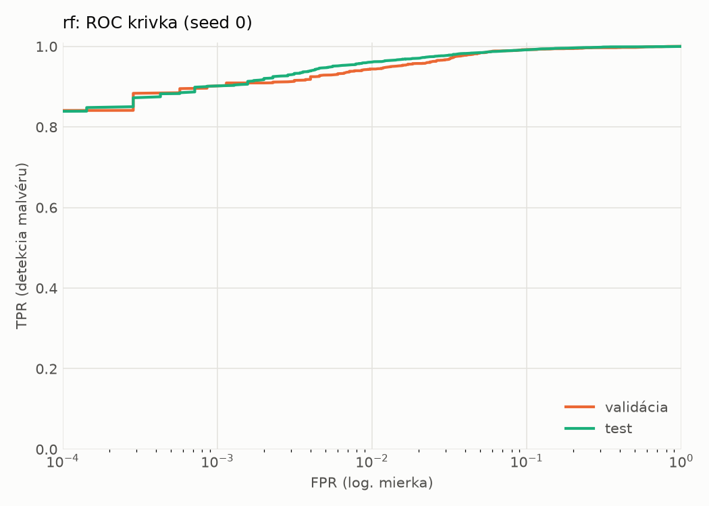
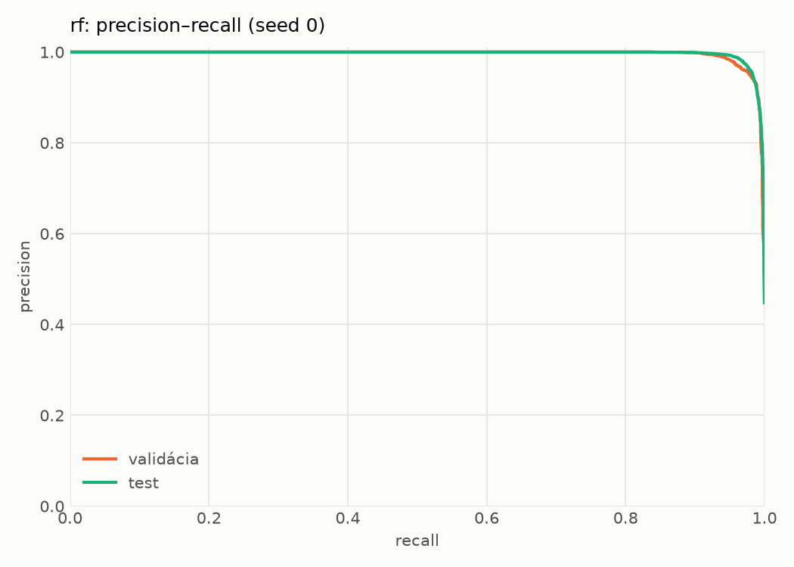
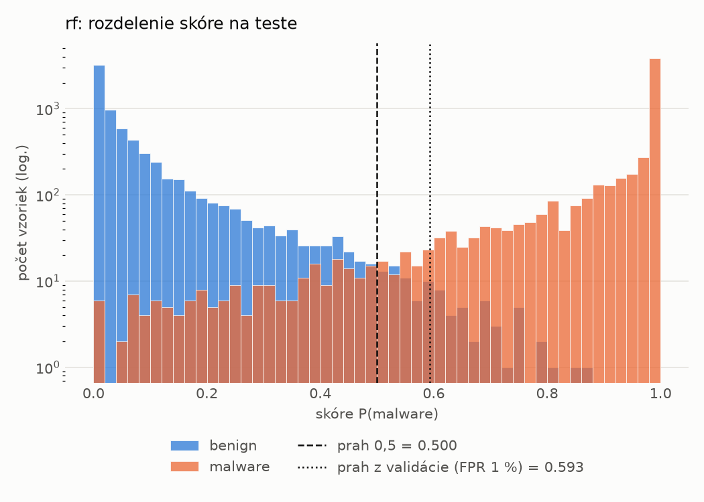
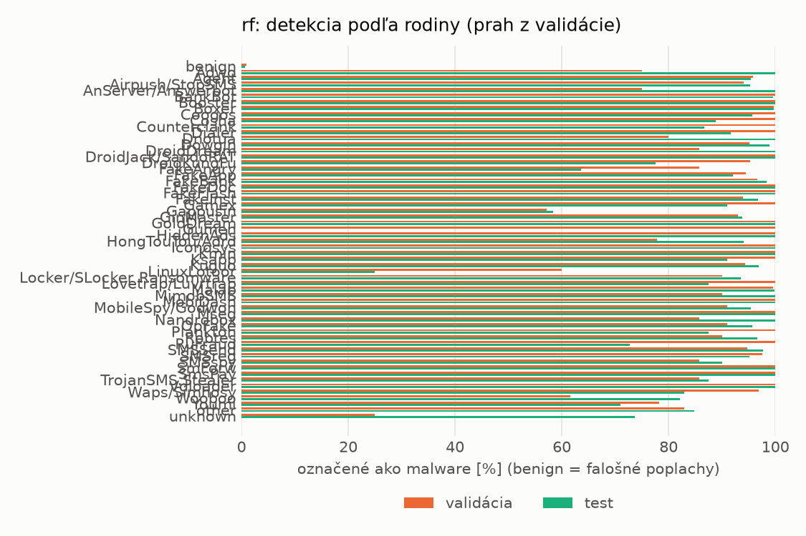
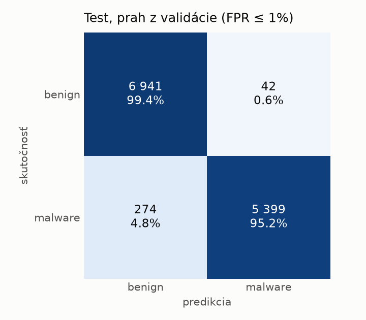
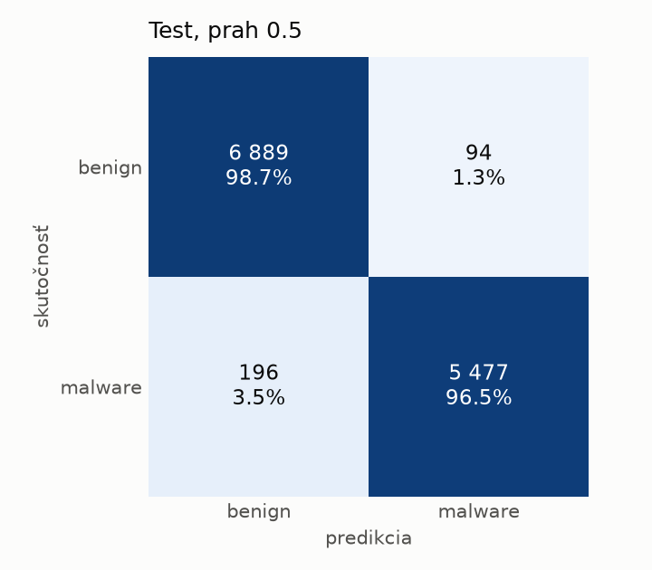
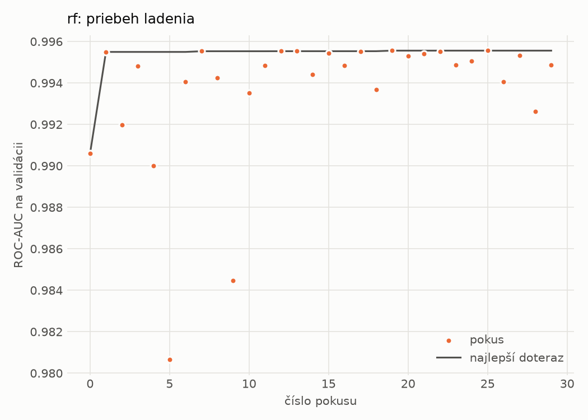

# hybrid/rf – beh `20261122-235747`

> Automaticky generované (`src/training/run_tabular.py`). Konfigurácia: `config.yaml`, protokol: `protocol.yaml`.

- **Model:** `random_forest` – Random Forest (pôvodné hodnoty príznakov)
- **Ladenie:** 30 dokončených pokusov (Optuna TPE), cieľ ROC-AUC na validácii, 1.1 min
- **Finálne modely:** seedy [0, 1, 2]; hodnoty sú priemer ± smerodajná odchýlka cez seedy
- **Najlepšie hyperparametre:** `{"n_estimators": 400, "max_depth": null, "min_samples_leaf": 1, "max_features": "sqrt"}`

## Detekčná kvalita (bez prahu)
| metrika | train (podvzorka) | validácia | test |
|---|---|---|---|
| ROC-AUC | 1.0000 ± 0.0000 | 0.9955 ± 0.0000 | 0.9965 ± 0.0000 |
| PR-AUC | 1.0000 ± 0.0000 | 0.9956 ± 0.0000 | 0.9965 ± 0.0000 |
| TPR pri FPR 1 % | 1.0000 ± 0.0000 | 0.9438 ± 0.0016 | 0.9613 ± 0.0015 |
| TPR pri FPR 0,1 % | 1.0000 ± 0.0000 | 0.8970 ± 0.0036 | 0.8956 ± 0.0066 |
| log loss | 0.0270 ± 0.0002 | 0.0971 ± 0.0017 | 0.0924 ± 0.0003 |
| Brier skóre | 0.0030 ± 0.0000 | 0.0242 ± 0.0001 | 0.0222 ± 0.0000 |

Rozdiel ROC-AUC train − validácia: **0.0045** (veľký rozdiel = preučenie).

## Pri prahu z validácie (FPR ≤ 1% na validácii)
| metrika | train (podvzorka) | validácia | test |
|---|---|---|---|
| accuracy | 1.0000 ± 0.0000 | 0.9694 ± 0.0007 | 0.9747 ± 0.0007 |
| balanced accuracy | 1.0000 ± 0.0000 | 0.9670 ± 0.0008 | 0.9725 ± 0.0007 |
| precision | 1.0000 ± 0.0000 | 0.9875 ± 0.0000 | 0.9927 ± 0.0006 |
| recall (TPR) | 1.0000 ± 0.0000 | 0.9438 ± 0.0016 | 0.9506 ± 0.0014 |
| FPR | 0.0000 ± 0.0000 | 0.0097 ± 0.0000 | 0.0057 ± 0.0005 |
| F1 | 1.0000 ± 0.0000 | 0.9651 ± 0.0008 | 0.9712 ± 0.0008 |
| MCC | 1.0000 ± 0.0000 | 0.9387 ± 0.0014 | 0.9494 ± 0.0014 |

## Pri pevnom prahu 0.5
| metrika | train (podvzorka) | validácia | test |
|---|---|---|---|
| accuracy | 1.0000 ± 0.0000 | 0.9698 ± 0.0004 | 0.9772 ± 0.0002 |
| balanced accuracy | 1.0000 ± 0.0000 | 0.9687 ± 0.0004 | 0.9761 ± 0.0002 |
| precision | 1.0000 ± 0.0000 | 0.9741 ± 0.0005 | 0.9831 ± 0.0004 |
| recall (TPR) | 1.0000 ± 0.0000 | 0.9581 ± 0.0004 | 0.9656 ± 0.0002 |
| FPR | 0.0000 ± 0.0000 | 0.0207 ± 0.0004 | 0.0135 ± 0.0003 |
| F1 | 1.0000 ± 0.0000 | 0.9660 ± 0.0005 | 0.9743 ± 0.0002 |
| MCC | 1.0000 ± 0.0000 | 0.9390 ± 0.0008 | 0.9539 ± 0.0004 |

## Výpočtové nároky (seed 0, testovacia množina)
| meranie | hodnota |
|---|---|
| tréning finálneho modelu | 2.9 s (priemer cez seedy) |
| ladenie spolu | 68 s |
| počet parametrov / uzlov | 1 927 422 |
| veľkosť modelu na disku | 154.53 MB |
| CPU latencia modelu (batch 1, 1 vlákno) | 12.282 ms (p95 12.635) |
| CPU priepustnosť (24 vlákien) | 98 690 vzoriek/s |

## Grafy
| | |
|---|---|
|  |  |
|  |  |
|  |  |
|  |  |

## Súbory
`metrics.json` (všetky metriky po seedoch vrátane rodín), `timing.json`, `hpo_trials.csv`,
`predictions/<časť>_seed<N>.parquet` (sha256, family, label, score), `model/seed_<N>/`, `log.txt`.
