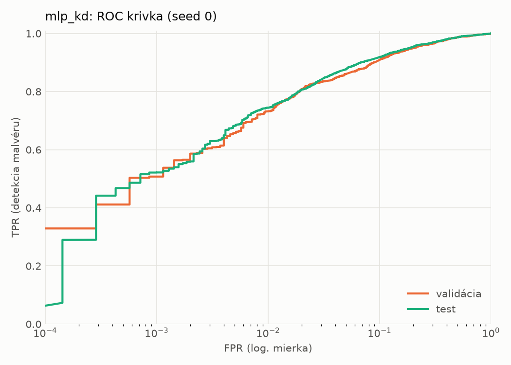
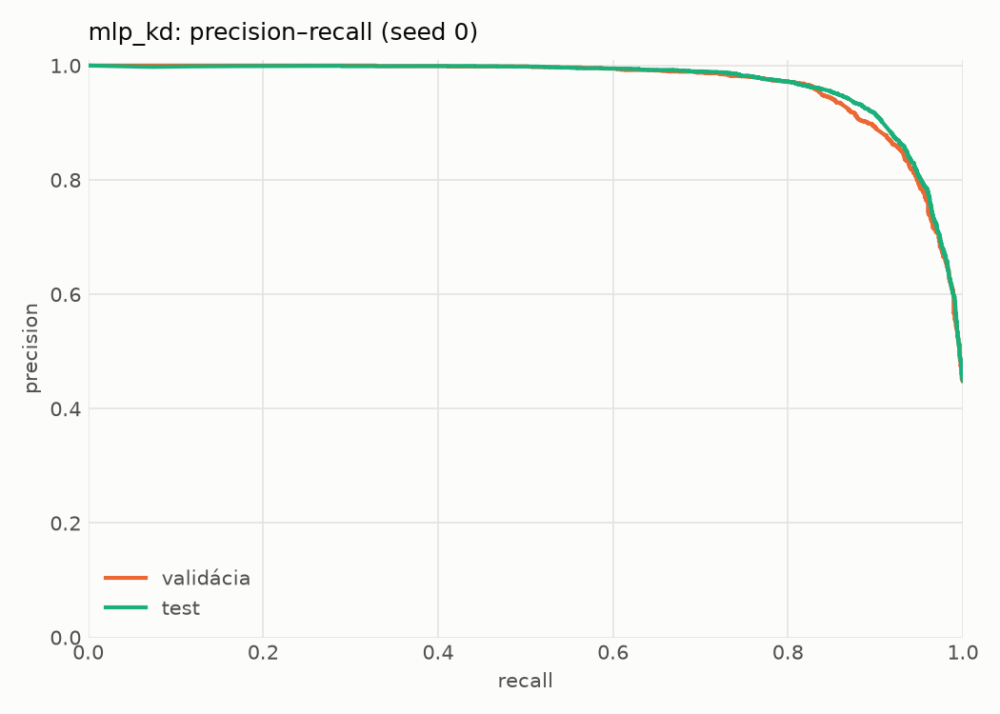
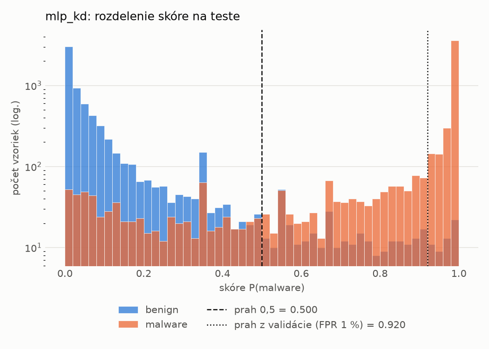
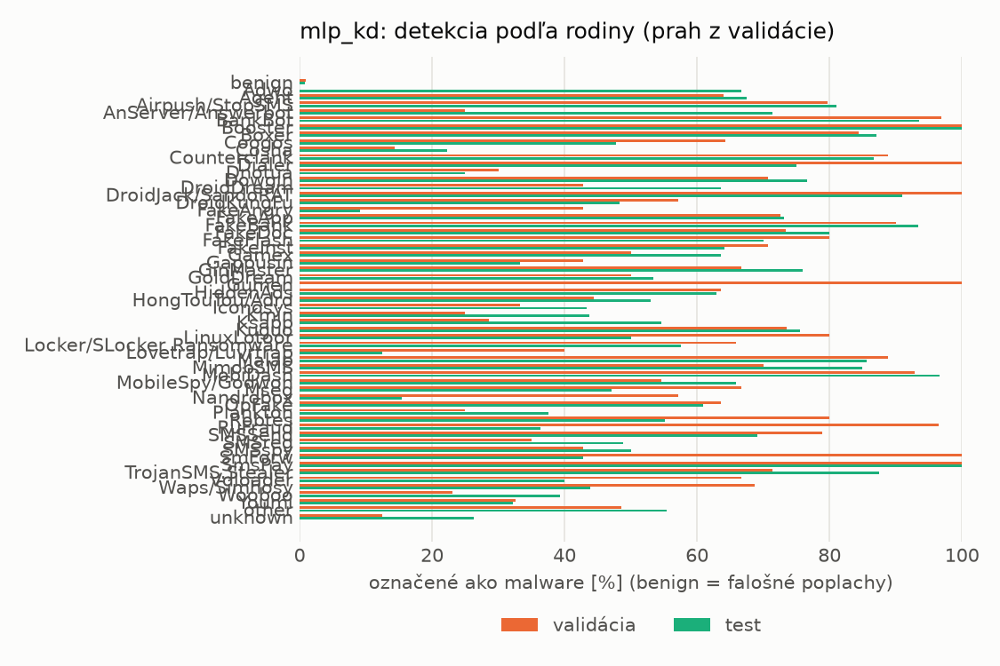
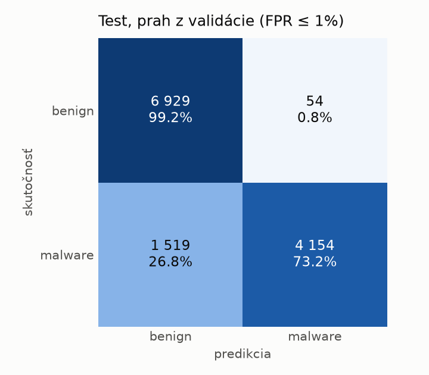
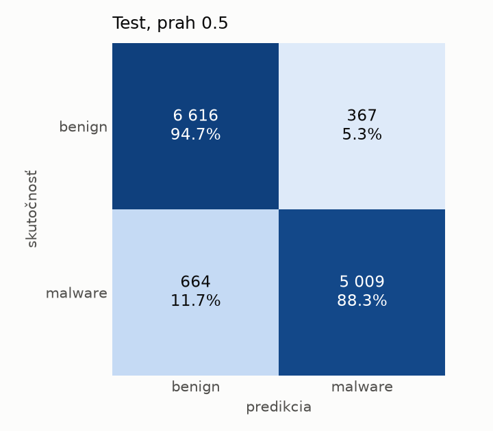
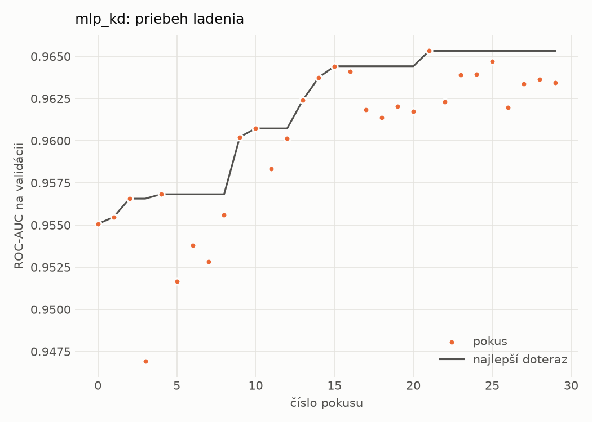
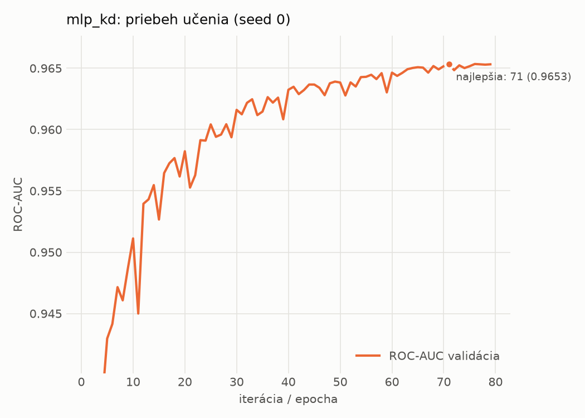

# dynamic/mlp_kd – beh `20261123-003616`

> Automaticky generované (`src/training/run_tabular.py`). Konfigurácia: `config.yaml`, protokol: `protocol.yaml`.

- **Model:** `mlp` – študent – malé MLP učené destiláciou z hybridného učiteľa
- **Ladenie:** 30 dokončených pokusov (Optuna TPE), cieľ ROC-AUC na validácii, 4.1 min
- **Finálne modely:** seedy [0, 1, 2]; hodnoty sú priemer ± smerodajná odchýlka cez seedy
- **Najlepšie hyperparametre:** `{"hidden_layers": 1, "max_epochs": 100, "patience": 8, "hidden_width": 64, "dropout": 0.008718220633742228, "lr": 0.002354362488135847, "weight_decay": 3.1986204696979587e-06, "batch_size": 1024, "kd_alpha": 0.2022752781289341, "kd_temperature": 1.263446759011441}`

## Detekčná kvalita (bez prahu)
| metrika | train (podvzorka) | validácia | test |
|---|---|---|---|
| ROC-AUC | 0.9732 ± 0.0007 | 0.9644 ± 0.0010 | 0.9677 ± 0.0005 |
| PR-AUC | 0.9736 ± 0.0005 | 0.9653 ± 0.0010 | 0.9678 ± 0.0008 |
| TPR pri FPR 1 % | 0.8079 ± 0.0008 | 0.7244 ± 0.0076 | 0.7339 ± 0.0092 |
| TPR pri FPR 0,1 % | 0.5990 ± 0.0490 | 0.5137 ± 0.0115 | 0.5115 ± 0.0090 |
| log loss | 0.1921 ± 0.0022 | 0.2355 ± 0.0034 | 0.2227 ± 0.0021 |
| Brier skóre | 0.0549 ± 0.0002 | 0.0675 ± 0.0011 | 0.0628 ± 0.0005 |

Rozdiel ROC-AUC train − validácia: **0.0088** (veľký rozdiel = preučenie).

## Pri prahu z validácie (FPR ≤ 1% na validácii)
| metrika | train (podvzorka) | validácia | test |
|---|---|---|---|
| accuracy | 0.8871 ± 0.0018 | 0.8711 ± 0.0035 | 0.8717 ± 0.0041 |
| balanced accuracy | 0.8711 ± 0.0021 | 0.8574 ± 0.0039 | 0.8579 ± 0.0045 |
| precision | 0.9915 ± 0.0006 | 0.9839 ± 0.0004 | 0.9857 ± 0.0014 |
| recall (TPR) | 0.7472 ± 0.0041 | 0.7244 ± 0.0076 | 0.7242 ± 0.0087 |
| FPR | 0.0050 ± 0.0004 | 0.0096 ± 0.0002 | 0.0085 ± 0.0008 |
| F1 | 0.8522 ± 0.0027 | 0.8344 ± 0.0052 | 0.8350 ± 0.0061 |
| MCC | 0.7837 ± 0.0033 | 0.7559 ± 0.0062 | 0.7573 ± 0.0075 |

## Pri pevnom prahu 0.5
| metrika | train (podvzorka) | validácia | test |
|---|---|---|---|
| accuracy | 0.9271 ± 0.0010 | 0.9081 ± 0.0018 | 0.9181 ± 0.0004 |
| balanced accuracy | 0.9237 ± 0.0010 | 0.9050 ± 0.0020 | 0.9148 ± 0.0005 |
| precision | 0.9329 ± 0.0016 | 0.9163 ± 0.0004 | 0.9305 ± 0.0027 |
| recall (TPR) | 0.8973 ± 0.0019 | 0.8750 ± 0.0040 | 0.8831 ± 0.0029 |
| FPR | 0.0498 ± 0.0013 | 0.0650 ± 0.0002 | 0.0536 ± 0.0024 |
| F1 | 0.9147 ± 0.0012 | 0.8952 ± 0.0023 | 0.9062 ± 0.0005 |
| MCC | 0.8517 ± 0.0020 | 0.8142 ± 0.0037 | 0.8345 ± 0.0009 |

## Výpočtové nároky (seed 0, testovacia množina)
| meranie | hodnota |
|---|---|
| tréning finálneho modelu | 7.0 s (priemer cez seedy) |
| ladenie spolu | 247 s |
| počet parametrov / uzlov | 8 129 |
| veľkosť modelu na disku | 0.04 MB |
| transformácia vstupu – latencia (1 vlákno) | 0.014 ms |
| transformácia vstupu – priepustnosť | 856 837 vzoriek/s |
| CPU latencia modelu (batch 1, 1 vlákno) | 0.066 ms (p95 0.072) |
| CPU priepustnosť (24 vlákien) | 5 326 375 vzoriek/s |
| GPU latencia (batch 1) | 0.271 ms (p95 0.297) |
| GPU priepustnosť | 1 942 713 vzoriek/s |
| GPU špičková pamäť | 53 MB |

## Grafy
| | |
|---|---|
|  |  |
|  |  |
|  |  |
|  |  |

## Súbory
`metrics.json` (všetky metriky po seedoch vrátane rodín), `timing.json`, `hpo_trials.csv`,
`predictions/<časť>_seed<N>.parquet` (sha256, family, label, score), `model/seed_<N>/`, `log.txt`.
