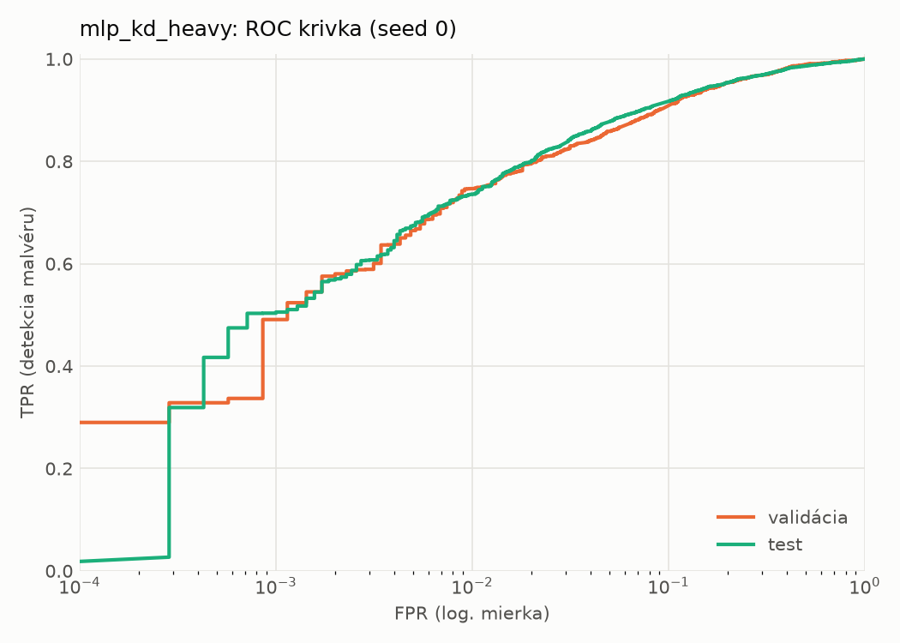
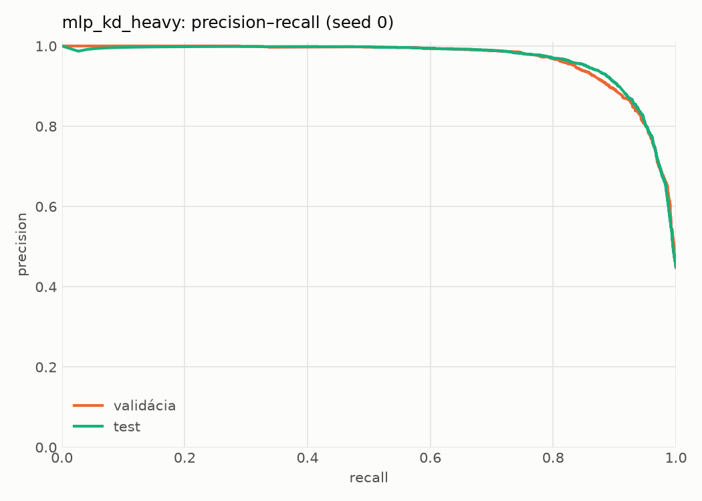
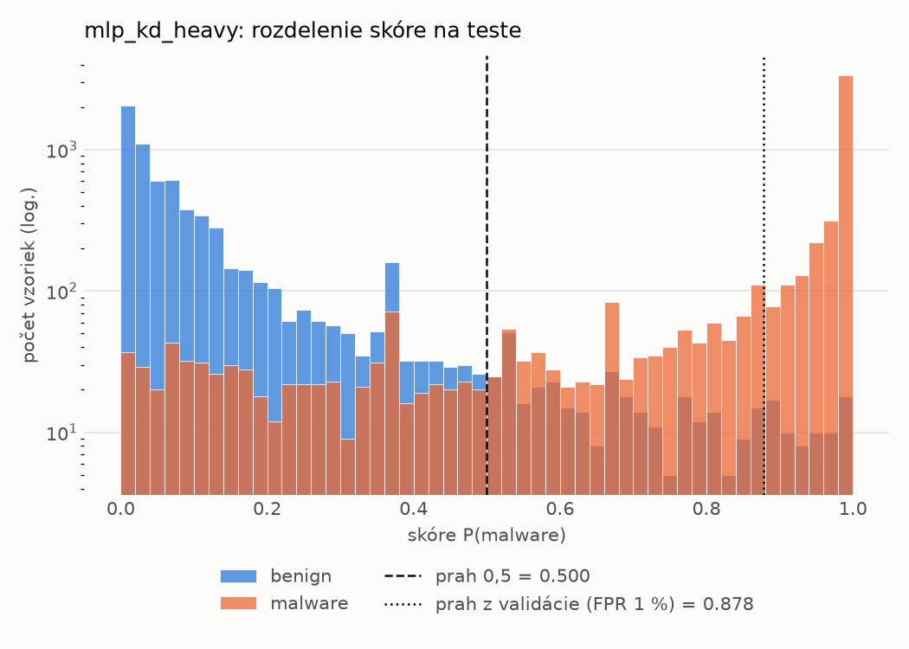
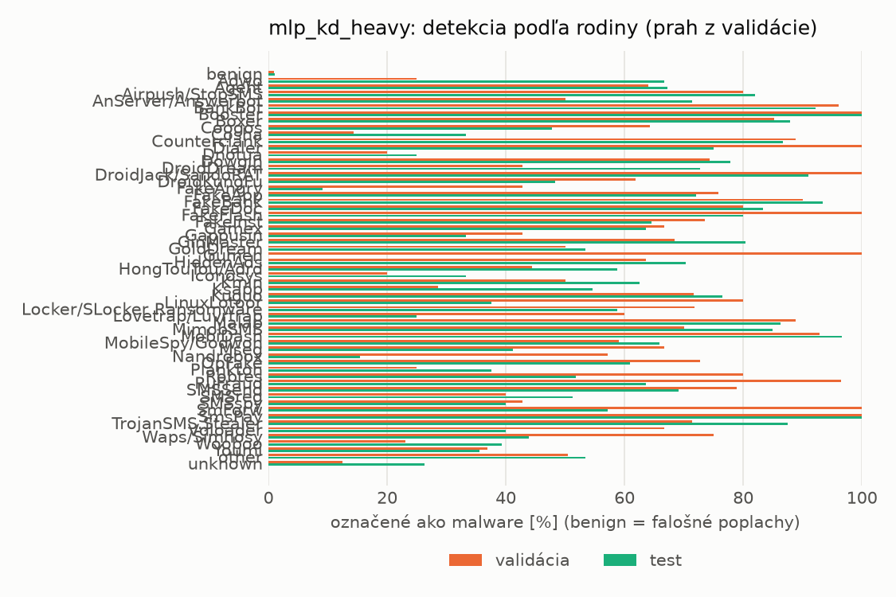
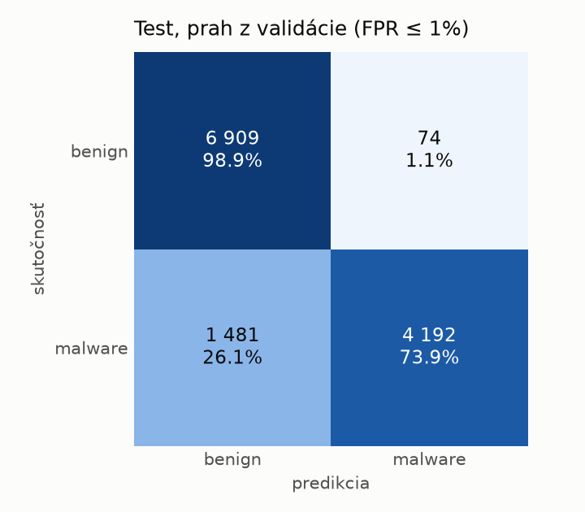
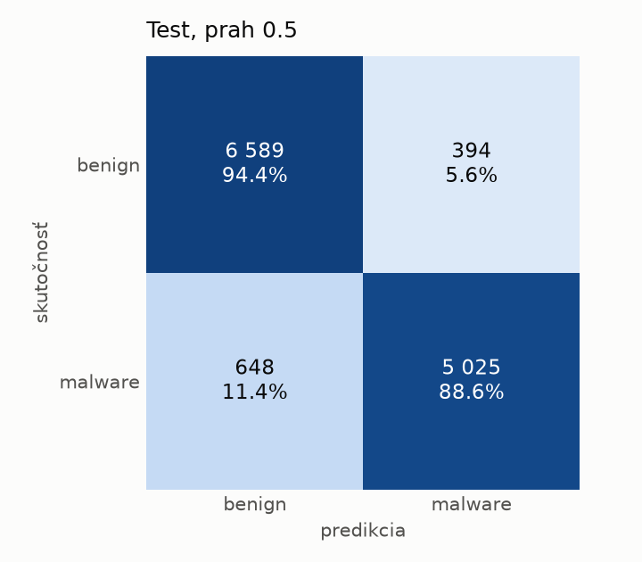
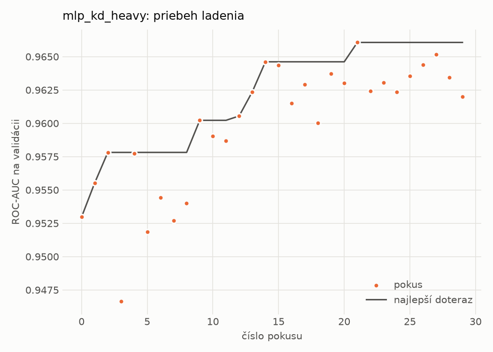
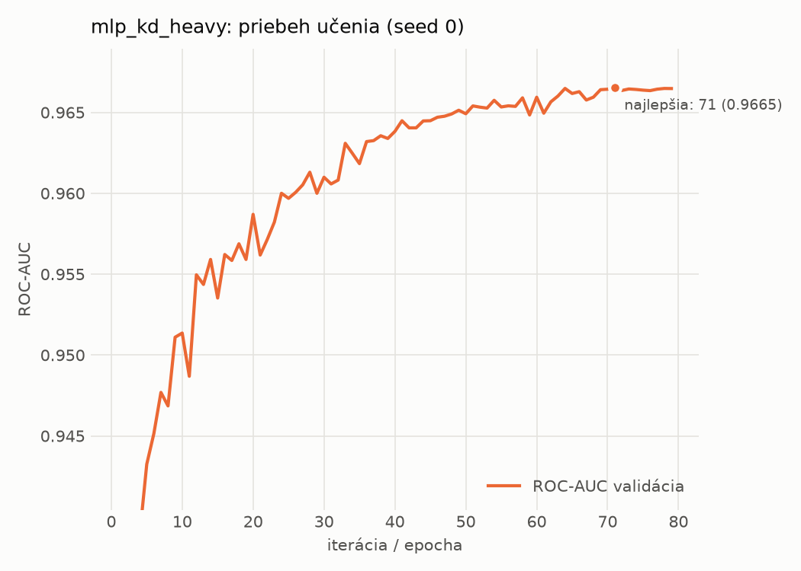

# dynamic/mlp_kd_heavy – beh `20261123-005328`

> Automaticky generované (`src/training/run_tabular.py`). Konfigurácia: `config.yaml`, protokol: `protocol.yaml`.

- **Model:** `mlp` – študent – malé MLP učené destiláciou z mlp_large hybridu (V4)
- **Ladenie:** 30 dokončených pokusov (Optuna TPE), cieľ ROC-AUC na validácii, 4.4 min
- **Finálne modely:** seedy [0, 1, 2]; hodnoty sú priemer ± smerodajná odchýlka cez seedy
- **Najlepšie hyperparametre:** `{"hidden_layers": 1, "max_epochs": 100, "patience": 8, "hidden_width": 64, "dropout": 0.020410116354877387, "lr": 0.0023709262856920267, "weight_decay": 2.3924155608522853e-05, "batch_size": 1024, "kd_alpha": 0.37221474320301356, "kd_temperature": 1.1598739057164045}`

## Detekčná kvalita (bez prahu)
| metrika | train (podvzorka) | validácia | test |
|---|---|---|---|
| ROC-AUC | 0.9735 ± 0.0017 | 0.9661 ± 0.0008 | 0.9676 ± 0.0012 |
| PR-AUC | 0.9739 ± 0.0017 | 0.9664 ± 0.0006 | 0.9678 ± 0.0016 |
| TPR pri FPR 1 % | 0.8092 ± 0.0139 | 0.7387 ± 0.0071 | 0.7376 ± 0.0061 |
| TPR pri FPR 0,1 % | 0.5985 ± 0.0323 | 0.4729 ± 0.0471 | 0.5128 ± 0.0130 |
| log loss | 0.1922 ± 0.0073 | 0.2262 ± 0.0018 | 0.2197 ± 0.0046 |
| Brier skóre | 0.0550 ± 0.0021 | 0.0661 ± 0.0006 | 0.0626 ± 0.0015 |

Rozdiel ROC-AUC train − validácia: **0.0074** (veľký rozdiel = preučenie).

## Pri prahu z validácie (FPR ≤ 1% na validácii)
| metrika | train (podvzorka) | validácia | test |
|---|---|---|---|
| accuracy | 0.8916 ± 0.0026 | 0.8775 ± 0.0032 | 0.8759 ± 0.0013 |
| balanced accuracy | 0.8765 ± 0.0030 | 0.8645 ± 0.0036 | 0.8627 ± 0.0015 |
| precision | 0.9893 ± 0.0018 | 0.9840 ± 0.0002 | 0.9838 ± 0.0012 |
| recall (TPR) | 0.7593 ± 0.0062 | 0.7387 ± 0.0071 | 0.7353 ± 0.0034 |
| FPR | 0.0063 ± 0.0011 | 0.0097 ± 0.0000 | 0.0098 ± 0.0008 |
| F1 | 0.8592 ± 0.0038 | 0.8439 ± 0.0047 | 0.8416 ± 0.0020 |
| MCC | 0.7914 ± 0.0047 | 0.7672 ± 0.0057 | 0.7644 ± 0.0023 |

## Pri pevnom prahu 0.5
| metrika | train (podvzorka) | validácia | test |
|---|---|---|---|
| accuracy | 0.9269 ± 0.0031 | 0.9089 ± 0.0013 | 0.9180 ± 0.0027 |
| balanced accuracy | 0.9235 ± 0.0029 | 0.9058 ± 0.0010 | 0.9148 ± 0.0027 |
| precision | 0.9327 ± 0.0065 | 0.9171 ± 0.0059 | 0.9297 ± 0.0039 |
| recall (TPR) | 0.8969 ± 0.0015 | 0.8761 ± 0.0042 | 0.8838 ± 0.0033 |
| FPR | 0.0500 ± 0.0051 | 0.0644 ± 0.0053 | 0.0543 ± 0.0031 |
| F1 | 0.9145 ± 0.0034 | 0.8961 ± 0.0011 | 0.9062 ± 0.0030 |
| MCC | 0.8512 ± 0.0065 | 0.8158 ± 0.0028 | 0.8342 ± 0.0054 |

## Výpočtové nároky (seed 0, testovacia množina)
| meranie | hodnota |
|---|---|
| tréning finálneho modelu | 7.3 s (priemer cez seedy) |
| ladenie spolu | 262 s |
| počet parametrov / uzlov | 8 129 |
| veľkosť modelu na disku | 0.04 MB |
| transformácia vstupu – latencia (1 vlákno) | 0.014 ms |
| transformácia vstupu – priepustnosť | 778 697 vzoriek/s |
| CPU latencia modelu (batch 1, 1 vlákno) | 0.158 ms (p95 0.168) |
| CPU priepustnosť (24 vlákien) | 8 273 518 vzoriek/s |
| GPU latencia (batch 1) | 0.454 ms (p95 0.479) |
| GPU priepustnosť | 3 509 025 vzoriek/s |
| GPU špičková pamäť | 78 MB |

## Grafy
| | |
|---|---|
|  |  |
|  |  |
|  |  |
|  |  |

## Súbory
`metrics.json` (všetky metriky po seedoch vrátane rodín), `timing.json`, `hpo_trials.csv`,
`predictions/<časť>_seed<N>.parquet` (sha256, family, label, score), `model/seed_<N>/`, `log.txt`.
