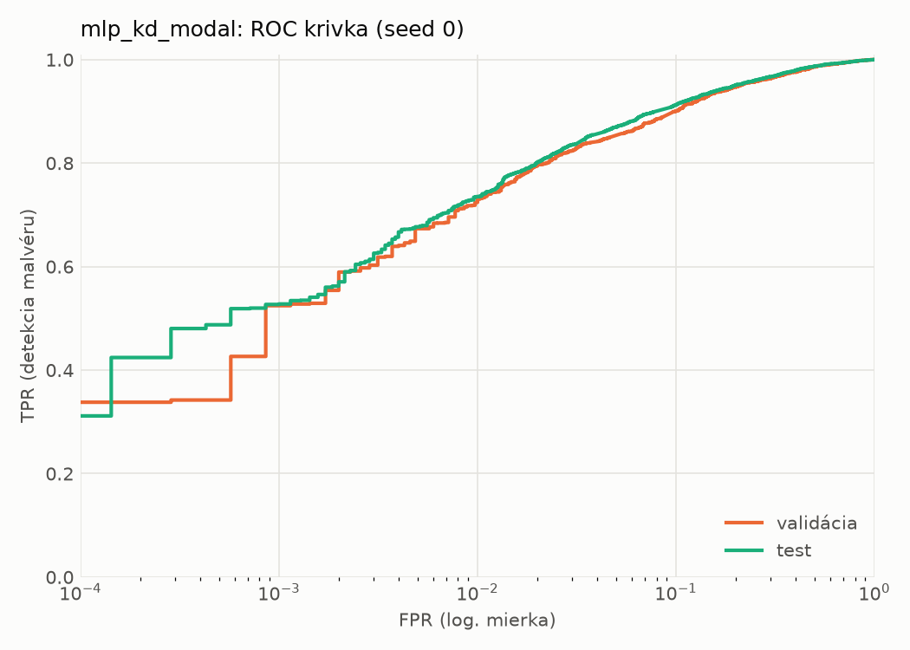
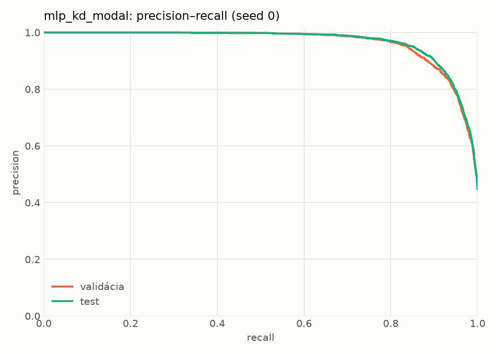
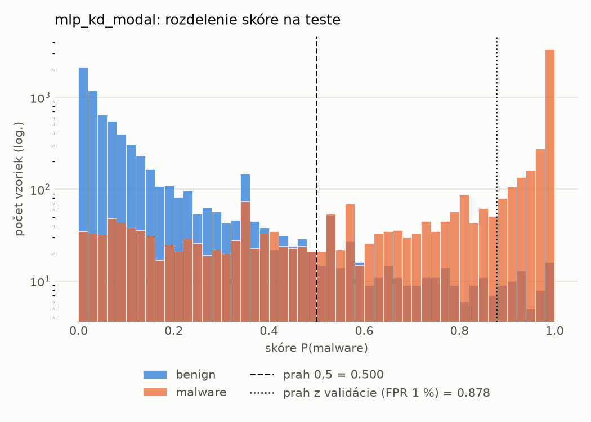
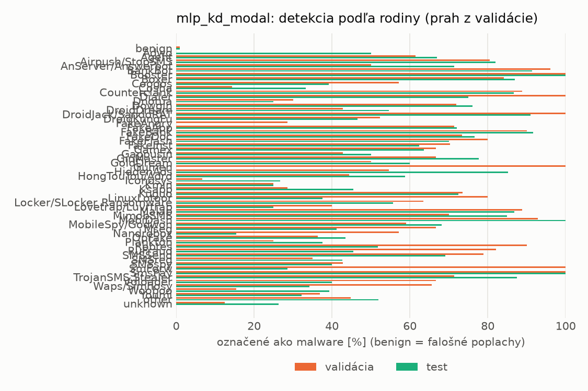
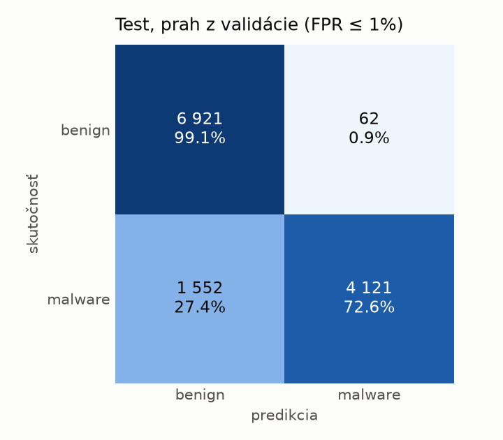
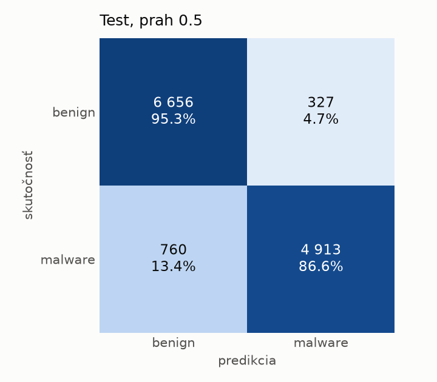
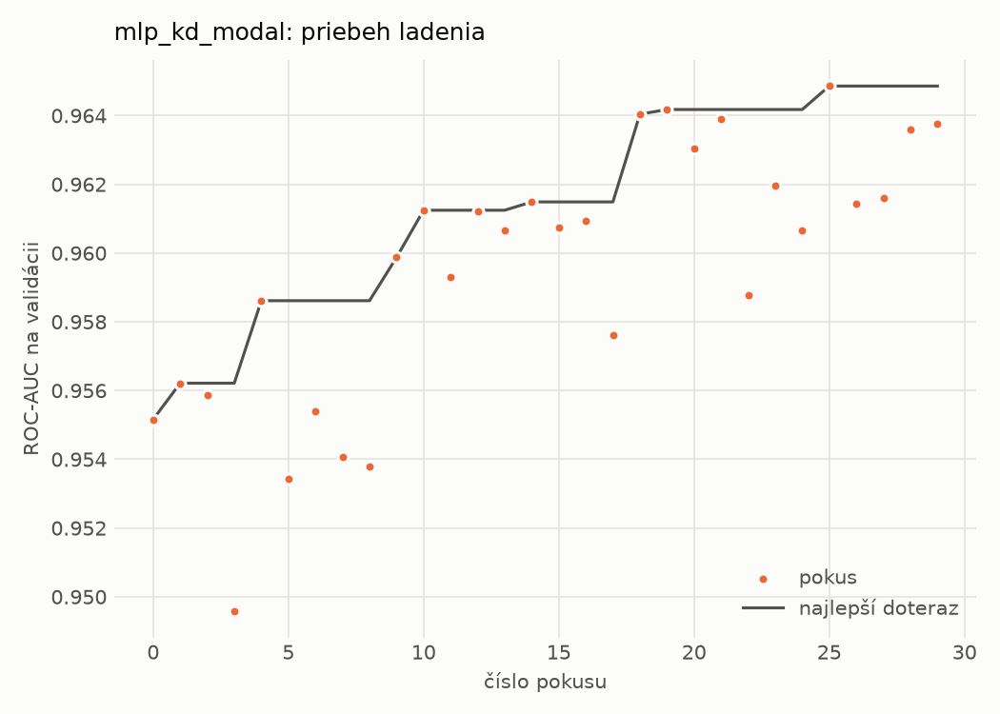
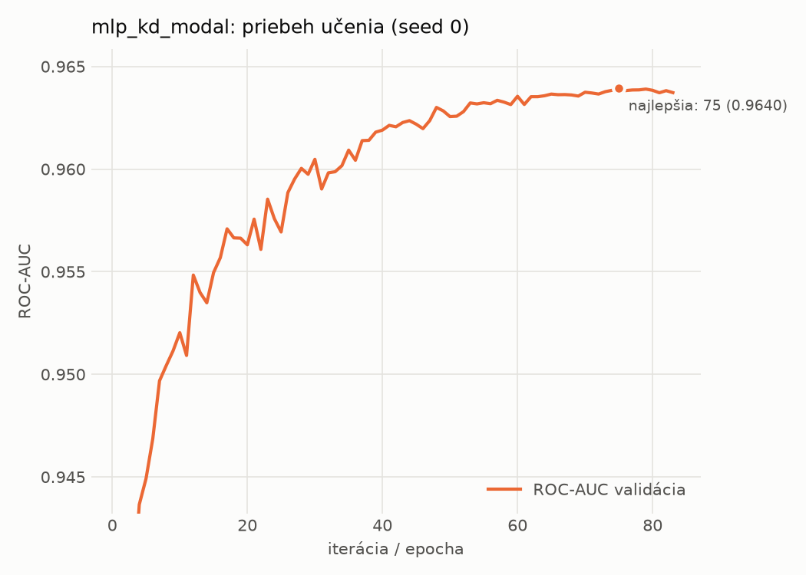

# dynamic/mlp_kd_modal – beh `20261123-004749`

> Automaticky generované (`src/training/run_tabular.py`). Konfigurácia: `config.yaml`, protokol: `protocol.yaml`.

- **Model:** `mlp` – študent – malé MLP učené destiláciou z učiteľa rovnakej modality (variant A)
- **Ladenie:** 30 dokončených pokusov (Optuna TPE), cieľ ROC-AUC na validácii, 5.0 min
- **Finálne modely:** seedy [0, 1, 2]; hodnoty sú priemer ± smerodajná odchýlka cez seedy
- **Najlepšie hyperparametre:** `{"hidden_layers": 1, "max_epochs": 100, "patience": 8, "hidden_width": 64, "dropout": 0.23306226533454044, "lr": 0.0029211055962699408, "weight_decay": 1.2442051354380418e-06, "batch_size": 512, "kd_alpha": 0.38098578248234166, "kd_temperature": 1.6615545083860346}`

## Detekčná kvalita (bez prahu)
| metrika | train (podvzorka) | validácia | test |
|---|---|---|---|
| ROC-AUC | 0.9699 ± 0.0005 | 0.9639 ± 0.0012 | 0.9664 ± 0.0006 |
| PR-AUC | 0.9705 ± 0.0005 | 0.9644 ± 0.0011 | 0.9669 ± 0.0007 |
| TPR pri FPR 1 % | 0.7779 ± 0.0107 | 0.7224 ± 0.0034 | 0.7373 ± 0.0077 |
| TPR pri FPR 0,1 % | 0.5725 ± 0.0112 | 0.5043 ± 0.0177 | 0.5259 ± 0.0105 |
| log loss | 0.2049 ± 0.0017 | 0.2333 ± 0.0044 | 0.2237 ± 0.0022 |
| Brier skóre | 0.0589 ± 0.0007 | 0.0689 ± 0.0010 | 0.0652 ± 0.0006 |

Rozdiel ROC-AUC train − validácia: **0.0061** (veľký rozdiel = preučenie).

## Pri prahu z validácie (FPR ≤ 1% na validácii)
| metrika | train (podvzorka) | validácia | test |
|---|---|---|---|
| accuracy | 0.8865 ± 0.0009 | 0.8702 ± 0.0015 | 0.8724 ± 0.0013 |
| balanced accuracy | 0.8707 ± 0.0010 | 0.8563 ± 0.0017 | 0.8587 ± 0.0016 |
| precision | 0.9887 ± 0.0006 | 0.9837 ± 0.0001 | 0.9849 ± 0.0010 |
| recall (TPR) | 0.7479 ± 0.0018 | 0.7224 ± 0.0034 | 0.7265 ± 0.0038 |
| FPR | 0.0066 ± 0.0004 | 0.0097 ± 0.0000 | 0.0090 ± 0.0007 |
| F1 | 0.8516 ± 0.0013 | 0.8330 ± 0.0023 | 0.8362 ± 0.0022 |
| MCC | 0.7820 ± 0.0017 | 0.7542 ± 0.0027 | 0.7585 ± 0.0021 |

## Pri pevnom prahu 0.5
| metrika | train (podvzorka) | validácia | test |
|---|---|---|---|
| accuracy | 0.9218 ± 0.0008 | 0.9052 ± 0.0008 | 0.9131 ± 0.0013 |
| balanced accuracy | 0.9169 ± 0.0010 | 0.9007 ± 0.0007 | 0.9084 ± 0.0012 |
| precision | 0.9383 ± 0.0061 | 0.9258 ± 0.0083 | 0.9384 ± 0.0062 |
| recall (TPR) | 0.8783 ± 0.0064 | 0.8574 ± 0.0079 | 0.8628 ± 0.0049 |
| FPR | 0.0446 ± 0.0050 | 0.0559 ± 0.0072 | 0.0460 ± 0.0051 |
| F1 | 0.9073 ± 0.0010 | 0.8902 ± 0.0009 | 0.8990 ± 0.0014 |
| MCC | 0.8413 ± 0.0016 | 0.8090 ± 0.0020 | 0.8253 ± 0.0030 |

## Výpočtové nároky (seed 0, testovacia množina)
| meranie | hodnota |
|---|---|
| tréning finálneho modelu | 11.7 s (priemer cez seedy) |
| ladenie spolu | 303 s |
| počet parametrov / uzlov | 8 129 |
| veľkosť modelu na disku | 0.04 MB |
| transformácia vstupu – latencia (1 vlákno) | 0.014 ms |
| transformácia vstupu – priepustnosť | 791 346 vzoriek/s |
| CPU latencia modelu (batch 1, 1 vlákno) | 0.070 ms (p95 0.164) |
| CPU priepustnosť (24 vlákien) | 8 087 418 vzoriek/s |
| GPU latencia (batch 1) | 0.274 ms (p95 0.307) |
| GPU priepustnosť | 2 256 615 vzoriek/s |
| GPU špičková pamäť | 53 MB |

## Grafy
| | |
|---|---|
|  |  |
|  |  |
|  |  |
|  |  |

## Súbory
`metrics.json` (všetky metriky po seedoch vrátane rodín), `timing.json`, `hpo_trials.csv`,
`predictions/<časť>_seed<N>.parquet` (sha256, family, label, score), `model/seed_<N>/`, `log.txt`.
