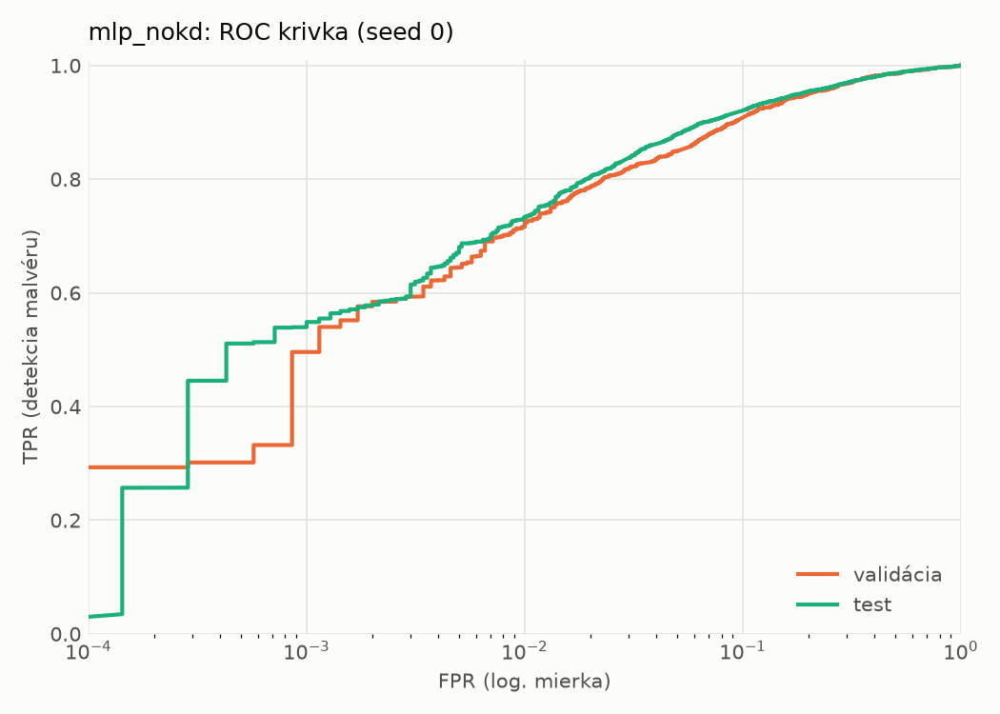
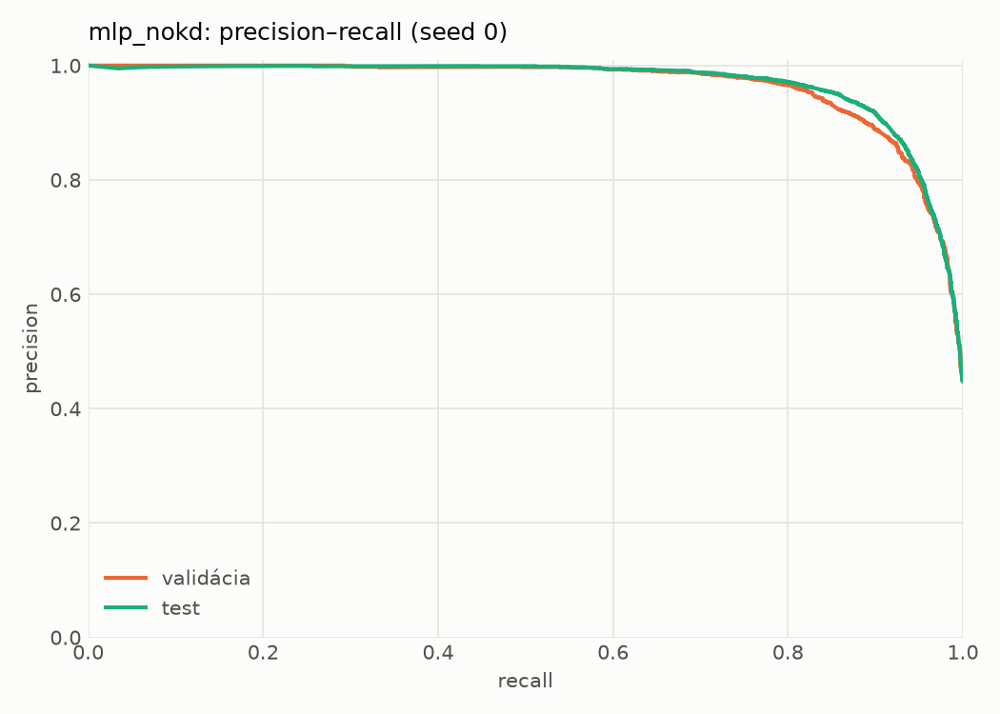
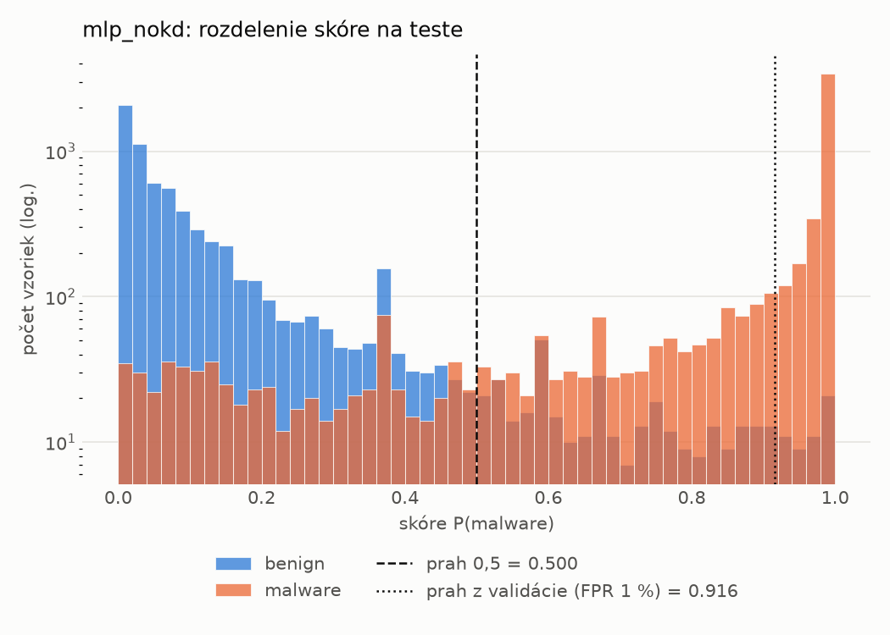
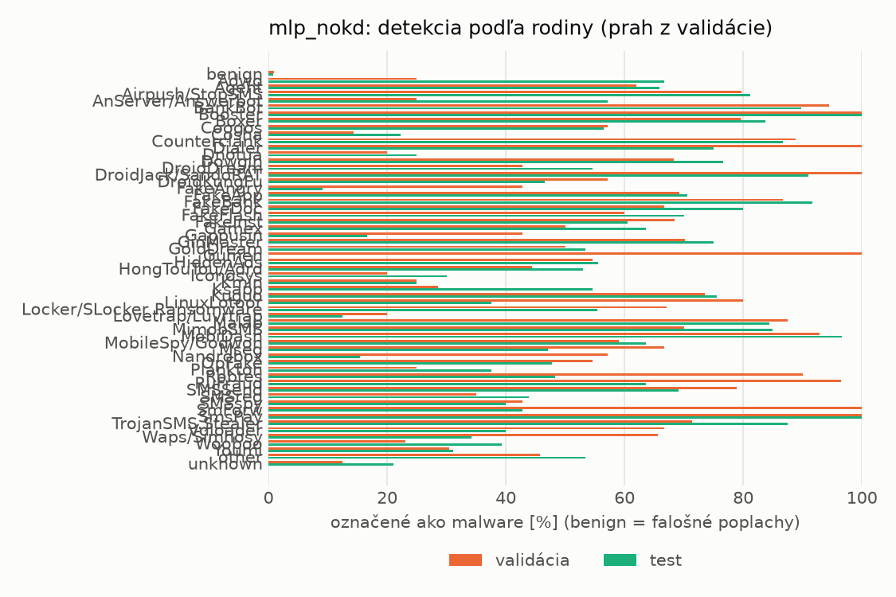
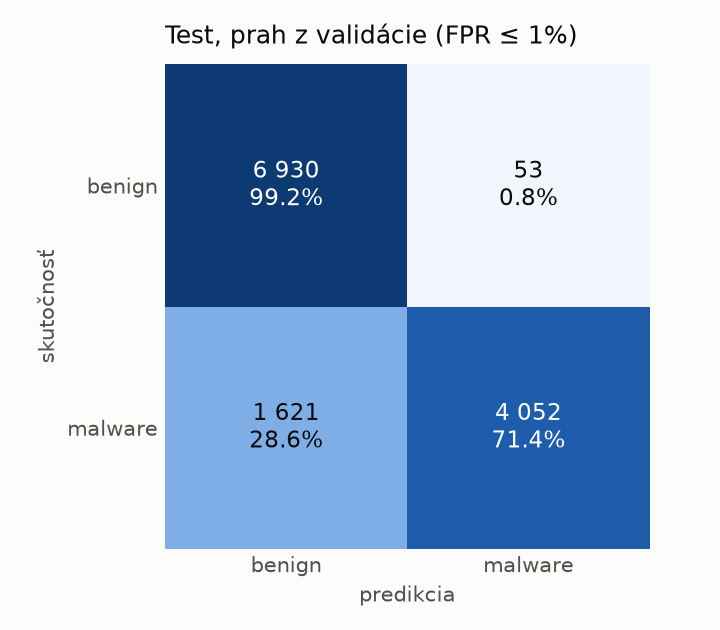
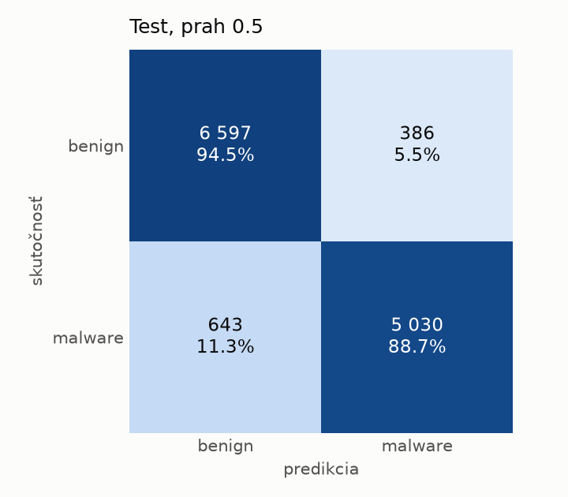
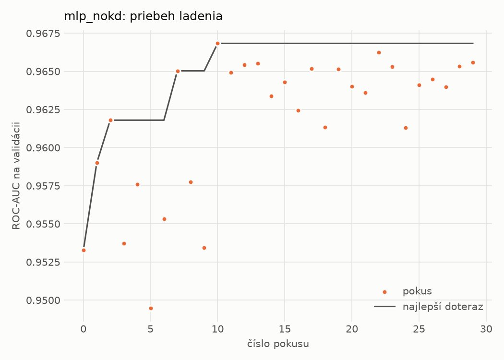
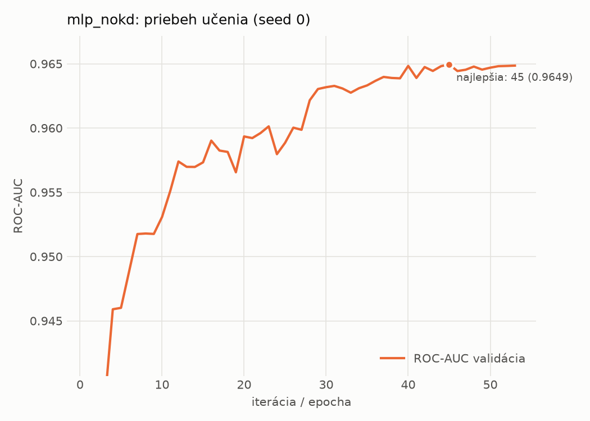

# dynamic/mlp_nokd – beh `20261123-004046`

> Automaticky generované (`src/training/run_tabular.py`). Konfigurácia: `config.yaml`, protokol: `protocol.yaml`.

- **Model:** `mlp` – kontrola – rovnaké malé MLP bez destilácie (iba skutočné označenia)
- **Ladenie:** 30 dokončených pokusov (Optuna TPE), cieľ ROC-AUC na validácii, 6.4 min
- **Finálne modely:** seedy [0, 1, 2]; hodnoty sú priemer ± smerodajná odchýlka cez seedy
- **Najlepšie hyperparametre:** `{"hidden_layers": 1, "max_epochs": 100, "patience": 8, "hidden_width": 64, "dropout": 0.01960392869507369, "lr": 0.0014251751351833603, "weight_decay": 1.336267730425129e-05, "batch_size": 256}`

## Detekčná kvalita (bez prahu)
| metrika | train (podvzorka) | validácia | test |
|---|---|---|---|
| ROC-AUC | 0.9745 ± 0.0017 | 0.9651 ± 0.0011 | 0.9680 ± 0.0014 |
| PR-AUC | 0.9748 ± 0.0016 | 0.9655 ± 0.0012 | 0.9681 ± 0.0014 |
| TPR pri FPR 1 % | 0.8082 ± 0.0106 | 0.7182 ± 0.0046 | 0.7379 ± 0.0074 |
| TPR pri FPR 0,1 % | 0.6035 ± 0.0008 | 0.5113 ± 0.0195 | 0.4920 ± 0.0512 |
| log loss | 0.1897 ± 0.0057 | 0.2301 ± 0.0032 | 0.2200 ± 0.0042 |
| Brier skóre | 0.0546 ± 0.0016 | 0.0672 ± 0.0014 | 0.0627 ± 0.0014 |

Rozdiel ROC-AUC train − validácia: **0.0094** (veľký rozdiel = preučenie).

## Pri prahu z validácie (FPR ≤ 1% na validácii)
| metrika | train (podvzorka) | validácia | test |
|---|---|---|---|
| accuracy | 0.8858 ± 0.0031 | 0.8683 ± 0.0021 | 0.8692 ± 0.0022 |
| balanced accuracy | 0.8695 ± 0.0034 | 0.8542 ± 0.0023 | 0.8550 ± 0.0025 |
| precision | 0.9925 ± 0.0009 | 0.9836 ± 0.0001 | 0.9866 ± 0.0005 |
| recall (TPR) | 0.7433 ± 0.0064 | 0.7182 ± 0.0046 | 0.7180 ± 0.0053 |
| FPR | 0.0043 ± 0.0005 | 0.0097 ± 0.0000 | 0.0079 ± 0.0004 |
| F1 | 0.8500 ± 0.0045 | 0.8302 ± 0.0031 | 0.8311 ± 0.0034 |
| MCC | 0.7816 ± 0.0057 | 0.7508 ± 0.0037 | 0.7532 ± 0.0038 |

## Pri pevnom prahu 0.5
| metrika | train (podvzorka) | validácia | test |
|---|---|---|---|
| accuracy | 0.9281 ± 0.0017 | 0.9077 ± 0.0021 | 0.9185 ± 0.0011 |
| balanced accuracy | 0.9249 ± 0.0026 | 0.9045 ± 0.0031 | 0.9152 ± 0.0021 |
| precision | 0.9331 ± 0.0054 | 0.9164 ± 0.0085 | 0.9308 ± 0.0083 |
| recall (TPR) | 0.8996 ± 0.0101 | 0.8740 ± 0.0137 | 0.8840 ± 0.0117 |
| FPR | 0.0498 ± 0.0048 | 0.0649 ± 0.0081 | 0.0535 ± 0.0075 |
| F1 | 0.9160 ± 0.0026 | 0.8946 ± 0.0035 | 0.9067 ± 0.0023 |
| MCC | 0.8537 ± 0.0032 | 0.8134 ± 0.0039 | 0.8353 ± 0.0018 |

## Výpočtové nároky (seed 0, testovacia množina)
| meranie | hodnota |
|---|---|
| tréning finálneho modelu | 12.5 s (priemer cez seedy) |
| ladenie spolu | 384 s |
| počet parametrov / uzlov | 8 129 |
| veľkosť modelu na disku | 0.04 MB |
| transformácia vstupu – latencia (1 vlákno) | 0.014 ms |
| transformácia vstupu – priepustnosť | 777 806 vzoriek/s |
| CPU latencia modelu (batch 1, 1 vlákno) | 0.157 ms (p95 0.166) |
| CPU priepustnosť (24 vlákien) | 7 857 453 vzoriek/s |
| GPU latencia (batch 1) | 0.274 ms (p95 0.292) |
| GPU priepustnosť | 3 187 668 vzoriek/s |
| GPU špičková pamäť | 78 MB |

## Grafy
| | |
|---|---|
|  |  |
|  |  |
|  |  |
|  |  |

## Súbory
`metrics.json` (všetky metriky po seedoch vrátane rodín), `timing.json`, `hpo_trials.csv`,
`predictions/<časť>_seed<N>.parquet` (sha256, family, label, score), `model/seed_<N>/`, `log.txt`.
