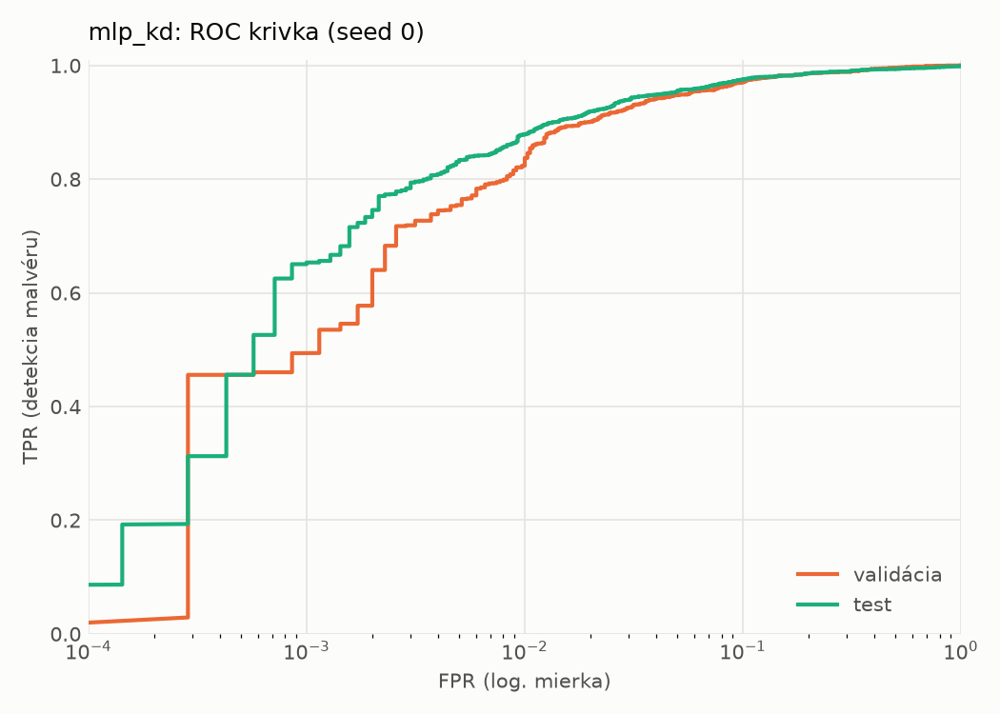
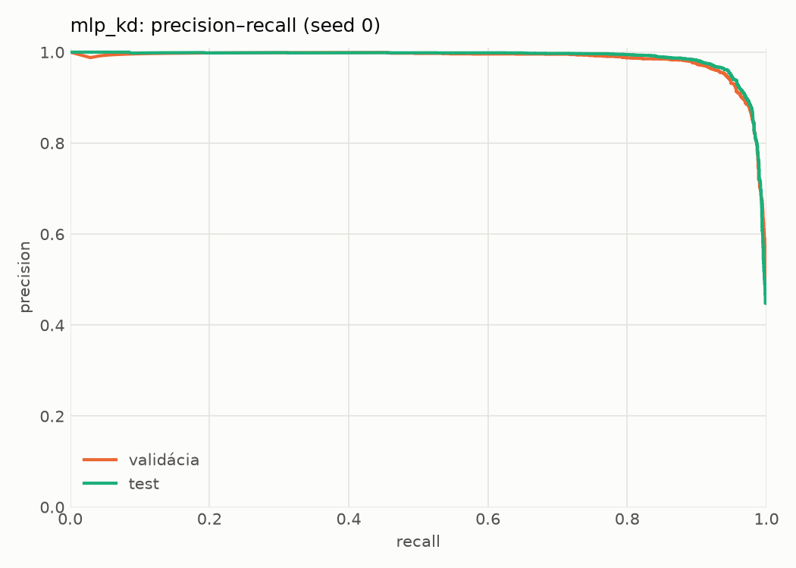
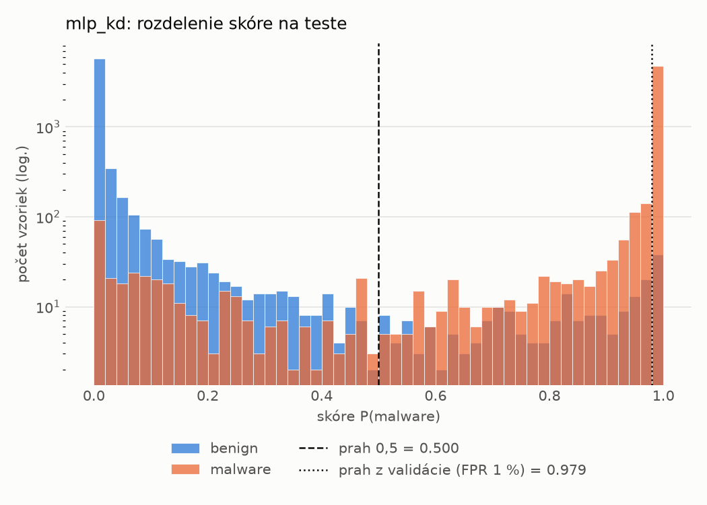
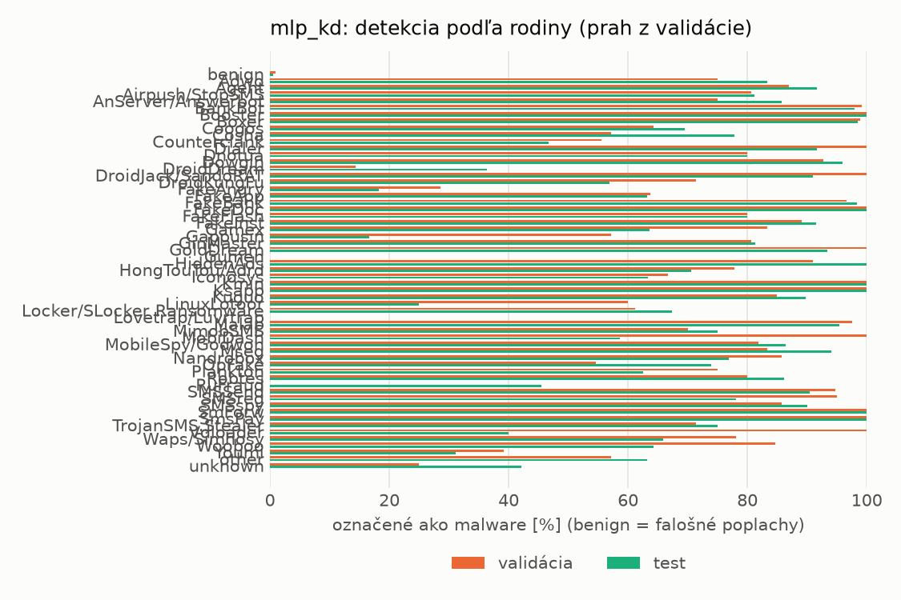
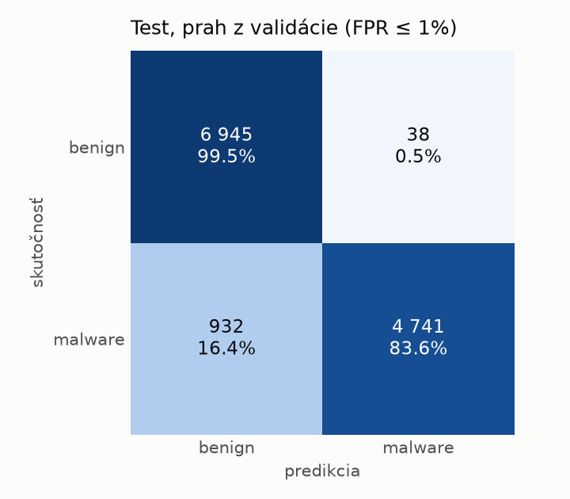
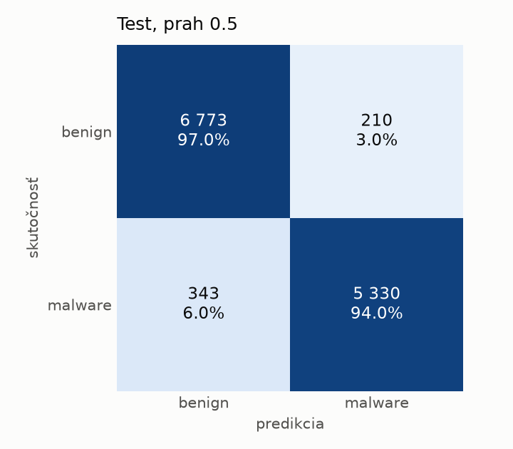
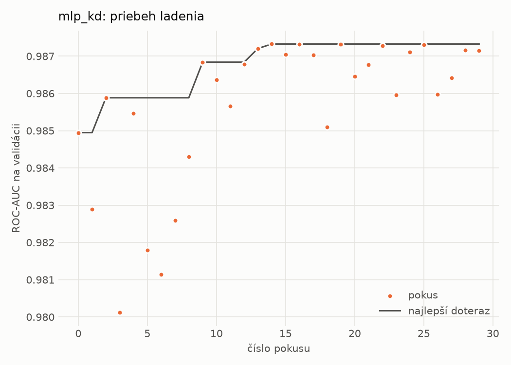
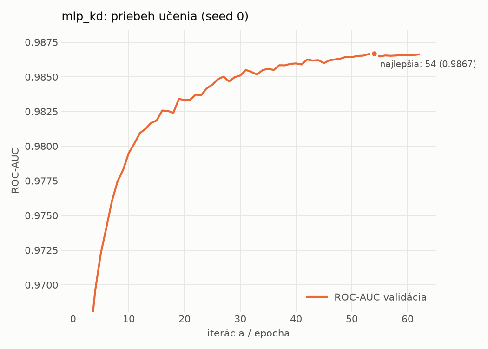

# static/mlp_kd – beh `20261123-002115`

> Automaticky generované (`src/training/run_tabular.py`). Konfigurácia: `config.yaml`, protokol: `protocol.yaml`.

- **Model:** `mlp` – študent – malé MLP učené destiláciou z hybridného učiteľa
- **Ladenie:** 30 dokončených pokusov (Optuna TPE), cieľ ROC-AUC na validácii, 3.4 min
- **Finálne modely:** seedy [0, 1, 2]; hodnoty sú priemer ± smerodajná odchýlka cez seedy
- **Najlepšie hyperparametre:** `{"hidden_layers": 1, "max_epochs": 100, "patience": 8, "hidden_width": 64, "dropout": 0.0632721567978865, "lr": 0.0009421311632910299, "weight_decay": 0.0003612082656275497, "batch_size": 1024, "kd_alpha": 0.17546922159086176, "kd_temperature": 1.684481613505065}`

## Detekčná kvalita (bez prahu)
| metrika | train (podvzorka) | validácia | test |
|---|---|---|---|
| ROC-AUC | 0.9913 ± 0.0000 | 0.9867 ± 0.0001 | 0.9880 ± 0.0008 |
| PR-AUC | 0.9913 ± 0.0001 | 0.9850 ± 0.0001 | 0.9880 ± 0.0006 |
| TPR pri FPR 1 % | 0.9203 ± 0.0026 | 0.8240 ± 0.0006 | 0.8717 ± 0.0060 |
| TPR pri FPR 0,1 % | 0.7466 ± 0.0280 | 0.5022 ± 0.0199 | 0.6209 ± 0.0407 |
| log loss | 0.1146 ± 0.0008 | 0.1631 ± 0.0015 | 0.1449 ± 0.0064 |
| Brier skóre | 0.0289 ± 0.0002 | 0.0401 ± 0.0003 | 0.0347 ± 0.0009 |

Rozdiel ROC-AUC train − validácia: **0.0046** (veľký rozdiel = preučenie).

## Pri prahu z validácie (FPR ≤ 1% na validácii)
| metrika | train (podvzorka) | validácia | test |
|---|---|---|---|
| accuracy | 0.9342 ± 0.0011 | 0.9157 ± 0.0003 | 0.9236 ± 0.0011 |
| balanced accuracy | 0.9250 ± 0.0012 | 0.9071 ± 0.0003 | 0.9155 ± 0.0011 |
| precision | 0.9946 ± 0.0007 | 0.9857 ± 0.0000 | 0.9909 ± 0.0015 |
| recall (TPR) | 0.8535 ± 0.0020 | 0.8240 ± 0.0006 | 0.8372 ± 0.0019 |
| FPR | 0.0035 ± 0.0005 | 0.0097 ± 0.0000 | 0.0063 ± 0.0011 |
| F1 | 0.9187 ± 0.0014 | 0.8976 ± 0.0004 | 0.9076 ± 0.0014 |
| MCC | 0.8711 ± 0.0021 | 0.8365 ± 0.0005 | 0.8520 ± 0.0022 |

## Pri pevnom prahu 0.5
| metrika | train (podvzorka) | validácia | test |
|---|---|---|---|
| accuracy | 0.9643 ± 0.0005 | 0.9514 ± 0.0009 | 0.9578 ± 0.0015 |
| balanced accuracy | 0.9622 ± 0.0005 | 0.9501 ± 0.0009 | 0.9564 ± 0.0017 |
| precision | 0.9712 ± 0.0013 | 0.9528 ± 0.0013 | 0.9627 ± 0.0008 |
| recall (TPR) | 0.9461 ± 0.0008 | 0.9380 ± 0.0009 | 0.9424 ± 0.0028 |
| FPR | 0.0216 ± 0.0010 | 0.0377 ± 0.0011 | 0.0297 ± 0.0005 |
| F1 | 0.9585 ± 0.0006 | 0.9454 ± 0.0010 | 0.9524 ± 0.0018 |
| MCC | 0.9274 ± 0.0011 | 0.9017 ± 0.0019 | 0.9147 ± 0.0031 |

## Výpočtové nároky (seed 0, testovacia množina)
| meranie | hodnota |
|---|---|
| tréning finálneho modelu | 4.7 s (priemer cez seedy) |
| ladenie spolu | 202 s |
| počet parametrov / uzlov | 10 689 |
| veľkosť modelu na disku | 0.05 MB |
| transformácia vstupu – latencia (1 vlákno) | 0.006 ms |
| transformácia vstupu – priepustnosť | 1 110 419 vzoriek/s |
| CPU latencia modelu (batch 1, 1 vlákno) | 0.155 ms (p95 0.165) |
| CPU priepustnosť (24 vlákien) | 3 227 583 vzoriek/s |
| GPU latencia (batch 1) | 0.276 ms (p95 0.313) |
| GPU priepustnosť | 2 431 975 vzoriek/s |
| GPU špičková pamäť | 63 MB |

## Grafy
| | |
|---|---|
|  |  |
|  |  |
|  |  |
|  |  |

## Súbory
`metrics.json` (všetky metriky po seedoch vrátane rodín), `timing.json`, `hpo_trials.csv`,
`predictions/<časť>_seed<N>.parquet` (sha256, family, label, score), `model/seed_<N>/`, `log.txt`.
