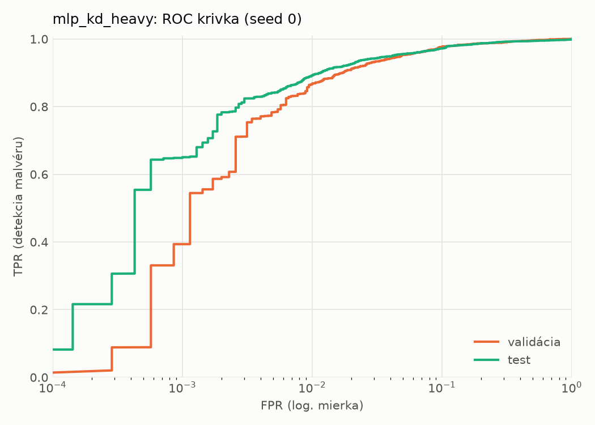
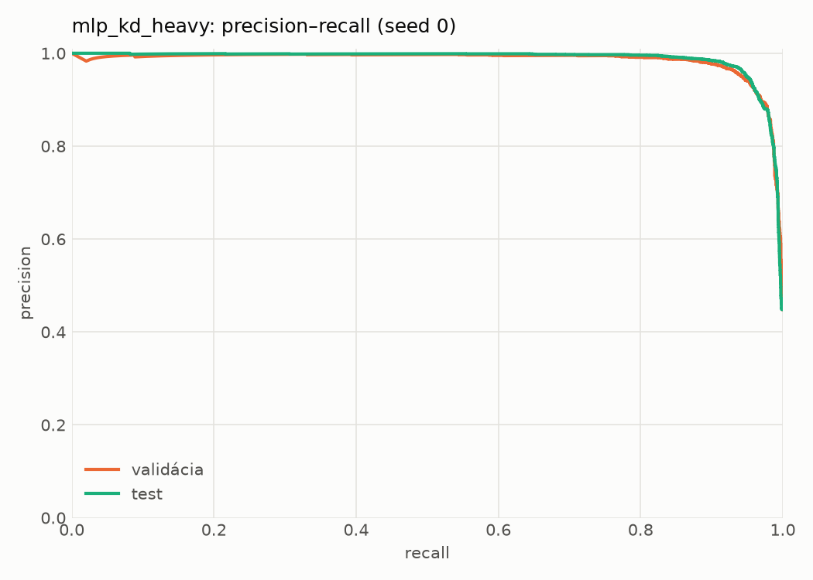
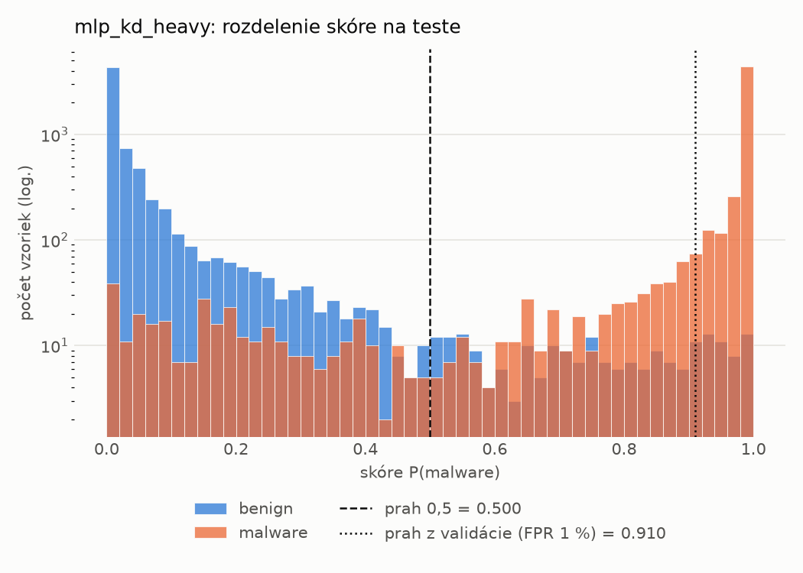
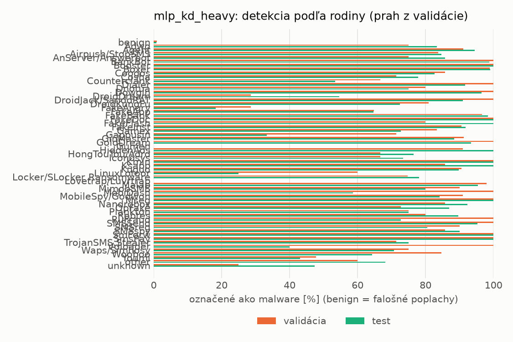
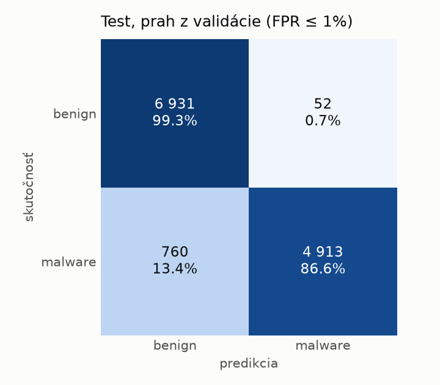
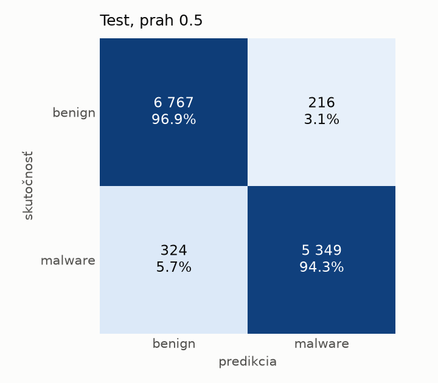
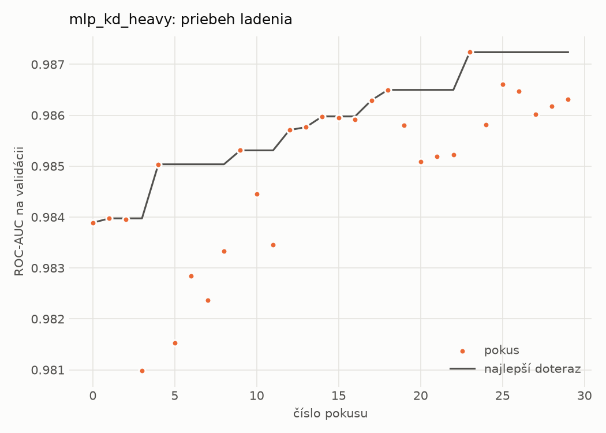
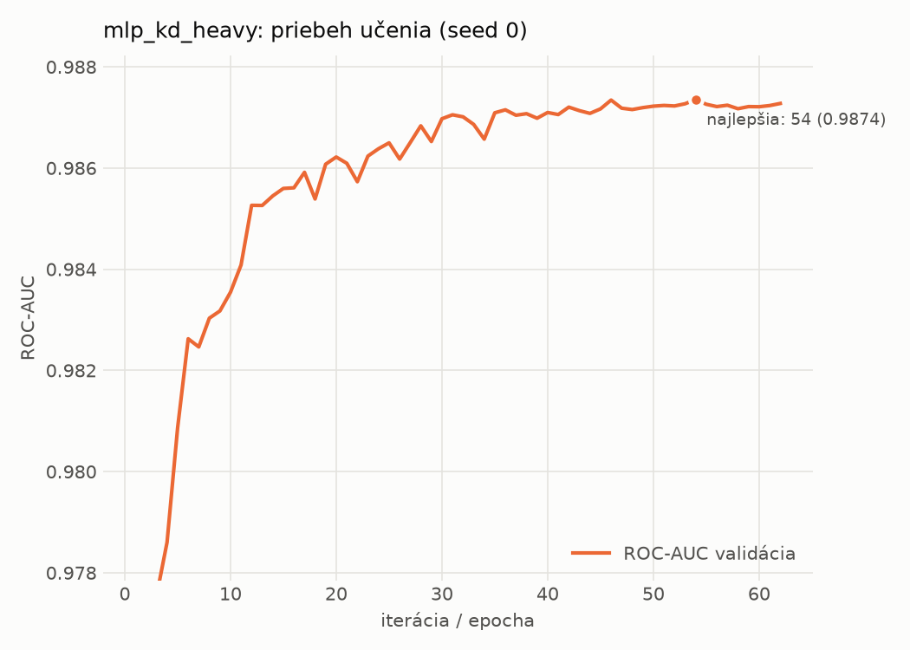

# static/mlp_kd_heavy – beh `20261123-003302`

> Automaticky generované (`src/training/run_tabular.py`). Konfigurácia: `config.yaml`, protokol: `protocol.yaml`.

- **Model:** `mlp` – študent – malé MLP učené destiláciou z mlp_large hybridu (V4)
- **Ladenie:** 30 dokončených pokusov (Optuna TPE), cieľ ROC-AUC na validácii, 3.0 min
- **Finálne modely:** seedy [0, 1, 2]; hodnoty sú priemer ± smerodajná odchýlka cez seedy
- **Najlepšie hyperparametre:** `{"hidden_layers": 1, "max_epochs": 100, "patience": 8, "hidden_width": 64, "dropout": 0.09027280410892091, "lr": 0.002542283406985367, "weight_decay": 5.0021287493134016e-05, "batch_size": 1024, "kd_alpha": 0.49398181049265616, "kd_temperature": 1.0496155846554518}`

## Detekčná kvalita (bez prahu)
| metrika | train (podvzorka) | validácia | test |
|---|---|---|---|
| ROC-AUC | 0.9933 ± 0.0005 | 0.9870 ± 0.0004 | 0.9883 ± 0.0006 |
| PR-AUC | 0.9930 ± 0.0006 | 0.9848 ± 0.0003 | 0.9882 ± 0.0003 |
| TPR pri FPR 1 % | 0.9304 ± 0.0061 | 0.8428 ± 0.0277 | 0.8836 ± 0.0121 |
| TPR pri FPR 0,1 % | 0.8134 ± 0.0057 | 0.4782 ± 0.0732 | 0.6346 ± 0.0601 |
| log loss | 0.0948 ± 0.0042 | 0.1380 ± 0.0031 | 0.1273 ± 0.0050 |
| Brier skóre | 0.0257 ± 0.0013 | 0.0373 ± 0.0012 | 0.0333 ± 0.0002 |

Rozdiel ROC-AUC train − validácia: **0.0063** (veľký rozdiel = preučenie).

## Pri prahu z validácie (FPR ≤ 1% na validácii)
| metrika | train (podvzorka) | validácia | test |
|---|---|---|---|
| accuracy | 0.9386 ± 0.0090 | 0.9242 ± 0.0124 | 0.9292 ± 0.0079 |
| balanced accuracy | 0.9300 ± 0.0104 | 0.9165 ± 0.0138 | 0.9217 ± 0.0089 |
| precision | 0.9951 ± 0.0016 | 0.9860 ± 0.0005 | 0.9910 ± 0.0013 |
| recall (TPR) | 0.8634 ± 0.0214 | 0.8428 ± 0.0277 | 0.8498 ± 0.0186 |
| FPR | 0.0033 ± 0.0011 | 0.0097 ± 0.0000 | 0.0063 ± 0.0010 |
| F1 | 0.9245 ± 0.0120 | 0.9086 ± 0.0164 | 0.9149 ± 0.0104 |
| MCC | 0.8796 ± 0.0168 | 0.8523 ± 0.0230 | 0.8624 ± 0.0144 |

## Pri pevnom prahu 0.5
| metrika | train (podvzorka) | validácia | test |
|---|---|---|---|
| accuracy | 0.9664 ± 0.0012 | 0.9518 ± 0.0012 | 0.9577 ± 0.0004 |
| balanced accuracy | 0.9647 ± 0.0011 | 0.9509 ± 0.0010 | 0.9565 ± 0.0006 |
| precision | 0.9704 ± 0.0021 | 0.9505 ± 0.0029 | 0.9602 ± 0.0013 |
| recall (TPR) | 0.9519 ± 0.0012 | 0.9416 ± 0.0007 | 0.9448 ± 0.0024 |
| FPR | 0.0224 ± 0.0016 | 0.0398 ± 0.0025 | 0.0318 ± 0.0011 |
| F1 | 0.9611 ± 0.0013 | 0.9460 ± 0.0012 | 0.9524 ± 0.0006 |
| MCC | 0.9317 ± 0.0024 | 0.9026 ± 0.0023 | 0.9145 ± 0.0009 |

## Výpočtové nároky (seed 0, testovacia množina)
| meranie | hodnota |
|---|---|
| tréning finálneho modelu | 4.0 s (priemer cez seedy) |
| ladenie spolu | 177 s |
| počet parametrov / uzlov | 10 689 |
| veľkosť modelu na disku | 0.05 MB |
| transformácia vstupu – latencia (1 vlákno) | 0.014 ms |
| transformácia vstupu – priepustnosť | 740 697 vzoriek/s |
| CPU latencia modelu (batch 1, 1 vlákno) | 0.157 ms (p95 0.166) |
| CPU priepustnosť (24 vlákien) | 6 819 333 vzoriek/s |
| GPU latencia (batch 1) | 0.274 ms (p95 0.303) |
| GPU priepustnosť | 2 466 624 vzoriek/s |
| GPU špičková pamäť | 97 MB |

## Grafy
| | |
|---|---|
|  |  |
|  |  |
|  |  |
|  |  |

## Súbory
`metrics.json` (všetky metriky po seedoch vrátane rodín), `timing.json`, `hpo_trials.csv`,
`predictions/<časť>_seed<N>.parquet` (sha256, family, label, score), `model/seed_<N>/`, `log.txt`.
