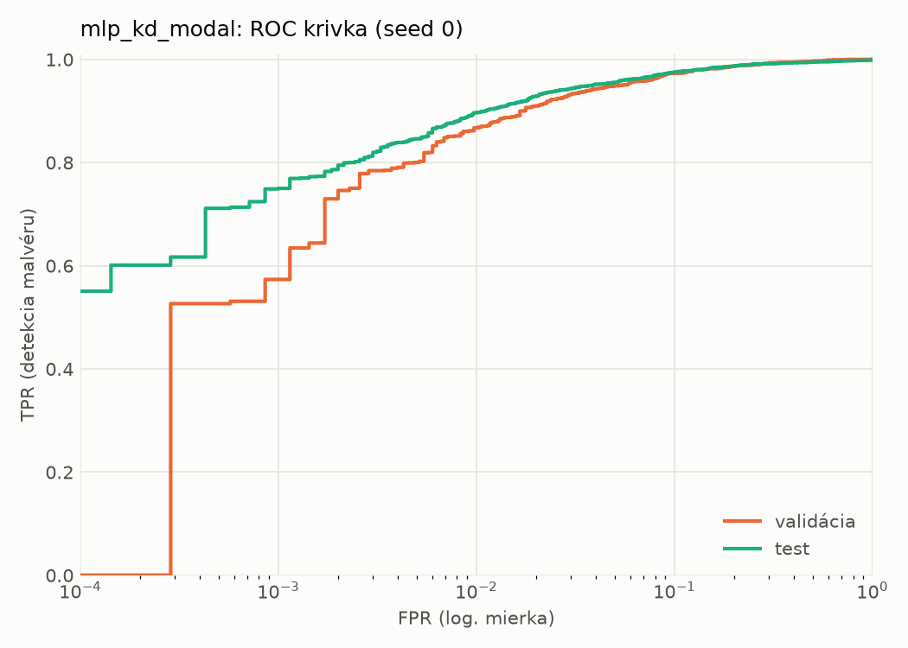
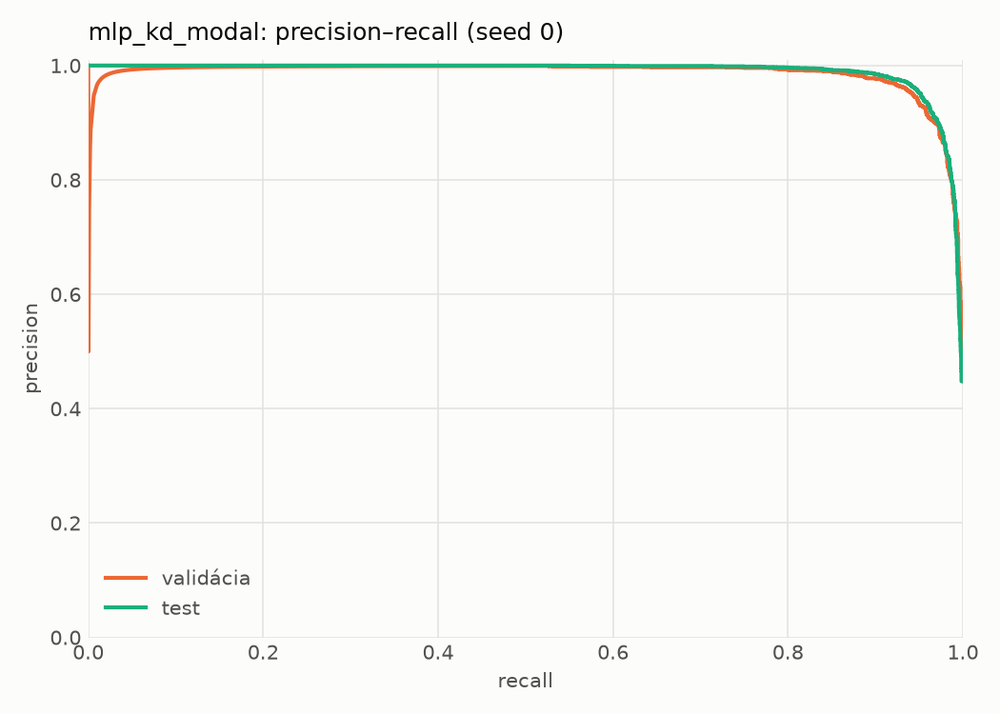
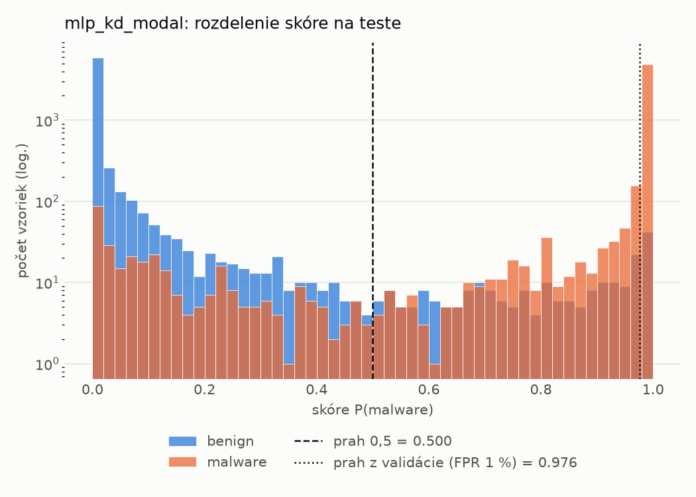
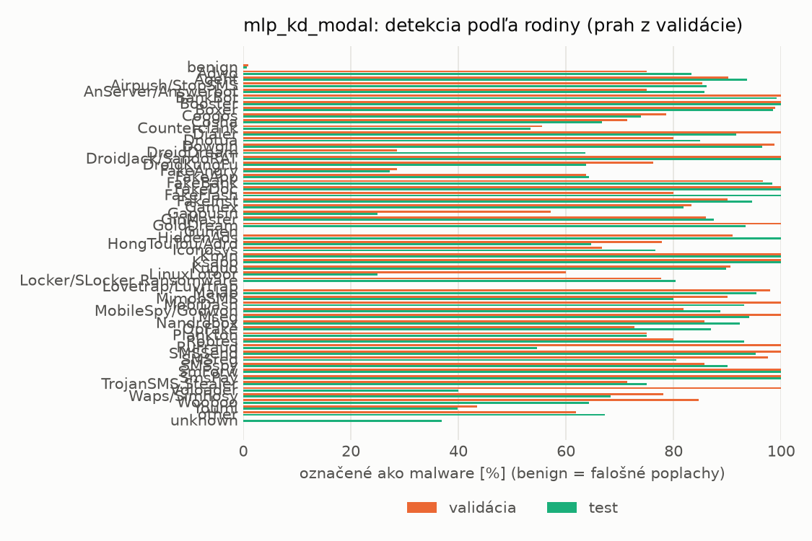
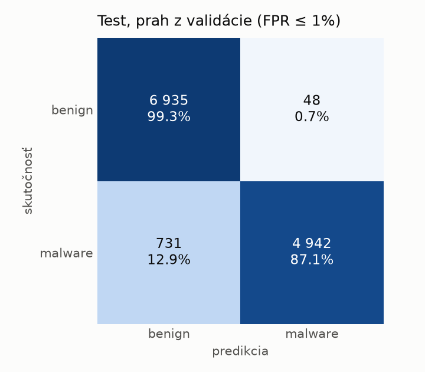
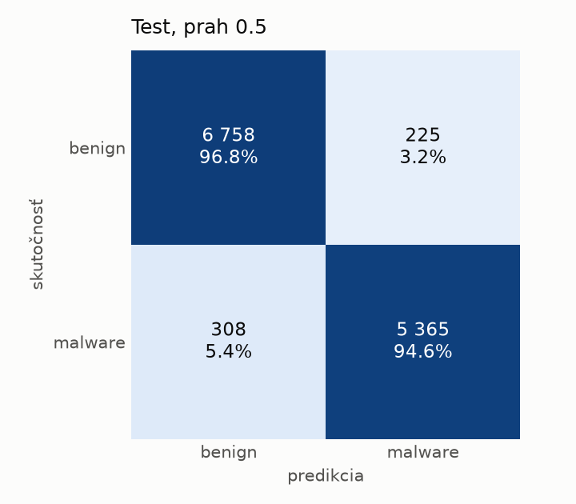
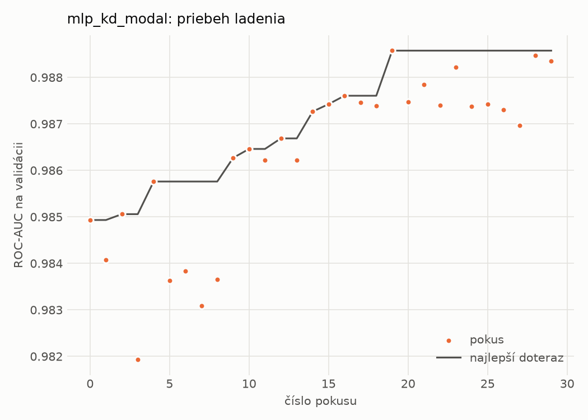
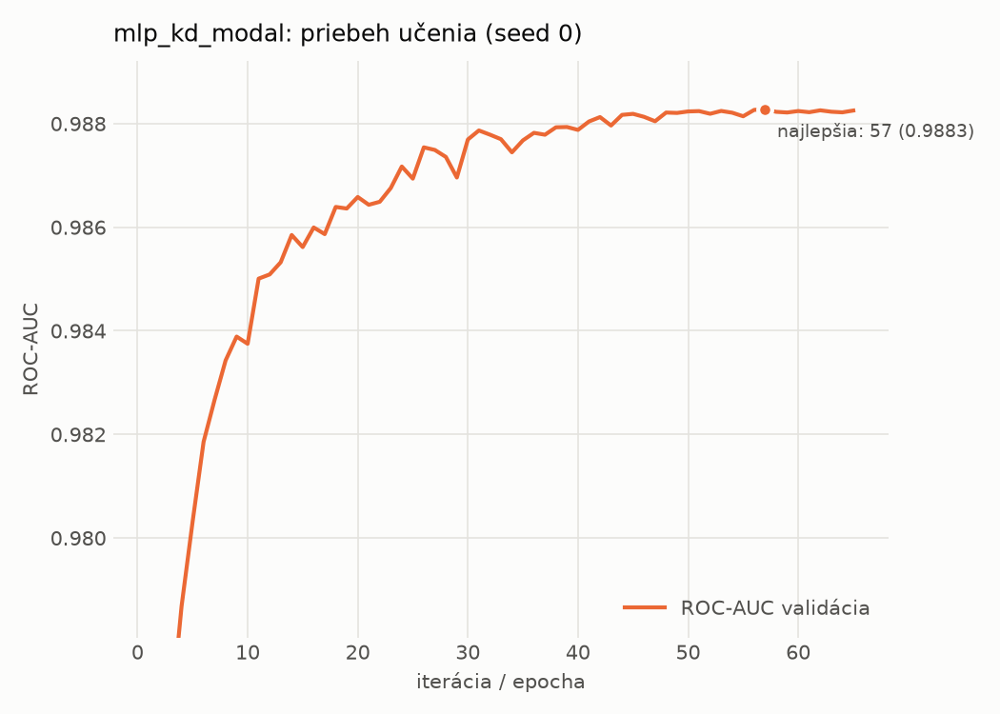

# static/mlp_kd_modal – beh `20261123-002851`

> Automaticky generované (`src/training/run_tabular.py`). Konfigurácia: `config.yaml`, protokol: `protocol.yaml`.

- **Model:** `mlp` – študent – malé MLP učené destiláciou z učiteľa rovnakej modality (variant A)
- **Ladenie:** 30 dokončených pokusov (Optuna TPE), cieľ ROC-AUC na validácii, 3.6 min
- **Finálne modely:** seedy [0, 1, 2]; hodnoty sú priemer ± smerodajná odchýlka cez seedy
- **Najlepšie hyperparametre:** `{"hidden_layers": 1, "max_epochs": 100, "patience": 8, "hidden_width": 64, "dropout": 0.037581027791643296, "lr": 0.0019348891318937097, "weight_decay": 9.225533739654786e-05, "batch_size": 512, "kd_alpha": 0.37781550385889523, "kd_temperature": 3.209412682485264}`

## Detekčná kvalita (bez prahu)
| metrika | train (podvzorka) | validácia | test |
|---|---|---|---|
| ROC-AUC | 0.9925 ± 0.0002 | 0.9881 ± 0.0002 | 0.9890 ± 0.0005 |
| PR-AUC | 0.9923 ± 0.0001 | 0.9855 ± 0.0002 | 0.9894 ± 0.0003 |
| TPR pri FPR 1 % | 0.9223 ± 0.0013 | 0.8607 ± 0.0062 | 0.8957 ± 0.0009 |
| TPR pri FPR 0,1 % | 0.8110 ± 0.0185 | 0.5376 ± 0.0428 | 0.7114 ± 0.0407 |
| log loss | 0.1093 ± 0.0007 | 0.1615 ± 0.0022 | 0.1431 ± 0.0026 |
| Brier skóre | 0.0281 ± 0.0001 | 0.0392 ± 0.0001 | 0.0347 ± 0.0004 |

Rozdiel ROC-AUC train − validácia: **0.0044** (veľký rozdiel = preučenie).

## Pri prahu z validácie (FPR ≤ 1% na validácii)
| metrika | train (podvzorka) | validácia | test |
|---|---|---|---|
| accuracy | 0.9451 ± 0.0024 | 0.9322 ± 0.0028 | 0.9360 ± 0.0028 |
| balanced accuracy | 0.9375 ± 0.0027 | 0.9255 ± 0.0031 | 0.9294 ± 0.0031 |
| precision | 0.9944 ± 0.0005 | 0.9863 ± 0.0001 | 0.9903 ± 0.0003 |
| recall (TPR) | 0.8789 ± 0.0054 | 0.8607 ± 0.0062 | 0.8657 ± 0.0063 |
| FPR | 0.0038 ± 0.0004 | 0.0097 ± 0.0000 | 0.0069 ± 0.0002 |
| F1 | 0.9331 ± 0.0031 | 0.9192 ± 0.0036 | 0.9238 ± 0.0036 |
| MCC | 0.8916 ± 0.0046 | 0.8671 ± 0.0053 | 0.8749 ± 0.0052 |

## Pri pevnom prahu 0.5
| metrika | train (podvzorka) | validácia | test |
|---|---|---|---|
| accuracy | 0.9647 ± 0.0002 | 0.9528 ± 0.0004 | 0.9576 ± 0.0004 |
| balanced accuracy | 0.9626 ± 0.0002 | 0.9517 ± 0.0004 | 0.9565 ± 0.0004 |
| precision | 0.9716 ± 0.0011 | 0.9532 ± 0.0009 | 0.9594 ± 0.0008 |
| recall (TPR) | 0.9465 ± 0.0012 | 0.9409 ± 0.0010 | 0.9455 ± 0.0002 |
| FPR | 0.0213 ± 0.0009 | 0.0375 ± 0.0008 | 0.0325 ± 0.0006 |
| F1 | 0.9589 ± 0.0002 | 0.9470 ± 0.0004 | 0.9524 ± 0.0004 |
| MCC | 0.9282 ± 0.0003 | 0.9045 ± 0.0007 | 0.9143 ± 0.0008 |

## Výpočtové nároky (seed 0, testovacia množina)
| meranie | hodnota |
|---|---|
| tréning finálneho modelu | 10.2 s (priemer cez seedy) |
| ladenie spolu | 219 s |
| počet parametrov / uzlov | 10 689 |
| veľkosť modelu na disku | 0.05 MB |
| transformácia vstupu – latencia (1 vlákno) | 0.014 ms |
| transformácia vstupu – priepustnosť | 749 528 vzoriek/s |
| CPU latencia modelu (batch 1, 1 vlákno) | 0.155 ms (p95 0.165) |
| CPU priepustnosť (24 vlákien) | 5 833 602 vzoriek/s |
| GPU latencia (batch 1) | 0.271 ms (p95 0.320) |
| GPU priepustnosť | 2 424 660 vzoriek/s |
| GPU špičková pamäť | 63 MB |

## Grafy
| | |
|---|---|
|  |  |
|  |  |
|  |  |
|  |  |

## Súbory
`metrics.json` (všetky metriky po seedoch vrátane rodín), `timing.json`, `hpo_trials.csv`,
`predictions/<časť>_seed<N>.parquet` (sha256, family, label, score), `model/seed_<N>/`, `log.txt`.
