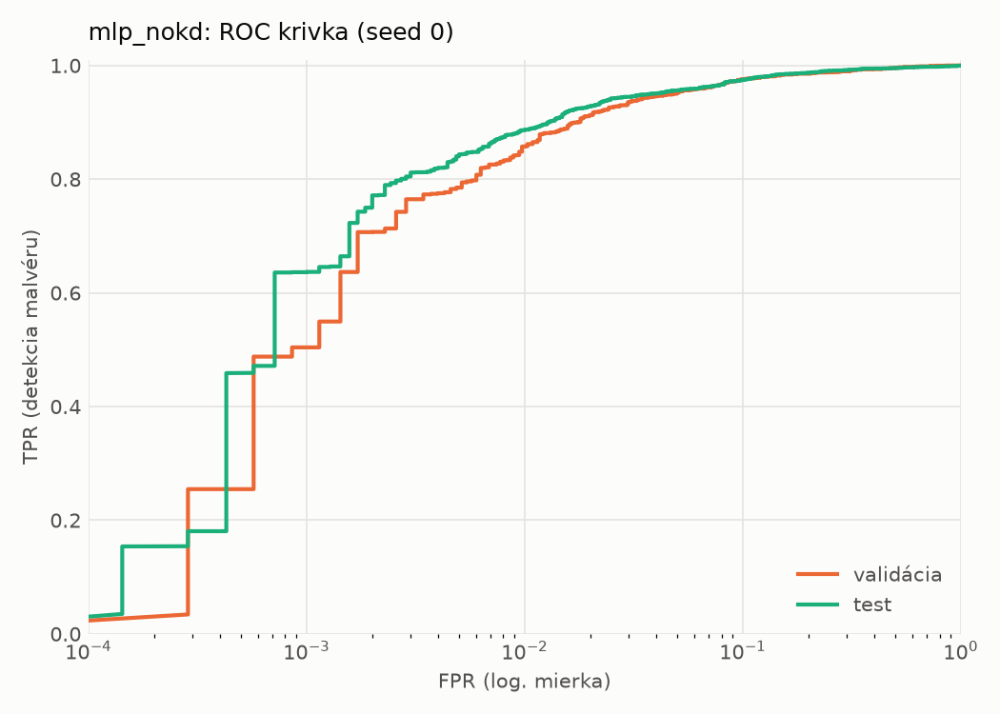
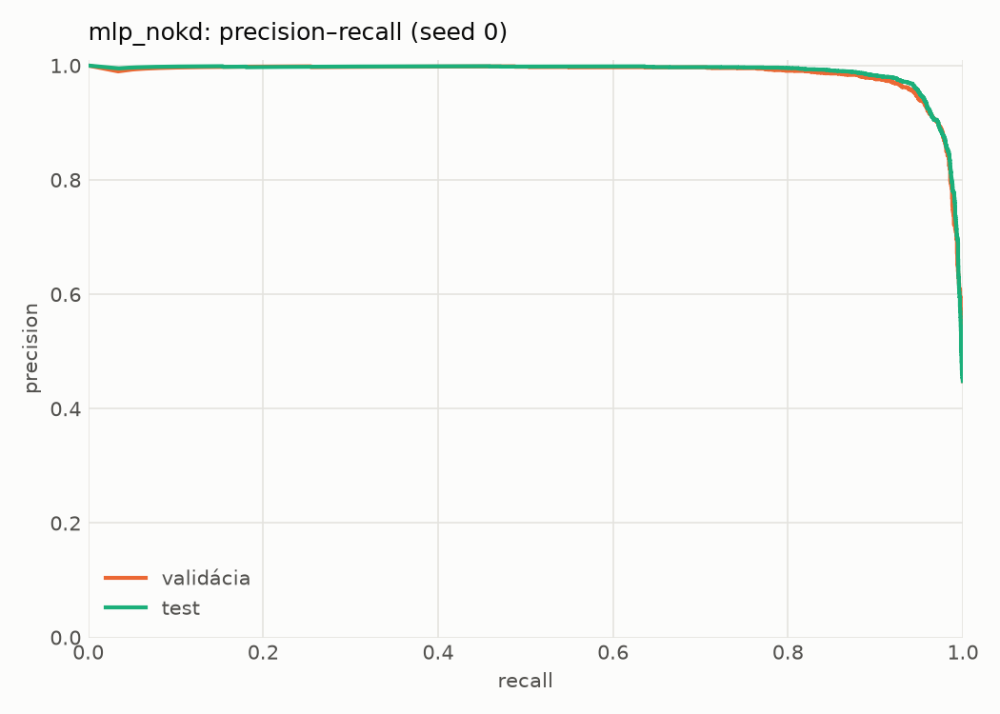
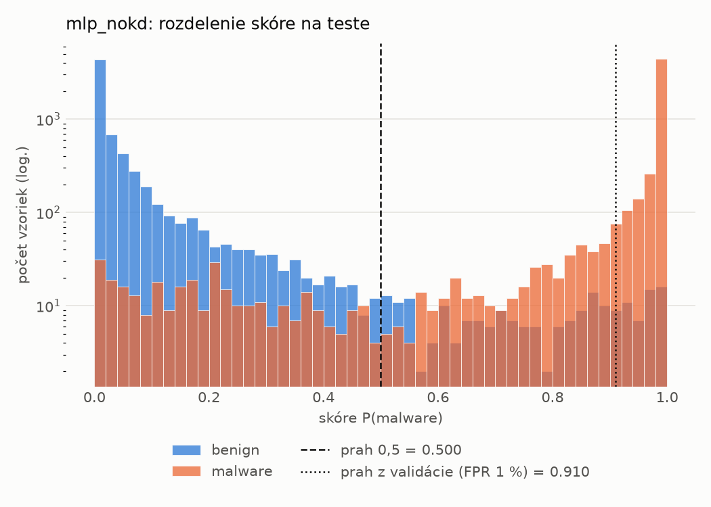
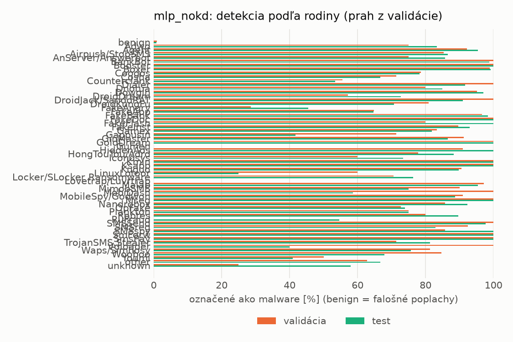
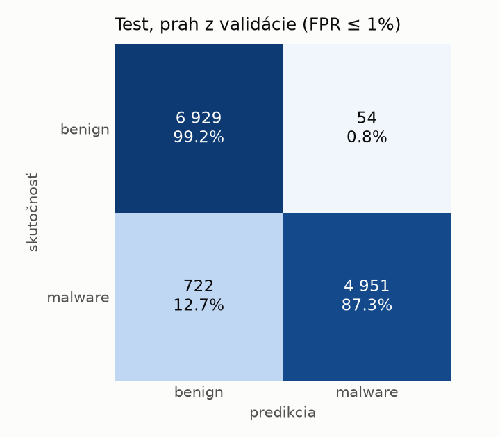
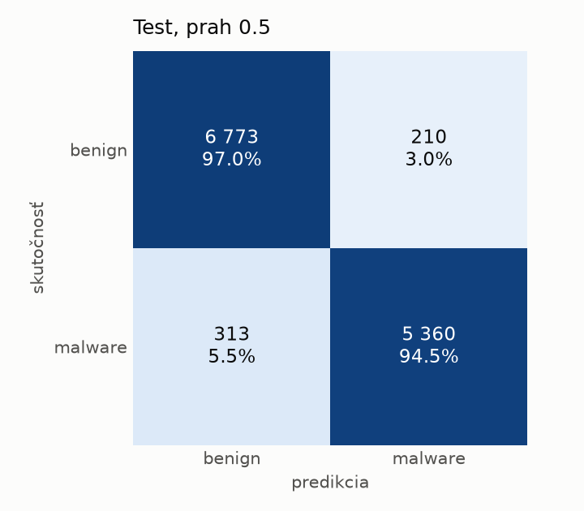
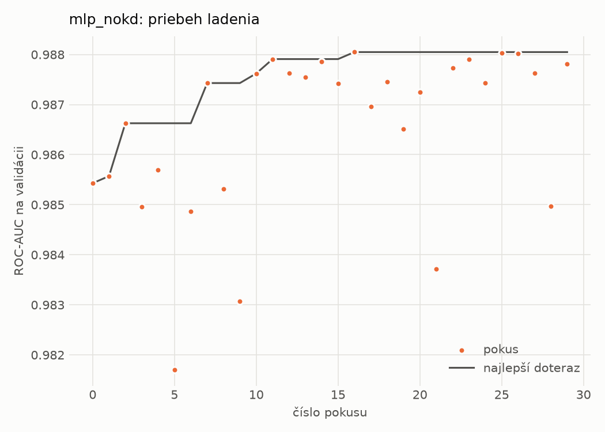
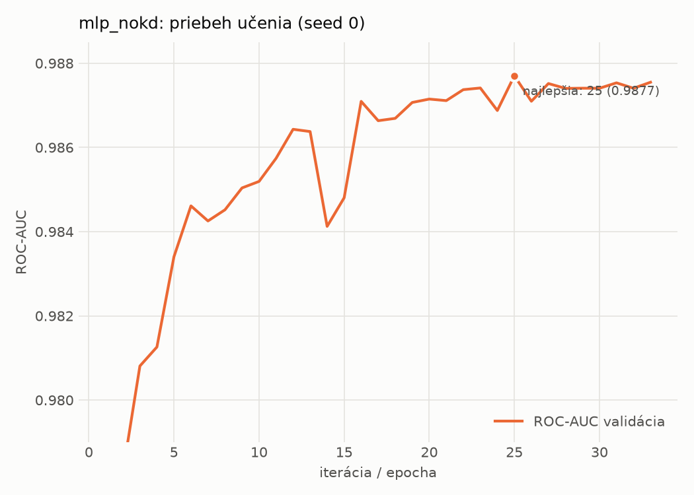

# static/mlp_nokd – beh `20261123-002453`

> Automaticky generované (`src/training/run_tabular.py`). Konfigurácia: `config.yaml`, protokol: `protocol.yaml`.

- **Model:** `mlp` – kontrola – rovnaké malé MLP bez destilácie (iba skutočné označenia)
- **Ladenie:** 30 dokončených pokusov (Optuna TPE), cieľ ROC-AUC na validácii, 3.4 min
- **Finálne modely:** seedy [0, 1, 2]; hodnoty sú priemer ± smerodajná odchýlka cez seedy
- **Najlepšie hyperparametre:** `{"hidden_layers": 1, "max_epochs": 100, "patience": 8, "hidden_width": 64, "dropout": 0.15022694447625398, "lr": 0.0027248227778296176, "weight_decay": 1.7062100113192703e-06, "batch_size": 256}`

## Detekčná kvalita (bez prahu)
| metrika | train (podvzorka) | validácia | test |
|---|---|---|---|
| ROC-AUC | 0.9946 ± 0.0007 | 0.9882 ± 0.0008 | 0.9891 ± 0.0004 |
| PR-AUC | 0.9944 ± 0.0007 | 0.9867 ± 0.0007 | 0.9888 ± 0.0008 |
| TPR pri FPR 1 % | 0.9438 ± 0.0066 | 0.8677 ± 0.0097 | 0.8925 ± 0.0056 |
| TPR pri FPR 0,1 % | 0.8374 ± 0.0282 | 0.5927 ± 0.0770 | 0.6198 ± 0.0432 |
| log loss | 0.0830 ± 0.0061 | 0.1310 ± 0.0037 | 0.1225 ± 0.0037 |
| Brier skóre | 0.0223 ± 0.0016 | 0.0349 ± 0.0011 | 0.0320 ± 0.0010 |

Rozdiel ROC-AUC train − validácia: **0.0064** (veľký rozdiel = preučenie).

## Pri prahu z validácie (FPR ≤ 1% na validácii)
| metrika | train (podvzorka) | validácia | test |
|---|---|---|---|
| accuracy | 0.9504 ± 0.0032 | 0.9353 ± 0.0044 | 0.9397 ± 0.0013 |
| balanced accuracy | 0.9434 ± 0.0036 | 0.9290 ± 0.0049 | 0.9336 ± 0.0014 |
| precision | 0.9959 ± 0.0011 | 0.9864 ± 0.0002 | 0.9896 ± 0.0009 |
| recall (TPR) | 0.8897 ± 0.0066 | 0.8677 ± 0.0097 | 0.8748 ± 0.0033 |
| FPR | 0.0028 ± 0.0008 | 0.0097 ± 0.0000 | 0.0075 ± 0.0007 |
| F1 | 0.9398 ± 0.0041 | 0.9232 ± 0.0056 | 0.9286 ± 0.0016 |
| MCC | 0.9020 ± 0.0062 | 0.8731 ± 0.0082 | 0.8818 ± 0.0023 |

## Pri pevnom prahu 0.5
| metrika | train (podvzorka) | validácia | test |
|---|---|---|---|
| accuracy | 0.9711 ± 0.0013 | 0.9556 ± 0.0014 | 0.9596 ± 0.0010 |
| balanced accuracy | 0.9694 ± 0.0012 | 0.9544 ± 0.0013 | 0.9582 ± 0.0009 |
| precision | 0.9769 ± 0.0027 | 0.9567 ± 0.0022 | 0.9644 ± 0.0023 |
| recall (TPR) | 0.9562 ± 0.0007 | 0.9436 ± 0.0009 | 0.9447 ± 0.0001 |
| FPR | 0.0175 ± 0.0021 | 0.0347 ± 0.0018 | 0.0284 ± 0.0019 |
| F1 | 0.9664 ± 0.0015 | 0.9501 ± 0.0015 | 0.9544 ± 0.0011 |
| MCC | 0.9412 ± 0.0026 | 0.9101 ± 0.0028 | 0.9183 ± 0.0020 |

## Výpočtové nároky (seed 0, testovacia množina)
| meranie | hodnota |
|---|---|
| tréning finálneho modelu | 10.6 s (priemer cez seedy) |
| ladenie spolu | 205 s |
| počet parametrov / uzlov | 10 689 |
| veľkosť modelu na disku | 0.05 MB |
| transformácia vstupu – latencia (1 vlákno) | 0.014 ms |
| transformácia vstupu – priepustnosť | 735 100 vzoriek/s |
| CPU latencia modelu (batch 1, 1 vlákno) | 0.064 ms (p95 0.161) |
| CPU priepustnosť (24 vlákien) | 4 795 938 vzoriek/s |
| GPU latencia (batch 1) | 0.275 ms (p95 0.309) |
| GPU priepustnosť | 2 454 521 vzoriek/s |
| GPU špičková pamäť | 97 MB |

## Grafy
| | |
|---|---|
|  |  |
|  |  |
|  |  |
|  |  |

## Súbory
`metrics.json` (všetky metriky po seedoch vrátane rodín), `timing.json`, `hpo_trials.csv`,
`predictions/<časť>_seed<N>.parquet` (sha256, family, label, score), `model/seed_<N>/`, `log.txt`.
