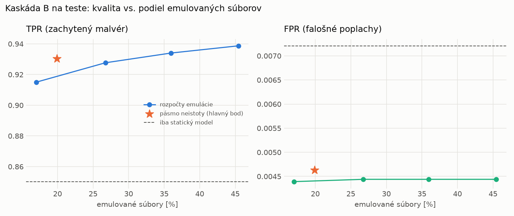

# Kaskáda B `b_baselines` – beh `20261123-011457`

> Generované `src/cascade/evaluate_b.py` (2026-11-23T01:14:57+01:00). Seedy: [0, 1, 2]; hodnoty = priemer ± sm. odchýlka.
> Všetky prahy a pásmo neistoty sú z validácie; test sa na nič nenastavuje. Postup: `docs/09_plan_v2.md`.

| rola | beh |
|---|---|
| static | `runs_v4/real_p/lofo/Airpush_StopSMS/static/lightgbm/20261123-010336` |
| dynamic | `runs_v4/real_p/lofo/Airpush_StopSMS/dynamic/lightgbm/20261123-010546` |
| hybrid | `runs_v4/real_p/lofo/Airpush_StopSMS/hybrid/lightgbm/20261123-010804` |

Druhý stupeň: **dynamic**. Pásmo neistoty statického modelu: FPR ≤ 0.1% nad `hi`,
najviac 1% malvéru validácie pod `lo` (seed 0: lo = 0.0019, hi = 0.9989, seed 1: lo = 0.0011, hi = 0.9990, seed 2: lo = 0.0008, hi = 0.9991).

## Test
| prístup | accuracy | balanced_accuracy | precision | recall_tpr | fpr | f1 | mcc |
|---|---|---|---|---|---|---|---|
| kaskáda B | 0.9663 ± 0.0004 | 0.9629 ± 0.0004 | 0.9939 ± 0.0011 | 0.9304 ± 0.0004 | 0.0046 ± 0.0009 | 0.9611 ± 0.0005 | 0.9330 ± 0.0009 |
| statický | 0.9289 ± 0.0014 | 0.9215 ± 0.0016 | 0.9897 ± 0.0003 | 0.8502 ± 0.0033 | 0.0072 ± 0.0002 | 0.9147 ± 0.0018 | 0.8616 ± 0.0026 |
| dynamický | 0.9267 ± 0.0006 | 0.9192 ± 0.0007 | 0.9881 ± 0.0007 | 0.8466 ± 0.0020 | 0.0083 ± 0.0005 | 0.9119 ± 0.0008 | 0.8572 ± 0.0010 |
| hybrid (každá vzorka) | 0.9727 ± 0.0003 | 0.9705 ± 0.0004 | 0.9899 ± 0.0010 | 0.9489 ± 0.0013 | 0.0079 ± 0.0008 | 0.9689 ± 0.0004 | 0.9453 ± 0.0007 |

- **emulované súbory: 19.91%** (ostatné rozhodne iba statický model); na hybrid ide 6.54% súborov
- chyby pri istom rozhodnutí statického modelu (seed 0): 145
- validácia: emulované 12.95%, na hybrid 2.44%

## Validácia
| prístup | accuracy | balanced_accuracy | precision | recall_tpr | fpr | f1 | mcc |
|---|---|---|---|---|---|---|---|
| kaskáda B | 0.9839 ± 0.0001 | 0.9809 ± 0.0002 | 0.9907 ± 0.0005 | 0.9674 ± 0.0007 | 0.0057 ± 0.0003 | 0.9789 ± 0.0001 | 0.9661 ± 0.0002 |
| statický | 0.9770 ± 0.0006 | 0.9730 ± 0.0008 | 0.9844 ± 0.0005 | 0.9556 ± 0.0013 | 0.0096 ± 0.0003 | 0.9698 ± 0.0008 | 0.9515 ± 0.0013 |
| dynamický | 0.9362 ± 0.0009 | 0.9203 ± 0.0012 | 0.9825 ± 0.0003 | 0.8502 ± 0.0025 | 0.0096 ± 0.0002 | 0.9116 ± 0.0014 | 0.8676 ± 0.0019 |
| hybrid (každá vzorka) | 0.9841 ± 0.0005 | 0.9822 ± 0.0005 | 0.9853 ± 0.0009 | 0.9735 ± 0.0007 | 0.0092 ± 0.0006 | 0.9794 ± 0.0007 | 0.9665 ± 0.0011 |

## Januárové vzorky vynechanej rodiny (iba malvér → TPR)
| prístup | TPR |
|---|---|
| kaskáda B | 0.8080 ± 0.0030 |
| statický | 0.4739 ± 0.0097 |
| dynamický | 0.8419 ± 0.0015 |
| hybrid (každá vzorka) | 0.8720 ± 0.0019 |

Podiel emulovaných: 76.37%

## Krivka rozpočtu emulácie (test, priemer cez seedy)
| budget_val | emulation_rate | hybrid_rate | recall_tpr | fpr | f1 |
|---|---|---|---|---|---|
| 0.1000 | 0.1701 | 0.0642 | 0.9150 | 0.0044 | 0.9529 |
| 0.2000 | 0.2673 | 0.0790 | 0.9277 | 0.0044 | 0.9598 |
| 0.3000 | 0.3597 | 0.0881 | 0.9340 | 0.0044 | 0.9632 |
| 0.4000 | 0.4544 | 0.0951 | 0.9387 | 0.0044 | 0.9657 |

## Výpočtové nároky
Čas dynamickej analýzy (beh v emulátore alebo na zariadení) dataset neuvádza, preto sa neodhaduje. Úspora kaskády B = podiel súborov s dynamickou analýzou: **19.91%** (ostatné prístupy 100 %).

_Chýba benchmark niektorého komponentu (v zero-day behoch sa nemeria)._

