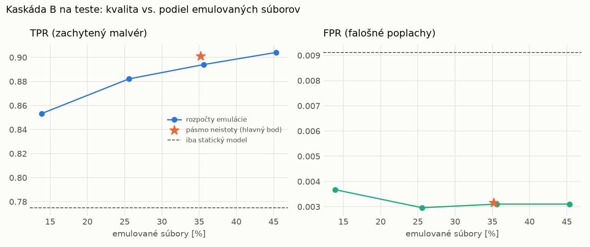

# Kaskáda B `b_heavyteacher` – beh `20261123-011501`

> Generované `src/cascade/evaluate_b.py` (2026-11-23T01:15:01+01:00). Seedy: [0, 1, 2]; hodnoty = priemer ± sm. odchýlka.
> Všetky prahy a pásmo neistoty sú z validácie; test sa na nič nenastavuje. Postup: `docs/09_plan_v2.md`.

| rola | beh |
|---|---|
| static | `runs_v4/real_p/lofo/Airpush_StopSMS/students_static/mlp_kd_heavy/20261123-011230` |
| dynamic | `runs_v4/real_p/lofo/Airpush_StopSMS/students_dynamic/mlp_kd_heavy/20261123-011417` |
| hybrid | `runs_v4/real_p/lofo/Airpush_StopSMS/hybrid/lightgbm/20261123-010804` |

Druhý stupeň: **dynamic**. Pásmo neistoty statického modelu: FPR ≤ 0.1% nad `hi`,
najviac 1% malvéru validácie pod `lo` (seed 0: lo = 0.0290, hi = 0.9937, seed 1: lo = 0.0249, hi = 0.9959, seed 2: lo = 0.0308, hi = 0.9945).

## Test
| prístup | accuracy | balanced_accuracy | precision | recall_tpr | fpr | f1 | mcc |
|---|---|---|---|---|---|---|---|
| kaskáda B | 0.9539 ± 0.0014 | 0.9489 ± 0.0016 | 0.9957 ± 0.0004 | 0.9010 ± 0.0033 | 0.0032 ± 0.0003 | 0.9460 ± 0.0017 | 0.9094 ± 0.0026 |
| statický | 0.8941 ± 0.0008 | 0.8829 ± 0.0008 | 0.9857 ± 0.0008 | 0.7750 ± 0.0011 | 0.0091 ± 0.0005 | 0.8678 ± 0.0010 | 0.7973 ± 0.0016 |
| dynamický | 0.8687 ± 0.0007 | 0.8546 ± 0.0008 | 0.9853 ± 0.0010 | 0.7178 ± 0.0015 | 0.0087 ± 0.0006 | 0.8306 ± 0.0010 | 0.7520 ± 0.0014 |
| hybrid (každá vzorka) | 0.9727 ± 0.0003 | 0.9705 ± 0.0004 | 0.9899 ± 0.0010 | 0.9489 ± 0.0013 | 0.0079 ± 0.0008 | 0.9689 ± 0.0004 | 0.9453 ± 0.0007 |

- **emulované súbory: 35.19%** (ostatné rozhodne iba statický model); na hybrid ide 10.61% súborov
- chyby pri istom rozhodnutí statického modelu (seed 0): 143
- validácia: emulované 29.50%, na hybrid 6.02%

## Validácia
| prístup | accuracy | balanced_accuracy | precision | recall_tpr | fpr | f1 | mcc |
|---|---|---|---|---|---|---|---|
| kaskáda B | 0.9732 ± 0.0017 | 0.9668 ± 0.0024 | 0.9918 ± 0.0008 | 0.9385 ± 0.0053 | 0.0049 ± 0.0005 | 0.9644 ± 0.0024 | 0.9439 ± 0.0036 |
| statický | 0.9553 ± 0.0031 | 0.9451 ± 0.0040 | 0.9831 ± 0.0001 | 0.8999 ± 0.0080 | 0.0097 ± 0.0000 | 0.9397 ± 0.0044 | 0.9065 ± 0.0063 |
| dynamický | 0.8769 ± 0.0029 | 0.8437 ± 0.0037 | 0.9785 ± 0.0005 | 0.6970 ± 0.0073 | 0.0096 ± 0.0002 | 0.8141 ± 0.0051 | 0.7492 ± 0.0057 |
| hybrid (každá vzorka) | 0.9841 ± 0.0005 | 0.9822 ± 0.0005 | 0.9853 ± 0.0009 | 0.9735 ± 0.0007 | 0.0092 ± 0.0006 | 0.9794 ± 0.0007 | 0.9665 ± 0.0011 |

## Januárové vzorky vynechanej rodiny (iba malvér → TPR)
| prístup | TPR |
|---|---|
| kaskáda B | 0.7880 ± 0.0112 |
| statický | 0.3622 ± 0.0061 |
| dynamický | 0.7980 ± 0.0026 |
| hybrid (každá vzorka) | 0.8720 ± 0.0019 |

Podiel emulovaných: 83.95%

## Krivka rozpočtu emulácie (test, priemer cez seedy)
| budget_val | emulation_rate | hybrid_rate | recall_tpr | fpr | f1 |
|---|---|---|---|---|---|
| 0.1000 | 0.1387 | 0.0676 | 0.8533 | 0.0037 | 0.9186 |
| 0.2000 | 0.2557 | 0.1021 | 0.8821 | 0.0030 | 0.9356 |
| 0.3000 | 0.3562 | 0.1164 | 0.8941 | 0.0031 | 0.9422 |
| 0.4000 | 0.4535 | 0.1282 | 0.9042 | 0.0031 | 0.9478 |

## Výpočtové nároky
Čas dynamickej analýzy (beh v emulátore alebo na zariadení) dataset neuvádza, preto sa neodhaduje. Úspora kaskády B = podiel súborov s dynamickou analýzou: **35.19%** (ostatné prístupy 100 %).

_Chýba benchmark niektorého komponentu (v zero-day behoch sa nemeria)._

