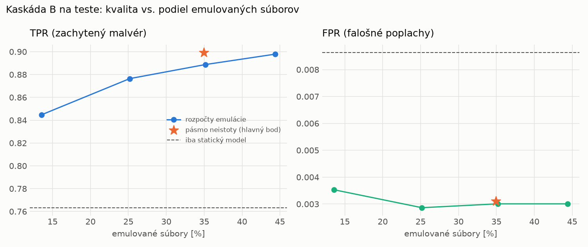

# Kaskáda B `b_main` – beh `20261123-011451`

> Generované `src/cascade/evaluate_b.py` (2026-11-23T01:14:52+01:00). Seedy: [0, 1, 2]; hodnoty = priemer ± sm. odchýlka.
> Všetky prahy a pásmo neistoty sú z validácie; test sa na nič nenastavuje. Postup: `docs/09_plan_v2.md`.

| rola | beh |
|---|---|
| static | `runs_v4/real_p/lofo/Airpush_StopSMS/students_static/mlp_kd/20261123-011119` |
| dynamic | `runs_v4/real_p/lofo/Airpush_StopSMS/students_dynamic/mlp_kd/20261123-011247` |
| hybrid | `runs_v4/real_p/lofo/Airpush_StopSMS/hybrid/lightgbm/20261123-010804` |

Druhý stupeň: **dynamic**. Pásmo neistoty statického modelu: FPR ≤ 0.1% nad `hi`,
najviac 1% malvéru validácie pod `lo` (seed 0: lo = 0.0039, hi = 0.9986, seed 1: lo = 0.0038, hi = 0.9991, seed 2: lo = 0.0041, hi = 0.9996).

## Test
| prístup | accuracy | balanced_accuracy | precision | recall_tpr | fpr | f1 | mcc |
|---|---|---|---|---|---|---|---|
| kaskáda B | 0.9532 ± 0.0006 | 0.9482 ± 0.0007 | 0.9958 ± 0.0006 | 0.8994 ± 0.0018 | 0.0031 ± 0.0004 | 0.9451 ± 0.0007 | 0.9081 ± 0.0010 |
| statický | 0.8891 ± 0.0036 | 0.8773 ± 0.0041 | 0.9863 ± 0.0010 | 0.7633 ± 0.0086 | 0.0086 ± 0.0007 | 0.8606 ± 0.0053 | 0.7885 ± 0.0064 |
| dynamický | 0.8713 ± 0.0034 | 0.8574 ± 0.0039 | 0.9849 ± 0.0007 | 0.7239 ± 0.0082 | 0.0090 ± 0.0005 | 0.8344 ± 0.0052 | 0.7564 ± 0.0058 |
| hybrid (každá vzorka) | 0.9727 ± 0.0003 | 0.9705 ± 0.0004 | 0.9899 ± 0.0010 | 0.9489 ± 0.0013 | 0.0079 ± 0.0008 | 0.9689 ± 0.0004 | 0.9453 ± 0.0007 |

- **emulované súbory: 34.95%** (ostatné rozhodne iba statický model); na hybrid ide 10.77% súborov
- chyby pri istom rozhodnutí statického modelu (seed 0): 146
- validácia: emulované 29.15%, na hybrid 5.94%

## Validácia
| prístup | accuracy | balanced_accuracy | precision | recall_tpr | fpr | f1 | mcc |
|---|---|---|---|---|---|---|---|
| kaskáda B | 0.9739 ± 0.0006 | 0.9674 ± 0.0008 | 0.9931 ± 0.0003 | 0.9390 ± 0.0014 | 0.0041 ± 0.0002 | 0.9653 ± 0.0008 | 0.9453 ± 0.0013 |
| statický | 0.9545 ± 0.0002 | 0.9440 ± 0.0002 | 0.9832 ± 0.0003 | 0.8976 ± 0.0005 | 0.0096 ± 0.0002 | 0.9385 ± 0.0003 | 0.9048 ± 0.0004 |
| dynamický | 0.8826 ± 0.0045 | 0.8511 ± 0.0058 | 0.9788 ± 0.0003 | 0.7119 ± 0.0115 | 0.0097 ± 0.0000 | 0.8243 ± 0.0079 | 0.7605 ± 0.0088 |
| hybrid (každá vzorka) | 0.9841 ± 0.0005 | 0.9822 ± 0.0005 | 0.9853 ± 0.0009 | 0.9735 ± 0.0007 | 0.0092 ± 0.0006 | 0.9794 ± 0.0007 | 0.9665 ± 0.0011 |

## Januárové vzorky vynechanej rodiny (iba malvér → TPR)
| prístup | TPR |
|---|---|
| kaskáda B | 0.7889 ± 0.0068 |
| statický | 0.3272 ± 0.0373 |
| dynamický | 0.7969 ± 0.0034 |
| hybrid (každá vzorka) | 0.8720 ± 0.0019 |

Podiel emulovaných: 85.61%

## Krivka rozpočtu emulácie (test, priemer cez seedy)
| budget_val | emulation_rate | hybrid_rate | recall_tpr | fpr | f1 |
|---|---|---|---|---|---|
| 0.1000 | 0.1355 | 0.0683 | 0.8448 | 0.0035 | 0.9137 |
| 0.2000 | 0.2518 | 0.1033 | 0.8764 | 0.0029 | 0.9324 |
| 0.3000 | 0.3517 | 0.1217 | 0.8888 | 0.0030 | 0.9393 |
| 0.4000 | 0.4438 | 0.1353 | 0.8979 | 0.0030 | 0.9443 |

## Výpočtové nároky
Čas dynamickej analýzy (beh v emulátore alebo na zariadení) dataset neuvádza, preto sa neodhaduje. Úspora kaskády B = podiel súborov s dynamickou analýzou: **34.95%** (ostatné prístupy 100 %).

_Chýba benchmark niektorého komponentu (v zero-day behoch sa nemeria)._

