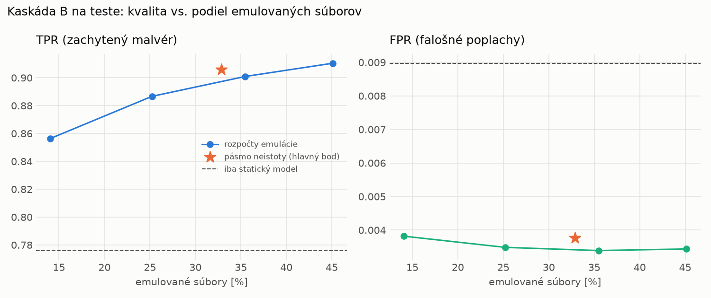

# Kaskáda B `b_nokd` – beh `20261123-011459`

> Generované `src/cascade/evaluate_b.py` (2026-11-23T01:14:59+01:00). Seedy: [0, 1, 2]; hodnoty = priemer ± sm. odchýlka.
> Všetky prahy a pásmo neistoty sú z validácie; test sa na nič nenastavuje. Postup: `docs/09_plan_v2.md`.

| rola | beh |
|---|---|
| static | `runs_v4/real_p/lofo/Airpush_StopSMS/students_static/mlp_nokd/20261123-011135` |
| dynamic | `runs_v4/real_p/lofo/Airpush_StopSMS/students_dynamic/mlp_nokd/20261123-011306` |
| hybrid | `runs_v4/real_p/lofo/Airpush_StopSMS/hybrid/lightgbm/20261123-010804` |

Druhý stupeň: **dynamic**. Pásmo neistoty statického modelu: FPR ≤ 0.1% nad `hi`,
najviac 1% malvéru validácie pod `lo` (seed 0: lo = 0.0281, hi = 0.9970, seed 1: lo = 0.0229, hi = 0.9944, seed 2: lo = 0.0266, hi = 0.9910).

## Test
| prístup | accuracy | balanced_accuracy | precision | recall_tpr | fpr | f1 | mcc |
|---|---|---|---|---|---|---|---|
| kaskáda B | 0.9558 ± 0.0016 | 0.9511 ± 0.0019 | 0.9949 ± 0.0006 | 0.9059 ± 0.0041 | 0.0038 ± 0.0004 | 0.9483 ± 0.0020 | 0.9128 ± 0.0031 |
| statický | 0.8946 ± 0.0105 | 0.8835 ± 0.0117 | 0.9860 ± 0.0012 | 0.7760 ± 0.0237 | 0.0090 ± 0.0008 | 0.8683 ± 0.0147 | 0.7983 ± 0.0188 |
| dynamický | 0.8735 ± 0.0022 | 0.8599 ± 0.0024 | 0.9861 ± 0.0007 | 0.7281 ± 0.0050 | 0.0084 ± 0.0005 | 0.8376 ± 0.0033 | 0.7606 ± 0.0039 |
| hybrid (každá vzorka) | 0.9727 ± 0.0003 | 0.9705 ± 0.0004 | 0.9899 ± 0.0010 | 0.9489 ± 0.0013 | 0.0079 ± 0.0008 | 0.9689 ± 0.0004 | 0.9453 ± 0.0007 |

- **emulované súbory: 32.86%** (ostatné rozhodne iba statický model); na hybrid ide 9.89% súborov
- chyby pri istom rozhodnutí statického modelu (seed 0): 136
- validácia: emulované 27.39%, na hybrid 5.30%

## Validácia
| prístup | accuracy | balanced_accuracy | precision | recall_tpr | fpr | f1 | mcc |
|---|---|---|---|---|---|---|---|
| kaskáda B | 0.9752 ± 0.0022 | 0.9694 ± 0.0029 | 0.9920 ± 0.0002 | 0.9435 ± 0.0059 | 0.0048 ± 0.0002 | 0.9672 ± 0.0030 | 0.9481 ± 0.0045 |
| statický | 0.9570 ± 0.0037 | 0.9473 ± 0.0048 | 0.9832 ± 0.0002 | 0.9043 ± 0.0096 | 0.0097 ± 0.0000 | 0.9421 ± 0.0053 | 0.9100 ± 0.0077 |
| dynamický | 0.8831 ± 0.0009 | 0.8517 ± 0.0011 | 0.9788 ± 0.0001 | 0.7132 ± 0.0022 | 0.0097 ± 0.0000 | 0.8251 ± 0.0015 | 0.7615 ± 0.0017 |
| hybrid (každá vzorka) | 0.9841 ± 0.0005 | 0.9822 ± 0.0005 | 0.9853 ± 0.0009 | 0.9735 ± 0.0007 | 0.0092 ± 0.0006 | 0.9794 ± 0.0007 | 0.9665 ± 0.0011 |

## Januárové vzorky vynechanej rodiny (iba malvér → TPR)
| prístup | TPR |
|---|---|
| kaskáda B | 0.7915 ± 0.0018 |
| statický | 0.3522 ± 0.0670 |
| dynamický | 0.8061 ± 0.0039 |
| hybrid (každá vzorka) | 0.8720 ± 0.0019 |

Podiel emulovaných: 82.05%

## Krivka rozpočtu emulácie (test, priemer cez seedy)
| budget_val | emulation_rate | hybrid_rate | recall_tpr | fpr | f1 |
|---|---|---|---|---|---|
| 0.1000 | 0.1404 | 0.0668 | 0.8564 | 0.0038 | 0.9203 |
| 0.2000 | 0.2522 | 0.0993 | 0.8867 | 0.0035 | 0.9378 |
| 0.3000 | 0.3547 | 0.1140 | 0.9009 | 0.0034 | 0.9458 |
| 0.4000 | 0.4511 | 0.1240 | 0.9105 | 0.0034 | 0.9510 |

## Výpočtové nároky
Čas dynamickej analýzy (beh v emulátore alebo na zariadení) dataset neuvádza, preto sa neodhaduje. Úspora kaskády B = podiel súborov s dynamickou analýzou: **32.86%** (ostatné prístupy 100 %).

_Chýba benchmark niektorého komponentu (v zero-day behoch sa nemeria)._

