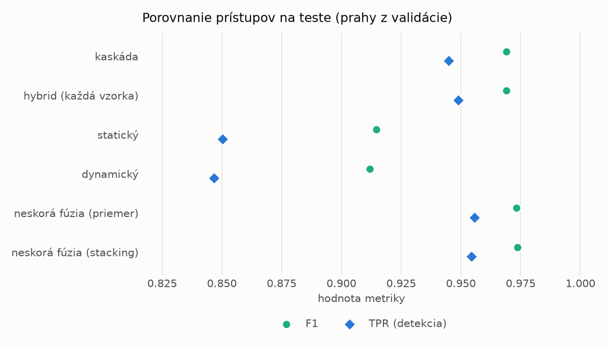
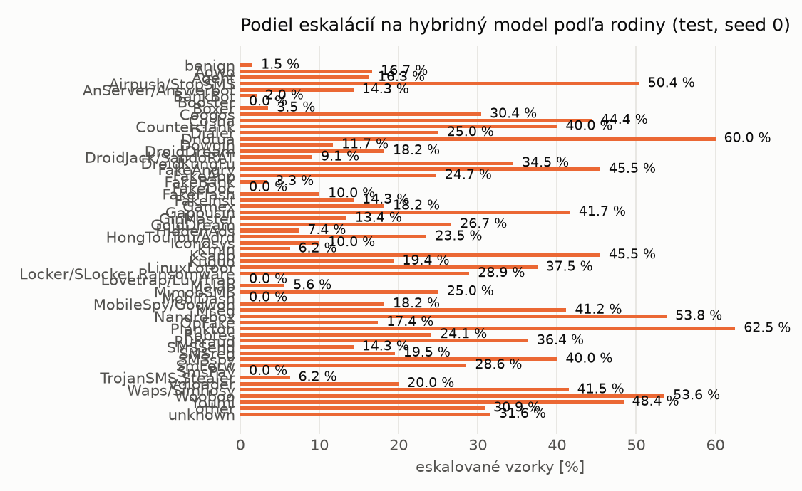

# Kaskáda `baselines` – beh `20261123-011447`

> Generované `src/cascade/evaluate.py` (2026-11-23T01:14:47+01:00). Seedy: [0, 1, 2]; hodnoty = priemer ± sm. odchýlka.
> Všetky prahy sú určené na validácii (FPR ≤ 1 %); test sa na nič nenastavuje.

| rola | beh |
|---|---|
| static | `runs_v4/real_p/lofo/Airpush_StopSMS/static/lightgbm/20261123-010336` |
| dynamic | `runs_v4/real_p/lofo/Airpush_StopSMS/dynamic/lightgbm/20261123-010546` |
| hybrid | `runs_v4/real_p/lofo/Airpush_StopSMS/hybrid/lightgbm/20261123-010804` |

## Test
| prístup | accuracy | balanced_accuracy | precision | recall_tpr | fpr | f1 | mcc |
|---|---|---|---|---|---|---|---|
| kaskáda | 0.9729 ± 0.0005 | 0.9703 ± 0.0004 | 0.9943 ± 0.0010 | 0.9449 ± 0.0004 | 0.0044 ± 0.0008 | 0.9690 ± 0.0005 | 0.9459 ± 0.0010 |
| hybrid (každá vzorka) | 0.9727 ± 0.0003 | 0.9705 ± 0.0004 | 0.9899 ± 0.0010 | 0.9489 ± 0.0013 | 0.0079 ± 0.0008 | 0.9689 ± 0.0004 | 0.9453 ± 0.0007 |
| statický | 0.9289 ± 0.0014 | 0.9215 ± 0.0016 | 0.9897 ± 0.0003 | 0.8502 ± 0.0033 | 0.0072 ± 0.0002 | 0.9147 ± 0.0018 | 0.8616 ± 0.0026 |
| dynamický | 0.9267 ± 0.0006 | 0.9192 ± 0.0007 | 0.9881 ± 0.0007 | 0.8466 ± 0.0020 | 0.0083 ± 0.0005 | 0.9119 ± 0.0008 | 0.8572 ± 0.0010 |
| neskorá fúzia (priemer) | 0.9764 ± 0.0002 | 0.9744 ± 0.0002 | 0.9913 ± 0.0009 | 0.9556 ± 0.0004 | 0.0068 ± 0.0007 | 0.9732 ± 0.0003 | 0.9526 ± 0.0005 |
| neskorá fúzia (stacking) | 0.9768 ± 0.0005 | 0.9747 ± 0.0006 | 0.9938 ± 0.0006 | 0.9543 ± 0.0015 | 0.0049 ± 0.0005 | 0.9737 ± 0.0006 | 0.9536 ± 0.0010 |

## Validácia
| prístup | accuracy | balanced_accuracy | precision | recall_tpr | fpr | f1 | mcc |
|---|---|---|---|---|---|---|---|
| kaskáda | 0.9847 ± 0.0003 | 0.9817 ± 0.0004 | 0.9913 ± 0.0003 | 0.9688 ± 0.0009 | 0.0054 ± 0.0002 | 0.9799 ± 0.0004 | 0.9677 ± 0.0006 |
| hybrid (každá vzorka) | 0.9841 ± 0.0005 | 0.9822 ± 0.0005 | 0.9853 ± 0.0009 | 0.9735 ± 0.0007 | 0.0092 ± 0.0006 | 0.9794 ± 0.0007 | 0.9665 ± 0.0011 |
| statický | 0.9770 ± 0.0006 | 0.9730 ± 0.0008 | 0.9844 ± 0.0005 | 0.9556 ± 0.0013 | 0.0096 ± 0.0003 | 0.9698 ± 0.0008 | 0.9515 ± 0.0013 |
| dynamický | 0.9362 ± 0.0009 | 0.9203 ± 0.0012 | 0.9825 ± 0.0003 | 0.8502 ± 0.0025 | 0.0096 ± 0.0002 | 0.9116 ± 0.0014 | 0.8676 ± 0.0019 |
| neskorá fúzia (priemer) | 0.9852 ± 0.0003 | 0.9836 ± 0.0003 | 0.9847 ± 0.0005 | 0.9768 ± 0.0008 | 0.0096 ± 0.0003 | 0.9808 ± 0.0004 | 0.9687 ± 0.0006 |
| neskorá fúzia (stacking) | 0.9857 ± 0.0001 | 0.9841 ± 0.0001 | 0.9859 ± 0.0003 | 0.9770 ± 0.0003 | 0.0088 ± 0.0002 | 0.9814 ± 0.0001 | 0.9698 ± 0.0002 |

## Správanie kaskády (test, seed 0)
- podiel eskalácií na hybrid: **11.54%** (1461 vzoriek)
- chyby pri zhode študentov (kaskáda ich nemôže opraviť): **181**
  (1.617% zo zhôd; FP 1, FN 180)
- úspešnosť na eskalovaných vzorkách: hybrid 0.891170431211499, statický 0.5119780971937029,
  dynamický 0.48802190280629704  → prínos hybridu pri nezhode

## Výpočtové nároky (odhad z benchmarkov komponentov)
_Chýba benchmark niektorého komponentu (`python -m src.evaluation.benchmark`)._

