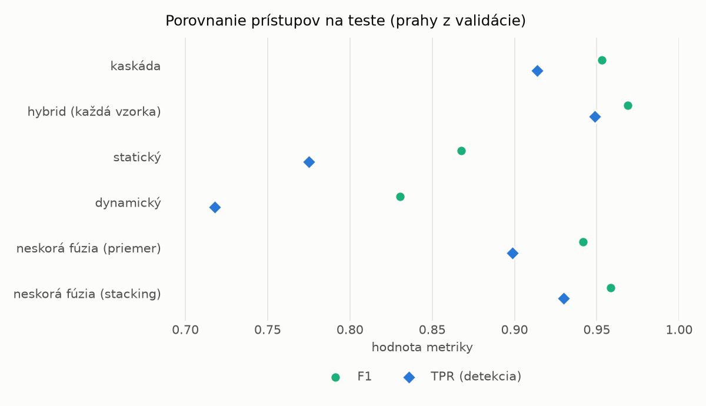
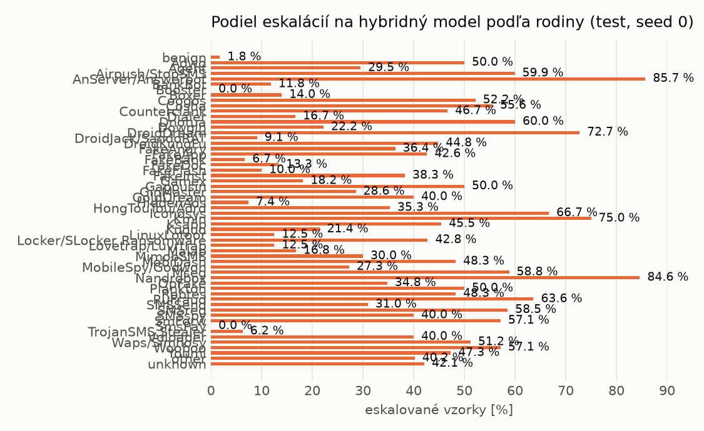

# Kaskáda `heavyteacher` – beh `20261123-011449`

> Generované `src/cascade/evaluate.py` (2026-11-23T01:14:50+01:00). Seedy: [0, 1, 2]; hodnoty = priemer ± sm. odchýlka.
> Všetky prahy sú určené na validácii (FPR ≤ 1 %); test sa na nič nenastavuje.

| rola | beh |
|---|---|
| static | `runs_v4/real_p/lofo/Airpush_StopSMS/students_static/mlp_kd_heavy/20261123-011230` |
| dynamic | `runs_v4/real_p/lofo/Airpush_StopSMS/students_dynamic/mlp_kd_heavy/20261123-011417` |
| hybrid | `runs_v4/real_p/lofo/Airpush_StopSMS/hybrid/lightgbm/20261123-010804` |

## Test
| prístup | accuracy | balanced_accuracy | precision | recall_tpr | fpr | f1 | mcc |
|---|---|---|---|---|---|---|---|
| kaskáda | 0.9596 ± 0.0003 | 0.9553 ± 0.0003 | 0.9958 ± 0.0003 | 0.9137 ± 0.0007 | 0.0031 ± 0.0002 | 0.9530 ± 0.0003 | 0.9203 ± 0.0005 |
| hybrid (každá vzorka) | 0.9727 ± 0.0003 | 0.9705 ± 0.0004 | 0.9899 ± 0.0010 | 0.9489 ± 0.0013 | 0.0079 ± 0.0008 | 0.9689 ± 0.0004 | 0.9453 ± 0.0007 |
| statický | 0.8941 ± 0.0008 | 0.8829 ± 0.0008 | 0.9857 ± 0.0008 | 0.7750 ± 0.0011 | 0.0091 ± 0.0005 | 0.8678 ± 0.0010 | 0.7973 ± 0.0016 |
| dynamický | 0.8687 ± 0.0007 | 0.8546 ± 0.0008 | 0.9853 ± 0.0010 | 0.7178 ± 0.0015 | 0.0087 ± 0.0006 | 0.8306 ± 0.0010 | 0.7520 ± 0.0014 |
| neskorá fúzia (priemer) | 0.9501 ± 0.0035 | 0.9453 ± 0.0040 | 0.9890 ± 0.0013 | 0.8988 ± 0.0087 | 0.0081 ± 0.0010 | 0.9417 ± 0.0044 | 0.9015 ± 0.0066 |
| neskorá fúzia (stacking) | 0.9640 ± 0.0015 | 0.9608 ± 0.0017 | 0.9891 ± 0.0017 | 0.9300 ± 0.0044 | 0.0084 ± 0.0013 | 0.9586 ± 0.0018 | 0.9282 ± 0.0028 |

## Validácia
| prístup | accuracy | balanced_accuracy | precision | recall_tpr | fpr | f1 | mcc |
|---|---|---|---|---|---|---|---|
| kaskáda | 0.9748 ± 0.0018 | 0.9687 ± 0.0023 | 0.9927 ± 0.0002 | 0.9418 ± 0.0048 | 0.0044 ± 0.0002 | 0.9666 ± 0.0024 | 0.9472 ± 0.0036 |
| hybrid (každá vzorka) | 0.9841 ± 0.0005 | 0.9822 ± 0.0005 | 0.9853 ± 0.0009 | 0.9735 ± 0.0007 | 0.0092 ± 0.0006 | 0.9794 ± 0.0007 | 0.9665 ± 0.0011 |
| statický | 0.9553 ± 0.0031 | 0.9451 ± 0.0040 | 0.9831 ± 0.0001 | 0.8999 ± 0.0080 | 0.0097 ± 0.0000 | 0.9397 ± 0.0044 | 0.9065 ± 0.0063 |
| dynamický | 0.8769 ± 0.0029 | 0.8437 ± 0.0037 | 0.9785 ± 0.0005 | 0.6970 ± 0.0073 | 0.0096 ± 0.0002 | 0.8141 ± 0.0051 | 0.7492 ± 0.0057 |
| neskorá fúzia (priemer) | 0.9704 ± 0.0015 | 0.9646 ± 0.0019 | 0.9840 ± 0.0003 | 0.9388 ± 0.0039 | 0.0096 ± 0.0002 | 0.9609 ± 0.0021 | 0.9378 ± 0.0031 |
| neskorá fúzia (stacking) | 0.9758 ± 0.0013 | 0.9716 ± 0.0017 | 0.9840 ± 0.0001 | 0.9529 ± 0.0034 | 0.0097 ± 0.0000 | 0.9682 ± 0.0018 | 0.9490 ± 0.0028 |

## Správanie kaskády (test, seed 0)
- podiel eskalácií na hybrid: **17.34%** (2195 vzoriek)
- chyby pri zhode študentov (kaskáda ich nemôže opraviť): **408**
  (3.900% zo zhôd; FP 2, FN 406)
- úspešnosť na eskalovaných vzorkách: hybrid 0.9530751708428246, statický 0.5753986332574031,
  dynamický 0.4246013667425968  → prínos hybridu pri nezhode

## Výpočtové nároky (odhad z benchmarkov komponentov)
_Chýba benchmark niektorého komponentu (`python -m src.evaluation.benchmark`)._

