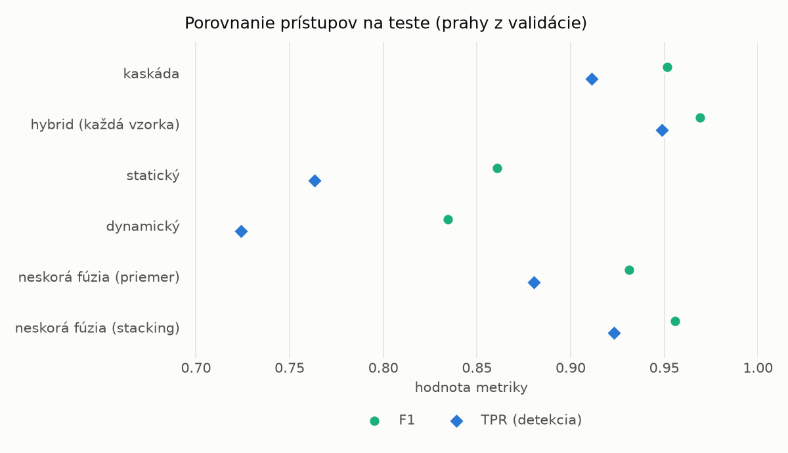
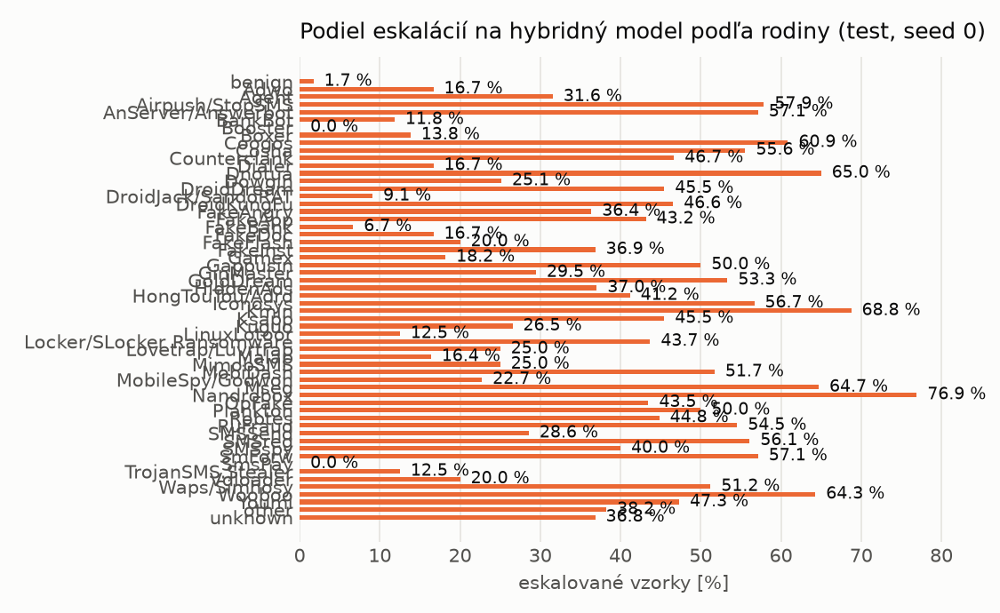

# Kaskáda `main` – beh `20261123-011438`

> Generované `src/cascade/evaluate.py` (2026-11-23T01:14:38+01:00). Seedy: [0, 1, 2]; hodnoty = priemer ± sm. odchýlka.
> Všetky prahy sú určené na validácii (FPR ≤ 1 %); test sa na nič nenastavuje.

| rola | beh |
|---|---|
| static | `runs_v4/real_p/lofo/Airpush_StopSMS/students_static/mlp_kd/20261123-011119` |
| dynamic | `runs_v4/real_p/lofo/Airpush_StopSMS/students_dynamic/mlp_kd/20261123-011247` |
| hybrid | `runs_v4/real_p/lofo/Airpush_StopSMS/hybrid/lightgbm/20261123-010804` |

## Test
| prístup | accuracy | balanced_accuracy | precision | recall_tpr | fpr | f1 | mcc |
|---|---|---|---|---|---|---|---|
| kaskáda | 0.9585 ± 0.0005 | 0.9541 ± 0.0005 | 0.9959 ± 0.0007 | 0.9112 ± 0.0006 | 0.0031 ± 0.0005 | 0.9516 ± 0.0005 | 0.9182 ± 0.0009 |
| hybrid (každá vzorka) | 0.9727 ± 0.0003 | 0.9705 ± 0.0004 | 0.9899 ± 0.0010 | 0.9489 ± 0.0013 | 0.0079 ± 0.0008 | 0.9689 ± 0.0004 | 0.9453 ± 0.0007 |
| statický | 0.8891 ± 0.0036 | 0.8773 ± 0.0041 | 0.9863 ± 0.0010 | 0.7633 ± 0.0086 | 0.0086 ± 0.0007 | 0.8606 ± 0.0053 | 0.7885 ± 0.0064 |
| dynamický | 0.8713 ± 0.0034 | 0.8574 ± 0.0039 | 0.9849 ± 0.0007 | 0.7239 ± 0.0082 | 0.0090 ± 0.0005 | 0.8344 ± 0.0052 | 0.7564 ± 0.0058 |
| neskorá fúzia (priemer) | 0.9419 ± 0.0043 | 0.9361 ± 0.0050 | 0.9887 ± 0.0020 | 0.8804 ± 0.0115 | 0.0082 ± 0.0016 | 0.9314 ± 0.0056 | 0.8858 ± 0.0080 |
| neskorá fúzia (stacking) | 0.9615 ± 0.0005 | 0.9579 ± 0.0006 | 0.9904 ± 0.0004 | 0.9231 ± 0.0014 | 0.0073 ± 0.0003 | 0.9556 ± 0.0006 | 0.9235 ± 0.0010 |

## Validácia
| prístup | accuracy | balanced_accuracy | precision | recall_tpr | fpr | f1 | mcc |
|---|---|---|---|---|---|---|---|
| kaskáda | 0.9753 ± 0.0004 | 0.9691 ± 0.0005 | 0.9939 ± 0.0003 | 0.9418 ± 0.0009 | 0.0036 ± 0.0002 | 0.9672 ± 0.0005 | 0.9483 ± 0.0008 |
| hybrid (každá vzorka) | 0.9841 ± 0.0005 | 0.9822 ± 0.0005 | 0.9853 ± 0.0009 | 0.9735 ± 0.0007 | 0.0092 ± 0.0006 | 0.9794 ± 0.0007 | 0.9665 ± 0.0011 |
| statický | 0.9545 ± 0.0002 | 0.9440 ± 0.0002 | 0.9832 ± 0.0003 | 0.8976 ± 0.0005 | 0.0096 ± 0.0002 | 0.9385 ± 0.0003 | 0.9048 ± 0.0004 |
| dynamický | 0.8826 ± 0.0045 | 0.8511 ± 0.0058 | 0.9788 ± 0.0003 | 0.7119 ± 0.0115 | 0.0097 ± 0.0000 | 0.8243 ± 0.0079 | 0.7605 ± 0.0088 |
| neskorá fúzia (priemer) | 0.9674 ± 0.0031 | 0.9607 ± 0.0040 | 0.9837 ± 0.0001 | 0.9311 ± 0.0080 | 0.0097 ± 0.0000 | 0.9567 ± 0.0043 | 0.9314 ± 0.0064 |
| neskorá fúzia (stacking) | 0.9739 ± 0.0010 | 0.9691 ± 0.0013 | 0.9841 ± 0.0002 | 0.9479 ± 0.0027 | 0.0096 ± 0.0002 | 0.9657 ± 0.0013 | 0.9451 ± 0.0020 |

## Správanie kaskády (test, seed 0)
- podiel eskalácií na hybrid: **17.20%** (2177 vzoriek)
- chyby pri zhode študentov (kaskáda ich nemôže opraviť): **426**
  (4.065% zo zhôd; FP 1, FN 425)
- úspešnosť na eskalovaných vzorkách: hybrid 0.9554432705558108, statický 0.5755627009646302,
  dynamický 0.42443729903536975  → prínos hybridu pri nezhode

## Výpočtové nároky (odhad z benchmarkov komponentov)
_Chýba benchmark niektorého komponentu (`python -m src.evaluation.benchmark`)._

