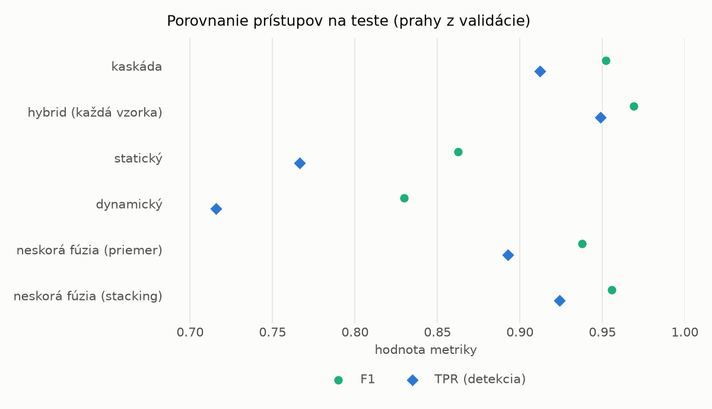
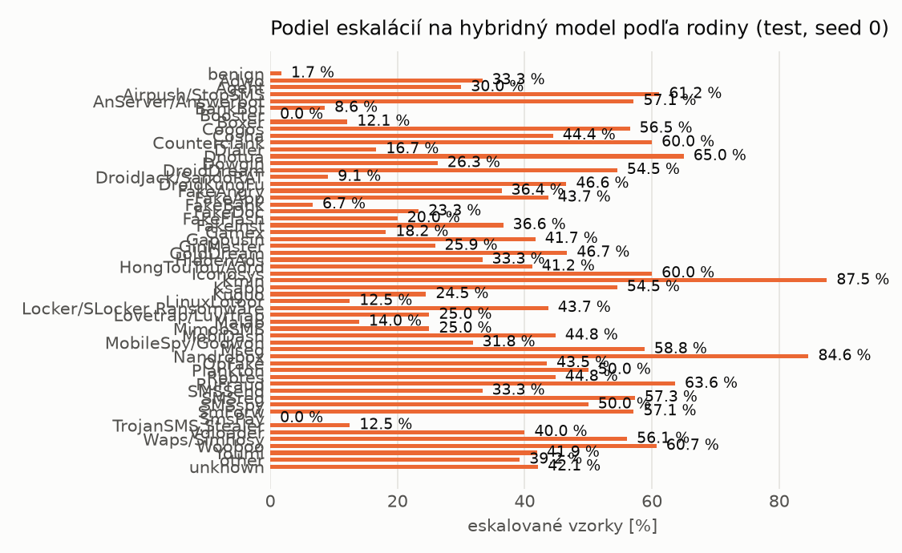

# Kaskáda `modal` – beh `20261123-011443`

> Generované `src/cascade/evaluate.py` (2026-11-23T01:14:43+01:00). Seedy: [0, 1, 2]; hodnoty = priemer ± sm. odchýlka.
> Všetky prahy sú určené na validácii (FPR ≤ 1 %); test sa na nič nenastavuje.

| rola | beh |
|---|---|
| static | `runs_v4/real_p/lofo/Airpush_StopSMS/students_static/mlp_kd_modal/20261123-011203` |
| dynamic | `runs_v4/real_p/lofo/Airpush_StopSMS/students_dynamic/mlp_kd_modal/20261123-011343` |
| hybrid | `runs_v4/real_p/lofo/Airpush_StopSMS/hybrid/lightgbm/20261123-010804` |

## Test
| prístup | accuracy | balanced_accuracy | precision | recall_tpr | fpr | f1 | mcc |
|---|---|---|---|---|---|---|---|
| kaskáda | 0.9589 ± 0.0016 | 0.9545 ± 0.0018 | 0.9956 ± 0.0002 | 0.9122 ± 0.0037 | 0.0032 ± 0.0002 | 0.9521 ± 0.0019 | 0.9189 ± 0.0030 |
| hybrid (každá vzorka) | 0.9727 ± 0.0003 | 0.9705 ± 0.0004 | 0.9899 ± 0.0010 | 0.9489 ± 0.0013 | 0.0079 ± 0.0008 | 0.9689 ± 0.0004 | 0.9453 ± 0.0007 |
| statický | 0.8904 ± 0.0028 | 0.8787 ± 0.0031 | 0.9858 ± 0.0009 | 0.7664 ± 0.0062 | 0.0090 ± 0.0005 | 0.8624 ± 0.0040 | 0.7906 ± 0.0051 |
| dynamický | 0.8684 ± 0.0035 | 0.8541 ± 0.0040 | 0.9871 ± 0.0020 | 0.7158 ± 0.0087 | 0.0076 ± 0.0012 | 0.8299 ± 0.0054 | 0.7520 ± 0.0059 |
| neskorá fúzia (priemer) | 0.9469 ± 0.0050 | 0.9418 ± 0.0057 | 0.9879 ± 0.0017 | 0.8925 ± 0.0126 | 0.0089 ± 0.0014 | 0.9378 ± 0.0063 | 0.8953 ± 0.0093 |
| neskorá fúzia (stacking) | 0.9617 ± 0.0010 | 0.9582 ± 0.0011 | 0.9901 ± 0.0009 | 0.9238 ± 0.0029 | 0.0075 ± 0.0007 | 0.9558 ± 0.0012 | 0.9238 ± 0.0018 |

## Validácia
| prístup | accuracy | balanced_accuracy | precision | recall_tpr | fpr | f1 | mcc |
|---|---|---|---|---|---|---|---|
| kaskáda | 0.9743 ± 0.0015 | 0.9681 ± 0.0021 | 0.9930 ± 0.0010 | 0.9403 ± 0.0044 | 0.0042 ± 0.0006 | 0.9659 ± 0.0021 | 0.9463 ± 0.0032 |
| hybrid (každá vzorka) | 0.9841 ± 0.0005 | 0.9822 ± 0.0005 | 0.9853 ± 0.0009 | 0.9735 ± 0.0007 | 0.0092 ± 0.0006 | 0.9794 ± 0.0007 | 0.9665 ± 0.0011 |
| statický | 0.9550 ± 0.0014 | 0.9446 ± 0.0018 | 0.9833 ± 0.0003 | 0.8988 ± 0.0036 | 0.0096 ± 0.0002 | 0.9392 ± 0.0020 | 0.9058 ± 0.0029 |
| dynamický | 0.8748 ± 0.0040 | 0.8409 ± 0.0052 | 0.9784 ± 0.0006 | 0.6915 ± 0.0103 | 0.0096 ± 0.0002 | 0.8103 ± 0.0072 | 0.7451 ± 0.0080 |
| neskorá fúzia (priemer) | 0.9708 ± 0.0038 | 0.9651 ± 0.0049 | 0.9838 ± 0.0002 | 0.9399 ± 0.0097 | 0.0097 ± 0.0000 | 0.9613 ± 0.0051 | 0.9385 ± 0.0078 |
| neskorá fúzia (stacking) | 0.9743 ± 0.0005 | 0.9696 ± 0.0006 | 0.9841 ± 0.0003 | 0.9488 ± 0.0011 | 0.0096 ± 0.0002 | 0.9661 ± 0.0007 | 0.9458 ± 0.0011 |

## Správanie kaskády (test, seed 0)
- podiel eskalácií na hybrid: **17.33%** (2193 vzoriek)
- chyby pri zhode študentov (kaskáda ich nemôže opraviť): **432**
  (4.129% zo zhôd; FP 3, FN 429)
- úspešnosť na eskalovaných vzorkách: hybrid 0.95531235750114, statický 0.5622435020519836,
  dynamický 0.4377564979480164  → prínos hybridu pri nezhode

## Výpočtové nároky (odhad z benchmarkov komponentov)
_Chýba benchmark niektorého komponentu (`python -m src.evaluation.benchmark`)._

