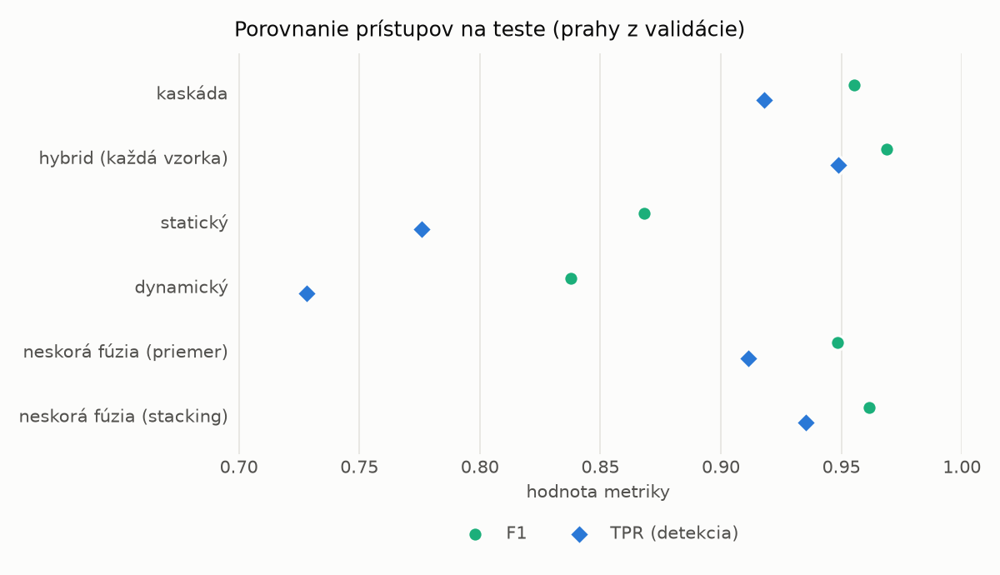
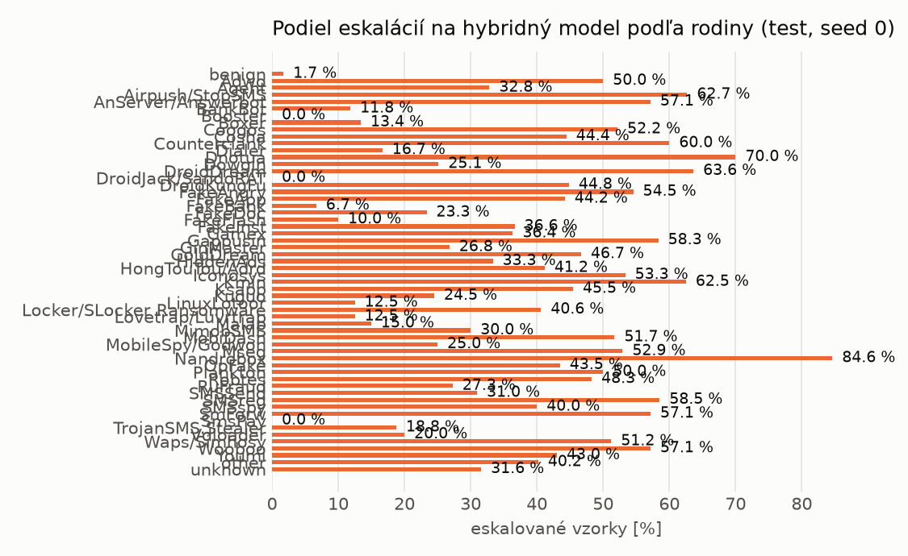

# Kaskáda `nokd` – beh `20261123-011440`

> Generované `src/cascade/evaluate.py` (2026-11-23T01:14:41+01:00). Seedy: [0, 1, 2]; hodnoty = priemer ± sm. odchýlka.
> Všetky prahy sú určené na validácii (FPR ≤ 1 %); test sa na nič nenastavuje.

| rola | beh |
|---|---|
| static | `runs_v4/real_p/lofo/Airpush_StopSMS/students_static/mlp_nokd/20261123-011135` |
| dynamic | `runs_v4/real_p/lofo/Airpush_StopSMS/students_dynamic/mlp_nokd/20261123-011306` |
| hybrid | `runs_v4/real_p/lofo/Airpush_StopSMS/hybrid/lightgbm/20261123-010804` |

## Test
| prístup | accuracy | balanced_accuracy | precision | recall_tpr | fpr | f1 | mcc |
|---|---|---|---|---|---|---|---|
| kaskáda | 0.9614 ± 0.0022 | 0.9573 ± 0.0024 | 0.9956 ± 0.0003 | 0.9179 ± 0.0050 | 0.0033 ± 0.0002 | 0.9552 ± 0.0026 | 0.9237 ± 0.0042 |
| hybrid (každá vzorka) | 0.9727 ± 0.0003 | 0.9705 ± 0.0004 | 0.9899 ± 0.0010 | 0.9489 ± 0.0013 | 0.0079 ± 0.0008 | 0.9689 ± 0.0004 | 0.9453 ± 0.0007 |
| statický | 0.8946 ± 0.0105 | 0.8835 ± 0.0117 | 0.9860 ± 0.0012 | 0.7760 ± 0.0237 | 0.0090 ± 0.0008 | 0.8683 ± 0.0147 | 0.7983 ± 0.0188 |
| dynamický | 0.8735 ± 0.0022 | 0.8599 ± 0.0024 | 0.9861 ± 0.0007 | 0.7281 ± 0.0050 | 0.0084 ± 0.0005 | 0.8376 ± 0.0033 | 0.7606 ± 0.0039 |
| neskorá fúzia (priemer) | 0.9556 ± 0.0026 | 0.9515 ± 0.0030 | 0.9885 ± 0.0007 | 0.9115 ± 0.0066 | 0.0086 ± 0.0006 | 0.9485 ± 0.0033 | 0.9119 ± 0.0050 |
| neskorá fúzia (stacking) | 0.9664 ± 0.0027 | 0.9635 ± 0.0030 | 0.9893 ± 0.0007 | 0.9352 ± 0.0066 | 0.0082 ± 0.0006 | 0.9615 ± 0.0032 | 0.9329 ± 0.0052 |

## Validácia
| prístup | accuracy | balanced_accuracy | precision | recall_tpr | fpr | f1 | mcc |
|---|---|---|---|---|---|---|---|
| kaskáda | 0.9767 ± 0.0021 | 0.9711 ± 0.0028 | 0.9927 ± 0.0005 | 0.9467 ± 0.0059 | 0.0044 ± 0.0003 | 0.9691 ± 0.0029 | 0.9511 ± 0.0044 |
| hybrid (každá vzorka) | 0.9841 ± 0.0005 | 0.9822 ± 0.0005 | 0.9853 ± 0.0009 | 0.9735 ± 0.0007 | 0.0092 ± 0.0006 | 0.9794 ± 0.0007 | 0.9665 ± 0.0011 |
| statický | 0.9570 ± 0.0037 | 0.9473 ± 0.0048 | 0.9832 ± 0.0002 | 0.9043 ± 0.0096 | 0.0097 ± 0.0000 | 0.9421 ± 0.0053 | 0.9100 ± 0.0077 |
| dynamický | 0.8831 ± 0.0009 | 0.8517 ± 0.0011 | 0.9788 ± 0.0001 | 0.7132 ± 0.0022 | 0.0097 ± 0.0000 | 0.8251 ± 0.0015 | 0.7615 ± 0.0017 |
| neskorá fúzia (priemer) | 0.9745 ± 0.0013 | 0.9699 ± 0.0017 | 0.9840 ± 0.0001 | 0.9496 ± 0.0034 | 0.0097 ± 0.0000 | 0.9665 ± 0.0018 | 0.9463 ± 0.0028 |
| neskorá fúzia (stacking) | 0.9784 ± 0.0019 | 0.9749 ± 0.0023 | 0.9845 ± 0.0006 | 0.9593 ± 0.0043 | 0.0096 ± 0.0003 | 0.9717 ± 0.0025 | 0.9544 ± 0.0039 |

## Správanie kaskády (test, seed 0)
- podiel eskalácií na hybrid: **17.57%** (2224 vzoriek)
- chyby pri zhode študentov (kaskáda ich nemôže opraviť): **407**
  (3.901% zo zhôd; FP 2, FN 405)
- úspešnosť na eskalovaných vzorkách: hybrid 0.9572841726618705, statický 0.5508093525179856,
  dynamický 0.44919064748201437  → prínos hybridu pri nezhode

## Výpočtové nároky (odhad z benchmarkov komponentov)
_Chýba benchmark niektorého komponentu (`python -m src.evaluation.benchmark`)._

