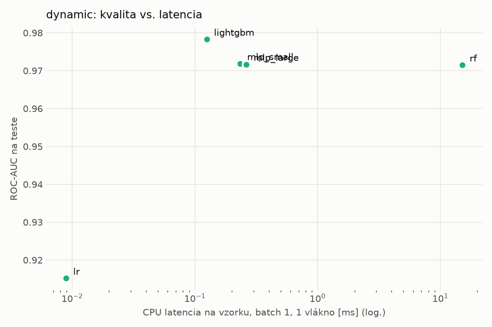
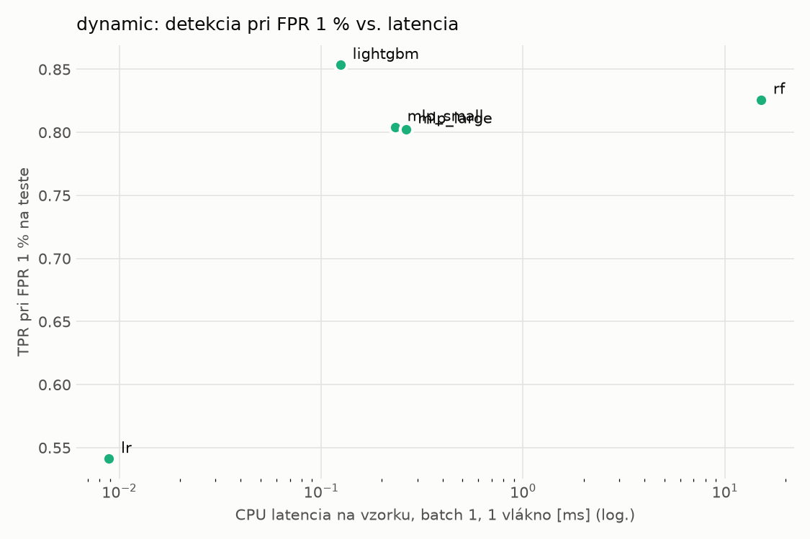
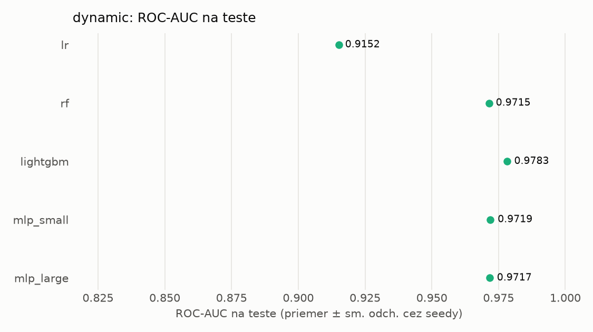
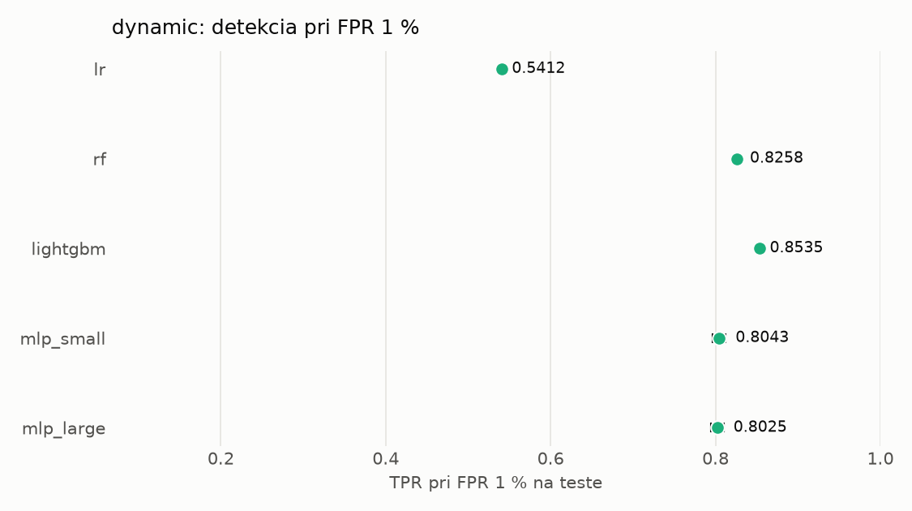

# Porovnanie modelov – dynamic

> Generované `src/evaluation/compare.py` (2026-11-23T01:07:43+01:00); použitý je posledný beh každého modelu.
> Metriky sú priemer cez seedy. \* = pri prahu určenom na validácii (FPR ≤ 1 %).
> CPU ms/vz. = medián latencie jednej vzorky na 1 vlákne vrátane transformácie vstupu (meranie hneď po tréningu,
> orientačné). Oficiálne merania spotreby sú v časti „Spotreba zdrojov pri inferencii“.

## Detekčná kvalita a orientačné časy
| model | ROC-AUC val | ROC-AUC test | TPR@FPR 1 % test | TPR@FPR 0,1 % test | F1 test* | FPR test* | gap train−val | CPU ms/vz. | CPU vz./s | GPU ms/vz. | parametre | MB | tréning s | ladenie min |
|---|---|---|---|---|---|---|---|---|---|---|---|---|---|---|
| [lr](../../dynamic/lr/20261123-010527/README.md) | 0.9146 | 0.9152 ± 0.0000 | 0.5412 | 0.3892 | 0.6671 | 0.0072 | 0.0030 | 0.009 | 3 825 298 | – | 124 | 0.01 | 0.3 | 0.0 |
| [rf](../../dynamic/rf/20261123-010529/README.md) | 0.9779 | 0.9715 ± 0.0001 | 0.8258 | 0.7355 | 0.8927 | 0.0068 | 0.0206 | 15.111 | 112 753 | – | 3 069 732 | 245.94 | 2.2 | 0.0 |
| [lightgbm](../../dynamic/lightgbm/20261123-010546/README.md) | 0.9825 | 0.9783 ± 0.0002 | 0.8535 | 0.7610 | 0.9119 | 0.0083 | 0.0168 | 0.125 | 112 598 | – | 238 293 | 13.09 | 10.4 | 0.0 |
| [mlp_small](../../dynamic/mlp_small/20261123-010626/README.md) | 0.9740 | 0.9719 ± 0.0004 | 0.8043 | 0.6596 | 0.8725 | 0.0071 | 0.0157 | 0.233 | 3 196 928 | 0.372 | 65 537 | 0.27 | 17.9 | 0.0 |
| [mlp_large](../../dynamic/mlp_large/20261123-010721/README.md) | 0.9747 | 0.9717 ± 0.0004 | 0.8025 | 0.6587 | 0.8740 | 0.0073 | 0.0147 | 0.262 | 374 613 | 0.717 | 1 119 745 | 4.51 | 6.2 | 0.0 |

## Nízka prevalencia malvéru (test, prah z validácie)
| model | TPR | FPR | precision @ 1 % | falošné na 1 skutočný poplach @ 1 % | precision @ 0.1 % | falošné na 1 skutočný poplach @ 0.1 % |
|---|---|---|---|---|---|---|
| lr | 0.5048 | 0.0072 | 0.416 | 1.40 | 0.066 | 14.17 |
| rf | 0.8130 | 0.0068 | 0.546 | 0.83 | 0.107 | 8.39 |
| lightgbm | 0.8466 | 0.0083 | 0.507 | 0.97 | 0.093 | 9.80 |
| mlp_small | 0.7807 | 0.0071 | 0.526 | 0.90 | 0.099 | 9.10 |
| mlp_large | 0.7832 | 0.0073 | 0.522 | 0.92 | 0.098 | 9.26 |

Prepočet: TPR a FPR nezávisia od podielu malvéru, preto sa dajú preniesť na nízku prevalenciu (v reálnej prevádzke je malvéru ~1 % alebo menej; v teste 54 %). „Falošné na 1 skutočný poplach“ = koľko neškodných súborov je označených na každý zachytený malvér.

## Spotreba zdrojov pri inferencii (benchmark, testovacia množina)
_Benchmark zatiaľ nebol spustený (`python -m src.evaluation.benchmark --approach dynamic`)._

## Grafy

