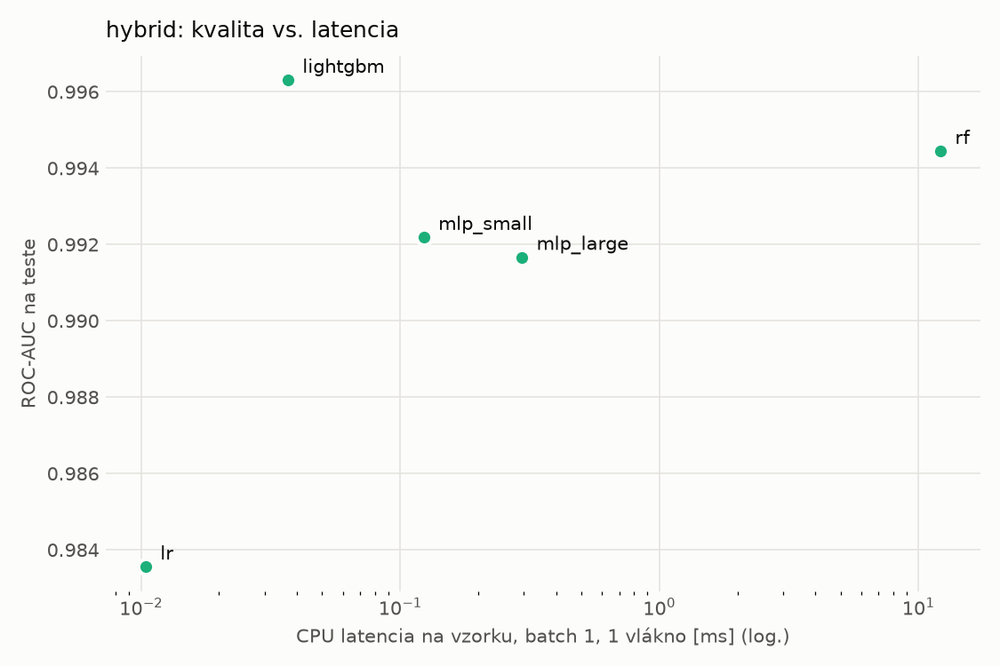
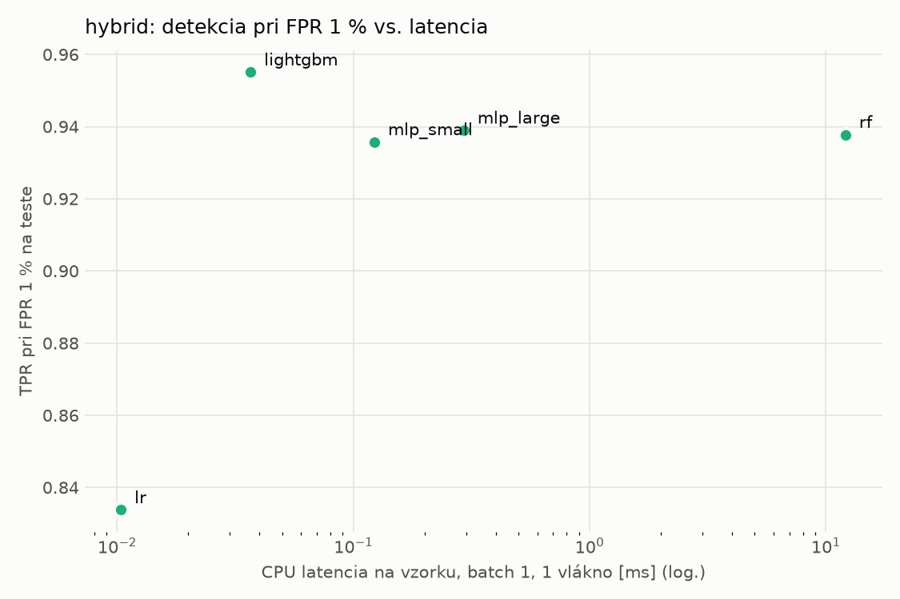
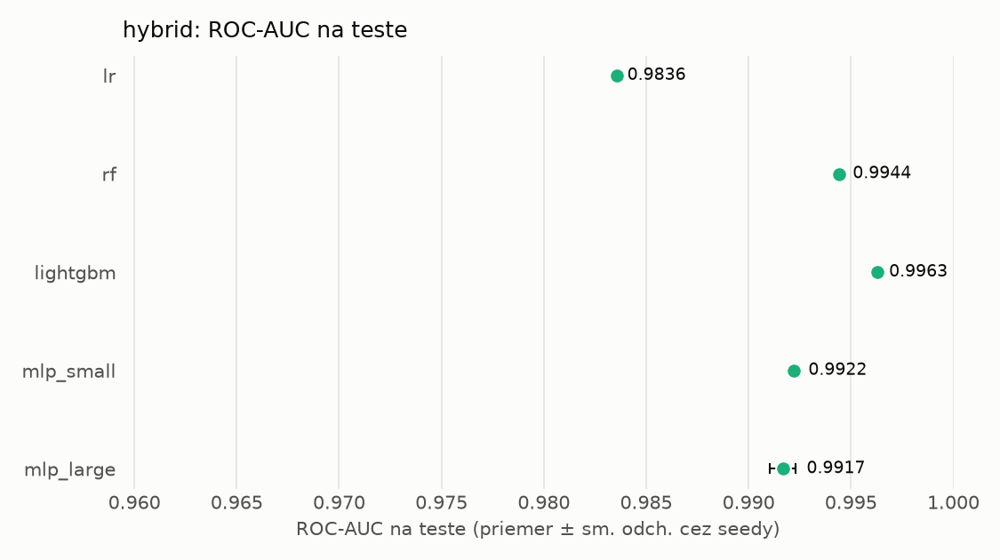
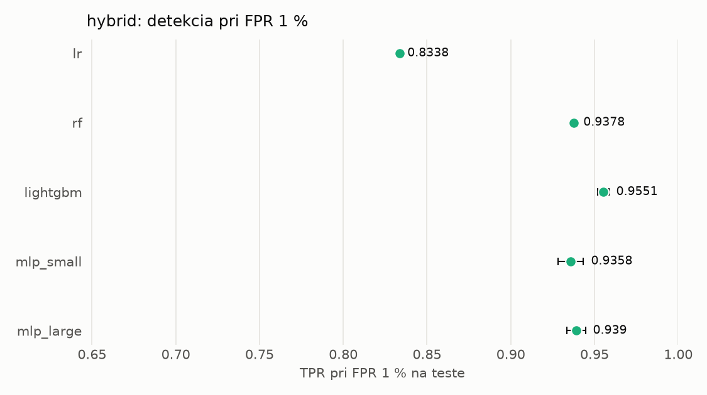

# Porovnanie modelov – hybrid

> Generované `src/evaluation/compare.py` (2026-11-23T01:08:50+01:00); použitý je posledný beh každého modelu.
> Metriky sú priemer cez seedy. \* = pri prahu určenom na validácii (FPR ≤ 1 %).
> CPU ms/vz. = medián latencie jednej vzorky na 1 vlákne vrátane transformácie vstupu (meranie hneď po tréningu,
> orientačné). Oficiálne merania spotreby sú v časti „Spotreba zdrojov pri inferencii“.

## Detekčná kvalita a orientačné časy
| model | ROC-AUC val | ROC-AUC test | TPR@FPR 1 % test | TPR@FPR 0,1 % test | F1 test* | FPR test* | gap train−val | CPU ms/vz. | CPU vz./s | GPU ms/vz. | parametre | MB | tréning s | ladenie min |
|---|---|---|---|---|---|---|---|---|---|---|---|---|---|---|
| [lr](../../hybrid/lr/20261123-010746/README.md) | 0.9858 | 0.9836 ± 0.0000 | 0.8338 | 0.6579 | 0.8996 | 0.0097 | 0.0018 | 0.010 | 2 015 832 | – | 287 | 0.01 | 0.2 | 0.0 |
| [rf](../../hybrid/rf/20261123-010748/README.md) | 0.9953 | 0.9944 ± 0.0001 | 0.9378 | 0.8689 | 0.9576 | 0.0074 | 0.0047 | 12.137 | 121 006 | – | 1 720 050 | 137.92 | 2.2 | 0.0 |
| [lightgbm](../../hybrid/lightgbm/20261123-010804/README.md) | 0.9972 | 0.9963 ± 0.0000 | 0.9551 | 0.9022 | 0.9689 | 0.0079 | 0.0028 | 0.037 | 573 482 | – | 42 411 | 2.38 | 3.7 | 0.0 |
| [mlp_small](../../hybrid/mlp_small/20261123-010817/README.md) | 0.9948 | 0.9922 ± 0.0002 | 0.9358 | 0.7958 | 0.9584 | 0.0079 | 0.0041 | 0.123 | 1 098 230 | 0.674 | 107 265 | 0.45 | 2.3 | 0.0 |
| [mlp_large](../../hybrid/mlp_large/20261123-010826/README.md) | 0.9948 | 0.9917 ± 0.0006 | 0.9390 | 0.8218 | 0.9604 | 0.0081 | 0.0044 | 0.294 | 154 253 | 0.626 | 2 400 257 | 9.64 | 6.6 | 0.0 |

## Nízka prevalencia malvéru (test, prah z validácie)
| model | TPR | FPR | precision @ 1 % | falošné na 1 skutočný poplach @ 1 % | precision @ 0.1 % | falošné na 1 skutočný poplach @ 0.1 % |
|---|---|---|---|---|---|---|
| lr | 0.8273 | 0.0097 | 0.462 | 1.17 | 0.078 | 11.76 |
| rf | 0.9271 | 0.0074 | 0.559 | 0.79 | 0.111 | 7.97 |
| lightgbm | 0.9489 | 0.0079 | 0.549 | 0.82 | 0.108 | 8.29 |
| mlp_small | 0.9292 | 0.0079 | 0.542 | 0.84 | 0.105 | 8.52 |
| mlp_large | 0.9330 | 0.0081 | 0.539 | 0.86 | 0.104 | 8.64 |

Prepočet: TPR a FPR nezávisia od podielu malvéru, preto sa dajú preniesť na nízku prevalenciu (v reálnej prevádzke je malvéru ~1 % alebo menej; v teste 54 %). „Falošné na 1 skutočný poplach“ = koľko neškodných súborov je označených na každý zachytený malvér.

## Spotreba zdrojov pri inferencii (benchmark, testovacia množina)
_Benchmark zatiaľ nebol spustený (`python -m src.evaluation.benchmark --approach hybrid`)._

## Grafy

