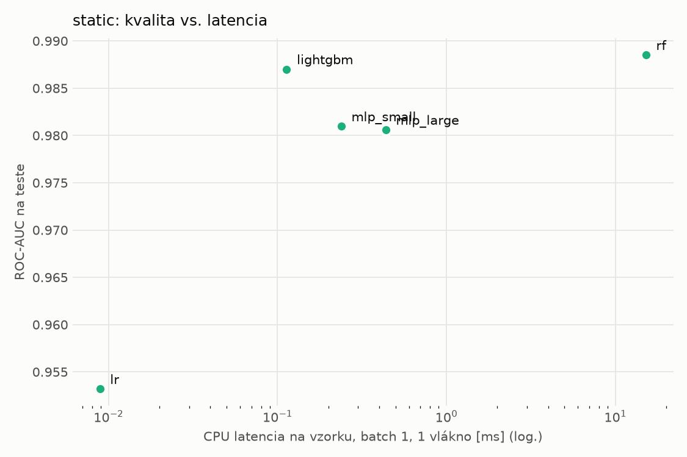
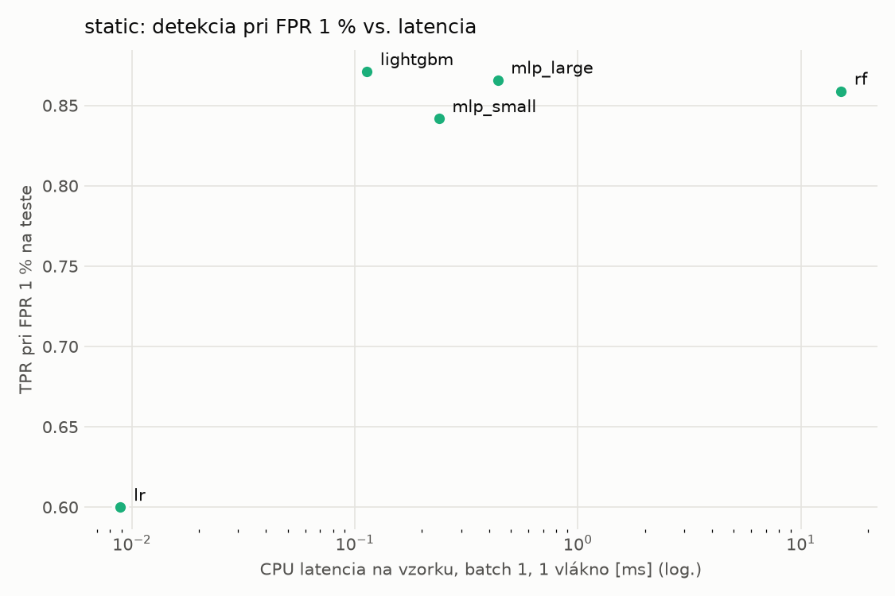
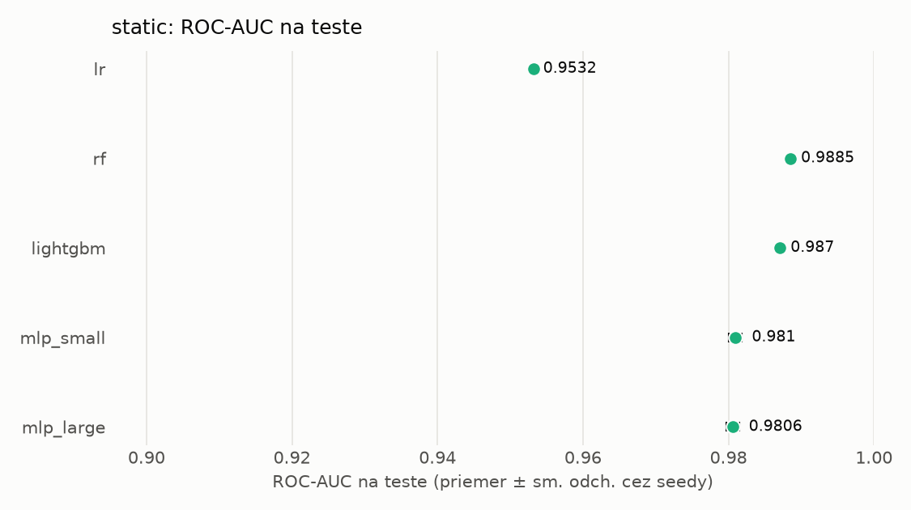
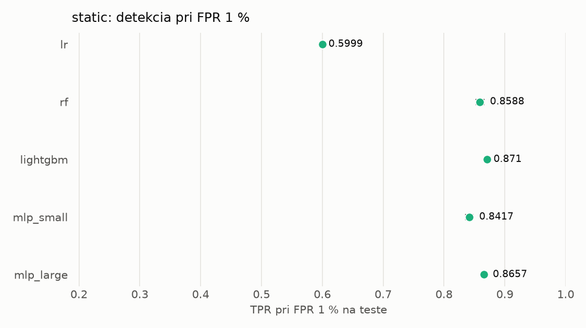

# Porovnanie modelov – static

> Generované `src/evaluation/compare.py` (2026-11-23T01:05:24+01:00); použitý je posledný beh každého modelu.
> Metriky sú priemer cez seedy. \* = pri prahu určenom na validácii (FPR ≤ 1 %).
> CPU ms/vz. = medián latencie jednej vzorky na 1 vlákne vrátane transformácie vstupu (meranie hneď po tréningu,
> orientačné). Oficiálne merania spotreby sú v časti „Spotreba zdrojov pri inferencii“.

## Detekčná kvalita a orientačné časy
| model | ROC-AUC val | ROC-AUC test | TPR@FPR 1 % test | TPR@FPR 0,1 % test | F1 test* | FPR test* | gap train−val | CPU ms/vz. | CPU vz./s | GPU ms/vz. | parametre | MB | tréning s | ladenie min |
|---|---|---|---|---|---|---|---|---|---|---|---|---|---|---|
| [lr](../../static/lr/20261123-010320/README.md) | 0.9682 | 0.9532 ± 0.0000 | 0.5999 | 0.1705 | 0.7277 | 0.0089 | 0.0035 | 0.009 | 2 829 801 | – | 164 | 0.01 | 0.1 | 0.0 |
| [rf](../../static/rf/20261123-010321/README.md) | 0.9941 | 0.9885 ± 0.0001 | 0.8588 | 0.7115 | 0.9045 | 0.0066 | 0.0059 | 15.161 | 111 333 | – | 2 572 218 | 206.14 | 1.4 | 0.0 |
| [lightgbm](../../static/lightgbm/20261123-010336/README.md) | 0.9944 | 0.9870 ± 0.0002 | 0.8710 | 0.7224 | 0.9147 | 0.0072 | 0.0056 | 0.113 | 126 800 | – | 291 232 | 16.32 | 8.4 | 0.0 |
| [mlp_small](../../static/mlp_small/20261123-010412/README.md) | 0.9914 | 0.9810 ± 0.0009 | 0.8417 | 0.5841 | 0.8955 | 0.0072 | 0.0067 | 0.238 | 2 593 602 | 0.391 | 75 777 | 0.32 | 10.9 | 0.0 |
| [mlp_large](../../static/mlp_large/20261123-010447/README.md) | 0.9918 | 0.9806 ± 0.0009 | 0.8657 | 0.5903 | 0.9078 | 0.0071 | 0.0069 | 0.437 | 119 338 | 0.430 | 2 966 529 | 11.91 | 11.2 | 0.0 |

## Nízka prevalencia malvéru (test, prah z validácie)
| model | TPR | FPR | precision @ 1 % | falošné na 1 skutočný poplach @ 1 % | precision @ 0.1 % | falošné na 1 skutočný poplach @ 0.1 % |
|---|---|---|---|---|---|---|
| lr | 0.5782 | 0.0089 | 0.397 | 1.52 | 0.061 | 15.34 |
| rf | 0.8324 | 0.0066 | 0.559 | 0.79 | 0.112 | 7.96 |
| lightgbm | 0.8502 | 0.0072 | 0.544 | 0.84 | 0.106 | 8.47 |
| mlp_small | 0.8180 | 0.0072 | 0.536 | 0.87 | 0.103 | 8.74 |
| mlp_large | 0.8384 | 0.0071 | 0.545 | 0.83 | 0.106 | 8.42 |

Prepočet: TPR a FPR nezávisia od podielu malvéru, preto sa dajú preniesť na nízku prevalenciu (v reálnej prevádzke je malvéru ~1 % alebo menej; v teste 54 %). „Falošné na 1 skutočný poplach“ = koľko neškodných súborov je označených na každý zachytený malvér.

## Spotreba zdrojov pri inferencii (benchmark, testovacia množina)
_Benchmark zatiaľ nebol spustený (`python -m src.evaluation.benchmark --approach static`)._

## Grafy

