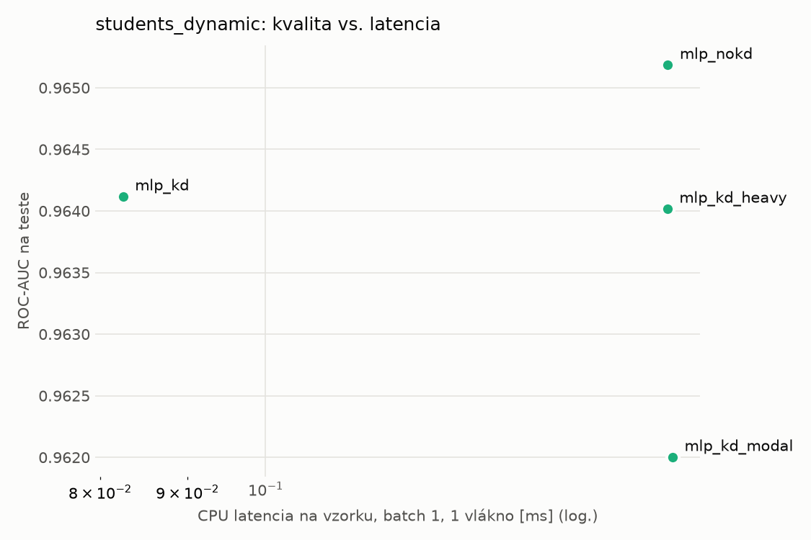
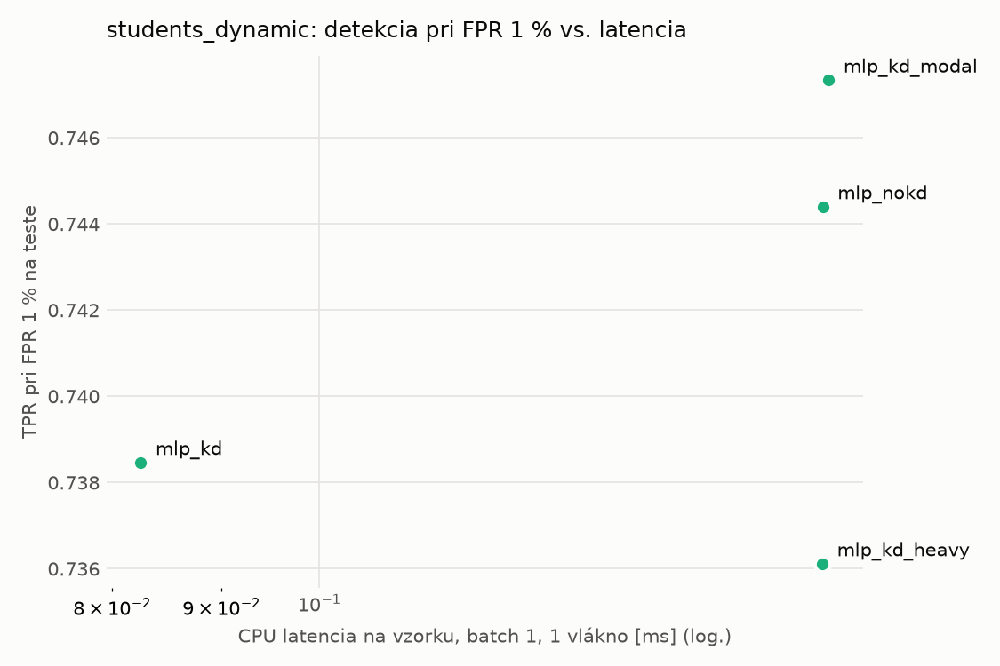
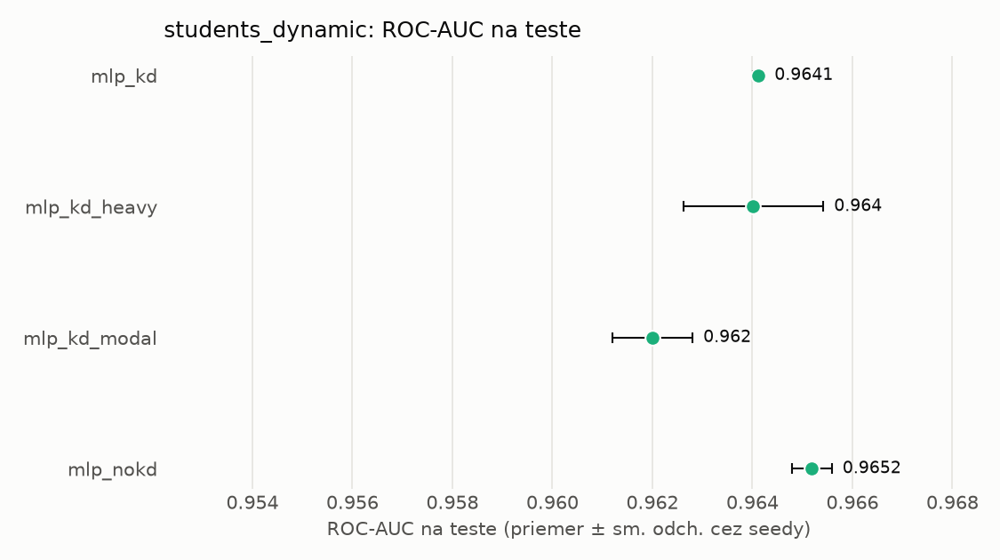
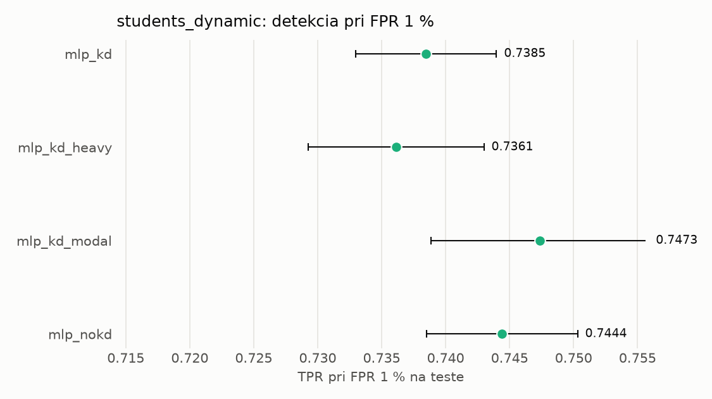

# Porovnanie modelov – students_dynamic

> Generované `src/evaluation/compare.py` (2026-11-23T01:14:35+01:00); použitý je posledný beh každého modelu.
> Metriky sú priemer cez seedy. \* = pri prahu určenom na validácii (FPR ≤ 1 %).
> CPU ms/vz. = medián latencie jednej vzorky na 1 vlákne vrátane transformácie vstupu (meranie hneď po tréningu,
> orientačné). Oficiálne merania spotreby sú v časti „Spotreba zdrojov pri inferencii“.

## Detekčná kvalita a orientačné časy
| model | ROC-AUC val | ROC-AUC test | TPR@FPR 1 % test | TPR@FPR 0,1 % test | F1 test* | FPR test* | gap train−val | CPU ms/vz. | CPU vz./s | GPU ms/vz. | parametre | MB | tréning s | ladenie min |
|---|---|---|---|---|---|---|---|---|---|---|---|---|---|---|
| [mlp_kd](../../students_dynamic/mlp_kd/20261123-011247/README.md) | 0.9659 | 0.9641 ± 0.0001 | 0.7385 | 0.5299 | 0.8344 | 0.0090 | 0.0125 | 0.082 | 8 974 614 | 0.258 | 8 129 | 0.04 | 6.0 | 0.0 |
| [mlp_kd_heavy](../../students_dynamic/mlp_kd_heavy/20261123-011417/README.md) | 0.9657 | 0.9640 ± 0.0014 | 0.7361 | 0.5057 | 0.8306 | 0.0087 | 0.0114 | 0.172 | 6 550 725 | 0.450 | 8 129 | 0.04 | 5.5 | 0.0 |
| [mlp_kd_modal](../../students_dynamic/mlp_kd_modal/20261123-011343/README.md) | 0.9649 | 0.9620 ± 0.0008 | 0.7473 | 0.5379 | 0.8299 | 0.0076 | 0.0079 | 0.173 | 6 242 170 | 0.445 | 8 129 | 0.04 | 10.5 | 0.0 |
| [mlp_nokd](../../students_dynamic/mlp_nokd/20261123-011306/README.md) | 0.9666 | 0.9652 ± 0.0004 | 0.7444 | 0.5244 | 0.8376 | 0.0084 | 0.0131 | 0.172 | 6 806 131 | 0.448 | 8 129 | 0.04 | 11.8 | 0.0 |

## Nízka prevalencia malvéru (test, prah z validácie)
| model | TPR | FPR | precision @ 1 % | falošné na 1 skutočný poplach @ 1 % | precision @ 0.1 % | falošné na 1 skutočný poplach @ 0.1 % |
|---|---|---|---|---|---|---|
| mlp_kd | 0.7239 | 0.0090 | 0.448 | 1.23 | 0.074 | 12.45 |
| mlp_kd_heavy | 0.7178 | 0.0087 | 0.455 | 1.20 | 0.076 | 12.09 |
| mlp_kd_modal | 0.7158 | 0.0076 | 0.488 | 1.05 | 0.086 | 10.59 |
| mlp_nokd | 0.7281 | 0.0084 | 0.468 | 1.14 | 0.080 | 11.46 |

Prepočet: TPR a FPR nezávisia od podielu malvéru, preto sa dajú preniesť na nízku prevalenciu (v reálnej prevádzke je malvéru ~1 % alebo menej; v teste 54 %). „Falošné na 1 skutočný poplach“ = koľko neškodných súborov je označených na každý zachytený malvér.

## Spotreba zdrojov pri inferencii (benchmark, testovacia množina)
_Benchmark zatiaľ nebol spustený (`python -m src.evaluation.benchmark --approach students_dynamic`)._

## Grafy

