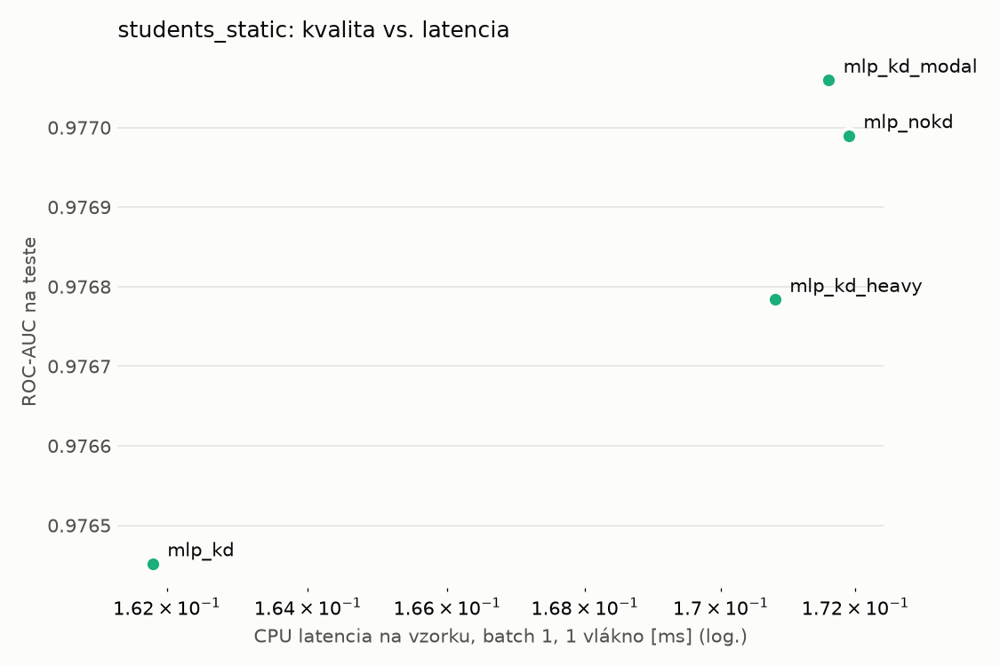
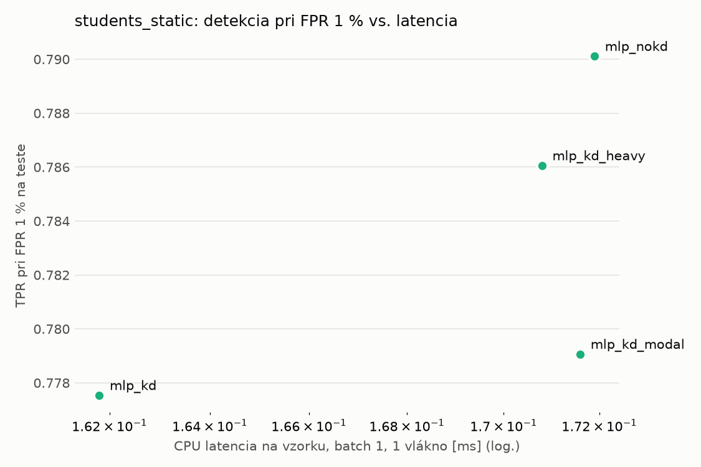
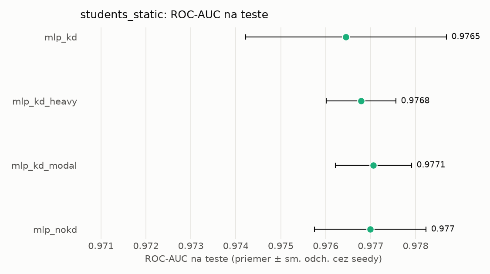
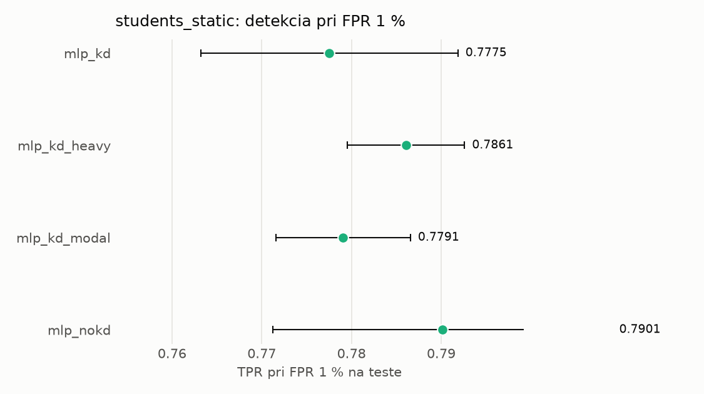

# Porovnanie modelov – students_static

> Generované `src/evaluation/compare.py` (2026-11-23T01:12:44+01:00); použitý je posledný beh každého modelu.
> Metriky sú priemer cez seedy. \* = pri prahu určenom na validácii (FPR ≤ 1 %).
> CPU ms/vz. = medián latencie jednej vzorky na 1 vlákne vrátane transformácie vstupu (meranie hneď po tréningu,
> orientačné). Oficiálne merania spotreby sú v časti „Spotreba zdrojov pri inferencii“.

## Detekčná kvalita a orientačné časy
| model | ROC-AUC val | ROC-AUC test | TPR@FPR 1 % test | TPR@FPR 0,1 % test | F1 test* | FPR test* | gap train−val | CPU ms/vz. | CPU vz./s | GPU ms/vz. | parametre | MB | tréning s | ladenie min |
|---|---|---|---|---|---|---|---|---|---|---|---|---|---|---|
| [mlp_kd](../../students_static/mlp_kd/20261123-011119/README.md) | 0.9886 | 0.9765 ± 0.0022 | 0.7775 | 0.5897 | 0.8606 | 0.0086 | 0.0045 | 0.162 | 4 091 556 | 0.470 | 10 689 | 0.05 | 4.7 | 0.0 |
| [mlp_kd_heavy](../../students_static/mlp_kd_heavy/20261123-011230/README.md) | 0.9891 | 0.9768 ± 0.0008 | 0.7861 | 0.5978 | 0.8678 | 0.0091 | 0.0056 | 0.171 | 5 464 594 | 0.448 | 10 689 | 0.05 | 3.8 | 0.0 |
| [mlp_kd_modal](../../students_static/mlp_kd_modal/20261123-011203/README.md) | 0.9886 | 0.9771 ± 0.0008 | 0.7791 | 0.6282 | 0.8624 | 0.0090 | 0.0049 | 0.172 | 5 273 553 | 0.452 | 10 689 | 0.05 | 8.2 | 0.0 |
| [mlp_nokd](../../students_static/mlp_nokd/20261123-011135/README.md) | 0.9896 | 0.9770 ± 0.0012 | 0.7901 | 0.4918 | 0.8683 | 0.0090 | 0.0064 | 0.172 | 5 310 953 | 0.450 | 10 689 | 0.05 | 8.9 | 0.0 |

## Nízka prevalencia malvéru (test, prah z validácie)
| model | TPR | FPR | precision @ 1 % | falošné na 1 skutočný poplach @ 1 % | precision @ 0.1 % | falošné na 1 skutočný poplach @ 0.1 % |
|---|---|---|---|---|---|---|
| mlp_kd | 0.7633 | 0.0086 | 0.472 | 1.12 | 0.081 | 11.31 |
| mlp_kd_heavy | 0.7750 | 0.0091 | 0.462 | 1.16 | 0.078 | 11.75 |
| mlp_kd_modal | 0.7664 | 0.0090 | 0.463 | 1.16 | 0.079 | 11.70 |
| mlp_nokd | 0.7760 | 0.0090 | 0.466 | 1.14 | 0.080 | 11.55 |

Prepočet: TPR a FPR nezávisia od podielu malvéru, preto sa dajú preniesť na nízku prevalenciu (v reálnej prevádzke je malvéru ~1 % alebo menej; v teste 54 %). „Falošné na 1 skutočný poplach“ = koľko neškodných súborov je označených na každý zachytený malvér.

## Spotreba zdrojov pri inferencii (benchmark, testovacia množina)
_Benchmark zatiaľ nebol spustený (`python -m src.evaluation.benchmark --approach students_static`)._

## Grafy

