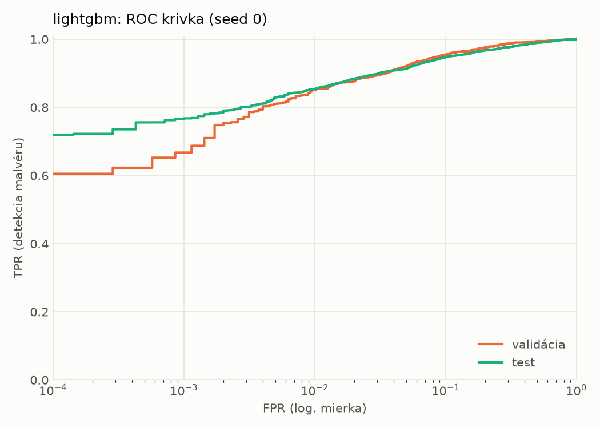
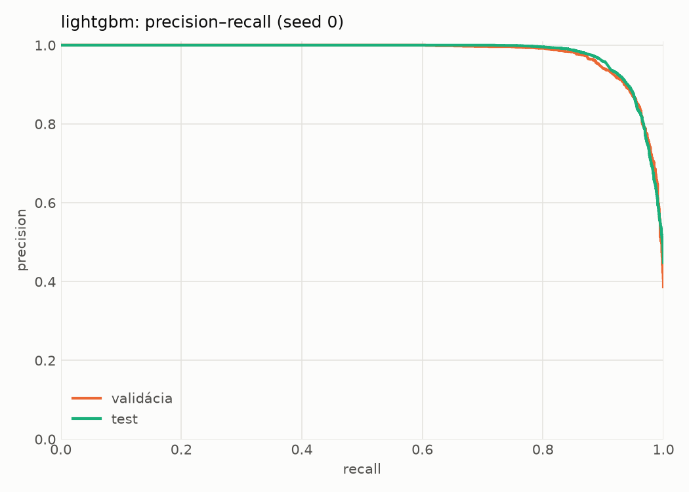
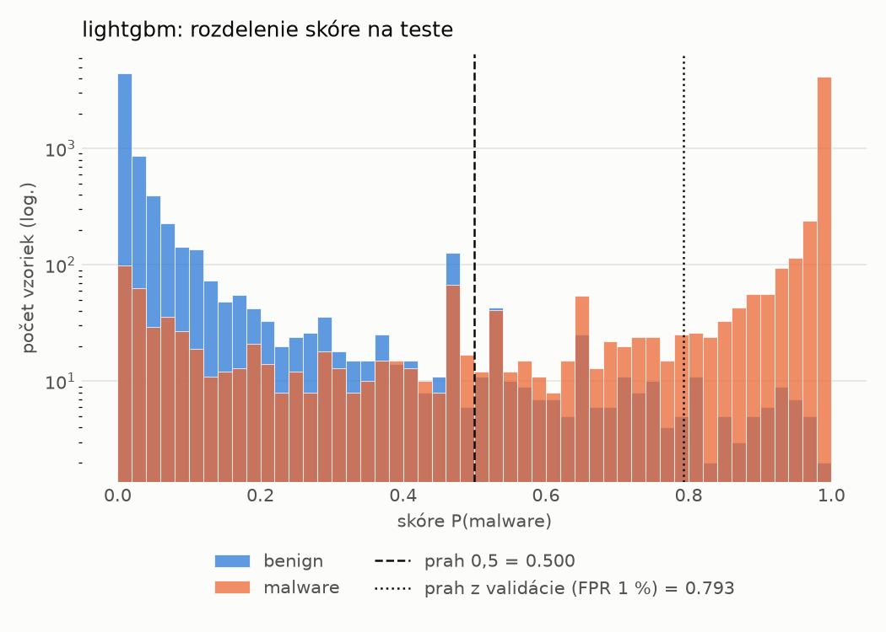
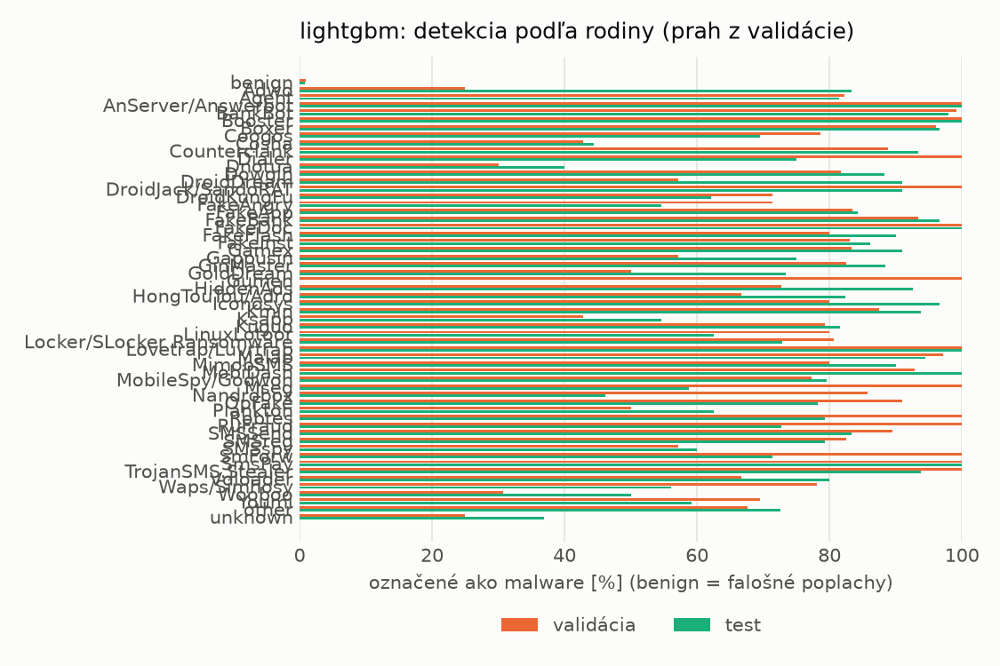
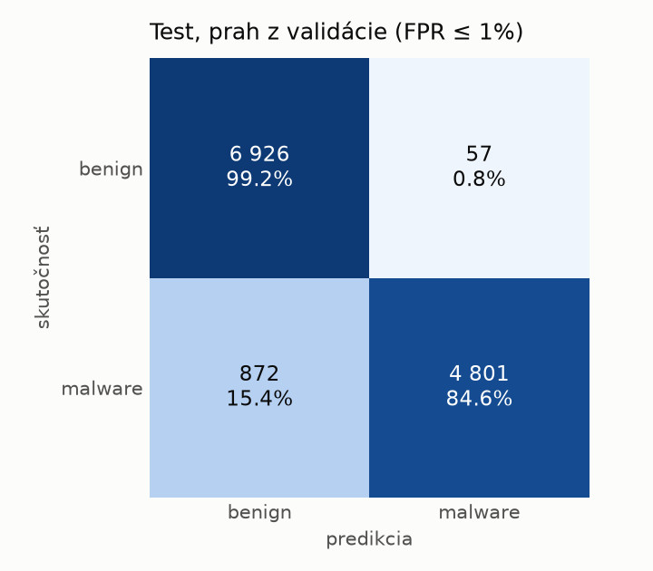
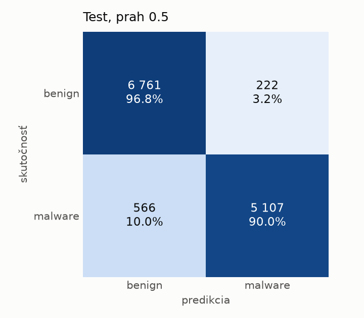
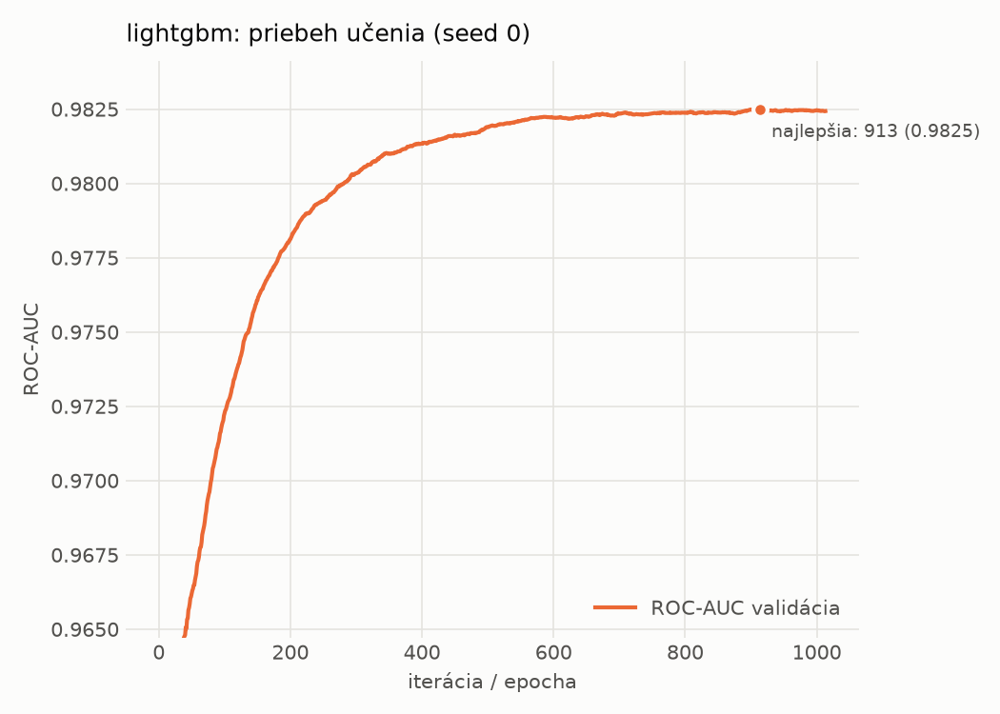

# dynamic/lightgbm – beh `20261123-010546`

> Automaticky generované (`src/training/run_tabular.py`). Konfigurácia: `config.yaml`, protokol: `protocol.yaml`.

- **Model:** `lightgbm` – LightGBM, gradient boosting stromov s early stopping na validácii (pôvodné hodnoty príznakov)
- **Ladenie:** bez ladenia – hyperparametre prevzaté z `runs_v4/real_p/full/dynamic/lightgbm/20261122-233440`
- **Finálne modely:** seedy [0, 1, 2]; hodnoty sú priemer ± smerodajná odchýlka cez seedy
- **Najlepšie hyperparametre:** `{"num_boost_round": 5000, "early_stopping_rounds": 100, "learning_rate": 0.027489744122517933, "num_leaves": 131, "min_child_samples": 30, "feature_fraction": 0.6013521321216351, "bagging_fraction": 0.9615246014341245, "lambda_l1": 3.231327066876444e-06, "lambda_l2": 0.000134433136248308}`

## Detekčná kvalita (bez prahu)
| metrika | train (podvzorka) | validácia | test |
|---|---|---|---|
| ROC-AUC | 0.9993 ± 0.0000 | 0.9825 ± 0.0001 | 0.9783 ± 0.0002 |
| PR-AUC | 0.9987 ± 0.0000 | 0.9790 ± 0.0001 | 0.9801 ± 0.0002 |
| TPR pri FPR 1 % | 0.9813 ± 0.0002 | 0.8502 ± 0.0025 | 0.8535 ± 0.0005 |
| TPR pri FPR 0,1 % | 0.9661 ± 0.0006 | 0.6611 ± 0.0110 | 0.7610 ± 0.0044 |
| log loss | 0.0420 ± 0.0014 | 0.1513 ± 0.0004 | 0.1729 ± 0.0011 |
| Brier skóre | 0.0098 ± 0.0002 | 0.0432 ± 0.0001 | 0.0479 ± 0.0002 |

Rozdiel ROC-AUC train − validácia: **0.0168** (veľký rozdiel = preučenie).

## Pri prahu z validácie (FPR ≤ 1% na validácii)
| metrika | train (podvzorka) | validácia | test |
|---|---|---|---|
| accuracy | 0.9850 ± 0.0007 | 0.9362 ± 0.0009 | 0.9267 ± 0.0006 |
| balanced accuracy | 0.9803 ± 0.0010 | 0.9203 ± 0.0012 | 0.9192 ± 0.0007 |
| precision | 0.9997 ± 0.0000 | 0.9825 ± 0.0003 | 0.9881 ± 0.0007 |
| recall (TPR) | 0.9608 ± 0.0019 | 0.8502 ± 0.0025 | 0.8466 ± 0.0020 |
| FPR | 0.0002 ± 0.0000 | 0.0096 ± 0.0002 | 0.0083 ± 0.0005 |
| F1 | 0.9799 ± 0.0010 | 0.9116 ± 0.0014 | 0.9119 ± 0.0008 |
| MCC | 0.9684 ± 0.0015 | 0.8676 ± 0.0019 | 0.8572 ± 0.0010 |

## Pri pevnom prahu 0.5
| metrika | train (podvzorka) | validácia | test |
|---|---|---|---|
| accuracy | 0.9867 ± 0.0001 | 0.9398 ± 0.0007 | 0.9382 ± 0.0005 |
| balanced accuracy | 0.9856 ± 0.0001 | 0.9331 ± 0.0004 | 0.9347 ± 0.0005 |
| precision | 0.9837 ± 0.0001 | 0.9382 ± 0.0024 | 0.9592 ± 0.0008 |
| recall (TPR) | 0.9811 ± 0.0003 | 0.9038 ± 0.0009 | 0.9005 ± 0.0009 |
| FPR | 0.0099 ± 0.0001 | 0.0375 ± 0.0016 | 0.0311 ± 0.0006 |
| F1 | 0.9824 ± 0.0001 | 0.9207 ± 0.0007 | 0.9289 ± 0.0006 |
| MCC | 0.9717 ± 0.0001 | 0.8726 ± 0.0014 | 0.8757 ± 0.0010 |

## Výpočtové nároky (seed 0, testovacia množina)
| meranie | hodnota |
|---|---|
| tréning finálneho modelu | 10.4 s (priemer cez seedy) |
| ladenie spolu | 0 s |
| počet parametrov / uzlov | 238 293 |
| veľkosť modelu na disku | 13.09 MB |
| CPU latencia modelu (batch 1, 1 vlákno) | 0.125 ms (p95 0.142) |
| CPU priepustnosť (24 vlákien) | 112 598 vzoriek/s |

## Grafy
| | |
|---|---|
|  |  |
|  |  |
|  |  |
|  |  |

## Súbory
`metrics.json` (všetky metriky po seedoch vrátane rodín), `timing.json`, `hpo_trials.csv`,
`predictions/<časť>_seed<N>.parquet` (sha256, family, label, score), `model/seed_<N>/`, `log.txt`.
