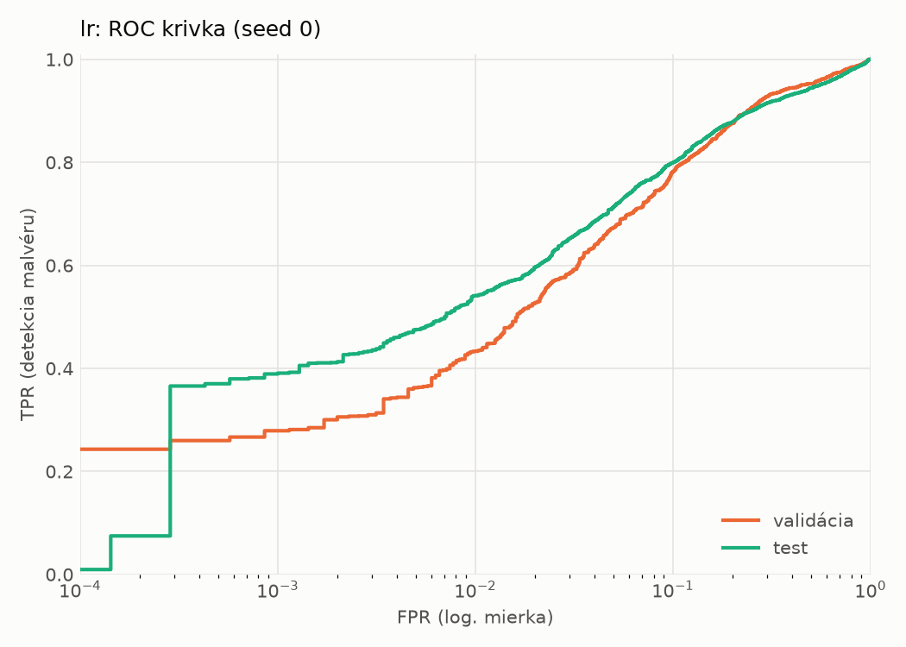
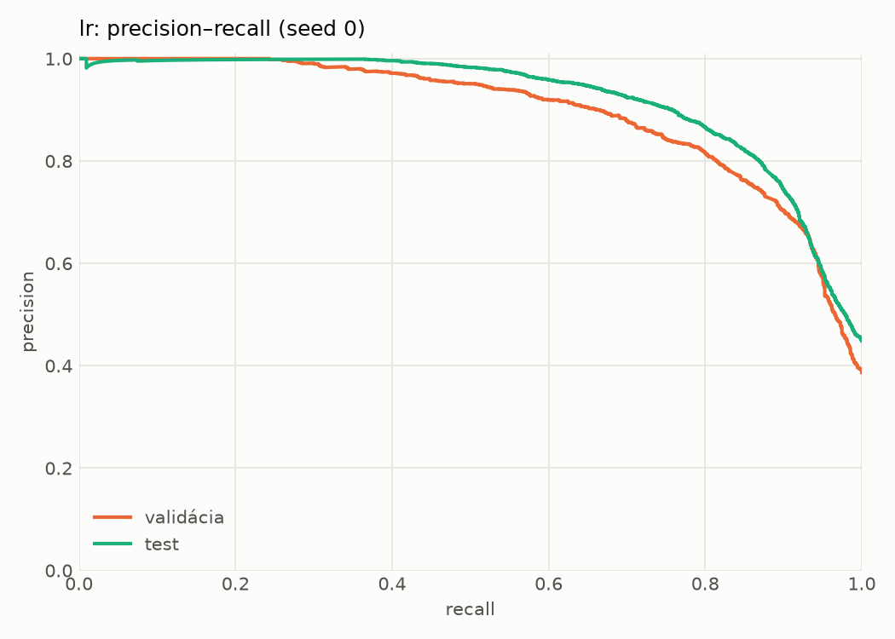
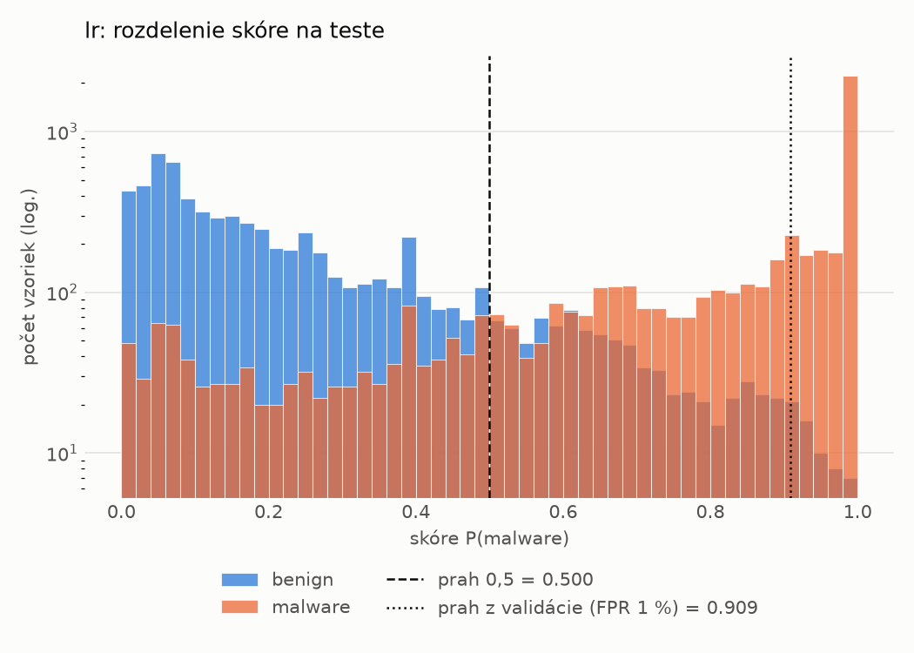
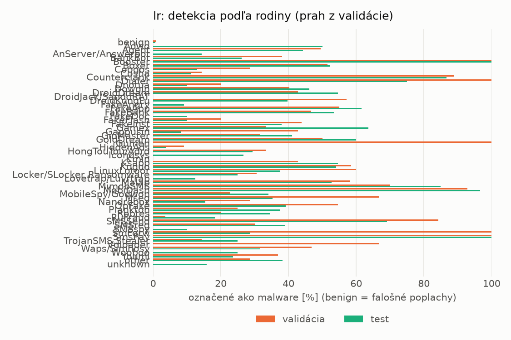
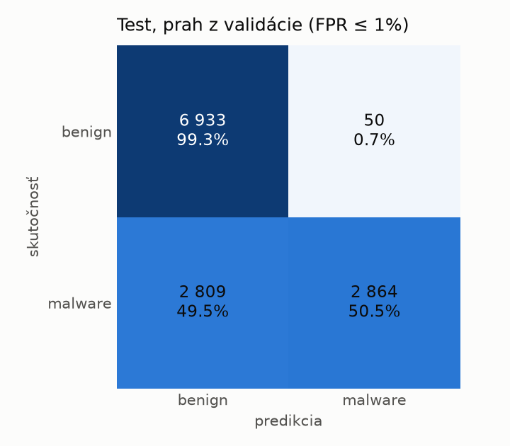
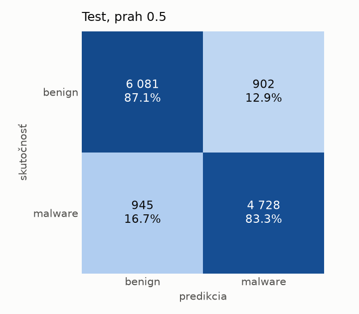

# dynamic/lr – beh `20261123-010527`

> Automaticky generované (`src/training/run_tabular.py`). Konfigurácia: `config.yaml`, protokol: `protocol.yaml`.

- **Model:** `logreg` – logistická regresia s L2 regularizáciou (vstup signed log1p + štandardizácia)
- **Ladenie:** bez ladenia – hyperparametre prevzaté z `runs_v4/real_p/full/dynamic/lr/20261122-233312`
- **Finálne modely:** seedy [0, 1, 2]; hodnoty sú priemer ± smerodajná odchýlka cez seedy
- **Najlepšie hyperparametre:** `{"max_iter": 2000, "C": 9.535095002298556}`

## Detekčná kvalita (bez prahu)
| metrika | train (podvzorka) | validácia | test |
|---|---|---|---|
| ROC-AUC | 0.9177 ± 0.0000 | 0.9146 ± 0.0000 | 0.9152 ± 0.0000 |
| PR-AUC | 0.8954 ± 0.0000 | 0.8948 ± 0.0000 | 0.9206 ± 0.0000 |
| TPR pri FPR 1 % | 0.4495 ± 0.0000 | 0.4330 ± 0.0000 | 0.5412 ± 0.0000 |
| TPR pri FPR 0,1 % | 0.2824 ± 0.0000 | 0.2790 ± 0.0000 | 0.3892 ± 0.0000 |
| log loss | 0.3621 ± 0.0000 | 0.3644 ± 0.0000 | 0.3628 ± 0.0000 |
| Brier skóre | 0.1096 ± 0.0000 | 0.1118 ± 0.0000 | 0.1101 ± 0.0000 |

Rozdiel ROC-AUC train − validácia: **0.0030** (veľký rozdiel = preučenie).

## Pri prahu z validácie (FPR ≤ 1% na validácii)
| metrika | train (podvzorka) | validácia | test |
|---|---|---|---|
| accuracy | 0.7845 ± 0.0000 | 0.7747 ± 0.0000 | 0.7741 ± 0.0000 |
| balanced accuracy | 0.7188 ± 0.0000 | 0.7116 ± 0.0000 | 0.7488 ± 0.0000 |
| precision | 0.9647 ± 0.0000 | 0.9656 ± 0.0000 | 0.9828 ± 0.0000 |
| recall (TPR) | 0.4476 ± 0.0000 | 0.4330 ± 0.0000 | 0.5048 ± 0.0000 |
| FPR | 0.0100 ± 0.0000 | 0.0097 ± 0.0000 | 0.0072 ± 0.0000 |
| F1 | 0.6115 ± 0.0000 | 0.5979 ± 0.0000 | 0.6671 ± 0.0000 |
| MCC | 0.5577 ± 0.0000 | 0.5444 ± 0.0000 | 0.5879 ± 0.0000 |

## Pri pevnom prahu 0.5
| metrika | train (podvzorka) | validácia | test |
|---|---|---|---|
| accuracy | 0.8535 ± 0.0000 | 0.8473 ± 0.0000 | 0.8541 ± 0.0000 |
| balanced accuracy | 0.8491 ± 0.0000 | 0.8431 ± 0.0000 | 0.8521 ± 0.0000 |
| precision | 0.7924 ± 0.0000 | 0.7898 ± 0.0000 | 0.8398 ± 0.0000 |
| recall (TPR) | 0.8311 ± 0.0000 | 0.8246 ± 0.0000 | 0.8334 ± 0.0000 |
| FPR | 0.1328 ± 0.0000 | 0.1384 ± 0.0000 | 0.1292 ± 0.0000 |
| F1 | 0.8113 ± 0.0000 | 0.8068 ± 0.0000 | 0.8366 ± 0.0000 |
| MCC | 0.6922 ± 0.0000 | 0.6811 ± 0.0000 | 0.7048 ± 0.0000 |

## Výpočtové nároky (seed 0, testovacia množina)
| meranie | hodnota |
|---|---|
| tréning finálneho modelu | 0.3 s (priemer cez seedy) |
| ladenie spolu | 0 s |
| počet parametrov / uzlov | 124 |
| veľkosť modelu na disku | 0.01 MB |
| transformácia vstupu – latencia (1 vlákno) | 0.005 ms |
| transformácia vstupu – priepustnosť | 1 344 538 vzoriek/s |
| CPU latencia modelu (batch 1, 1 vlákno) | 0.004 ms (p95 0.005) |
| CPU priepustnosť (24 vlákien) | 3 825 298 vzoriek/s |

## Grafy
| | |
|---|---|
|  |  |
|  |  |
|  |  |
|  |  |

## Súbory
`metrics.json` (všetky metriky po seedoch vrátane rodín), `timing.json`, `hpo_trials.csv`,
`predictions/<časť>_seed<N>.parquet` (sha256, family, label, score), `model/seed_<N>/`, `log.txt`.
